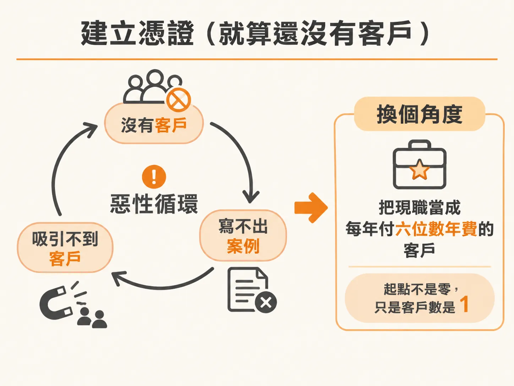
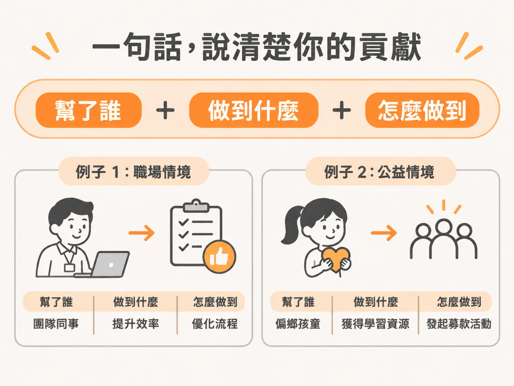
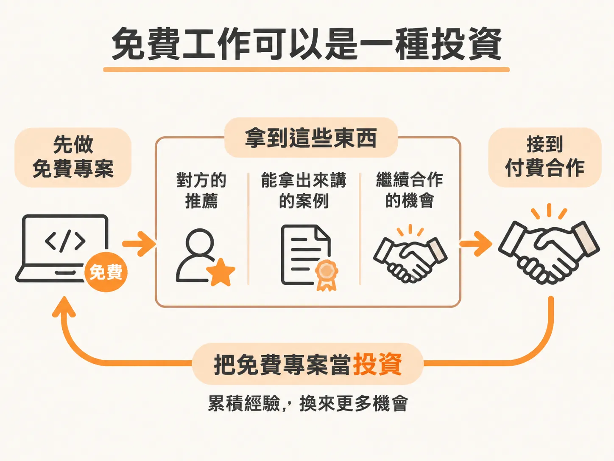

# 建立憑證（就算還沒有客戶）

最常卡住人的是這兩句：我沒有 case study，怎麼拿到客戶？我沒有客戶，怎麼生出 case study？

這是雞生蛋、蛋生雞的老問題，在這個行業特別明顯。很多人還沒開始就先停了。

但事實是，你手上的可信度比你以為的多。缺的通常不是憑證，是換一個角度看已經發生的事。

## 你已經有一個付六位數年費的客戶

如果你現在有工作，或以前有過，試著這樣重框：假設你年薪 10 萬美金，那就等於有一個客戶，每年付你 10 萬美金的年費 retainer。

你已經在經營一個年收六位數的事業。差別只有一個：你只服務這一個客戶。

要做的事，是把服務範圍擴到更多客戶，不是從零開始。用的很可能還是同一套技能，只是結構稍微不同。選 AI vertical 的時候，領域知識佔的比重很高，而你剛好已經懂某一個行業。

## 不是只有正職才算經驗

真正算數的是經驗。你不需要擁有一間 agency 才叫有經驗。

在工作裡自動化過某件事，算。為自己的興趣實作過一套新系統，算。開了一個社群帳號、拿到幾千次觀看，可以重框成一次行銷成果。

這些事就算零散、不在同一個框架底下，也都可以是 case study。共同點只有一個：是你讓這些事發生的。

如果你的過去偏對外，例如要跟外部代理商的多個夥伴合作、要跟很多人談事情，講經歷時不用只列自己的公司。很多人早年的 corporate 經驗其實來自跟大品牌合作：在消費品公司任職期間，直接跟 Ogilvy、Microsoft 這些夥伴一起工作、替他們做出成果。即使是合作案、你不是他們的員工，你確實直接跟他們工作，也確實帶出了結果。那算真實經驗，可以拿出來講。

## 結果和情境才是重點

任何你做過的事，都能重框成建立可信度的材料。它不需要很大，也不需要驚天動地。真正有份量的是結果和情境。

講的時候用一個三段結構就夠：helped who, achieve what, by how。你幫了誰、達成什麼、用什麼方法。

例如：

- 幫一個內容創作者把製作時間從兩天縮到四小時，做法是建一套自動化內容工作流。
- 幫一間公司把報表產出時間減少 80%，做法是把每週分析自動化。
- 實作了一套 lead tracking 系統，讓 follow-up 率提升 40%。

這些例子裡，絕對規模有時根本不必講。如果那位創作者只有 500 個追蹤者，不用特別說出來。重要的是結果：製作時間從兩天變四小時。這就是「不必驚天動地」的意思。

這個結構的用處很直接：跟潛在客戶介紹自己的事業時，你手上已經有幾個現成的例子，不用臨時想。

## 匿名完全可以

這個行業很尊重 NDA（保密協議）。所以你可以直接說：因為 NDA，我不方便講客戶的名字，但我們做了這件事。

在飯局上介紹自己的事業，或跟潛在客戶談的時候，都可以跳過「對方是誰」。作品本身會說話。而且大多數時候，人們想聽的是你做成了什麼，不是全部細節。

## 免費工作可以是一種投資

如果你還是覺得缺經驗，免費幫人做，也是一條路。

找一個手上有痛點要解決的人，最好是你在的領域裡有點名聲、報得出名字的人。如果你有時間、沒有客戶、經驗也不多，就主動提出免費幫忙，換一份證明回來：一份 testimonial、一份 case study，或者只是跟這個人合作的機會。

把它當投資看。一個免費專案可以換到付費工作，因為你手上終於有證明了。幫的對象層級越高，效果越明顯；你換到的是真實經驗。

一個有名的例子是華倫・巴菲特。他從哥倫比亞大學畢業後，主動提出要為當時傳奇投資人 Benjamin Graham 工作，而且不支薪。那份免費工作最後成了他職涯的地基。有時候經驗真的比錢更值錢。

## 社群 leaderboard 也是憑證

還有一個可以用的機會：leaderboard。

在一個 AI 社群裡，如果你很活躍、很願意幫人，這件事本身就是憑證。有人在社群裡直接因為「很活躍、很支持別人」而接到客戶。如果你是某個 leaderboard 的前段班，特別是在一個以 AI 為核心的社群裡，那就是一個明確的 credential，可以直接寫進 CV 或你的 credentials 頁面，例如「全球最大 AI 社群之一的前三名成員」。

## 客戶買的不是你的履歷

如果這段只留一句話，那就是：客戶買的不是你的履歷。

他們其實沒時間把你做過的事全部翻一遍，除非那是百萬美元等級的專案。他們買的是「你能解決我的問題」這份信心。

所以在說出「我沒有憑證」之前，先停下來想兩件事：你已經做過哪些相關的事？這週你可以做出什麼、或記錄下什麼，開始產生證明？

credibility 不是等來的，是自己做出來的。

這週的動作：挑三件你做過的事，各寫成一句「helped who, achieve what, by how」。寫不出數字就先寫情境，寫完貼到你正在準備的網站或 credentials 頁面上。
