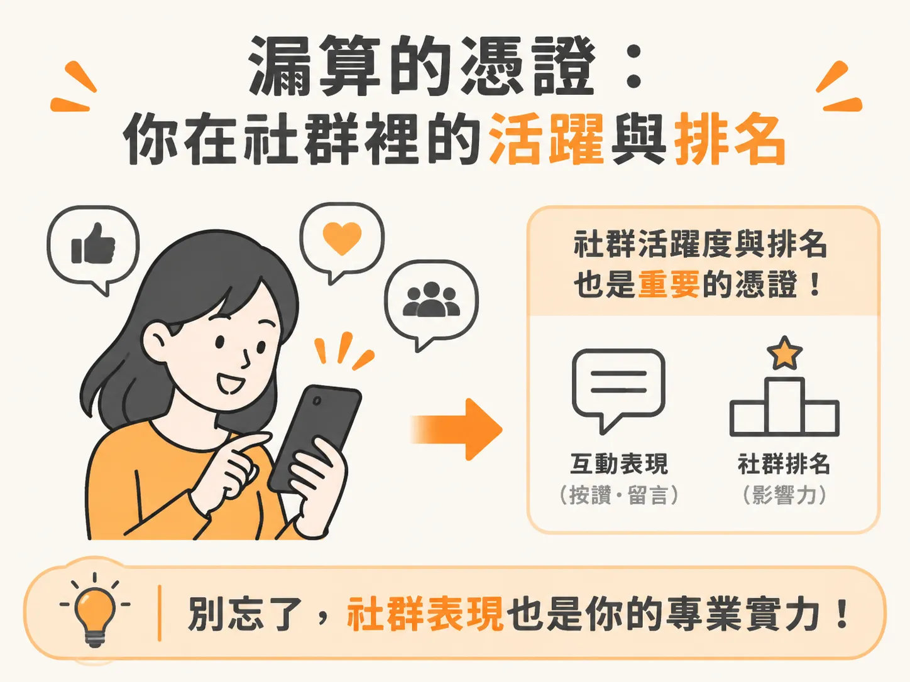
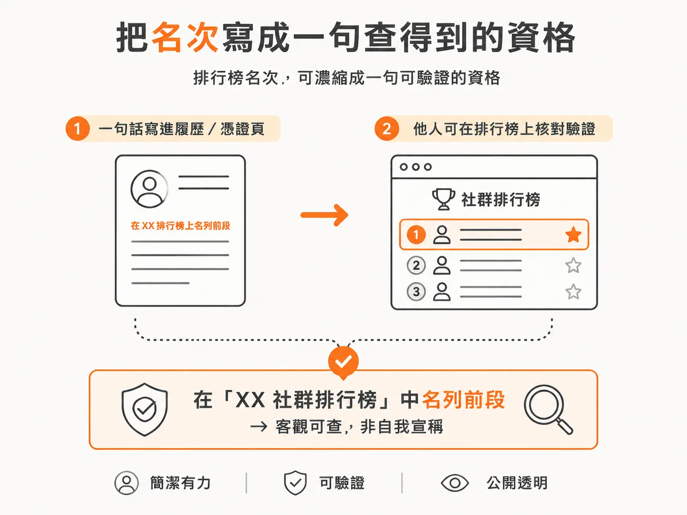
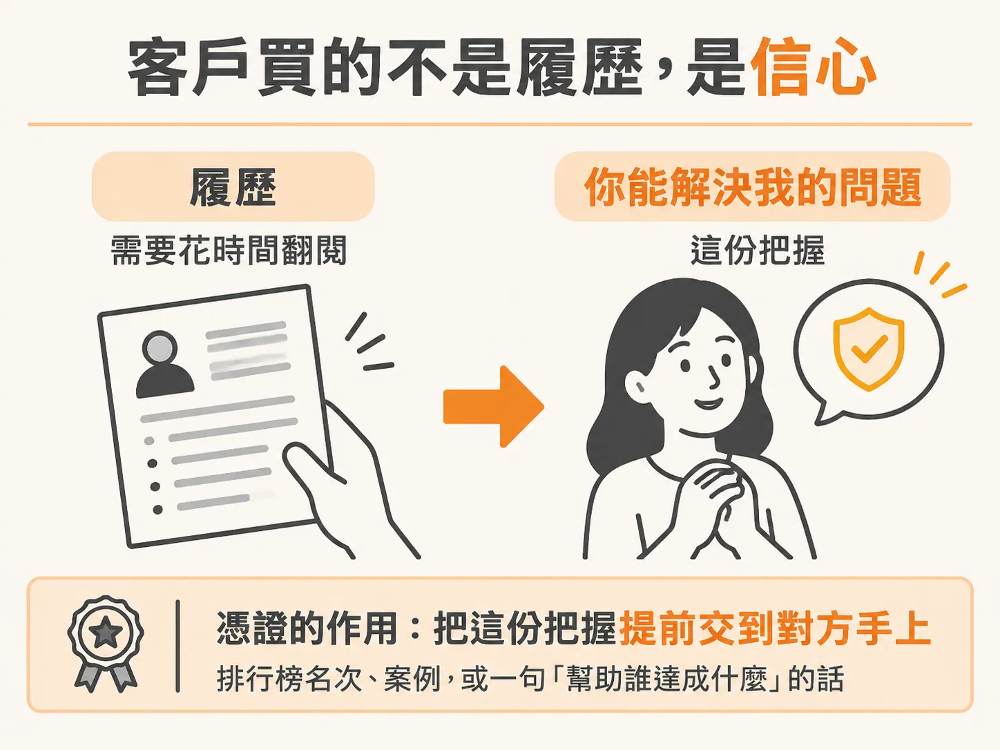

# 社群排行榜作為憑證

前面幾篇把過去的工作整理成「幫助誰、達成什麼、用什麼方法」的句子，也把現在的工作重新算成一個年付六位數的客戶。清單還是不長，心裡那句「可是我還沒有憑證」還是會冒出來。

還有一類憑證，你一直沒算進去：你在社群裡的活躍度與排名。

## 排行榜上看得見的東西

在一個以 AI 為主題的社群裡，排行榜就是一份公開紀錄：你多常出現、幫過多少人、回過多少問題。這些行為都留著，而且別人看得到。

差別在於，社群裡的人是先看到你，才決定要不要認識你。有些人就是因為在群組裡夠活躍、夠願意幫人，直接從社群內部接到客戶。他們不是先有案子才被看見，而是先被看見，才開始有案子。

## 排進前段，就是一句寫得出來的資格

如果你在排行榜上排在前面，尤其是在一個大型的 AI 社群裡，那本身就是一句可以寫進 CV 或憑證頁的話。

寫法不用花俏。例如：全球最大的幾個 AI 社群之一的前段成員。這種句子對陌生人來說很好驗證：他打開排行榜就找得到你。

還有一件事容易漏掉：這種憑證不需要你已經服務過付費客戶。它證明的是你持續投入、願意回答、在一個圈子裡被看見。對還在等第一個客戶的人來說，這是最快能拿到的東西之一。

## 客戶買的不是履歷

最該記住的一句話：客戶沒有時間把你做過的每件事翻一遍——除非那是個百萬美元的案子。

他們買的是「你可以解決我的問題」這份信心。

所以憑證要做的事很單純：讓對方在還沒跟你說過話之前，就比較敢相信你。排行榜名次、案例、一句「幫助誰達成什麼」的句子，做的都是同一件事：把信心提前交給對方。

## 這一週可以做的事

在說出「我沒有憑證」之前，先停下來問自己三件事。

第一，我已經做過什麼，是跟我要賣的東西相關的？工作上的自動化、幫朋友解決的問題、自己經營的帳號，都算。

第二，現在可以做出什麼？一個小工具、一份流程、一個能拿給人看的成果。

第三，這一週可以做出什麼、或記錄下什麼，開始累積證明？

因為 credibility 不是等來的，是造出來的。
