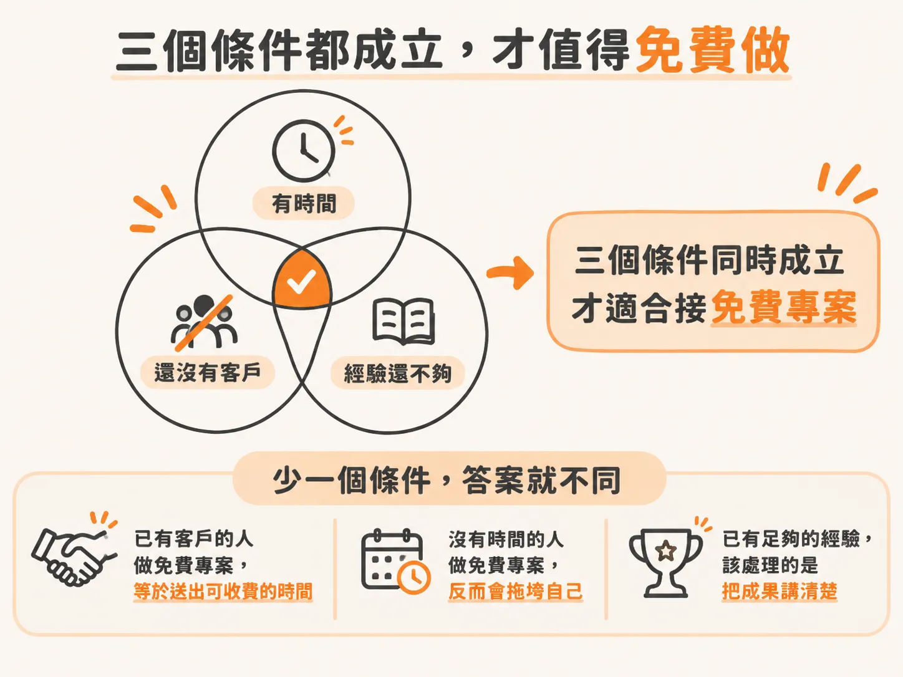
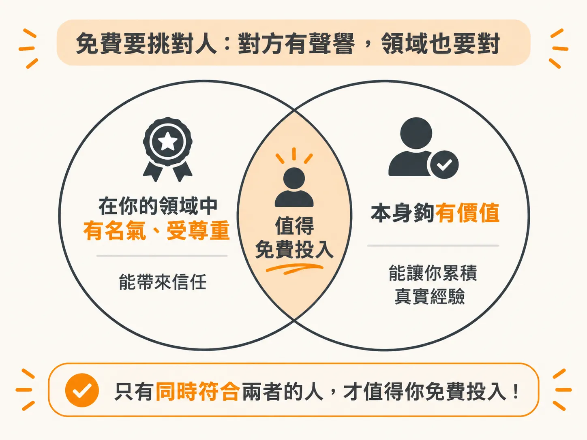
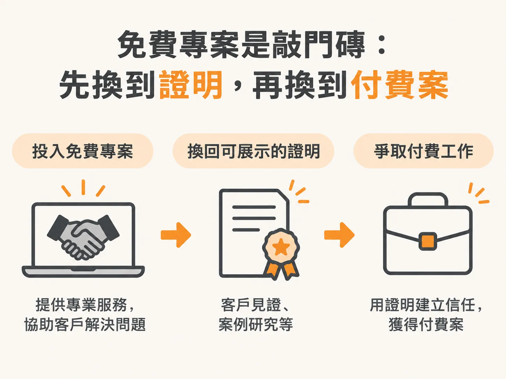

# 免費工作是一種投資

前三篇把現職重算成客戶、把經驗盤出來、也把經驗寫成句子。如果你照著做完，手上通常已經有能講的案例。先讀完這篇，再決定要不要免費。

免費專案是補經驗缺口的工具，不是預設的第一步。

## 三個條件同時成立，才值得免費

只有下面三個條件同時成立，才值得考慮：

- 你有時間。
- 你還沒有客戶。
- 你還沒有足夠的經驗。

少一個條件，答案就會不同。已有客戶的人做免費專案，等於把原本可以收費的時間送出去。沒有時間的人做免費專案，反而會拖垮自己的交付。如果你已經有足夠的經驗，該處理的是怎麼把成果講清楚，不必再去找一個新專案。

## 挑對人：聲譽，加上領域重疊

先找一個你真的能幫他解決問題的人，優先從兩種人裡挑：一種是在你正在建立的領域裡有名聲、受到尊重的人；另一種是本身價值高，或能讓你累積真實經驗的人。

為什麼要挑有名聲的人？

因為你要換的是 proof，而 proof 的分量取決於對方是誰。同一個自動化專案，掛在有名字的人身上，比掛在沒人認識的人身上有用。

但領域也必須對得上。對方要在你正在建立的產業或領域裡。你在內容、電商或行銷領域做自動化，就該找這個圈子裡有名字的人。

領域不對，你拿到的 testimonial 就無法說服下一個客戶。

## 先講清楚你要換回什麼

免費不代表沒有條件。開始之前，先講明白你要拿回什麼：

- 一個 testimonial，也就是客戶替你背書的短評。
- 一份 case study，也就是能拿來講給下一個客戶聽的案例。
- 或者只是跟這個特定的人合作的機會。

這三種都能算報酬。

最差的情況是做完一輪，什麼都沒拿到，對方連一句話都不願意說。

## 一個免費專案，可以解鎖付費工作

把免費專案當成投資。

免費專案會給你 proof，而 proof 能解鎖付費工作。你之前缺少的，就是「我做過，這是結果」這句話。免費專案就是為了換到這句話。

Buffett 就是一個例子。他從 Columbia 畢業後，去找當時傳奇的投資人 Benjamin Graham，提出免費替他工作。那段免費工作後來成了 Buffett 職涯的基礎。

所以，有時候經驗真的比錢值錢。

前提是那段經驗必須變成你講得出口的 proof，而不是一段沒有人知道的無酬工作。

## 這週要做的動作

挑一個符合上述條件的人。

寫下你要換回的 proof，以及你要幫他解決的問題。

把訊息送出去，在開始前就講清楚免費專案的條件。不要等做完才談。
