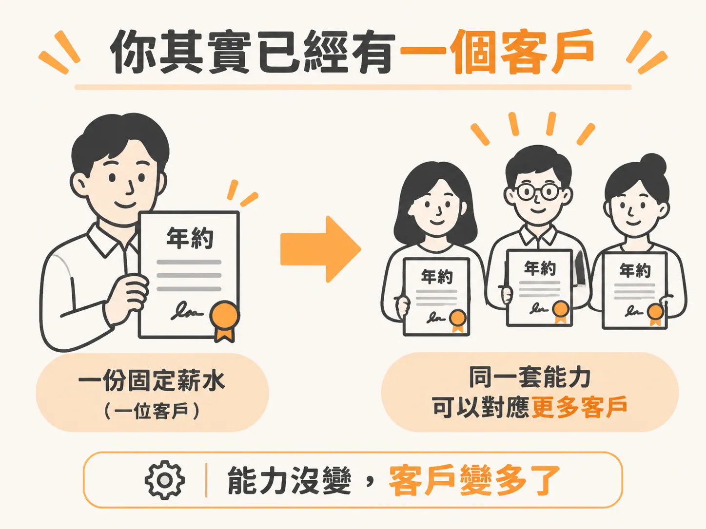
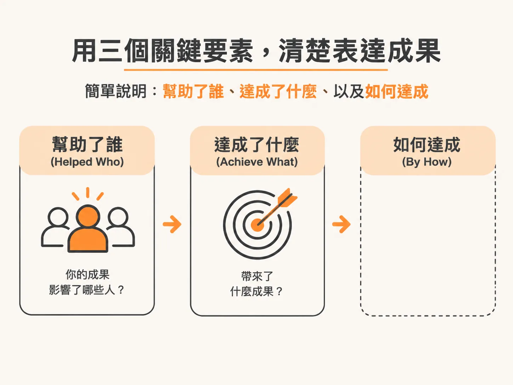
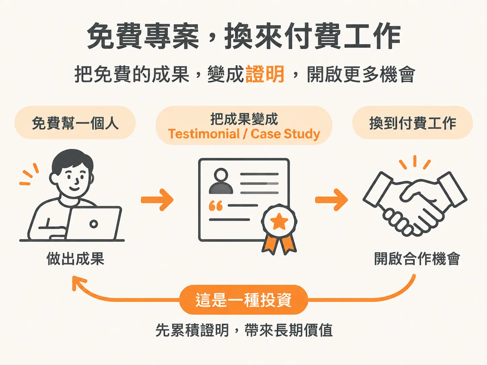

# Helped Who, Achieve What, By How

上一篇把經驗一條一條盤出來。這篇只做一個動作：把其中三條寫成可以直接講給客戶聽的句子。

格式不難，難的是把「我做過這些」翻成客戶聽得懂的話。

## 你其實已經有一個客戶

先沿用前面那個角度：年薪 100k，就等於一個客戶每年付你 100k 的 annual retainer。你已經有一個六位數的 practice，只是客戶只有一個。技能大概就是同一套，差別只在服務幾個人。

## 哪些事算經驗

- 你在工作裡自動化了某件事，算。
- 你為自己的興趣建了一套新系統，算。
- 你開的社群帳號拿到幾千次觀看，可以重新框架成一次 marketing win。

這些事看起來零散，不在同一個屋簷下，但都可以是 case study。共通點只有一個：這些事都是你做的。

如果你過去的工作是對外的，例如跟外部 agency 的夥伴合作、跟很多人對接，列經驗時不要只寫自己的公司。那些外部夥伴也可以寫進去。

一個例子。很多人的企業經驗來自跟 Unilever 這家消費品公司合作。有人剛開始做 practice 時，第一批客戶就是 Unilever 的同事，那段時間也直接跟 Ogilvy、Microsoft 這些夥伴合作。不是他們的員工，但直接跟他們工作，也為他們做出結果。這是可以拿出來講的真實經驗。

## 三格填空

講過去的工作時，用這個結構：你 helped who, achieve what, by how。

- Helped a content creator cut production time from 2 days to 4 hours by building an automated content workflow.
- Helped a business reduce report generation time by 80% by automating their weekly analytics.
- Implemented a lead tracking system that improved follow-up rates by 40%.

第三句沒有寫 who，也沒有寫 by how。這個格式是幫你把話講清楚，不是拿來檢查你有沒有填滿三格。

## 數字不用大，名字可以省

如果你幫的那個 content creator 只有 500 個追蹤者，不用講。真正要說的是「從兩天變四小時」這個結果。

結果和情境才是重點。事情不需要驚天動地。

名字也可以省。NDA（non-disclosure agreement，保密合約）在這個行業裡完全被尊重。你可以直接說：因為 NDA，不能講客戶名字，但我們做了這件事。

多數人只想聽 headline，不想聽全部細節。

## 還沒有東西可以講，就先做一個

如果你還是覺得手上沒有經驗，可以免費做一個專案。

找一個正面對某個問題的人，最好是你在建的這個領域裡有名聲的人。你有時間、沒有客戶、經驗也不多，就可以主動說你願意免費幫他。你要換的是證據：一份 testimonial、一個 case study，或至少是跟這個人共事的機會。

把它當投資。一個免費專案可以帶來付費工作，因為你手上終於有證明了。

巴菲特從 Columbia 畢業後，主動說要免費跟著 Benjamin Graham 工作。Graham 是當時的傳奇投資人。那段免費工作後來成了巴菲特職涯的地基。有些時候，經驗就是比錢值錢。

社群排行榜也是一種憑證。在 AI 社群裡，排行榜前面的人常常直接從社群裡拿到客戶，因為他們常出聲、願意幫人，這件事本身就讓人信得過。如果你在某個大型 AI 社群排在前段，這件事可以直接放進 CV 或憑證清單。

## 客戶買的不是你的履歷

客戶沒有時間翻完你所有的過去。他們買的是「你能解決我的問題」這件事的信心。

所以在你說「我沒有憑證」之前，先停下來想兩件事：我已經做過什麼相關的事？這週我可以做出什麼、記錄下什麼，開始累積證明？

憑證不用等，可以自己做出來。

## 這週要做的事

寫三句，用這個格式：

> Helped [WHO] achieve [WHAT] by [HOW]

三句都要有具體的結果。絕對數字不用寫，名字可以用 NDA 帶過。

不知道從哪裡開始，就請你的 agent 幫你。給它的指令是：用編號問題問你現在或過去的工作、side project、以及你做過的結果，然後用上面這個格式寫出三句憑證句。

寫完就貼進網站、貼進提案、貼進下次跟人吃飯時的開場。你不需要等到有客戶，才開始講你做過什麼。
