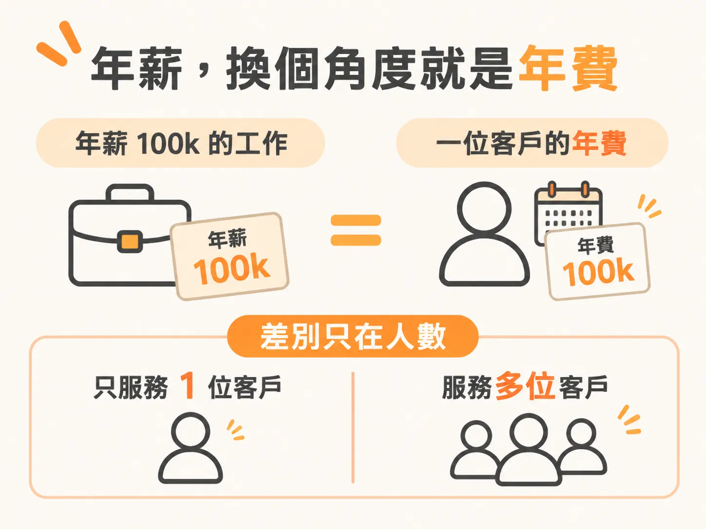
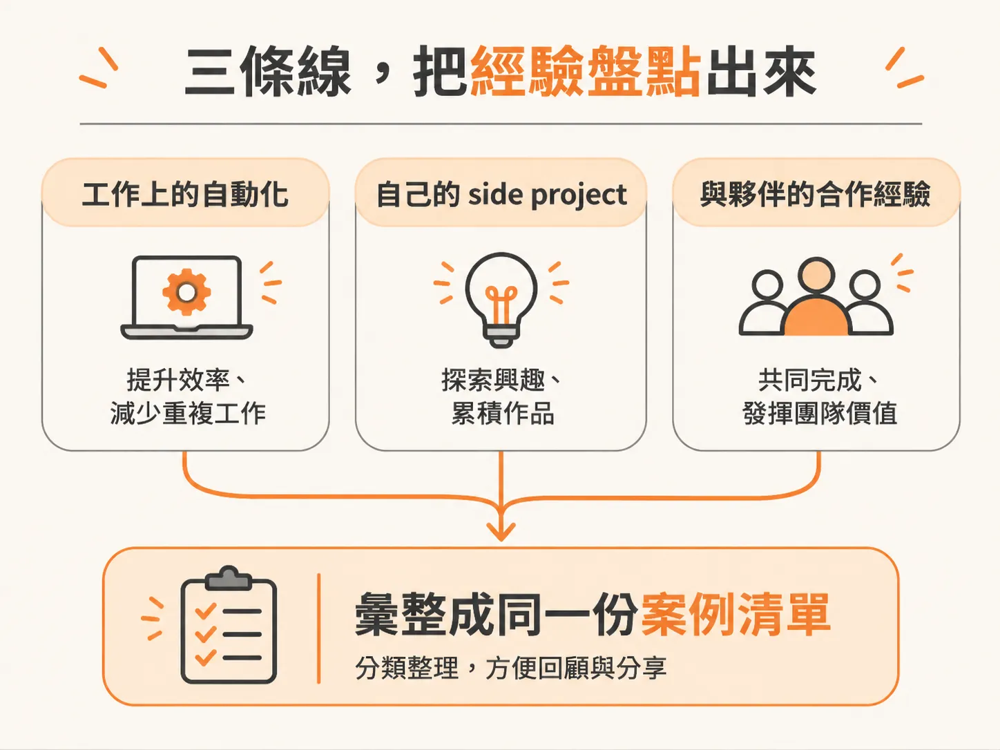
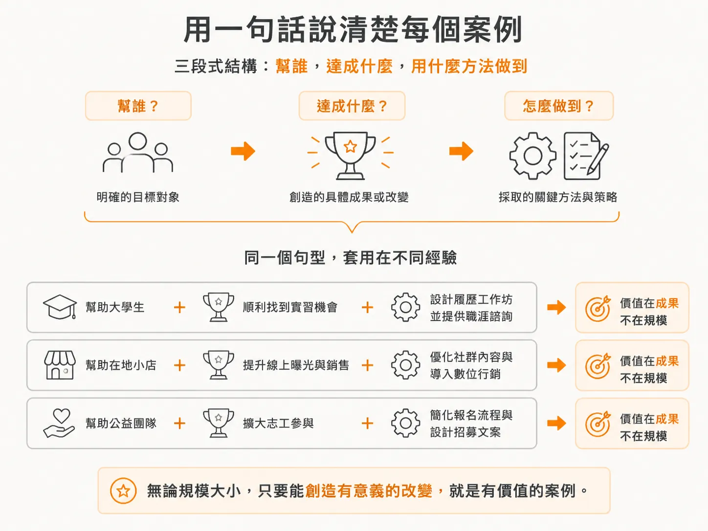

# 你其實比你想像的更有可信度

## 雞生蛋的問題

上一篇已經把這個循環拆開：現職就是一個年付六位數的客戶，起點不是零。

接下來換個對象，用同一個角度看自己：一條一條盤點你已經做過的事。

## 你現在的工作，就是一個年約客戶

年薪 100k，就等於一個每年付你 100k 的 annual retainer 客戶，這件事上一篇算過了。

真正要看的差別只有一個：服務的人數。

技能大致相同，因為 domain knowledge 決定你做哪一個 AI vertical，變的只是結構。

經驗才是重點。

你不需要開過 agency 才算有經驗。

## 三條線，把經驗盤點出來

第一條線是工作上的自動化。你在公司自動化過某件事，那就是相關經驗。

第二條線是 side project。你為自己的興趣實作過一套新系統，那也是經驗。

你曾經營一個社群帳號，拿到數千次瀏覽，這可以當成一次行銷成果。

第三條線是對外合作夥伴。如果你的工作本來就對外，需要與外部 agency 或多個對象合作，列舉經驗時不要只寫自己的公司。

把這些外部夥伴也寫進去。

在消費品公司 Unilever 工作期間，你累積了不少 corporate 經驗。

剛開始做 practice 時，第一批客戶裡有不少就是 Unilever 的同事。

同一段期間，你也與 Ogilvy、Microsoft 等夥伴合作。

即使不是這些公司的員工，你仍然直接與他們工作，也為他們做出成果。

這些都是可以拿出來談的真實經驗。

這些經驗可能很零散，也不屬於同一類。

它們仍然可以當成 case study。

因為它們有一個共同點：這些事都是你做出來的。

## 一句話講完一個案例

任何你做過的事，都可以轉化成可信度。

它不需要很大，也不必驚天動地。

真正重要的是 results 和 context。

說明時可以用三段式結構：幫誰達成什麼，以及用什麼方法做到。

三個現成的例子：

- 幫一位內容創作者把製作時間從兩天縮到四小時，方法是建立一套自動化內容流程。
- 幫一間公司把每週分析報表的產出時間減少 80%，方法是把流程自動化。
- 實作一套 lead tracking 系統，把 follow-up 率提升 40%。

有些時候，不必說明絕對規模。

那位內容創作者如果只有 500 位追蹤者，你不必說出來。

讀者想看的是「兩天變四小時」這個結果。

匿名也可以。

NDA 在業界普遍受到尊重。

你可以說：「因為 NDA，我不能透露客戶名稱，但我們做了這些。」

多數人想聽的是你做過什麼的重點，不是所有細節。

## 免費做一件，換一份證明

如果你還是覺得自己缺經驗，免費接一件工作完全可行。

找一個有問題的人。

最好找一個在你的領域中有口碑、有名字的人。

你有時間、沒有客戶，經驗也不多，那就提出免費幫忙。

你要換回的是證明：一份 testimonial、一份 case study，或只是與這個人合作的機會。

把它當成一筆投資。

一個免費專案可以帶來付費工作，因為你手上終於有了證明。

華倫．巴菲特從哥倫比亞畢業後，曾提出免費為 Benjamin Graham 工作。

Graham 是當時的傳奇投資人。

那段免費工作，後來成了巴菲特職涯的基礎。

有時候，經驗真的比錢更值錢。

## 排行榜也是 credential

Leaderboard 也是一種 credential。

在 AI 社群裡，很多成員直接就在社群內拿到客戶。

原因很簡單：他們很活躍，也願意幫人，credential 自然先建立起來。

如果你在一個大型 AI 社群裡排在排行榜前段，這就是明確的 credential。

你可以把它放進 CV 或 credential board。

例如：「全球最大 AI 社群之一的前三名成員。」

## 客戶買的不是你的履歷

客戶不是在買你的 resume。

除非是一百萬美元的專案，否則他們不會有時間翻完你所有的經歷。

他們買的是信心，相信你能解決他們的問題。

所以，在說出「我沒有 credential」之前，先停下來想兩件事。

你已經做過什麼，而且跟眼前這件事有關？

這一週你可以做出什麼、記錄下什麼，開始累積證明？

可信度不是等來的，是你自己創造的。
