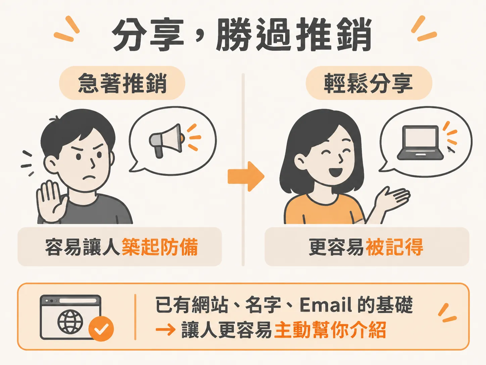

# 每一次對話都是一個機會

貼文發出去了，事情還沒結束。上一篇的貼文把你放進名單，真正把人帶到你面前的是對話。

## 貼文之後，剩下的工作在對話裡

大部分轉介不是因為有人看到你的貼文才發生，而是因為某次聊天裡，對方忽然想起「我認識一個人在做這個」。

貼文的功能到這裡就結束了。它讓別人查得到你，但不能替你在飯桌上開口。

## 對話有時候比貼文更有力

很多人沒意識到，在對話裡讓對方知道你已經開始做這件事，效果其實很強，有時甚至比公開貼文更好。

每一次對話都是機會。跟朋友吃晚飯、在派對上、跟老朋友敘舊，都可以順口把這個想法種下去。

這件事不用刻意安排。實際做起來，就是在同事和同儕之間順口提到。對方本來就對你在做什麼有興趣，講給他們聽就好。

還有一點對你有利：AI 現在聲量很大，每個人都想知道它能怎麼幫自己、幫自己的生意。你講的時候，對方會自然想多聽一點。

差別在於，以前你只能跟他們聊你用 Claude Code 或哪個工具。現在你有一個網站、一個 practice 當後盾，你也可以開始聊起身邊可能認識、正在找這類服務的人。

## 如果你還有正職，就誠實講

如果你還有一份朝九晚五的工作，只是先在工作之外做這件事，那就照實說，把話說成「我正在試」就好。

可以這樣講：我最近在工作之外開始做一個小小的 practice，主要是幫企業做 AI 自動化和 AI agent 的導入。目前還在探索，但很有意思。

這樣講的好處是，你不需要宣稱自己已經完全離開原本的工作、轉進服務業。把它說成「我開始做了，正在決定要不要走下去」，對很多人來說更容易開口。

## 只是分享，不用求人

轉介紹會複利。知道你在做什麼的人越多，機會出現的時候，就越可能有人想到你。

所以有機會就講。你不需要向對方要任何東西，你只是在分享你在做什麼。這跟推銷的差別在這裡：推銷是向對方要一個結果，分享是讓對方多知道一件事。

而且現在的情況跟以前不同。這件事背後已經有實際的基礎：網站、名字、email 都在，它是一個真的建立起來的 practice，不再只是你腦子裡的想法。

如果還需要一個理由，前兩篇已經講過：轉介紹是 B2B 服務實際運作的方式，而且轉介紹的轉換率明顯優於 cold email。你在對話裡種下的種子，走的正是這條路。

社群是同一個機制。群組裡已經有幾個人彼此接上線，也有人就是在群組裡被推薦、接到第一個客戶。

所以，把進展、學到的東西、你在做的事講出來。你會建立起更多連結，也會累積更多信任。

這一週就發一篇 LinkedIn 貼文，開幾個對話。下一篇把這兩件事收成一個正式的里程碑。
