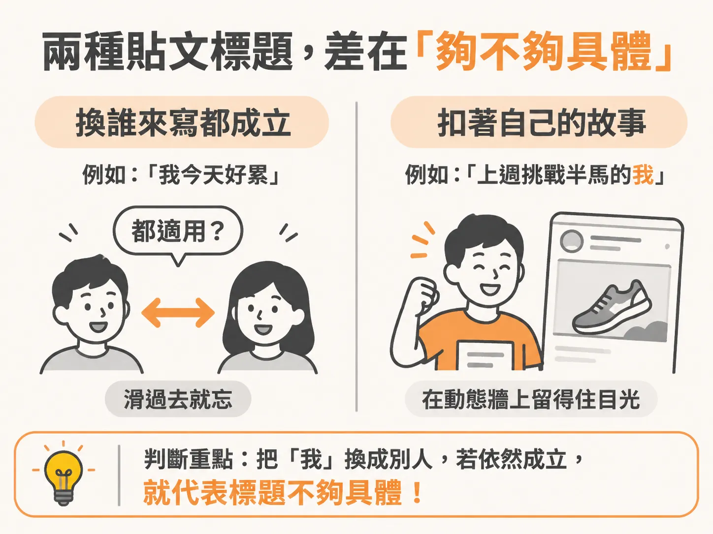
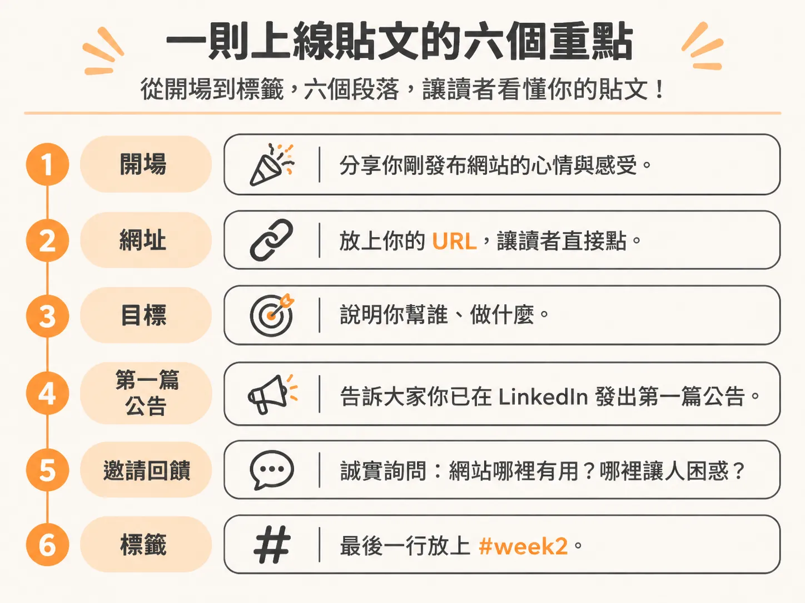
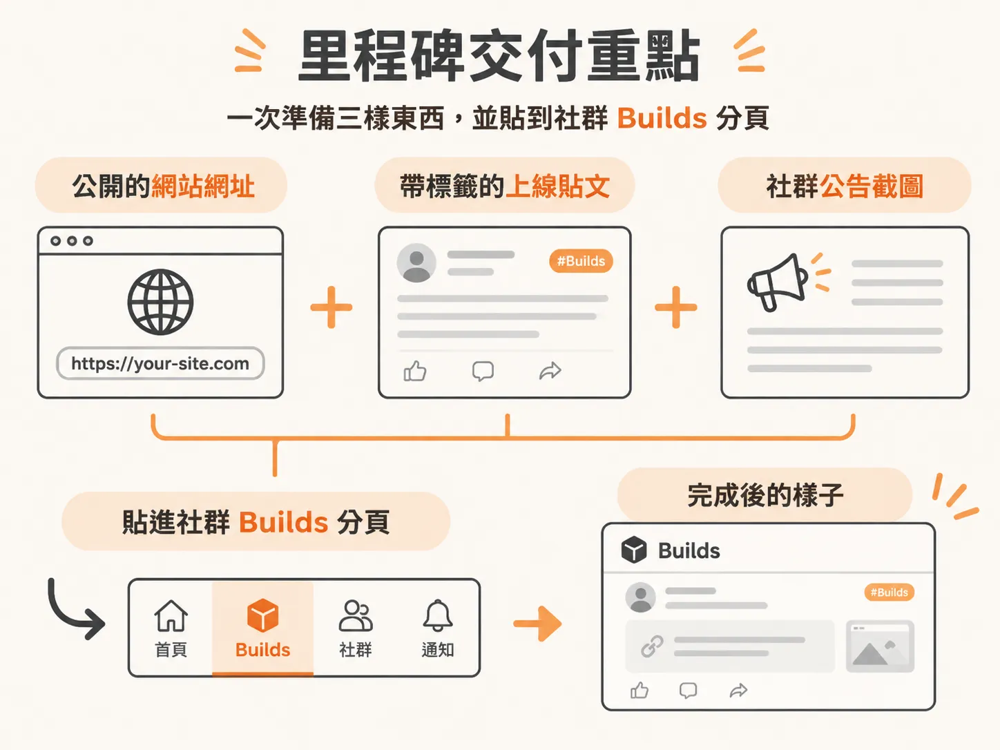

# 里程碑：正式上線

貼文寫過、對話也開過，這一週要留下一個能直接秀給別人看的成果。

網站按下 publish 的那一刻，你可能會想回去改 hero 文案，再調一次按鈕顏色。

現在要做的恰恰相反：把網址交出去，讓其他人真的看得到你的網站。

這個階段只有兩個目標：分享你上線的網站，並發出你的第一篇公開公告。

這兩件事都會留下看得到的紀錄：一個可以點的網址，以及一則貼在社群上的貼文。

做完之後，你會有第一批外部觀眾，也才有機會收到回饋。

## 標題要具體，而且放在第一行

貼文的第一行就是標題。

它要自己佔一行，擺在最上面。

不要用「It's official, my practice is live」這種誰都能寫的標題。它沒有辨識度，讀者滑過去就忘了。

標題要連結你自己的故事，讓它在動態牆上停得住。

判斷方法很簡單。把標題裡的「我」換成另一個人，如果整句話依然成立，就代表標題不夠具體。

## 貼文的六個段落

貼文不需要很長。

按照下面的順序寫，每一段只做一件事。

1. **開場**：說你剛把網站發布出去，以及看到它真的存在時有什麼感受。
2. **網址**：放上你的 URL，讓讀者可以直接點。
3. **目標**：用一句話說清楚你幫誰、做什麼。「The goal: help [WHO YOU HELP] with [WHAT YOU DO].」
4. **第一篇公告**：說明你也已經在 LinkedIn 或其他社群發出第一篇公告。
5. **邀請回饋**：誠實地詢問，網站哪裡有用？哪裡讓人困惑？
6. **標籤**：最後一行放 `#week2`，單獨一行。

第 3 段最容易寫壞。

很多人會寫「我用 AI 做自動化」。這講的是工具，客戶聽不出來你在幫他什麼。

改成「我幫小型電商業主省下每天回訊息的時間」，意思一樣，客戶卻能馬上判斷要不要繼續看下去。

第 5 段不需要客氣。

你真正要的是誠實的回饋，不是按讚。

「What's working? What's confusing?」這兩個問題問得很直接，也容易讓人回答。

## 卡住時，讓 agent 先問你問題

如果你盯著空白畫面，不知道該從哪裡開始，就把下面這段指令交給你的 agent：

> 我想把這個貼文範本改成自己的版本，用在社群上。請你用編號問題的方式問我，等我回答後，再寫出一篇看起來像我的貼文。
>
> 貼文最上面要有一行單獨的標題。標題要針對我和我的故事，讓它在動態牆上跳出來。不要使用「It's official, my practice is live」這種通用標題。貼文最後一行放 `#week2`。

它會一題一題問你：你幫誰、你解決什麼問題，以及網站上線時你在想什麼。

你只要照實回答，它就會把你的答案寫成貼文，而不是只替範本換幾個詞。

## 附上截圖，貼到 Builds

貼文發出去後，截一張圖。

畫面要是你的 LinkedIn 或社群公告，不要截網站首頁。

然後把上線的網站和這張截圖一起貼到社群，位置放在 **Builds** 分頁。

這個階段就完成了。

你手上有三樣東西：一個公開的網址、一則帶有 `#week2` 的貼文，以及一張公告截圖。

不管有沒有人回覆，你已經把自己放到別人看得到的地方。
