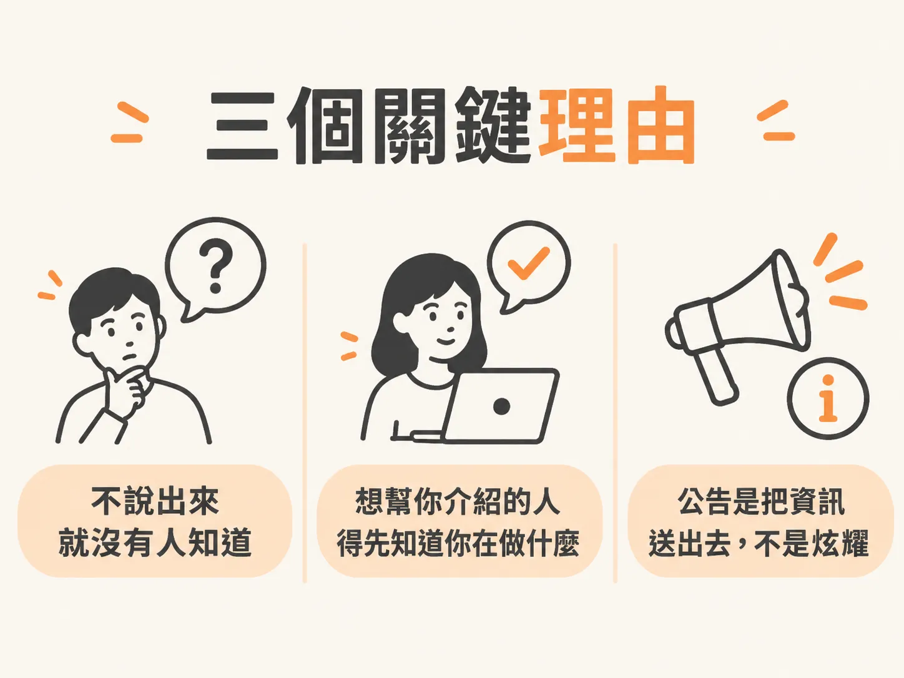
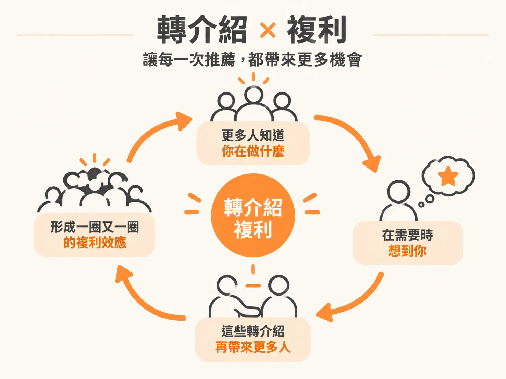
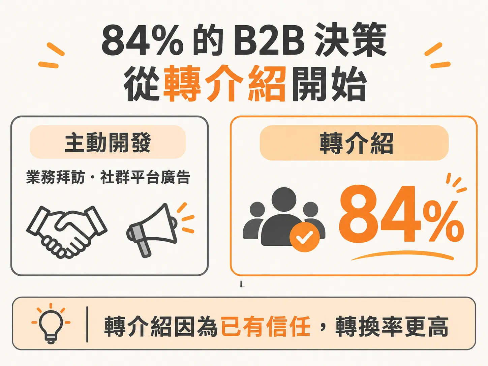

# 為什麼要公告？

你已經有名稱、有網站、有 email。下一個動作很簡單，卻讓很多人卡住：把它公開講出來。

卡住的原因很具體。把一件新的事情講出去，會覺得尷尬。你怕像在炫耀，也怕別人接著問「所以做得怎樣了」。

但機會就是從這裡開始的。而且你不需要假裝自己很厲害，只要誠實說出你在做什麼。

先講清楚目的：公告不是要訂單，是把資訊送出去。

## 網站上線了，但沒有人知道

網站放在那裡，不會自己帶來客戶。沒有人會路過你的網域。

你的朋友、前同事、LinkedIn 上的聯絡人，多半還不知道你已經把 AI 解決方案做成一個對外接案的 practice：掛上名字、有網站、可以談的服務項目。

他們不知道，就沒辦法幫你。所以順序是先公告，不是等客戶自己找上門。

## 三個理由

### 理由一：你不說，別人不會知道

沒有人知道你在建什麼，除非消息流出去。這不是要你到處推銷，只是讓別人知道：我現在在做這件事。

### 理由二：想幫你的人，要先知道你在做什麼

你身邊的人其實願意幫忙。朋友、前同事、LinkedIn 上的聯絡人、有點交情的熟人，多數人都願意出一點力，就算只是小事。

他們可能剛好認識一個需要你服務的人。但如果他們不知道你存在，也不知道你已經開始賣 AI 解決方案，就沒辦法把你介紹出去。

轉介紹的前提是：對方知道你在做什麼。

### 理由三：公告是傳遞資訊，不是炫耀

把公告想成資訊傳遞。你不是在吹噓，只是讓別人知道你在忙什麼，好讓他們在願意的時候幫上忙。

還有一個對你有利的現實條件：AI agent 和 AI 解決方案，是現在全球最搶手的技能與服務之一。

當別人看懂三件事：你已經把這個 practice 做起來、它是真的，而且你這個人可靠、對這個領域也真的有熱情，你就離第一個客戶近很多。

## 轉介紹會複利

知道你在做什麼的人越多，機會出現時，越多人會想到你。

所以每次有機會就講。你不需要開口要什麼，只是在分享你在做什麼。

差別在時機。現在你有網站，該有的基礎都到位了，你講的東西背後有東西撐著。

## 84% 的 B2B 決策從轉介紹開始

看一個數字：84% 的 B2B 決策，起點是轉介紹。

起點不是業務，也不是 Facebook 或 Meta 上的廣告，而是某個他們信任的人給的推薦。

不管你喜不喜歡，生意一開始就是這樣運作。尤其在初期，你的第一批客戶會來自你身邊的人。

冷開發也會帶來客戶，只是很硬。把轉介紹和冷 email 的轉換率放在一起比，轉介紹就是轉得比較好，原因不難懂：前面已經有一層信任。

## 每一場對話都是一次機會

對話比貼文更有力，有時候強得多。

跟朋友吃飯、在派對上、跟老朋友敘舊，你都有機會把這個念頭種下去。

實際情況大概長這樣：你跟同事或同儕隨口聊起，因為他們本來就對你現在在做什麼有興趣。你把資訊給他們。AI 現在這麼熱，每個人都想知道 AI 能怎麼幫自己和自己的生意，所以他們自然想多聽一點。

跟以前不同的是：以前你只能講 Claude Code 或你用的其他工具。現在你有網站，也有一個 practice 撐著，可以開始聊「他們可能認識的、正在找這類服務的人」。

同樣的事也會在一群人裡發生。有人互相連上線，最後就在同一個圈子裡找到客戶。

## 有正職也能這樣講

如果你還有正職，只是利用下班時間開始做，就照實講。就說「我開始做一個小 practice」。

例如你可以說：「我其實在旁邊開始做一個小 practice，幫企業做 AI 自動化和 AI agent 導入。現在還在摸索，但很有意思。」

這樣講的好處是：你不必宣稱自己已經完全離開公司、轉進服務生意。你只說你開始做了，也還在判斷要不要繼續。

## 這一週，至少做兩件事

底線很清楚。每一場對話，只要場合合適，就提一下你開始做這個 AI practice。種下那顆種子，它可能長成你最好的客戶。

轉介紹不是「有也不錯」的東西，它就是 B2B 服務生意實際運作的方式。

然後這一週做兩件事：

1. 發一篇 LinkedIn 貼文。挑一個最像你的版本，改成自己的話，按下發佈。
2. 開始幾段對話。從你身邊的名單開始。
