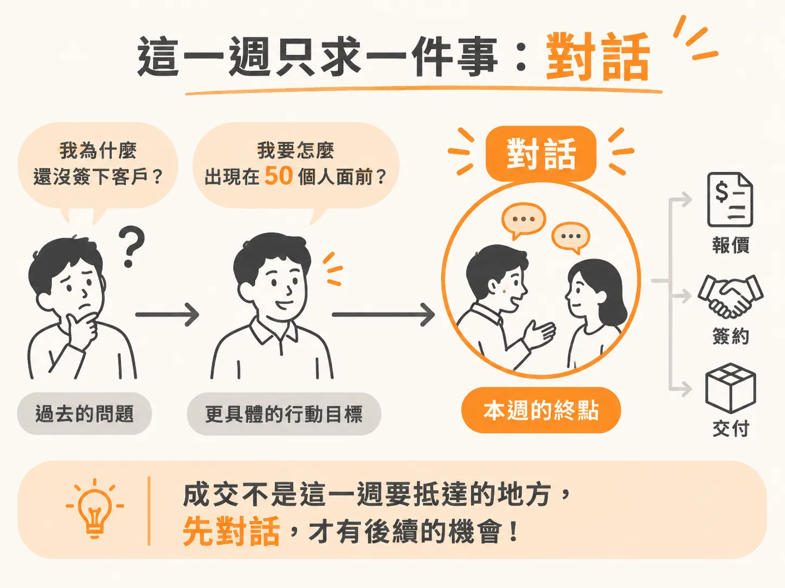
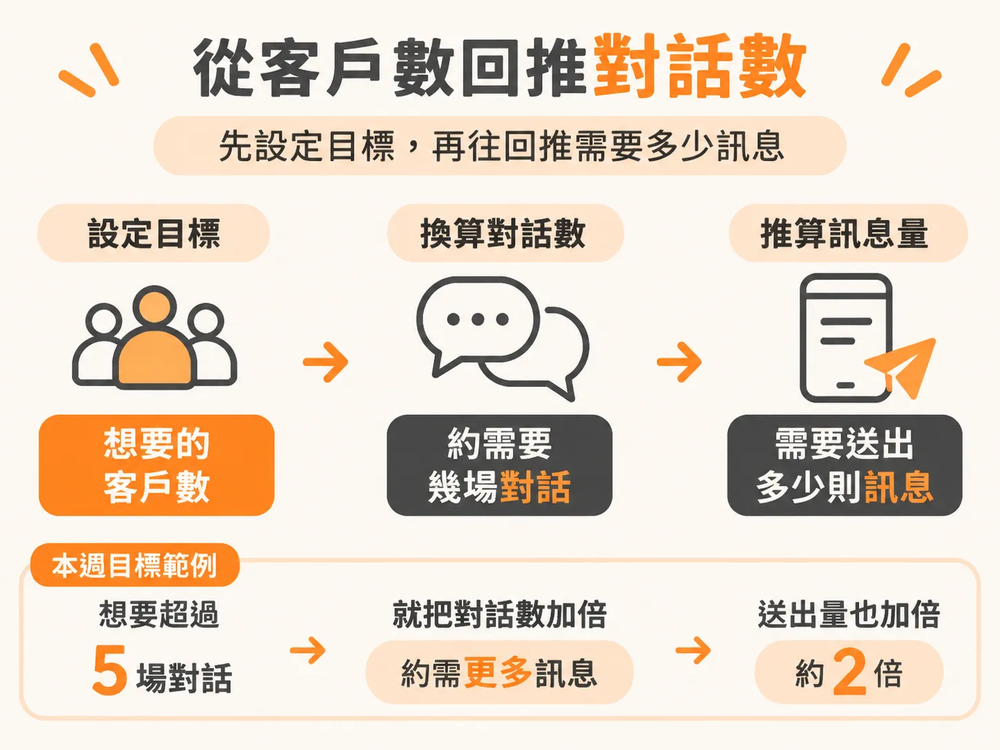
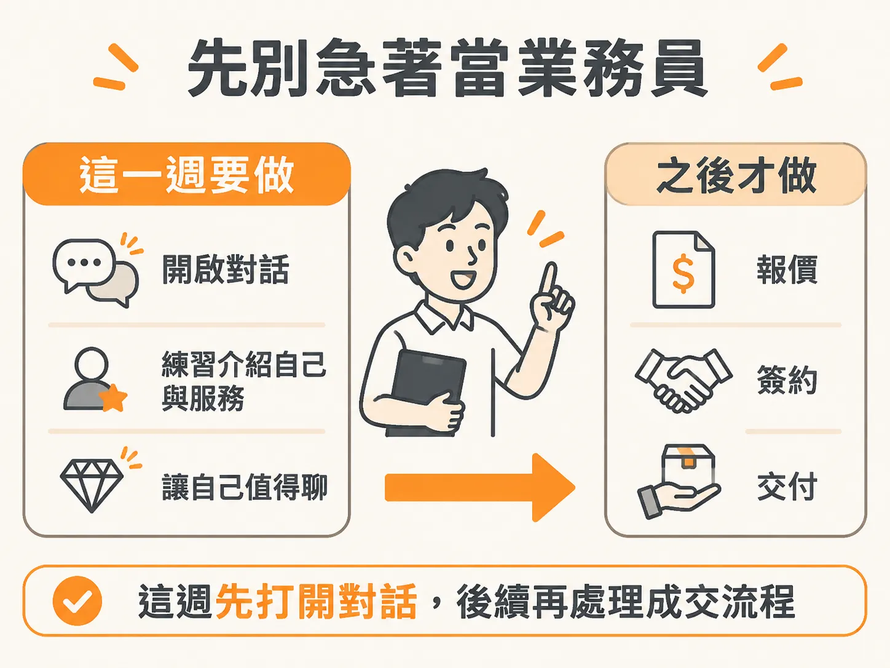

# 目標是對話

前面幾課依序拆掉了情緒、數學、input KPI，還有「這是服務還是 spam」的判斷。心態都到位了，最後要調的是目標本身：這一週，你追的到底是什麼數字。

## 這一週只要求一件事

這一週的目標是對話。成交還不到時候。

你可能覺得，沒有成交的 outreach 好像白做。但把數字攤開看，對話本來就是成交前面的那一格：10 場對話成交 1 位，成交率是 10%。想要 5 位客戶，往回推大約需要 50 場對話。

問題就從「我為什麼還沒簽下客戶」變成「我要怎麼出現在 50 個人面前」。第二個問題具體得多，也容易動手得多。

## 把本週目標設成對話數

所以這一週的目標，寫成這樣：這週要有幾場對話。不是這週要成交幾位。

這樣寫有一個好處。對話是你把人約到面前、把話講開就會發生的事。成交要等別人剛好在對的時間點頭，對話不用。目標放在你能直接推動的那一格，你每天就知道要做什麼。

數字也能直接回推。上週送 50 則訊息、換到 3 場對話，這週想要超過 5 場，就把送出的量加倍。不用想更複雜的公式。

## 先不用當業務員

把成交從本週目標拿掉，壓力也一起拿掉。

你現在不需要當業務員。不需要說服誰，不需要逼出一個 yes，也不需要這週就簽下客戶。要做的只有三件小事：讓對話開始流動、練習怎麼講你自己和你的服務、讓自己變成一個值得聊的人。

至於「這樣會不會打擾人」，上一課已經給過判準：帶著對方用得到的東西上門，就不是 spam。這裡不再重講一次。

簽約、開發票、實際上怎麼交付 agent，都是後面另外處理的事。這一週先不碰。

## 帶走這幾件事

這一週做完該做的動作時，記住：目標是對話。

成交會晚一點來。但這一週你把對話跑起來，就已經贏過 90% 的人。那些人從來沒開始，因為他們卡在自己的腦子裡。
