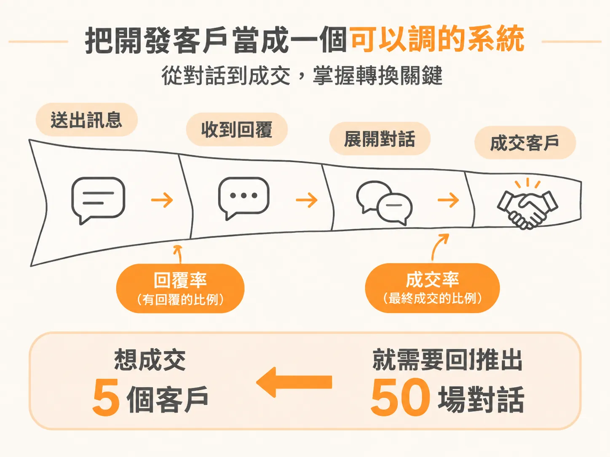
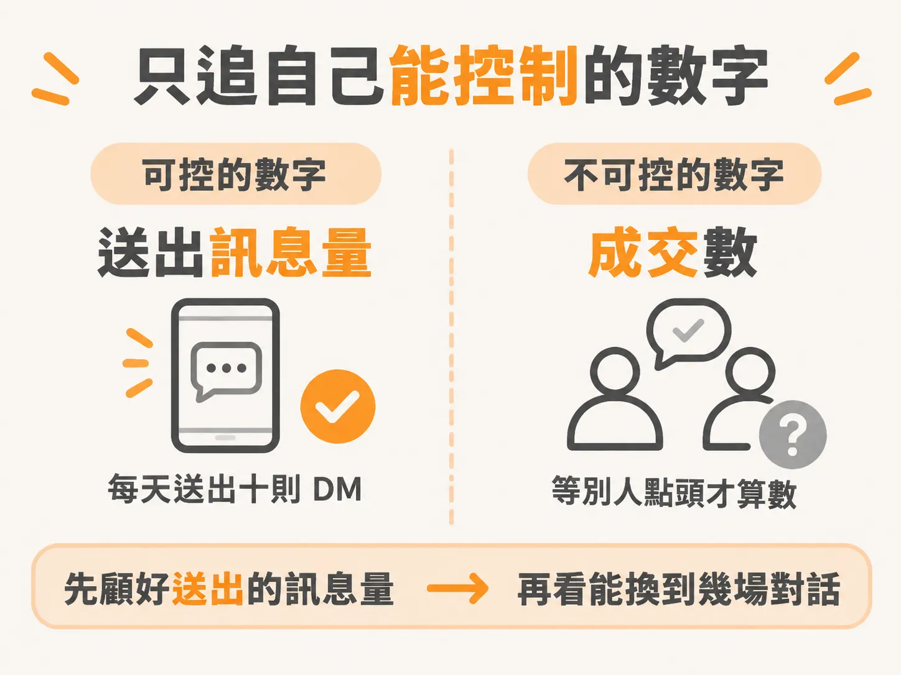
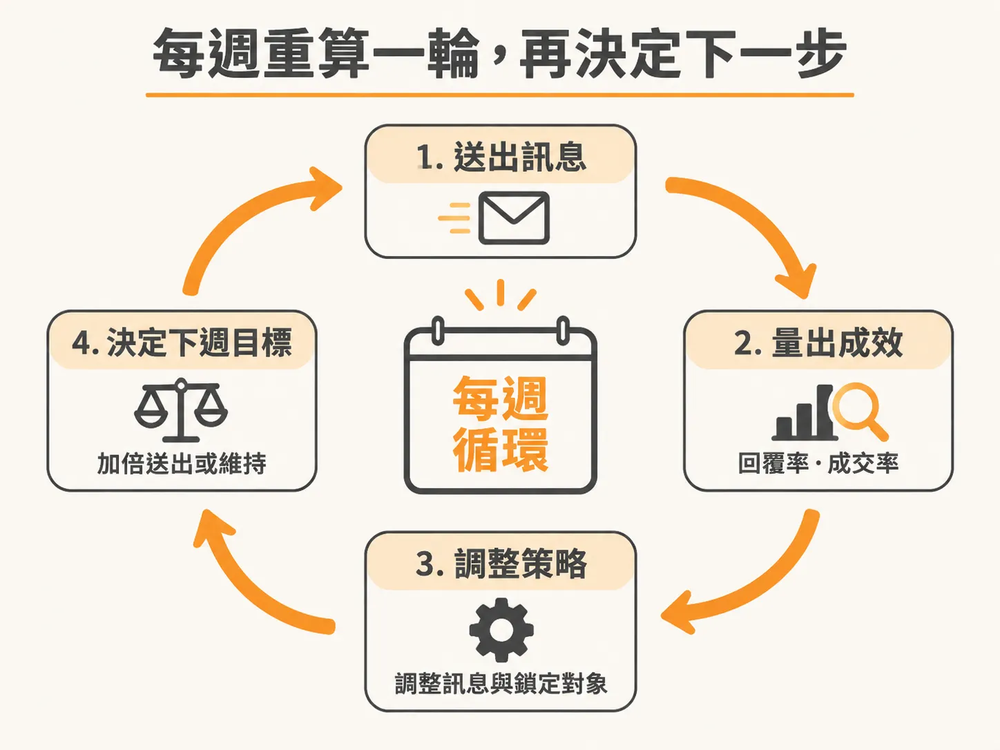

# 一切都只是數學

上一課把三個情緒卡點講開了：怕被拒絕、怕看起來很蠢、怕像在推銷。知道它們叫什麼，不代表它們會自己讓開。

要拆掉這道牆，最有效的一個念頭是：一切都只是數學。

## 把 outreach 當成一個可以調的系統

你送出一百則 DM，只收到一則回覆。這不是失敗，這是 1% 的回覆率。

回覆率（response rate）是「送出的訊息裡有多少變成回覆」。它是一個數字，數字可以拿來工作。改一下訊息，或換一批對象，回覆率就會動。

對話也一樣。十場對話成交一個客戶，成交率（close rate）就是 10%。

反推從這裡開始有用。目標是五個客戶，用 10% 的成交率往回推，你需要大約五十場對話。

問題換了一個長相。原本是「我要怎麼成交客戶」，現在是「我要怎麼出現在五十個人面前」。後面這個問題通常比較好解，因為它是量的問題，不是說服力的問題。

## 追 input KPI，不追 output KPI

多數人設目標的方式，讓自己一開始就失去控制權。「這週拿到三個客戶」就是這種目標。你控制不了它，它要看別人在對的時間點頭，也要看一堆你以外的條件剛好對上。

你能控制的是 input KPI。比如「這週送出一百則訊息」。判斷標準只有一個：你做了，或你沒做。沒有模糊地帶，也不用等誰回你。

把目標翻過來寫。「這週預約到兩通電話」改成「每天送出十則 DM」。「這週要五場對話」改成「先顧好送出的訊息量」。量夠了，再看這些訊息實際換到幾場對話。

例如你送了五十則訊息，換到三場對話。下週想要超過五場對話，做法很簡單：把 input 加倍。就這樣。

這個問題比「我要怎麼拿到更多客戶」乾淨得多，也直接得多。

## 每週用同一組數字重算一次

第一次算出來的比率不是你的最終水準，它只是這週的實測值。拿它調訊息、調對象，下週再算一次。

真正重要的不是開頭就完美，而是持續做。每天進步 1%，整年複利下來是 37 倍。這種系統——包括找客戶的 outreach——比的是一路做下去，不是第一次就做到最好。

被拒絕的時候，記得那個 no 只是眾多嘗試裡的一個資料點。它不代表你不適合做這件事。你要做的是讀它：哪裡出了問題，哪裡可以更好。每次嘗試都讓你更準一點。

## 下一步：把目標寫成你能控制的數字

比率算出來了，但它還不會替你決定今天要做什麼。要讓它變成動作，得先選定一個每天追的數字。

下一課處理的就是這件事：input KPI 和 output KPI 的差別，以及怎麼把「這週要五場對話」改寫成一個你完全控制得了的發送量。至於「這樣會不會像 spam」和「這一週只要對話」這兩個顧慮，後面各有專門一課，先記著就好。
