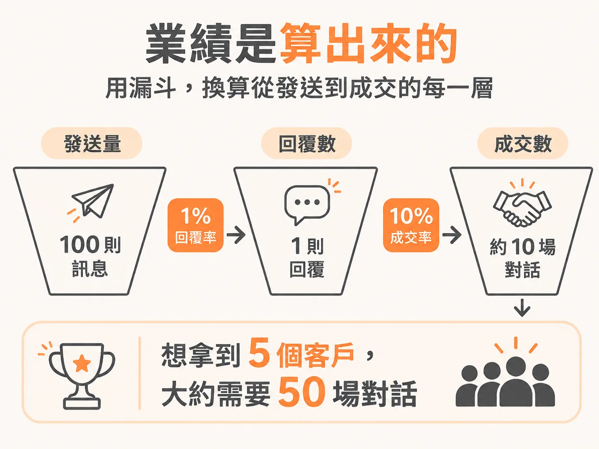
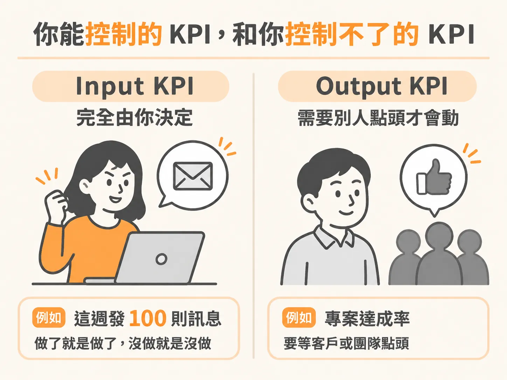
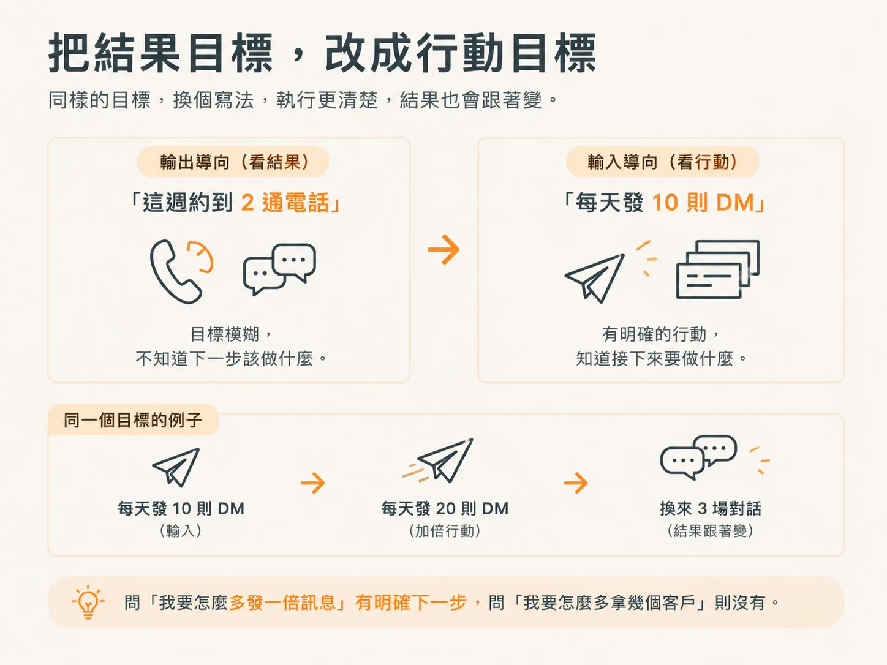

# 追蹤 input，不要追蹤 output

前兩課把心態和數學講完了：卡點是情緒，回覆率和成交率是可以調的參數。但比率本身不會告訴你明天要做什麼。

這一課補上那個缺口：把「這週要有五場對話」變成一個每天照著做就好的數字。

## 比率記住就好，不用重算

發 100 則訊息只收到 1 則回覆，是 1% 的回覆率；10 場對話成交 1 個客戶，是 10% 的成交率。要 5 個客戶，往回推大約 50 場對話。

這條算式上一課已經走過。這裡只需要記得它的用處：它把「我要怎麼成交客戶」換成「我要送多少訊息」，也讓那個「不」變成眾多嘗試裡的一個資料點，而不是對你的判決。

## input KPI 與 output KPI

要讓這件事真的運作，你要追蹤的是 input KPI，不是 output KPI。

- **input KPI**：你直接控制得了的動作，例如每天發幾則訊息、每週約到幾通電話。
- **output KPI**：你無法直接控制的結果，例如營收、成交的客戶數。

output KPI 之所以讓人不舒服，是因為它掛在別人身上。「這週拿到 3 個客戶」取決於別人在對的時間點頭，取決於一堆你排不了的條件。你可能做對每件事，還是達不到。

input KPI 沒有這個問題。「這週發 100 則訊息」完全是你的事：做了就是做了，沒做就是沒做，不用等誰回你。

## 把目標反過來寫

所以目標要反著寫。想在這週約到 2 通電話，就把它翻成「每天發 10 則 DM」——一個你控制得了的數字。想要這週有 5 場對話，就盯住你送出的訊息量，再往回看轉換率。

舉個實際的例子：發了大約 50 則訊息，換到 3 場對話。下週你希望對話超過 5 場，做法不是想辦法「多聊一點」，而是把 input 加倍。就這樣。

這也是為什麼 input 的問法比 output 乾淨：問「我要怎麼多發一倍訊息」有明確的下一步，問「我要怎麼多拿幾個客戶」沒有。

## 先擱著兩個顧慮

你可能還擔心「這樣會不會像 spam」，或覺得「把目標設成對話，是不是在自我安慰」。這兩件事後面各有一課專門處理。這裡先把它們當前提：你帶的是對方用得到的東西，而且這一週要的是對話，不是簽約。合約、發票、交付結構，都還不到時候。

## 這週你要做的動作

把你這週的目標改寫成一個發送量：

- 原本：「這週要約到 2 通電話。」
- 改寫：「這週每天發 10 則 DM，一共 50 則。」

數字用你自己的。寫完之後貼在看得見的地方，每天只問一件事：今天發完了嗎？
