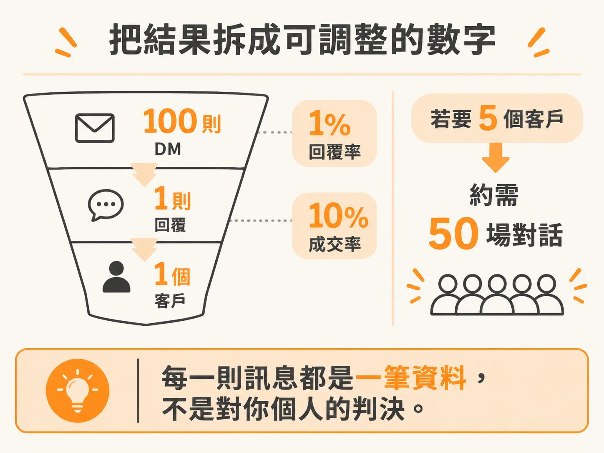
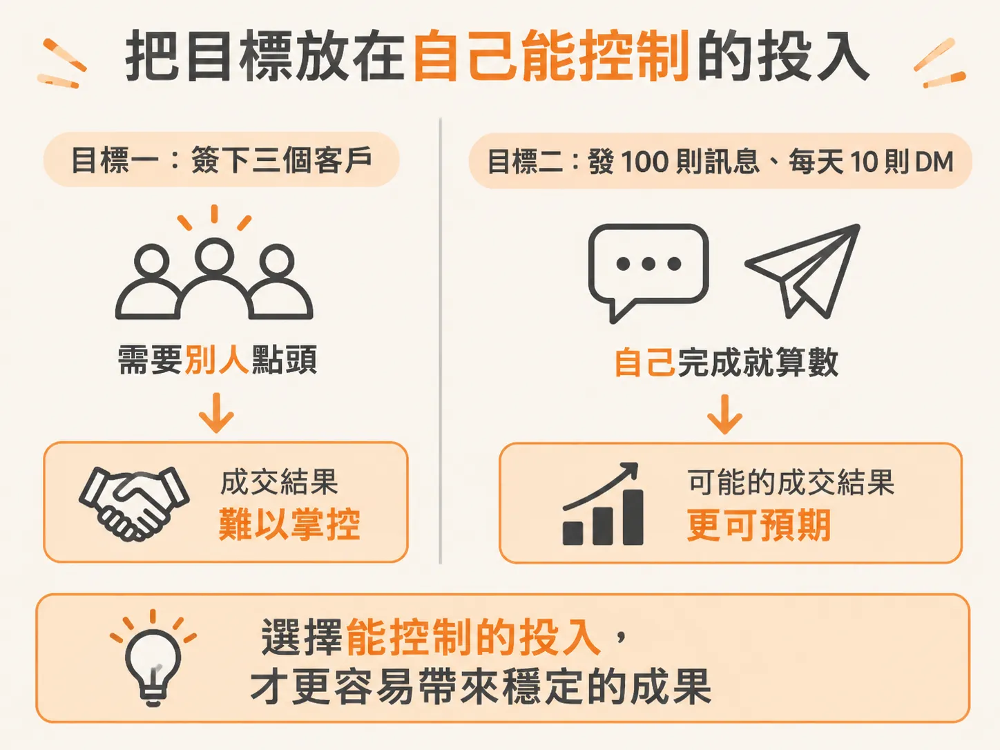
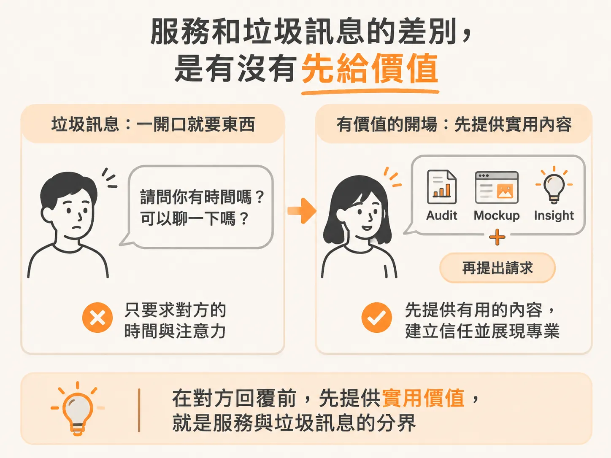

# 先給出用得上的東西

目標已經改寫成發送量了。現在真的坐到訊息框前，另一個擔心會冒出來：這樣發過去，會不會很煩？對方會不會覺得我在推銷？如果那個人還是認識的，會不會更尷尬？

這跟技術或文筆都無關。前面幾課處理的是「不敢開始」，這一課處理的是「開始了，但怕自己變成那種人」。

## 數字那條線，先收在這裡

回覆率、成交率、input KPI 的算法，前三課已經講完。這裡不重算一次漏斗，只留下一個結論：你送出的每一則訊息都是一筆資料，不是對你這個人的判決。

也不必再回頭調整目標的寫法。真正跟這裡有關的是：當你把目標設成「每天十則訊息」，你遲早會問自己「這樣會不會像 spam」。那個問題跟量無關。

## 服務與 spam 的差別，在你有沒有先帶東西

你可能還是擔心：這樣大量發訊息，不就是 spam？

Spam 的範圍其實很窄：把大量訊息丟給不在乎的人。關鍵不在「大量」，在「不在乎」。要問的是：你有沒有先確認對方真的在意？有沒有先給對方一個在意的理由？

就算做的是 cold outreach，也就是傳給完全不認識的陌生人，你還是可以在開口要東西之前，先帶一個有用的東西過去：一份 audit、一個設計的 mockup，或一個對方沒要求、但收到會開心的 insight。這種開場會讓對方比較願意相信你，也比較相信你真的解得到他那個具體的問題。

判斷一則訊息是服務還是 spam，問一句就好：如果對方什麼都不回，他有沒有從這則訊息裡拿到任何好處？沒有，那是 spam；有，那就是服務。這個判斷跟規模無關——大量發送不會讓服務變成 spam，先帶價值也不會因為量變大就失效。

## 下一個要改的是目標

判斷完「這是服務還是 spam」之後，還剩下最後一個心態沒處理：你以為自己要成交，其實這一週只要對話。下一課專門講這件事，這一課先把訊息送出去就好。

## 練習：把一則像 spam 的訊息改寫

拿一則你寫過、或你收過覺得很煩的訊息來改。

像 spam 的版本：

> 嗨，我是 Kevin，我們專門幫企業用 AI agent 做流程自動化，已經幫很多公司省下大量時間與成本。有興趣的話，可以約 15 分鐘聊聊嗎？

問題不在語氣禮不禮貌，而在整則訊息都在講「我」。對方拿不到任何東西，還得先付出 15 分鐘，才知道這東西對他有沒有用。

先帶東西的版本：

> 嗨 Kevin，我看了你們的 {{某個公開頁面}}，注意到 {{一個具體、看得出來的現象}}。我整理了一份兩頁的檢查清單，把這個現象最常見的三個成因和可以怎麼處理寫在裡面。直接看就好，不用回我，想聊再說。

兩則的差別只有一個：第二則在要東西之前，先給了一個對方就算不回也不吃虧的東西。這就是 audit、mockup、insight 放進訊息裡真正的樣子。

改完之後，今天就發出去。一則就夠了。
