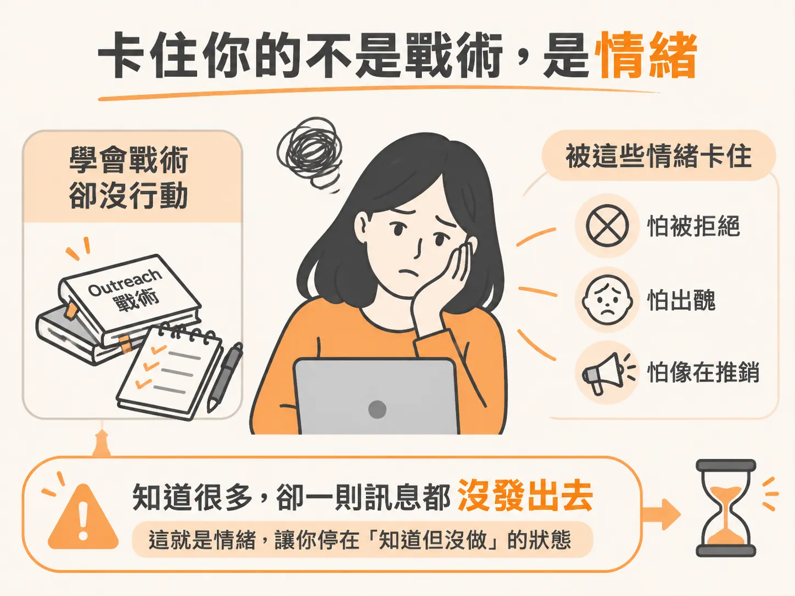
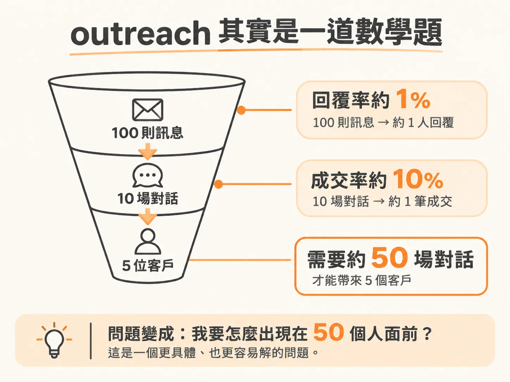
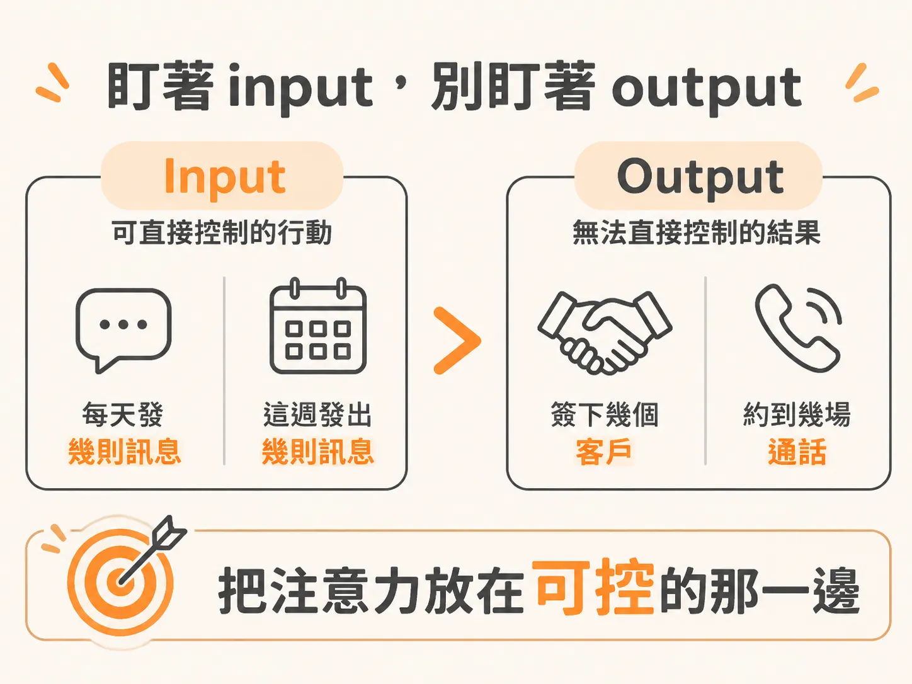

# 先講心態，再講戰術

你的 agent 做得出來，offer 也講得出來了。剩下的事只有一件：把訊息送出去。

然後你打開對話框，打了兩行字，刪掉，關掉。隔天再看一次，還是沒送。

多數人以為自己缺的是戰術：訊息腳本不夠好、名單不夠精準、cold outreach 的流程還沒學完。但真正卡住的地方通常不在那裡。你已經看過夠多教學，也知道該做什麼，卻遲遲沒有動作。原因幾乎都是情緒。

## 戰術不是瓶頸，情緒才是

最常見的三個卡點：怕被拒絕、怕看起來很蠢、怕自己像在推銷。

這三個感覺不會讓你大喊「我不做了」。它們比較像安靜地把動作往後延一天，再往後延一天。有人把該學的都學完、筆記做得漂漂亮亮，卻一封訊息都沒發出去。對這些人來說，知識從來不是問題，問題是他們沒有用真實的方式看「怎麼拿到客戶」這件事。

現在不處理，它不會自己消失，只會在後面某個時間點悄悄把你的動能磨掉。

## 把 outreach 當成一組數字

真正改變一切的那個念頭是：這全部都是數學。

一旦這樣看，你就不會再往心裡去，而是把 outreach 當成一個可以調的系統。

送 100 則訊息只收到 1 則回覆，那不是失敗，那是 1% 的回覆率。這是一個可以拿來工作的數字。也許改一下訊息，也許換一批對象，回覆率就會動。

對話也一樣。10 場對話成交 1 個客戶，那是 10% 的成交率。想要 5 個客戶，往回推就是大約 50 場對話。

問題於是變成「我要怎麼出現在 50 個人面前」。這是完全不同的問題，通常比較簡單、也比較好管。

數字之所以關鍵，是因為它把拒絕去個人化。收到一個「不用」，不代表你不適合做這件事。那只是你接下來一連串嘗試裡的其中一個資料點。你要做的是把它讀好：哪裡不對、哪裡可以更好。每一次嘗試都讓你更準一點。

每天進步 1%，複利一整年，年底的你會是年初的 37 倍。這一類系統，包括找客戶的 outreach，比的不是開頭多完美，而是你有沒有留在場上、有沒有持續做。

## 看 input，不看 output

要讓這件事真的落地，你追蹤的必須是 input KPI（你可以直接控制的行動），而不是 output KPI（你控制不了的結果）。

這聽起來有點反直覺：把注意力從結果上移開。但追蹤 input 才會把你放到有掌控感的位置。

把目標設成「這週簽下三個客戶」，你其實控制不了它。它取決於別人在對的時間說好，取決於一堆你無法安排的情況剛好對上。

你可以控制的是 input。目標是這週送出 100 則訊息，那就是純粹的行動：你做了，或你沒做，沒有模糊空間，也不用等誰回你。

所以把目標反過來寫。想在這週約到兩場通話，就改成每天送 10 則 DM。想在這週有 5 場對話，就盯住你送出的訊息數，等量累積起來，再回頭看整個漏斗的轉換率是多少。

例如送出 50 則訊息、換到 3 場對話。下週想要超過 5 場對話，就把 input 加倍，就這樣。

「我要怎麼把訊息量加倍」比「我要怎麼拿到更多客戶」好回答太多了。

## 怕像 spam，是因為你把意圖放錯了位置

另一個常見的擔心，是怕自己很煩、很像在發垃圾訊息，尤其是要動用自己認識的人，去告訴他們你有 AI agent 的服務可以賣。

但差別從來都在意圖。你要相信你替自己練起來的這項技能，對別人是真的有幫助；把這件事講出去，會替你打開一些門，對收到的人也有價值。

spam 的定義其實很窄：把不相關的訊息大量丟給不在乎的人。就算對象是完全不認識的陌生人，你還是有辦法讓訊息值得被讀。做法是先用有用的東西開場：一份稽核、一個設計 mockup，或一個對方沒開口問、但收到會慶幸的觀察。這樣即使量大，也還說得過去。

## 這一週的目標只有對話

現在還不是成交的時候。這一週要做的，只是設法開啟一場對話。

把壓力拿掉。你現在不需要當業務，也不需要立刻簽下客戶。你要的是讓對話流動起來，練習怎麼講自己、怎麼講你的服務，讓自己變成一個值得聊的人。

簽約、開發票、實際交付 agent 的結構，都是後面的事。

所以這一週做完該做的動作時，記住三件事：這都是數學；拒絕是資料；input 才是關鍵，而對話就是目標。

帶著這三件事離開，你就已經贏過九成的人。他們不是不夠聰明，只是卡在自己的腦子裡，從來沒有開始。

現在寫下你這週要送出的訊息數。不是客戶數，是訊息數。
