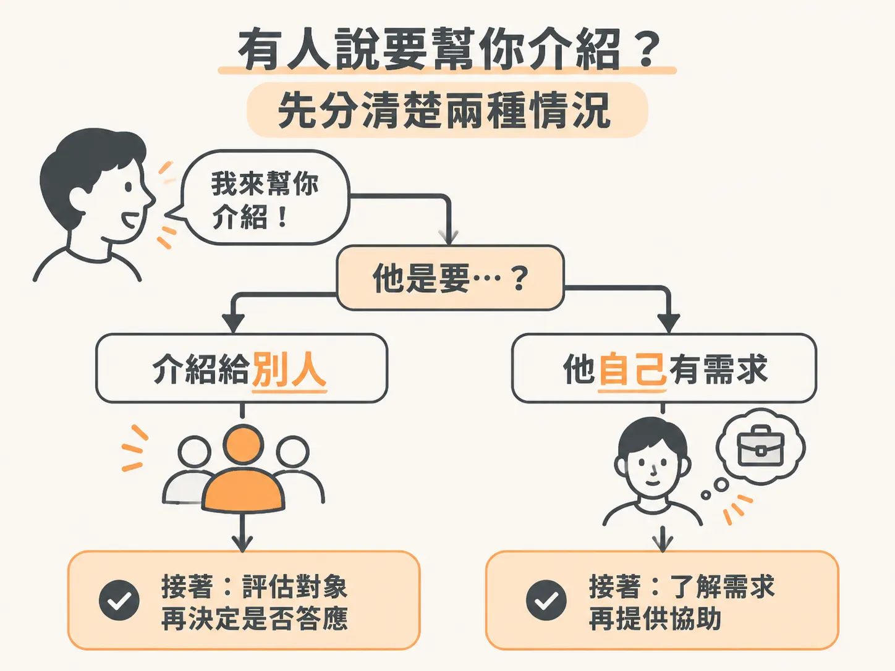
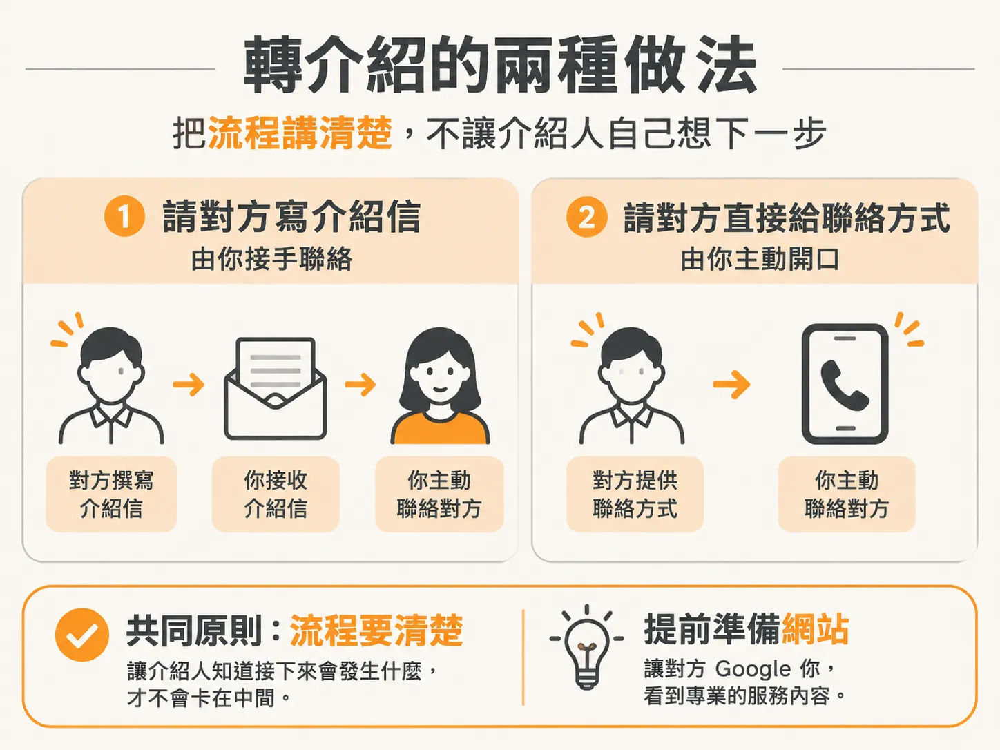
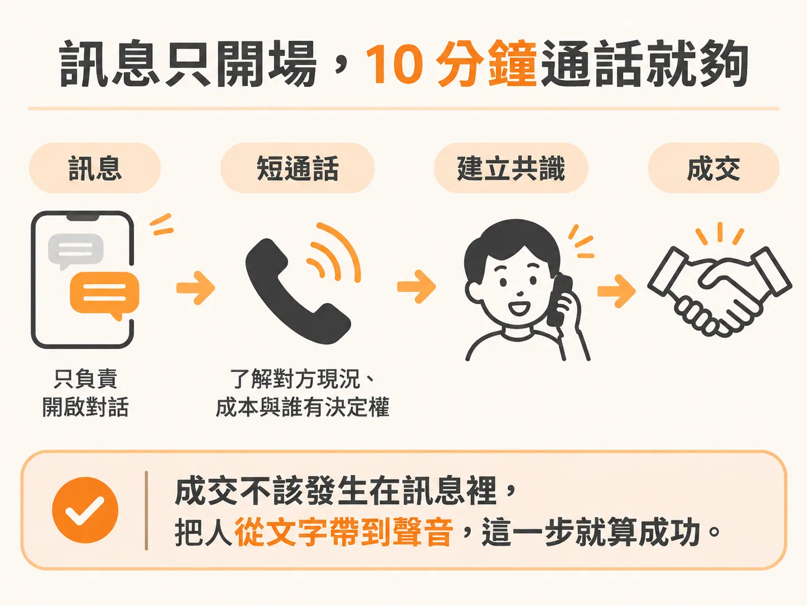

# 目標是對話，不是成交

訊息發出去，沒人回是常態。多數人不回，通常不是你寫得不好，只是他們忙。真正的訊號藏在少數幾則回覆裡，而那些回覆幾乎只有兩種樣子。

一種是：「我好像認識一個人，這個對他可能有幫助。」另一種是：「其實我自己也有這個問題。」

這兩種回覆，下一步完全不同。分開處理，才不會在同一個對話框裡同時做兩件事。

## 有人要幫你介紹：讓他少做一點

轉介紹最容易卡住的地方：對方答應了，然後就沒有下文。不是他反悔，是他不知道接下來該做什麼。

所以你要把動作講清楚，而且只給兩個選項。

選項一：請他直接用 email 幫你介紹，後續對話你來接。選項二：請他把對方的聯絡方式給你，由你主動開口。

兩個都可以，重點是別讓他自己發明流程。他願意說出那個人的名字，已經是這週最好的消息，剩下的麻煩你來吸收。

介紹成立之後，你送出的第一樣東西通常是網站。對方會去 Google 你，看到清楚的服務項目和像樣的排版，才會把你當成真的在做事的人，而不是一則陌生訊息。這也是網站要在開始 outreach 之前就準備好的原因。

## 他自己有需求：先不要切換成銷售模式

第二種回覆比第一種更好。你們本來就認識，對話不用從零開始，也最容易推進。

但這裡有個常見的失手：一看到「我有興趣」，就立刻講起方案、價格、能做什麼。對方還停在「我最近有點煩」，你已經在報價了。

先讓他講。問他現在實際卡在哪裡、哪件事最花時間、多久發生一次。你只需要好奇，不需要說服。

大概知道他的狀況之後，再提出那個很輕的請求：能不能約 10 分鐘聊一下。

## 10 分鐘就夠了

10 分鐘是刻意設計的長度。短到對方幾乎不用考慮，又長到足以讓你判斷這件事值不值得往下走。這是 discovery call，不是提案，也不是 demo。

通話裡要拿到三件事：他現在怎麼做、這件事讓他付出什麼成本、他有沒有決定權。拿到這三件，你才知道下一步該給什麼。

訊息能做的就到這裡。真正的成交發生在對話裡，不是在 DM 裡。把人從文字帶到聲音，這一步就算成功。

## 訊息的規矩沒有變

不管在哪個管道回覆，規矩都一樣。

第一條：第一則訊息不推銷。沒有價格、沒有方案描述、沒有預約連結。先給溫度、給具體的個人化，或給一點對方用得到的東西。

第二條：要短。LinkedIn 訊息壓在 300 字元以內，簡訊壓在 160 字元以內，email 控制在 100 到 150 個字。再長，讀起來就像行銷信。

第三條：跟進兩次就停。第一次在原訊息後三到五天，說一句「怕它被埋在信箱裡」。第二次再隔一段時間，而且每次都要帶點新東西，不要只寫「follow up」。兩次沒回應，就換下一個人。多數回覆其實來自跟進，不是第一則訊息。

第四條：用純文字。HTML 版型、Logo、多個連結、短網址，在 warm outreach 裡都只會被讀成廣告。

## 這週要做的事

打開名單，挑出現在立刻想得到的十個人，今天就發。

不用等文案完美，也不用等網站改好。Warm outreach 免費、快，轉換率也比你想的高。你要的是讓對話開始發生。十則訊息裡有一則回覆，這一週就沒白過。

發完之後，把回覆分成兩堆：要幫你介紹的，和本身有興趣的。前者給兩個明確選項，後者只問問題、約 10 分鐘。剩下的，交給下一次跟進。
