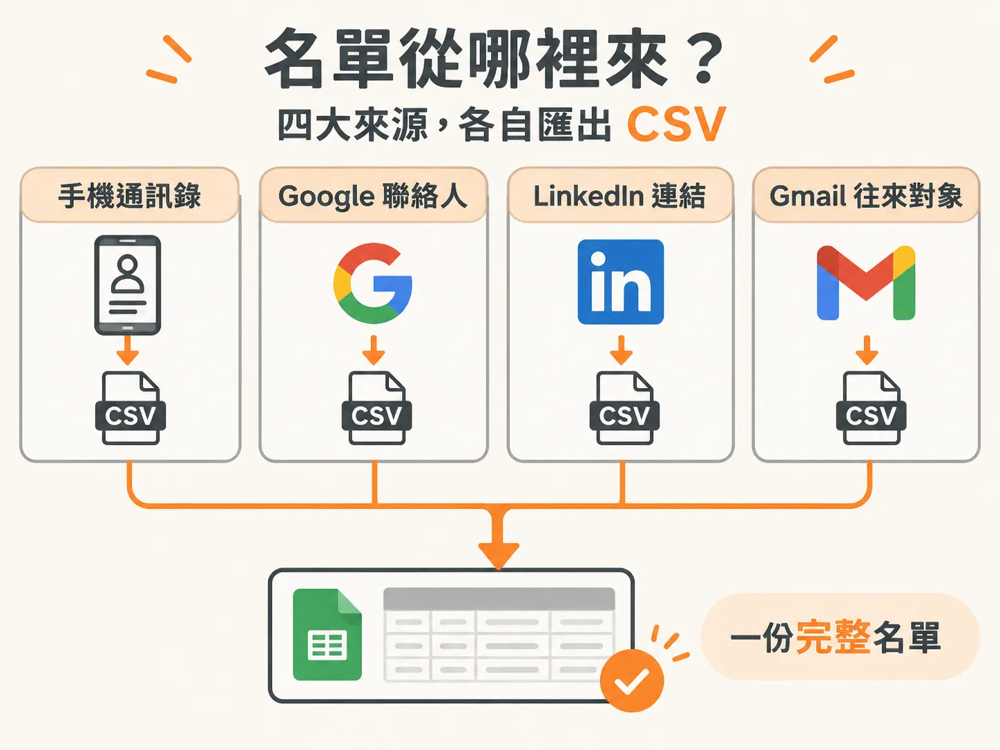
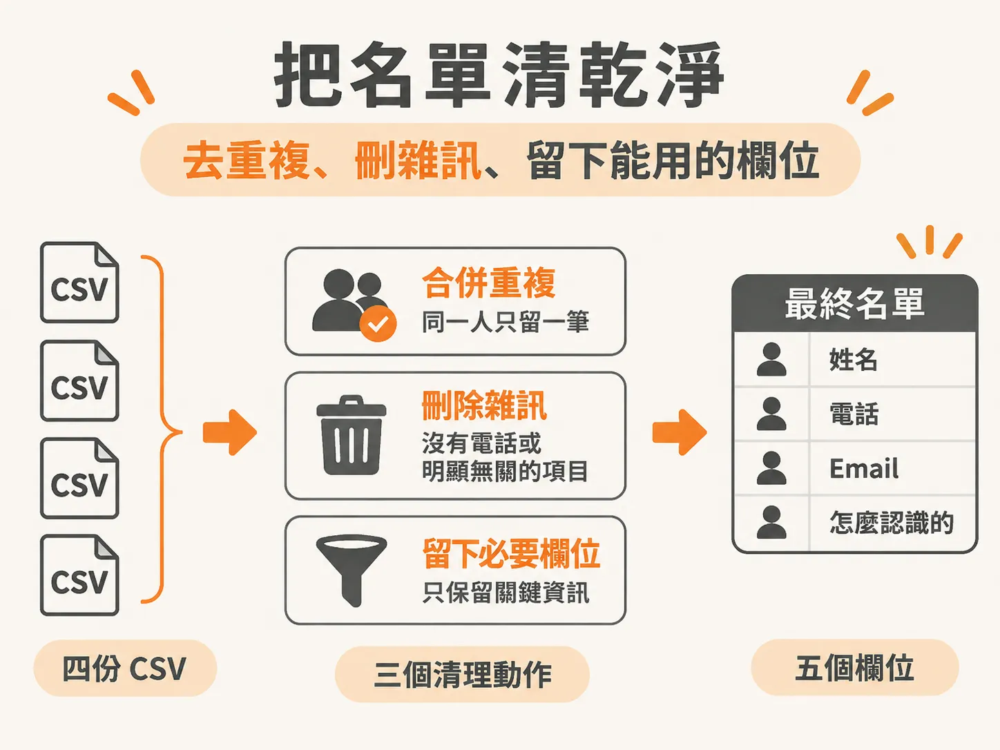
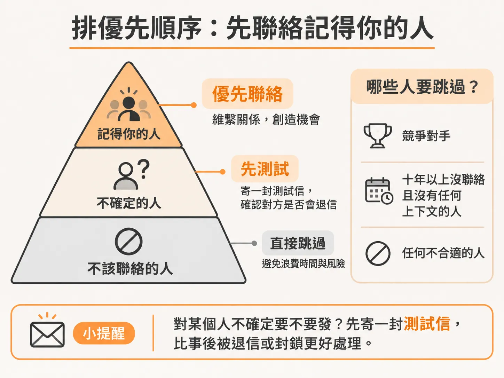

# 第一步：把你認識的人都列成一份名單

你決定開始做 warm outreach。第一個浮現的問題通常不是「訊息怎麼寫」，而是「我到底要發給誰」。

多數人卡在這裡，因為以為要從零開始建名單。不用。你手機裡、Google 帳號裡、LinkedIn 上、Gmail 裡，早就存著一份經營好幾年的聯絡人資料庫，只是你從沒把它當資產看。裡面有幾百個你早就忘了的人，但你們其實還連著線。

Warm outreach 的流程是五格：匯出聯絡人、清單並排優先序、寫訊息、分批送出、最多跟進兩次。先做前兩格。做完你會有一份 50 人以上的名單，而且知道先發給哪十個。

## 名單不用重寫，去匯出就好

先接受一件事：你不需要回想每一個人叫什麼名字。你要做的是把已經存在的紀錄倒出來，變成一份可以排序、可以加欄位的表格。

四個來源就夠了：手機通訊錄、Google 聯絡人、LinkedIn 連結、Gmail 往來對象。每一個都能匯出成 CSV，丟進同一份試算表。

匯出時有個原則：先求有，再求好。不要一邊匯出一邊判斷「這個人會不會理我」，那只會讓你停在中途。先把資料倒出來，清理跟排序是下一步的事。

## 手機通訊錄：最多你忘記的人

手機通訊錄通常是最肥的來源。你以為只有幾十個常用聯絡人，實際匯出往往是好幾百筆。

iPhone 有兩條路。第一條是裝匯出 App，把聯絡人備份後直接匯成 CSV。第二條不用裝東西：到 icloud.com/contacts，用 Apple ID 登入，全選之後點齒輪圖示的「Export vCard」，再把 .vcf 檔轉成 CSV。Android 也有對應的匯出 App，做的是同一件事。

如果你本來就用 Google 帳號存聯絡人，那更直接：到 contacts.google.com，左側點 Export，格式選 Google CSV，檔案立刻下載。這裡有個坑：它只匯出「有同步到 Google」的聯絡人，只存在 SIM 卡或只存在裝置上的不會出現。如果筆數少得不合理，去設定裡的帳號頁確認聯絡人同步是開著的。

## Google 聯絡人：記得去看「其它聯絡人」

`contacts.google.com` 會列出你存過的每一個人。有人整個職涯累積下來是一千五百多筆，橫跨好幾家公司。裡面有些人有電話、有些人只有 email，都無所謂，能連上就夠了。

真正容易被漏掉的是另一區。Google 聯絡人只存你「主動存過」的人，而 Gmail 另外留著一份「其它聯絡人」（Other Contacts），放的是你寄過信、卻從沒存進通訊錄的對象。這一區常常有幾百個人。

做法是在 Google 聯絡人側邊欄找到「其它聯絡人」這個標籤，單獨再匯出一次；或者直接在 Gmail 搜 `from:me to:@`、`in:sent`，把過去的往來挖出來。

## LinkedIn：只勾 Connections 就好

LinkedIn 的匯出藏在設定裡。點右上角大頭照 → Settings & Privacy → 左側 Data Privacy → Get a copy of your data → 只勾 Connections → Request archive。

只勾連結的話，通常十幾分鐘就會收到通知信。下載 ZIP、解開，裡面就是 `Connections.csv`。

這份 CSV 的欄位不多，先知道它有什麼、沒什麼：First Name、Last Name、Email Address（只有對方分享過才會有，很多是空的）、Company、Position、Connected On。它沒有電話、沒有 LinkedIn 網址、也沒有共同好友數。單日匯出上限是一萬筆，對一般人來說碰不到。

## 清名單：去重、砍雜訊、留下能用的欄位

四份 CSV 疊在一起，第一件事是去重。Google 聯絡人有內建的「合併與修正」（Merge & fix），可以先自動 dedupe 一輪；進了試算表之後，再用「資料 → 移除重複」掃一次。

第二件事是砍雜訊。這些欄位裡混著一堆你根本不會發訊息的人：商家、外送司機、以前看過的醫生。在試算表裡依姓名排序，把沒有電話號碼的列刪掉，再手動掃一遍，清掉明顯不屬於名單的項目。

最後只留五個欄位：名字、姓、電話、email（有就留）、以及一欄「怎麼認識的」。最後那一欄現在看起來多餘，等你要寫訊息時，它就是個人化的材料。

## 排優先序：用「他記不記得你」分三層

名單不是平的。同樣是 50 個人，回覆率差很多，差別在你們之間的溫度。分層的判斷標準只有一個：這個人記不記得你。

手機名單可以這樣分。Tier 1 是常聊的朋友、家人、你固定會講話的人，他們會回，也多半願意幫你轉。Tier 2 是前同事、大學朋友、兩年內沒聊但還算熟的人，溫度還在，只是睡著了。Tier 3 是點頭之交、舊工作的同事、很鬆的連結，他們知道你的名字，但訊息需要更多上下文。

有些人不該放進名單：你在路上認不出來的人、關係緊繃的人、任何會覺得你這樣做不合適的人。這一類直接跳過，不要因為「湊人數」把他們塞回來。

有一個很快的測試法：如果現在傳一句「嘿，最近好嗎？」完全不帶目的，這個人會回你嗎？會，就夠 warm 了。

LinkedIn 那邊的分法類似，但多一個可以操作的篩選。Tier 1 是最近半年到一年內建立、職務跟你 offer 相關、而且你互動過他內容的連結。Tier 2 是職務相關但沒什麼互動的人，先花一週在他貼文底下按讚留言，再發訊息。Tier 3 是很久以前建立、後來沒再講過話的連結，需要另一種寫法。

實作上最省時的做法：在 CSV 裡依 Connected On 由新到舊排序，再用職稱關鍵字篩出跟你服務相關的人。這樣 Tier 1 會自己浮上來。

## 在表格裡留下兩個判斷欄位

清理完、分完層，在 Google Sheets 加兩欄，之後寫訊息時會一直用到。

第一欄是「Relationship」，標這個人是朋友、前同事、客戶，還是產業裡認識的人。第二欄是「Priority」，1 到 3 分，評的是兩件事：他多認識你，以及你的服務對他多相關。

順手再刪一輪：競爭對手、十年以上沒聯絡又沒有任何上下文的人、任何不合適的人。對某個人不確定要不要發，就先寄一封測試信看他會不會退信，比事後被退信或封鎖好處理。

## 做完這一步，你會有的東西

四個來源匯出完、去重完、分完層，你會得到一份 50 人以上、放在試算表裡的名單。它同時告訴你兩件事：誰值得先發，以及你可以用什麼話題開場。

名單的第一個用途不是寄給全部的人。是挑出最上面那 5 到 10 個，今天就發。剩下的留著，等你測出哪一種訊息有人回，再往下一層推。
