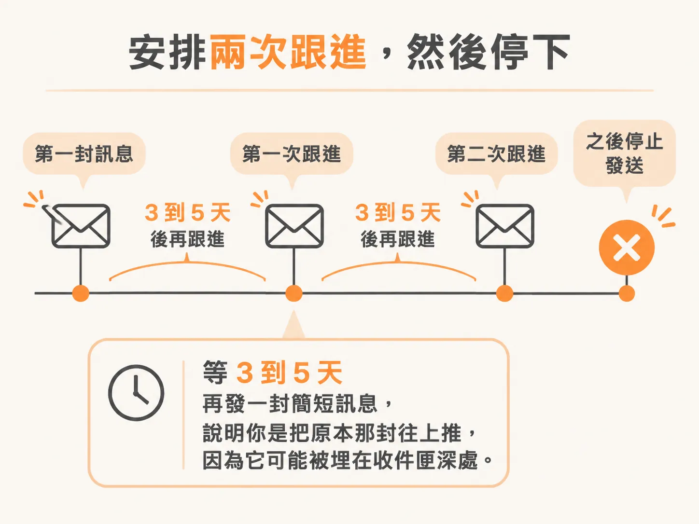
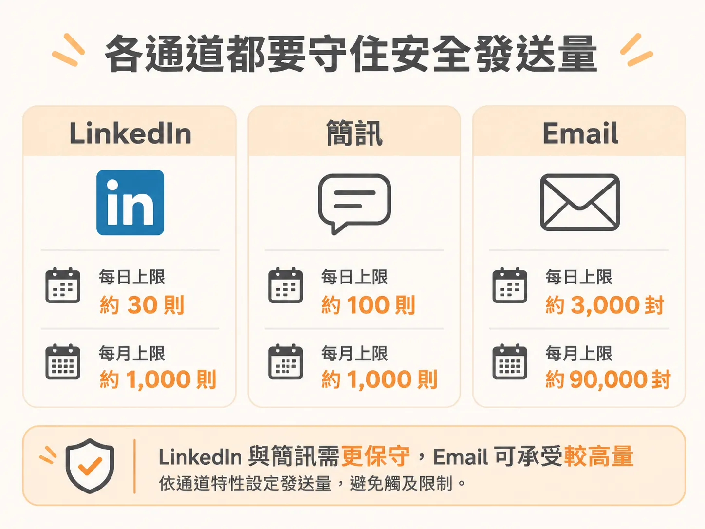
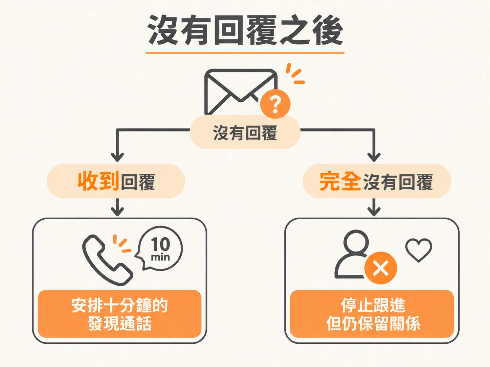

# 跟進兩次，然後停

你發出十封訊息。三天過去，兩封有回，八封沒動靜。多數人第一個念頭是「他們不在乎」。真實情況通常更單純：對方很忙，訊息被埋在收件匣裡。

第一封沒回，不代表要放棄，也不代表要再轟十封。你需要一套節奏：什麼時候推第二次、推幾次、每次推什麼，還有每個通道一天最多發多少，才不會被系統盯上。

## 3 到 5 天後，把訊息往上推一次

第一封發出後，等 3 到 5 天。這幾天什麼都不要做。時間一到，再發一封很短的訊息，說明你是把原本那封往上推，因為它可能被埋在收件匣深處。

心態要先調整：大部分的回覆來自跟進，不是來自第一封訊息。第一封負責讓人看見你，跟進負責讓人真的回你。

## 三個通道，三種節奏

每個通道的容忍度不同。同樣是「最多兩次」的原則，間隔時間不一樣。

**LinkedIn**：每次跟進至少隔 3 到 5 個工作天。常見的理想節奏是四次接觸。第 1 天，對方接受邀請後道謝，並提到一個具體的細節；等對方接受後 2 到 4 小時再發，立刻發看起來像機器人。第 4 天，分享一個有用的東西。第 9 天，提出門檻很低的請求，例如「十分鐘通話有幫助嗎，還是你想先看案例」。第 14 天收尾，說明這是最後一封，之後還是歡迎他回來。

對方從頭到尾沒回，累積三封沒有回覆的訊息就停。第一封加兩封跟進，就是上限。

**簡訊**：第一封跟進在原始訊息後 3 到 5 天。第二封在第一封跟進後 7 到 10 天。之後就停。對 warm 聯絡人最多兩封跟進，第三封會開始讓人有壓力。同一個對象，一個月不要超過 3 到 5 則簡訊。

**Email**：第 1 天寄原始信。第 4 到 5 天跟進，說明你擔心信被淹沒。第 10 到 14 天寄最後一封，補上新價值或換一個角度。warm outreach 的總量上限是三封。跟進回在同一個討論串裡，對方看得到上下文，收件匣也不會變亂。三封都沒回就停手，兩三個月後再換角度試。

## 每一次跟進都要帶新東西

「只是跟進一下」是最沒有用的一句話。每一次接觸都要給對方一點新的東西：一篇文章、一個觀察、一個他可能用得到的資源，或一個更具體的問題。

這不是禮貌問題，是效果問題。有節奏的跟進序列，轉換率比只發一封高出 49%。

## 守住每個通道的安全量

通道會處罰「突然變多」和「看起來一樣」。安全量是上限，不是建議。

**LinkedIn**：免費帳號一天約 20 封新的 outreach 訊息，一週約 100 封。Premium 與 Sales Navigator 一天約 30 封，一週約 150 封。平台看的是滾動的一週，不是嚴格的每日上限；跟進既有對話的訊息計算比較寬鬆。不論哪種帳號，一天都不要超過 50 封新的 outreach 訊息。

**簡訊**：一天 10 到 20 則，是還能一封一封寫個人化內容的區間。從個人號碼一天發 200 則以上，會被電信商標記。還有一個容易忽略的指標：進出比。你發出去的數量如果是收到的大約三倍，就會被當成垃圾訊息發送者。

**Email**：免費 Gmail 的官方上限是一天 500 封，Google Workspace 是 2,000 封。實際一天只發 50 到 100 封，保護寄件聲譽。分批發，一小時 20 到 50 封，200 人的名單分散在 2 到 3 天。擴量要慢慢來：第一週一天 10 到 30 封，第二週 50 到 75 封，第三週之後如果互動正常，再拉到 100 到 150 封。

還有一件事：量的突然跳升本身就是觸發點。從一天 5 封跳到 200 封，比任何用字都更容易進垃圾信。

## 沒有回覆之後

兩封跟進發完，沒有回覆，就把這個人從這一輪拿掉。不要切斷關係，只是不要再發。這是數字遊戲：繼續接觸下一個人，直到遇到願意開啟對話的人。

有人回你，而且說他自己就需要，那是最好的結果。這時不要立刻進入推銷模式，先問他現在實際在處理什麼，保持好奇。可以的話，約一段十分鐘的對話，當成第一次的發現通話。交易通常在對話裡成交，不在私訊裡。

訊息負責讓人看見你，對話負責成交。門推開兩次，就夠了。
