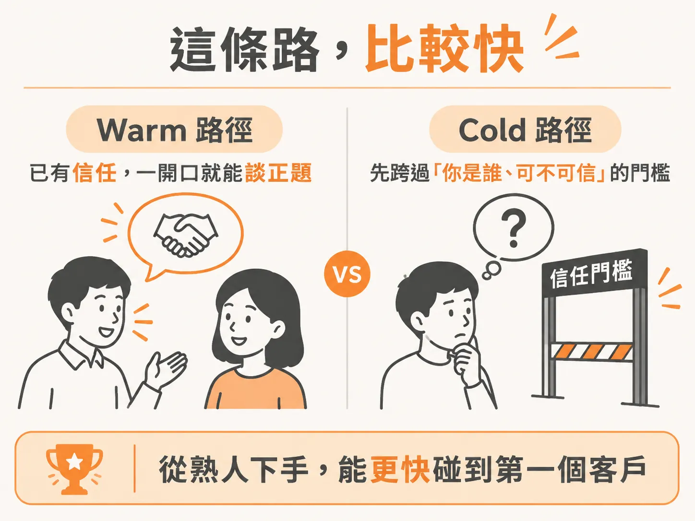
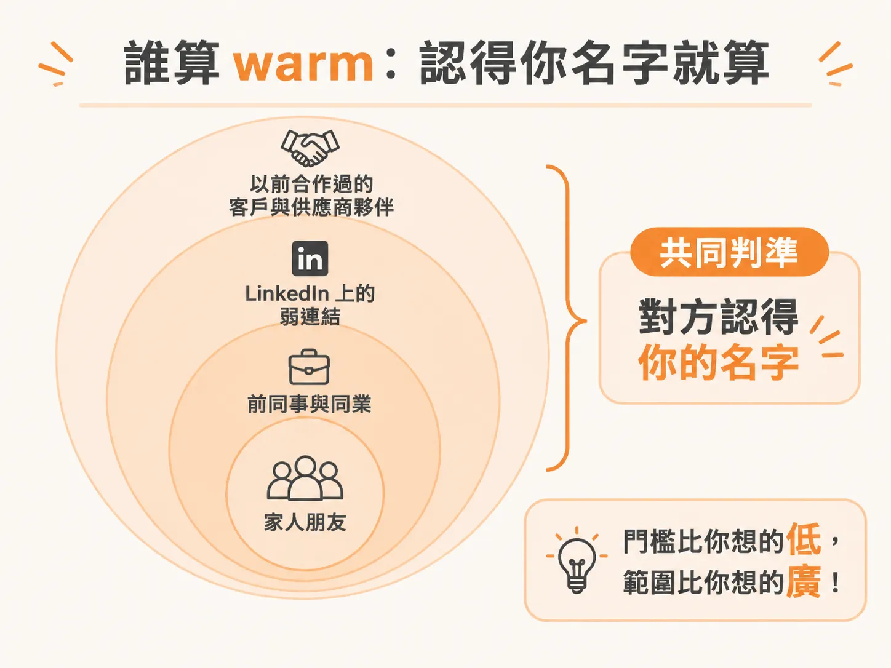
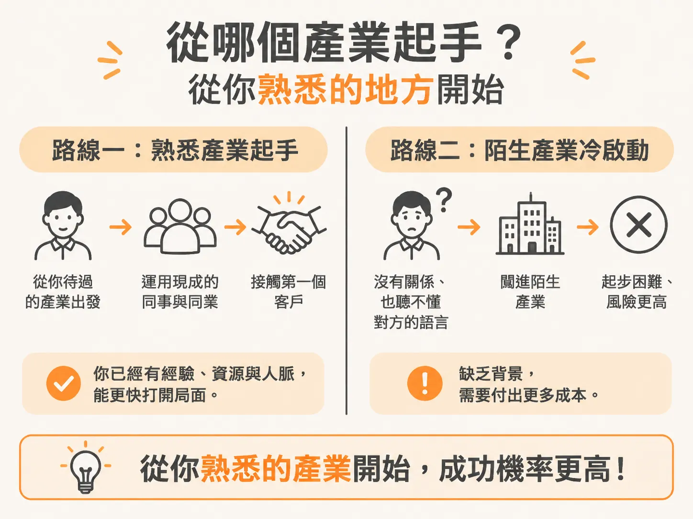

# 認得你名字的人，都算 warm

你會 build agent，這已經不是問題。真正的問題是：到目前為止，沒有人為它付過錢。

於是你開始想，是不是該先做個網站、投廣告，或跑一份冷開發名單。

順序反了。第一個客戶幾乎不會從行銷漏斗來，也不會來自你自己 launch 的 cold outreach 活動。實務上，他通常是你已經認識的人，或是你認識的人再往外一步的那個人。

## 最快，不是最漂亮

warm outreach 的意思是：聯絡本來就認識你的人。它不是最炫的做法，也不是最能規模化的做法，但它最快。

快的原因很單純。你們之間已經有信任，你不必先證明自己是個真人、不會騙人。對方知道你的名字，最難的那一半已經先贏了。

而且它免費、快，轉換率是幾種做法裡最高的。你需要的只是你的聯絡人，和每天三十分鐘。

現在對你來說，速度比什麼都重要。你需要第一個成果，才有動能往下走。先有一筆成交、一句客戶說得出口的話，之後再回頭做網站、做內容、做冷開發，都會容易得多。

## 誰算 warm：門檻比你想的低

最內圈是家人和朋友。就算他們自己不需要你的服務，他們也可能認識需要的人。

下一圈是前同事與同業。如果你在某間公司待過，那些人看過你怎麼做事、知道你怎麼交付，心裡對你多少留了一些評價。這種人可以直接聯絡。

LinkedIn 特別適合這件事，因為那個平台本來就是為了讓專業對話自然發生。所以連弱連結都算：只在某場活動打過照面也沒關係，只要對方還記得你，就可以。

再往外一圈，是以前合作過的客戶，還有以前在公司往來的供應商或合作夥伴。

判斷標準只有一條：**對方認得你的名字。** 就這樣，門檻比你想的低非常多。

名單不用從零開始寫。你手機裡本來就有幾百個人，很多你早就忘了，但你們其實還連著。把通訊錄匯出成表格：用 Email 的，可以從 Google 聯絡人匯出；用 LinkedIn 的，可以到設定裡的資料隱私，下載一份自己的資料。三個來源匯一匯，清單要累積到五十人以上並不難。

## 從哪個產業起手：從你現在的位置

很常見的錯誤是：挑一個「感覺很好賺」的產業，然後從零開始敲門。你會撞得比想像中大力，因為你既不認識裡面的人，也不懂他們每天在煩什麼。

正確的起手式是：從你自己的產業開始。

第一個客戶通常從你原本的世界長出來。你的產業之所以是第一站，是因為你已經會說那個語言，而且那個圈子裡本來就有你的同業與同事。跟一個毫無背景、直接走進來的人相比，這是巨大的優勢。

做過行銷，就從行銷人開始。做過房地產，就從房地產開始。有財務背景，就從財務開始。

舉個實例：第一批客戶是行銷人員，來源就是消費品公司 Unilever 時期的同事。賣給他們容易很多，一是本來就認識，二是對行銷這個主題有內建的理解。所以不需要去賣給牙醫或律師，往自己已經有可信度與關係的地方走就對了。

還有一個讓人安心的地方：agent 幾乎橫跨所有產業。你不需要擔心「這個產業會不會被 AI 影響」，該擔心的是你有沒有關係在裡面。

## 網站先準備好，因為它會替你說話

當你請人幫你介紹、對方把你轉給另一個潛在客戶時，你第一件送出去的東西就是網站。

一個做得乾淨、服務寫得清楚、看起來專業的網站，會先替你建立正當性。對方 Google 你，看到那個網站，會覺得這個人有團隊、有真的服務、是認真的。如果什麼都找不到，情況就不太理想。

網站的功能不是成交，是在對話開始之後替你背書。

## 今天就能做的事

先不要想自動化。就算這種事有辦法自動化，一開始也建議手動做。你真正該先做的，是前十個、前二十個第一個想到的人，一個一個寫訊息給他們，從回覆裡感覺什麼有用、什麼沒用。

規模化到一天十幾二十封，是下一階段的問題。

訊息要短，控制在五十字以內。太長的訊息聽起來就像推銷，尤其在一開始。講清楚你最近開始做 AI 解決方案，然後問一個關鍵問題：**你認不認識誰可能會需要這樣的東西？**

這個問法把對話從「我被推銷」變成「我幫你想想你身邊有誰」。如果你直接問對方有沒有興趣，他的腦袋會立刻切換到被推銷的模式，談話就變得不自然，對象是點頭之交時尤其明顯。

訊息發出去，多數人不會回。這通常不是因為不在意，而是因為忙。三到五天後補一封，說你把訊息往上推一下，怕它被埋在信箱裡。多數結果會出現在跟進，而不是第一封。一般規則是最多跟進兩次，沒回就往下走。

最後，把這週的動作定下來：匯出聯絡人、列出清單，至少發十封訊息。機會往往就在你原本已經有、卻沒意識到的那份 network 裡。
