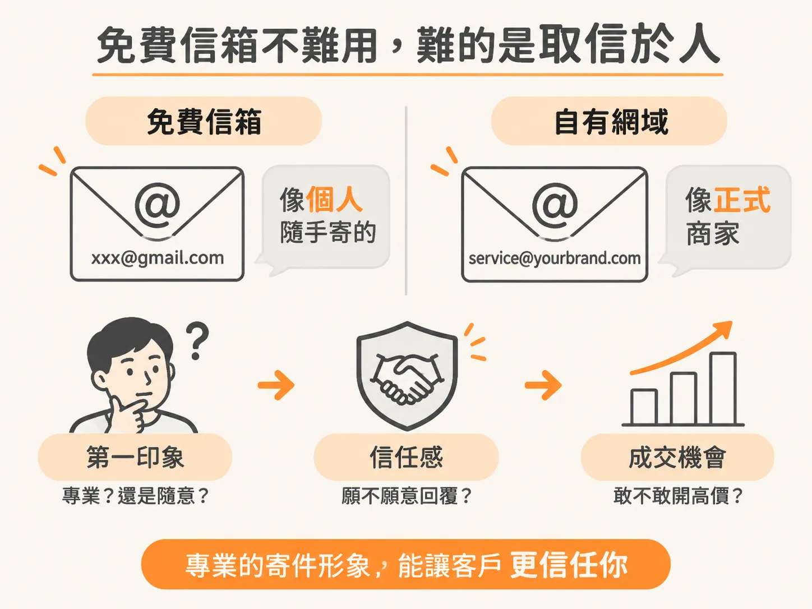
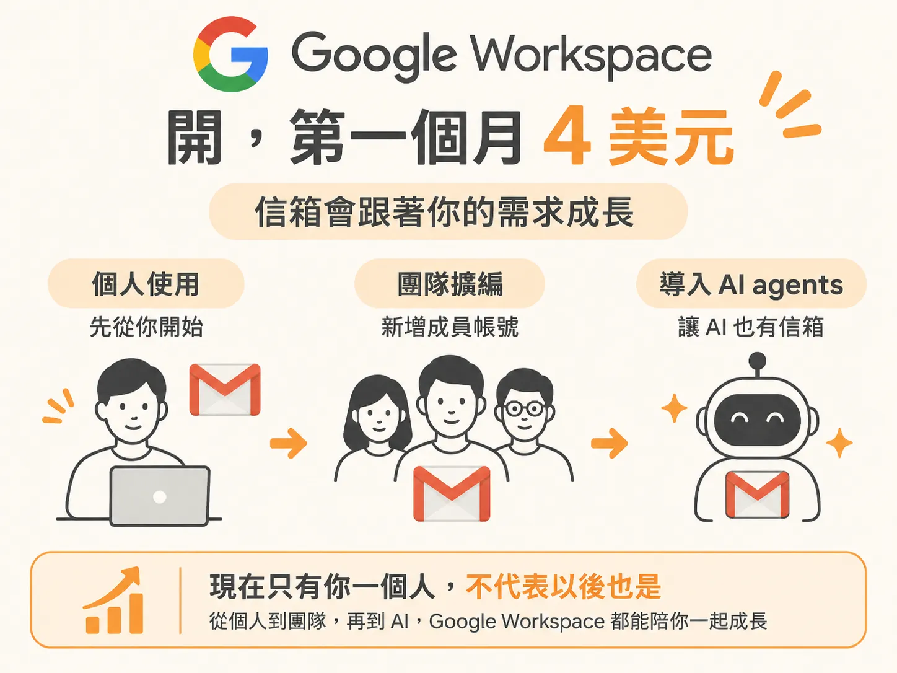
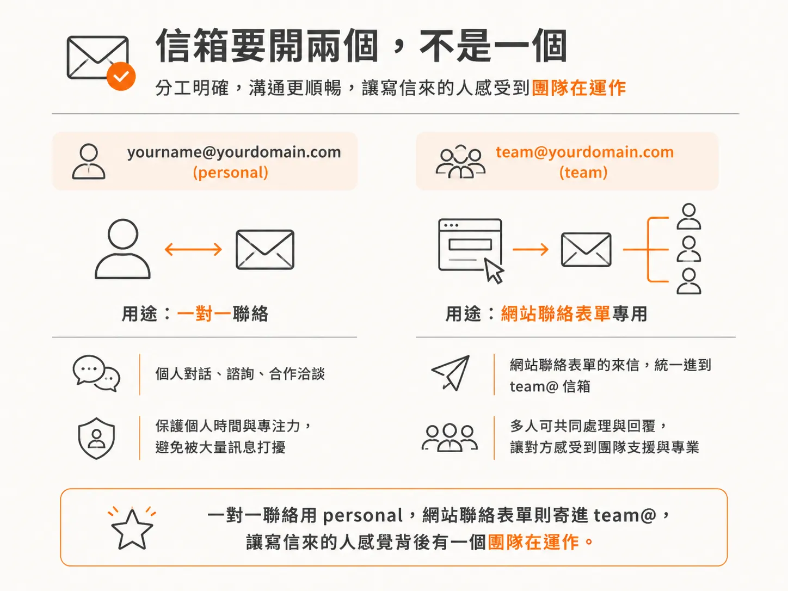

# 為什麼商業 Email 會拉高可信度，以及怎麼開兩個

網站上線了，上面放一個「跟我們聊聊」按鈕。真的有人按下去，看到的信箱卻是 `yourname@gmail.com`。他心裡大概只會冒出一個念頭：這個人可能還沒開始認真做。

商業 Email 解決的就是這件事。你交付的東西沒變，變的是別人第一眼怎麼判斷你。

## Gmail 看起來業餘，不是因為它不好用

用 Gmail 收發信完全沒問題。問題出在對外：信箱掛著 gmail.com，看起來就像還沒正式開始。

換成自己網域的地址，例如 `你的名字@你的品牌.com`，看起來就專業得多。你的生意跟著更有份量，價格也開得上去，信任感也跟著來；工作往來跟私人帳號自然分開。

還有一點常被忽略：對方會覺得你是認真的。很多客戶要不要回你，看的就是這個。

## 用 Google Workspace 開，第一個月 4 美元

開商業 Email，最直接的辦法就是 Google Workspace：把信箱掛在自己的網域上，第一個月 4 美元，之後每月約 8.40 美元。

它直接跑在 Google 的環境裡，Gmail、Google Drive 這些工具都能用在自己的網域上。

之後要加人，多開一個信箱就好。等你開始跑 AI agents、把它們當員工，也能替它們開信箱。現在只有你一個人，不代表以後也是。

## 開兩個，不是一個

多數人第一反應是開一個就好，這裡要開兩個。

第一個是 personal，用你自己的名字，像 `J@yourdomain.com`。一對一跟人往來，就用這個地址。

第二個是 team：`team@yourdomain.com`，這個才是重點。

## team@ 要放在網站上，不是拿來自己收信

team@ 的用途很單純：它就是網站上的聯絡地址。

把「跟我們聊聊」按鈕後面的聯絡表單接到 team@。訪客送出表單，信就進到這裡。他看到的不是某個人的名字，而是一個團隊的信箱。

這件事跟實際有幾個人無關。就算現在只有你，加上幾個 AI agents，對方看到的還是一個團隊在運作。

等你開始找客戶，這件事會更有感：做這種服務生意，專業感和正當性就是本錢。

## 做完的樣子

做到這裡，你手上有兩樣東西：

- 一個真的上線的網站，別人聯絡得到你。
- 一個專業的信箱，未來的客戶可以用它找到你。

這兩樣不需要完美，只需要存在。之後再改都來得及。
