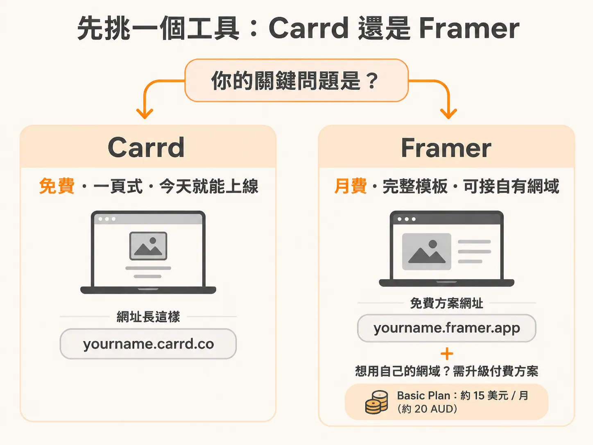
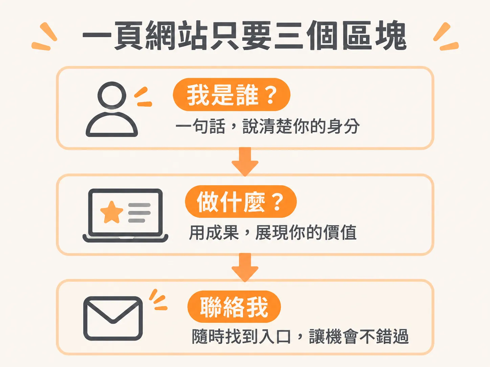
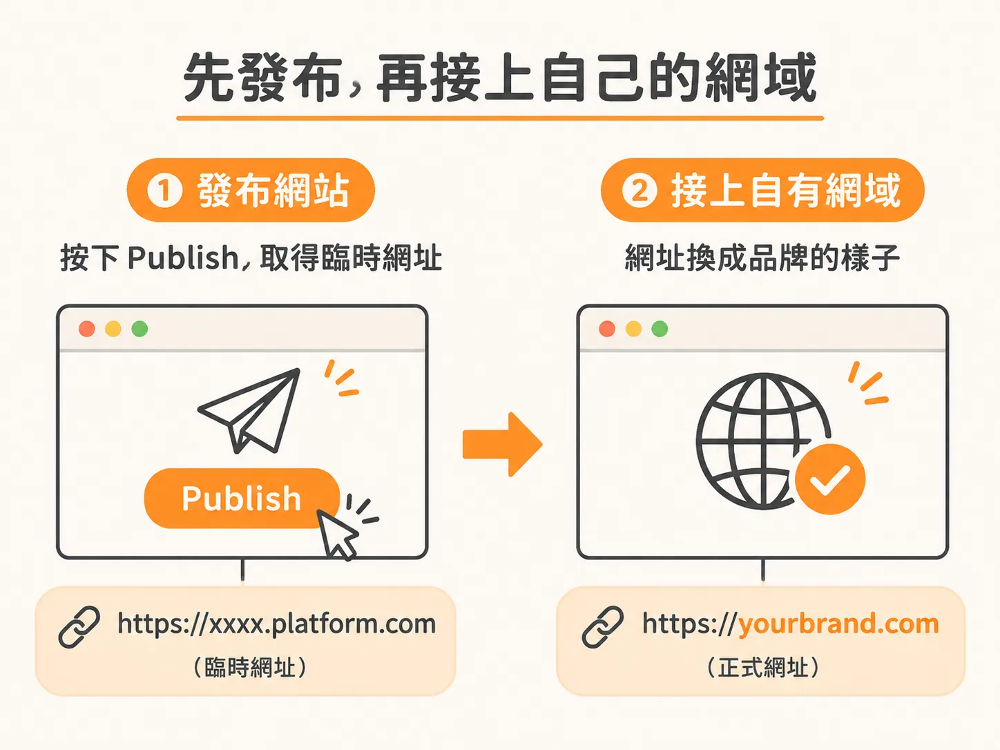

# 先有一個可以給人看的網址

名字想好了，網域也先保留著。接下來要讓網站真的存在。

標準不用訂太高。網站不用完美，先存在就好，之後隨時能改。現在只要有一個網址可以給人看，讓你能開始跟別人介紹這家新公司。

## 先選工具：Carrd 還是 Framer

最省事的做法，是找一個模板多的網站平台，別從空白頁開始。

**Carrd** 最簡單。它能做一頁式網站，一頁網站需要的東西都放得進去，你的 agency 和 practice 都行。免費模板有好幾套可以直接拿來用，挑一個，今天就能讓一個乾淨的網站上線。

**Framer** 適合想再專業一點的人。它要月費，但模板涵蓋各種服務和網站類型。你可以搜尋 tech agency 的版型，也能只篩選免費模板。網站看起來更正式，改起來一樣容易。

判斷只看兩件事：你現在要不要花錢，還有要不要立刻看起來專業一點。

- 只想先有東西可以給人看，成本壓到零：選 Carrd。
- 願意付月費，換一個更像樣的門面：選 Framer。

Framer 的免費方案會給你一個子網域，結尾是 Framer 自己的網域名稱，不是你的品牌網域。要接自己的網域，就得買付費方案。它的 basic plan 是 20 AUD，大約一個月 15 美元。

## 從模板開始，只改必要的欄位

選好模板先預覽。只要看起來沒問題，就按「use for free」開始編輯。

每一欄都能直接改。標題欄換成你的一句話，例如「AI solutions for every business」。Logo 換成你自己的。模板如果有合作夥伴的 logo 區，也可以放進去。

模板常附帶一堆你現在用不到的區塊。把它們選起來、按右鍵隱藏，畫面上留越少東西越好。

Framer 也能切到平板和手機的檢視畫面，看小螢幕排版有沒有跑掉。調完就按 publish。

## 一頁網站只需要三個部分

模板預設塞了很多內容，但填好三個部分就夠用：最上面一句 tagline 說你是誰，中間一段講你做什麼，再放一個找得到的聯絡方式。見證、案例研究和更細的服務說明，之後再補就好。

這三塊怎麼寫，下一頁會一塊一塊拆。先把工具定下來、頁面發出去，有一個網址可以打開，再回頭雕文案。

## 發布，然後接上自己的網域

按了 publish，馬上就會有一個網址。點開它，再傳到手機，確認網站真的連得到。

這個網址是平台給的。想換成自己的網域，就把已經買好的網域接上去。Framer 有 connect existing domain 選項，但要付費方案；Carrd 也能接自訂網域。

接好之後，你就有一個正式對外的網址，裡面是你的品牌名稱加自己的網域。這個連結可以給別人看、貼進訊息，也能放進貼文。

## 今天要完成的動作

選一個工具，不要兩個同時研究。想零成本、今天就上線，就用 Carrd 的免費模板。想一次到位，也願意一個月付 15 美元，就用 Framer 的 basic plan，順便把網域接上。

填完三個欄位：一句 tagline、一段用結果描述「你做什麼」的文案、一個顯眼的聯絡方式。按 publish，把網址傳到手機，確認打得開。今天要交的就是這個網址。
