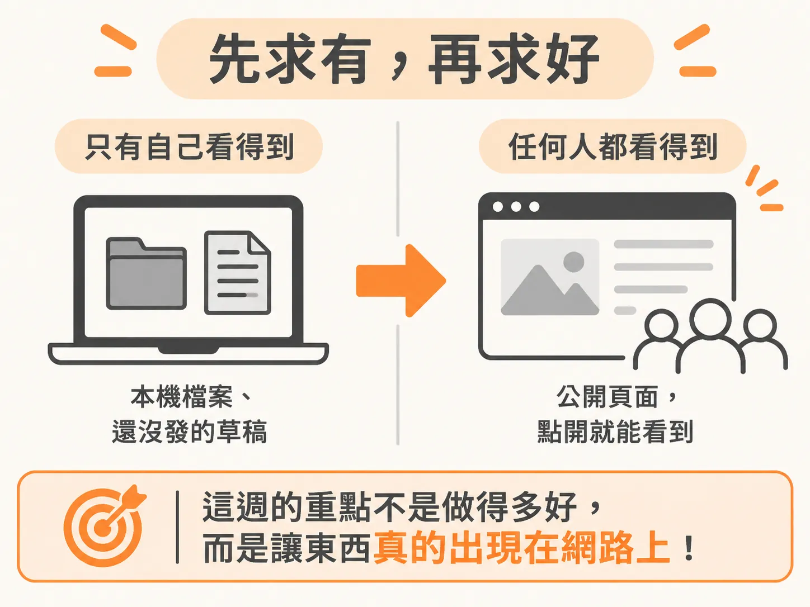
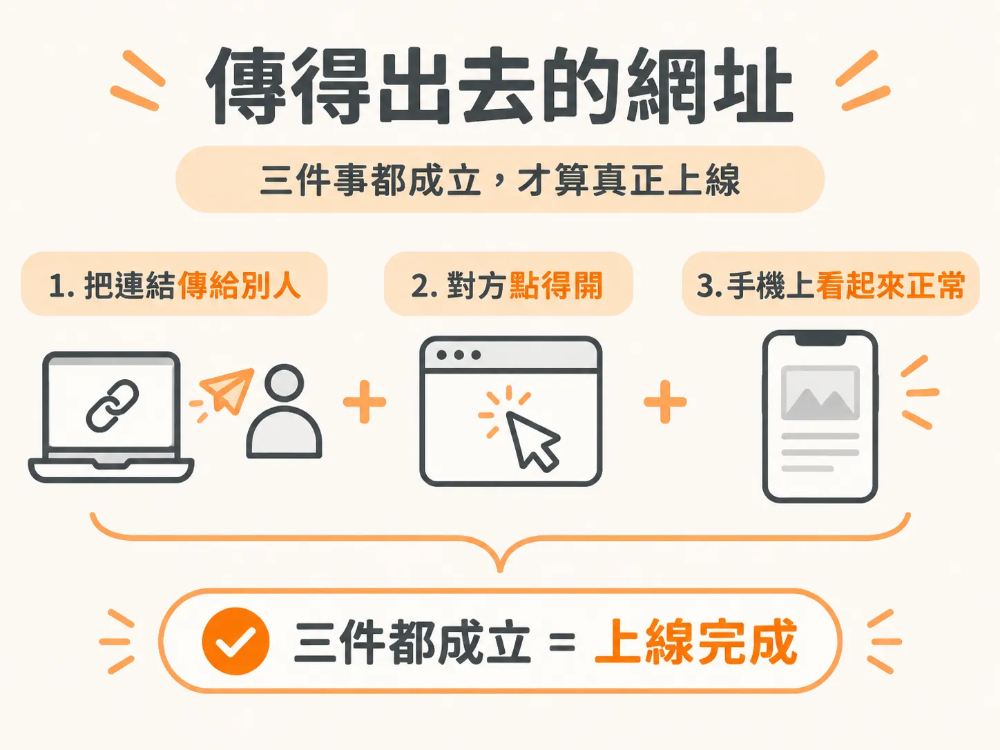
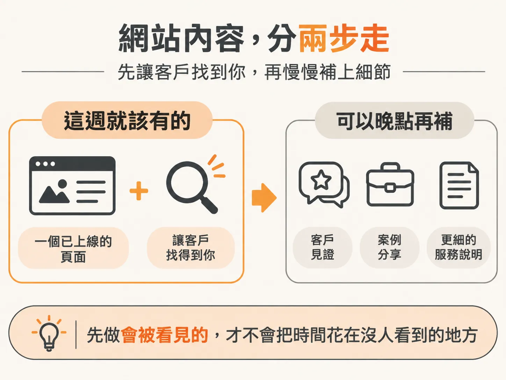

# 本週重點：Going Live

上週你打好了地基：一個名字、一個網域、一個 logo。但這些目前只有你看得到。別人不知道你在做什麼，也不知道要去哪裡找你。這一週的任務，就是把這些從私人的實驗，變成別人找得到、信得過，也願意花錢請你做的東西。

## 不用完美，先存在就好

網站最常卡住的地方，就是想做到好才敢公開。這個順序是反的。它現在不用完美，只要存在就好，因為之後隨時可以再改。

剛開始做，簡單就好。你不是在參加設計比賽，不用想太多。現階段的目標只有一個：做出一個能指給別人看的東西。

## 交付物是一個可以分享的 URL

這一週的目標講白一點，就是一個可以分享的網址。當你把連結貼出去，對方點得開、手機上也看得到，你才算真的在網路上有一個位置。

在那之前，你做的都還只是準備。有了那個 URL，你才能開始跟人說你剛成立的公司在做什麼。

## 這一週不是只有網站一件事

網站上線之後，還有兩件事要一起到位。一個是商務信箱：客戶往來走這個信箱，跟你的私人信箱分開，看起來也專業得多。另一個是第一則公開貼文，跟網路上的人說清楚你做什麼、幫誰。

這兩件事其實在補同一個洞：讓找到你的人覺得你是真的在做生意，不是一個週末的 side project。

## 其他元素都可以晚點再補

網站上還有很多東西可以放：客戶見證、案例研究、更細的服務說明。這些現在都不用急。先有一個頁面讓別人看到，再看他們的反應決定要補什麼。

在還沒有人會打開的頁面上雕這些細節，只是把時間花在不會被看見的地方。

## 這一週結束時，你手上要有

一個真的上線、訪客能從上面聯絡到你的網站。理想上，還要有一個讓未來客戶聯繫得到你的專業信箱。這兩樣到位，你的服務就正式上線了。

接下來要做的，是真的把這條連結生出來：先挑一個工具、把頁面做出來，再補上一個像樣的 business email。等網址真的在你手上，你跟別人說這件事時，訊息裡才有東西可以附。
