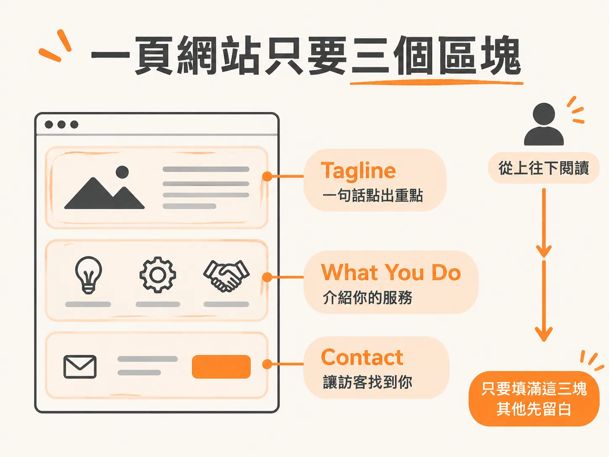
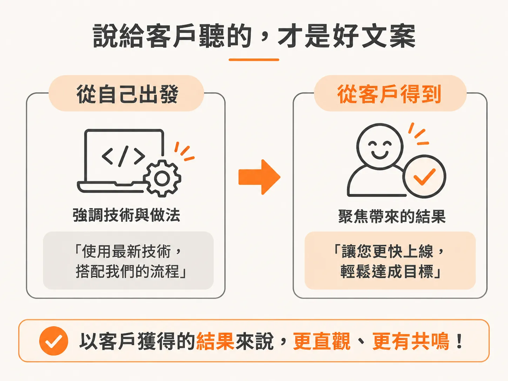
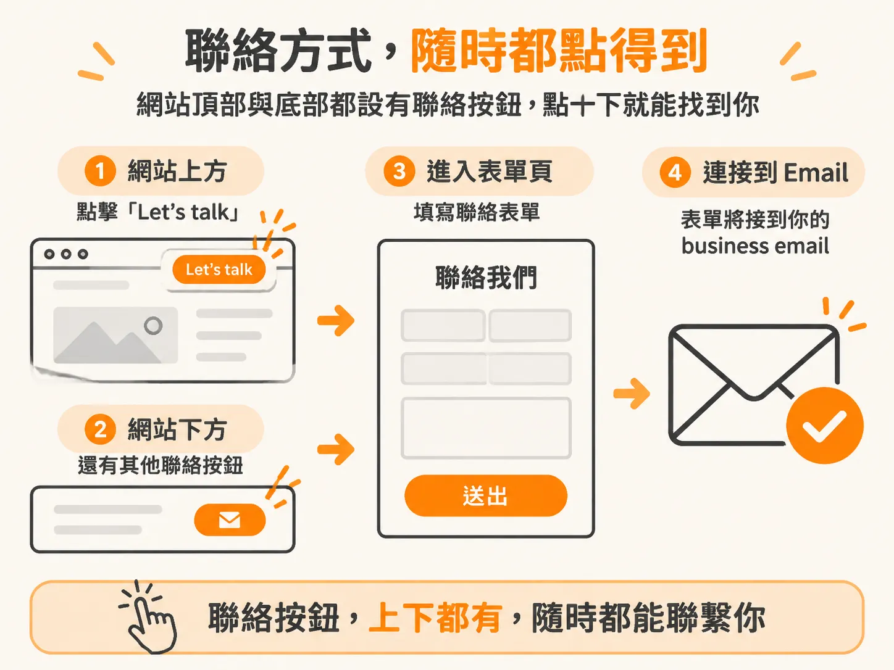

# 三個不可或缺的網站元件

上一頁結束時，你手上已經有一個打得開的網址。接下來要決定的是：訪客打開之後，看到什麼。

先說一件讓人安心的事：網站不需要完美，只需要存在，之後隨時可以改。所以這一頁只談頁面上要寫的三塊內容。

## 只寫三塊，其他先不管

模板一打開就有一堆現成元素：合作夥伴的 logo 牆、案例區、服務列表。這些很容易讓人不知道從哪下手。其實只要專心寫三塊，其餘先留白。

第一塊是標題，也就是 tagline。

### 一、tagline：訪客讀到的第一句話

tagline 是 hook。訪客一打開網站，第一眼看到的就是它；它要抓住注意力，同時告訴對方你是誰。

可以從很泛的一句開始，像「AI solutions for every business」。想再精準一點，換成「AI solutions for content businesses」，或寫「helping companies automate what slows them down」。心裡已經有特定產業，就把產業放進標題。

### 二、what you do：講對方得到什麼

第二塊是 what you do。寫得多具體、範圍多大都行，但最有效的做法是用結果來寫：先講對方得到什麼；你用了什麼技術，之後再說。

RoboLabs 的網站就是這樣寫：我們打造 AI agent，讓你省下時間、觸及更多人、做出更多東西，靠的是我們幫你省下的時間。整段就這麼簡單。要避免的是，網站一開口就講得很複雜。

這段文案可以直接借去用，先讓網站有一個能上線的版本。之後慢慢知道哪種說法有共鳴，再改得更精準。

### 三、contact：最重要的一塊

第三塊是讓人找得到你，這大概是三塊裡最重要的。形式可以是表單、email，或預約會議的連結；重點是簡單，而且非常顯眼。

做法上，頁面最上面放一個「Let's talk」按鈕，往下捲也還有其他按鈕可以聯絡你。按下去會連到表單頁，表單再接到你的 business email。

這樣就夠了。testimonials、case study、更細的服務說明，之後再補。

三塊寫完，網站就有個樣子了。還差一樣東西，讓它看起來像真的在做生意：一個掛在自己網域上的 business email。那是下一頁要處理的事。
