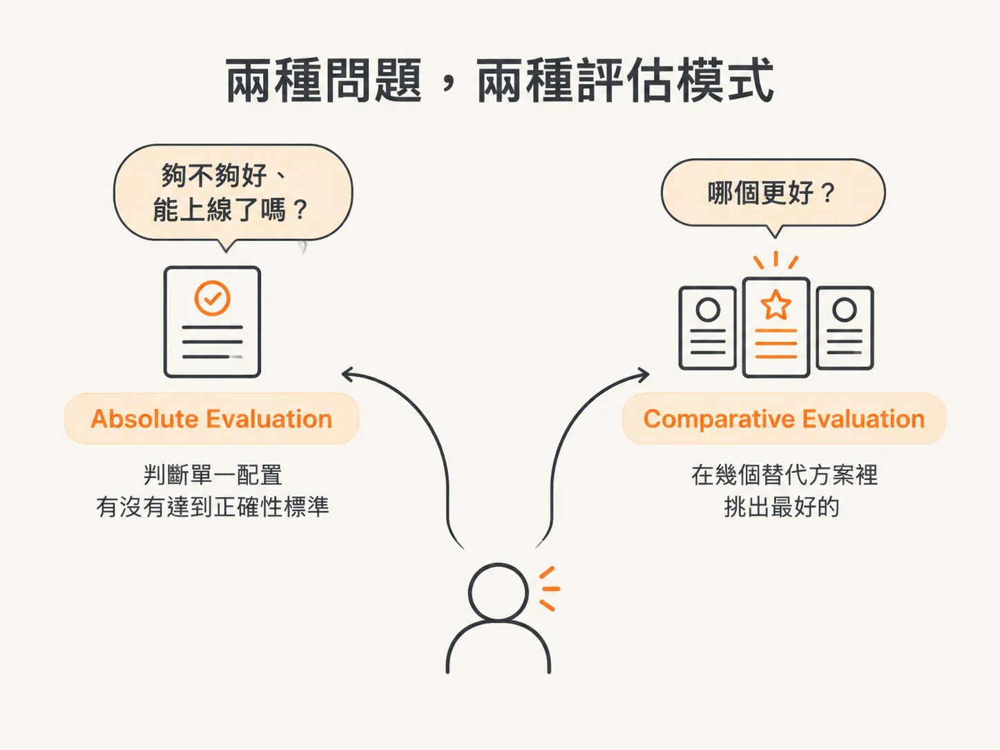
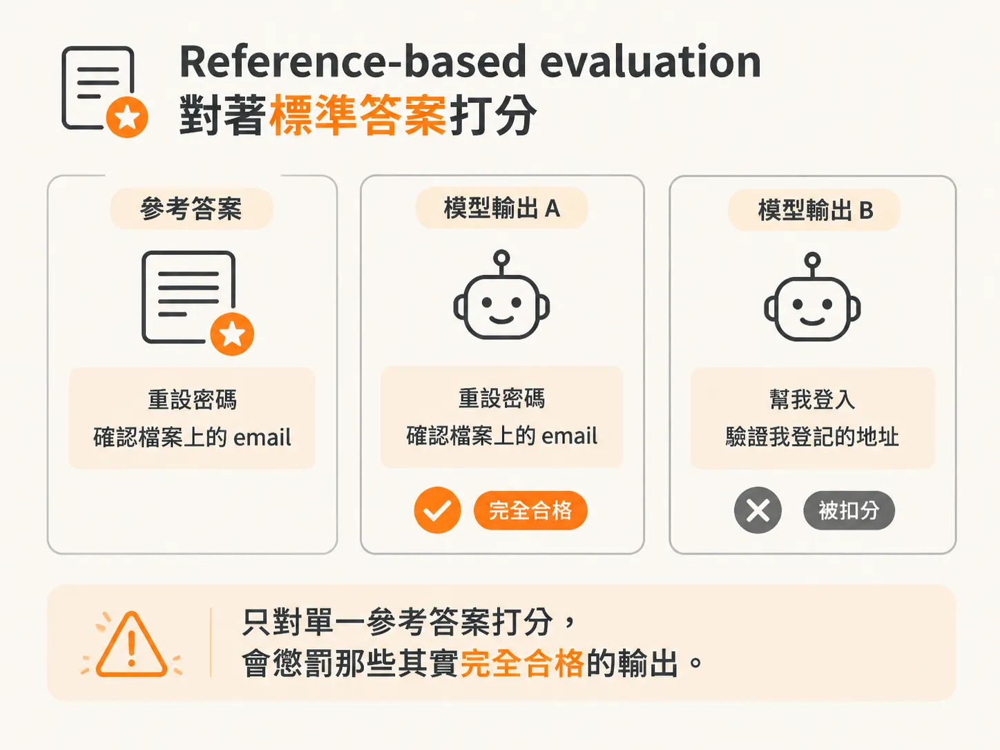
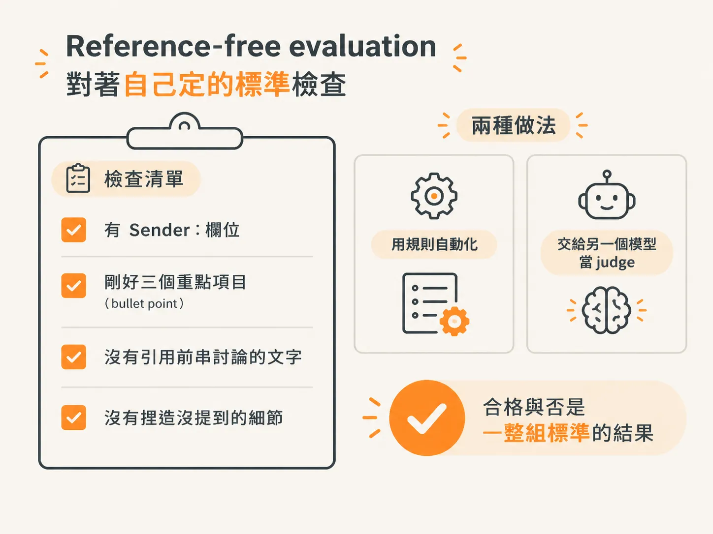
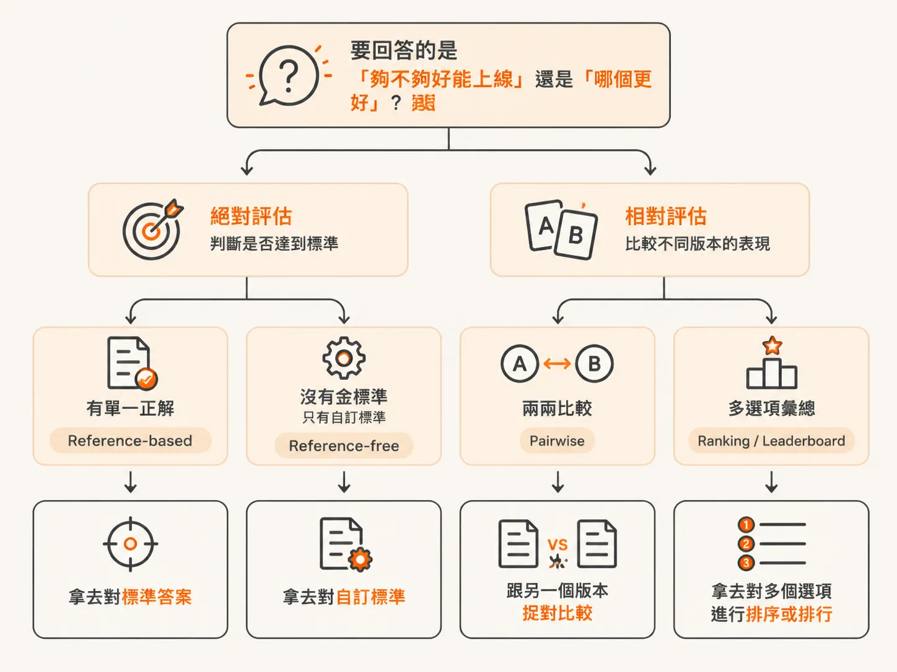

# Absolute vs comparative：reference-based、reference-free、pairwise 與 leaderboard

延續上一段留下的岔路：評估的設定在文獻裡很多，實務上也常常各做各的。不過，把這些設定整理起來，其實可以歸納成兩種高層次問題：

1. **這個系統夠不夠好，可以上線了嗎？**
2. **這幾個選項裡，哪一個更好？**

第一種問題需要 **absolute evaluation**，也就是判斷系統有沒有達到某個正確性標準。

第二種問題需要 **comparative evaluation**，也就是在幾個替代方案之間，找出表現最好的選項。

沿著這兩種問題往下看，absolute evaluation 底下有 **reference-based** 與 **reference-free**，comparative evaluation 底下有 **pairwise** 與 **leaderboard**；最後回到一個實務判斷：你現在要回答的，究竟是「夠不夠好」，還是「哪個更好」。

## 兩種問題，兩種評估模式

先建立一個簡單的心理模型。

**Absolute evaluation** 判斷的是：單一配置（例如某個 prompt、模型或工具設定）是否已經正確到足以出貨。

**Comparative evaluation** 比較的則是：多個選項之間，哪一個表現更好。常見形式包括 A/B test、pairwise、ranking 或 leaderboard。

這兩種模式會貫穿整本書。之後每次你想判斷「這次改動值不值得」時，第一步就是先分清楚自己正在回答哪一種問題。

## Absolute evaluation：多數團隊的起點

Absolute evaluation 是多數團隊開始做評估的地方。

假設你已經做出一個系統，例如一個搭配第一版 prompt 的 email 摘要器。現在你想知道，它到底夠不夠好用。

這代表你要先定義「夠不夠好」的意思，再檢查輸出是否達到那條標準。文獻裡，absolute evaluation 的指標通常可分成兩類：

- **Reference-based evaluation**
- **Reference-free evaluation**

## Reference-based evaluation：對著標準答案打分

Reference-based evaluation，是把模型輸出拿去和標註資料比對。這些標註資料通常稱為 **ground truth**，也就是標準答案。

依照任務不同，ground truth 可能是：

- 人工撰寫的摘要
- 抽取出的欄位，例如名字或日期
- 分類標籤
- 一筆結構化紀錄

以 email 摘要器為例，你可以準備一份 email 資料集，每封信都附上一份人工撰寫的摘要。接著，再替每個模型輸出打分數。

評分方式可以是：

- **exact match**：是否完全一致
- 和參考答案的重疊程度
- 語意相似度

這種方法吸引人的地方，是它提供了相對清楚的是非判斷。不過，它也有兩個問題。

第一，製作標註資料的成本很高。

第二，很多任務本來就不只有一個正確答案。比如同一封 email，可能有兩種都合格的摘要：

- 「重設密碼；確認檔案上的 email」
- 「幫我登入；驗證我登記的地址」

只對著單一參考答案打分，會懲罰那些其實完全合格的輸出。

因此，我們建議：只有在確實存在單一正確答案時，例如確認某個欄位是否抽取正確，才使用 reference-based 方法。

## Reference-free evaluation：對著自己定的標準檢查

Reference-free evaluation 則是把輸出拿去對照自己定義的標準，不需要準備一份標準答案。

以 email 摘要器為例，你可以檢查輸出是否：

- 包含 `Sender:` 欄位
- 剛好產出三個 bullet point
- 沒有引用前一串討論中的文字
- 沒有捏造 email 裡沒有提到的細節

這裡的「正確」，通常是一組標準的總和，例如：

- 格式是否正確
- 內容是否完整
- 是否符合事實，也就是 factuality

它不是要求輸出對上某一個唯一答案。這些檢查可以用規則自動化，也可以交給另一個模型擔任 judge。

多數團隊剛開始做自己的應用時，手上並沒有已經標註好的資料集。因此，reference-free evaluation 是一個務實的選項，這也是本書主要聚焦這類方法的原因。

不過，當你確實有能力準備 reference data 時，這項投資的回報很可觀。即使只有一小批人工標註的「golden」輸出，例如 50 到 100 個例子，也能提供一組 ground truth，用來：

- 驗證自動化 judge
- 在已知良好的案例中找出 regression
- 隨著時間衡量系統是否進步

第 3 章介紹的 error analysis 流程，本身就會在閱讀與標註 trace 的過程中，順帶產出這些已標註的例子。

## Comparative evaluation：從「對不對」換成「哪個更好」

當你手上已經有一個大致能運作的系統，下一步可能是比較不同替代方案，例如：

- 不同的 prompt
- 不同的模型
- 不同的 retrieval 方法

這時候，問題不再是「這個輸出夠正確嗎？」，而是「這幾個選項裡，哪一個更好？」

Comparative evaluation 通常會採用以下其中一種形式。

## Pairwise comparison：兩兩捉對

Pairwise comparison 的做法是：針對每一個輸入，產生兩份輸出。

一份來自 prompt A，另一份來自 prompt B。接著，請一個 evaluator（可能是人，也可能是模型）判斷哪一份更符合指定標準。

以 email 摘要器為例，評估問題可能是：

> 哪一份輸出更準確地捕捉到寄件者的請求，而且沒有加油添醋？

這種方式就像讓兩位選手直接對決，適合快速判斷兩個方案之間誰比較好。

## Ranking 與 leaderboard：多個選項一起排

Ranking 與 leaderboard 不只比較兩份輸出，而是讓 evaluator 對同一個輸入的多個選項排序，通常是三個以上。

把這些排名跨很多輸入彙整起來，就能得到系統層級的分數，並以 leaderboard 的形式呈現。這有點像把許多場比賽的名次累積起來，最後排出整季排行榜。

像 LMArena 這樣的公開 benchmark，就使用這種格式比較不同的 AI 模型。有些公司也會維護內部 leaderboard，追蹤哪個 prompt、模型或配置表現最好。

## 這本書為什麼不深入 comparative evaluation

本書不會深入探討 comparative evaluation，因為多數團隊一開始遇到的瓶頸，是先把單一配置做到穩定可靠。

等到你已經有一個能運作的系統，想在不同替代方案之間做選擇時，comparative evaluation 才會變得有用。這些替代方案可能是：

- 兩個 prompt
- 兩個模型
- 兩種 retrieval 策略

到了這個階段，pairwise comparison 是早期開發決策中，快速又低成本的方法。

但如果是會對使用者造成可量測影響的 production 變更，統計上更嚴謹的 A/B testing 會比較合適。

第 9 章會說明，如何把 comparative evaluation 放進 CI/CD 流程。

## 回到那個判斷：你要回答哪一種問題？

可以把整篇文章收束成一個決策。

先問自己：現在要回答的是「夠不夠好、能不能上線」，還是「哪個更好」？

如果是前者，你需要 **absolute evaluation**：

- 有標準答案，而且確實只有單一正解：使用 **reference-based**
- 沒有 gold answer，只有一組自訂標準，例如格式、完整度與 factuality：使用 **reference-free**

如果是後者，你需要 **comparative evaluation**：

- 早期想快速比較：使用 **pairwise**
- 想把多個選項的結果彙整成系統層級排名：使用 **ranking** 與 **leaderboard**

分清楚這個岔路，你才知道手上的 trace 應該拿去對標準答案、對自訂標準，還是拿去和另一個版本兩兩比較。

