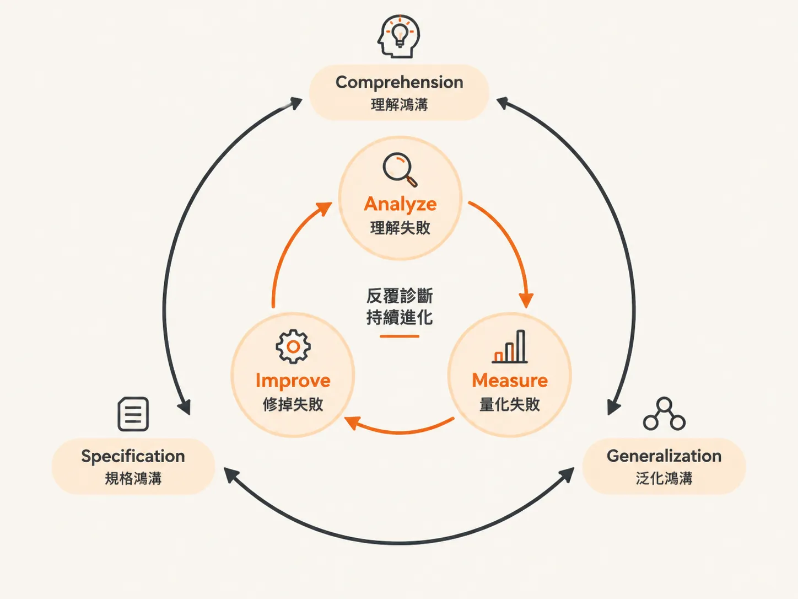
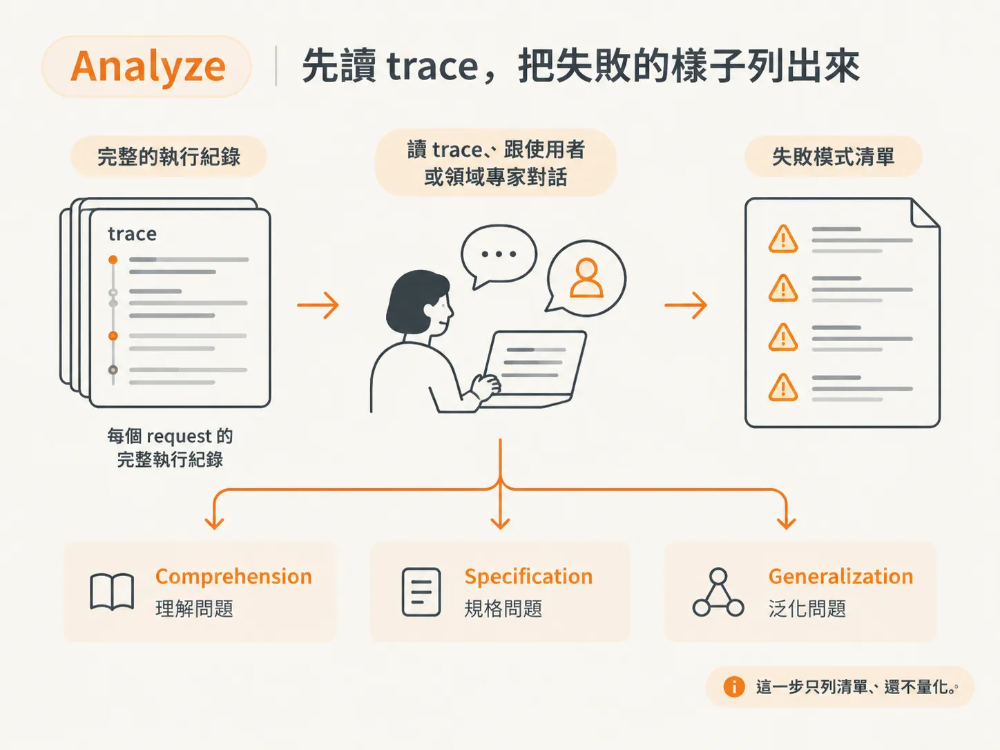
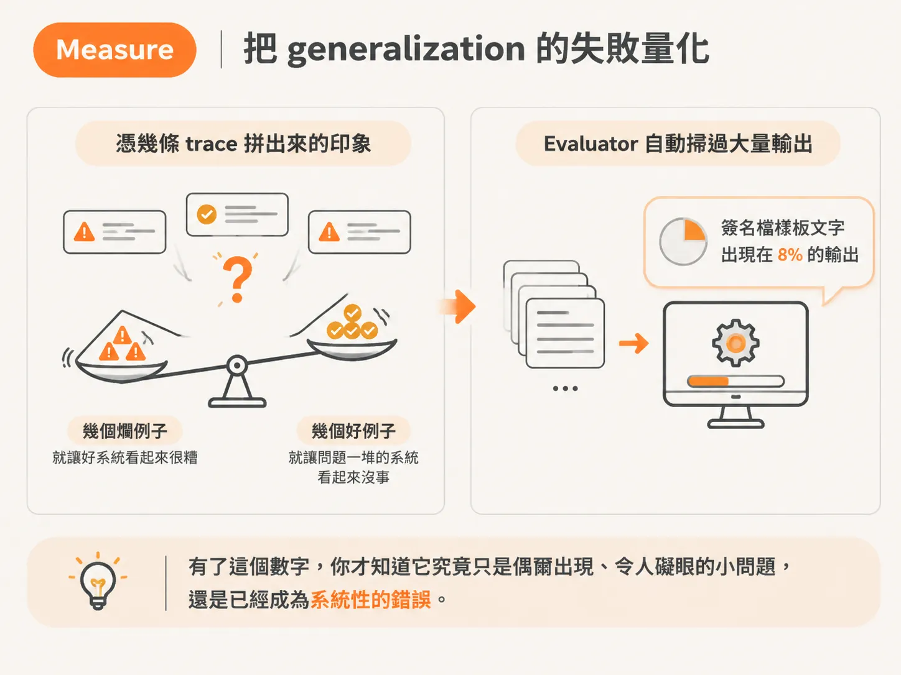
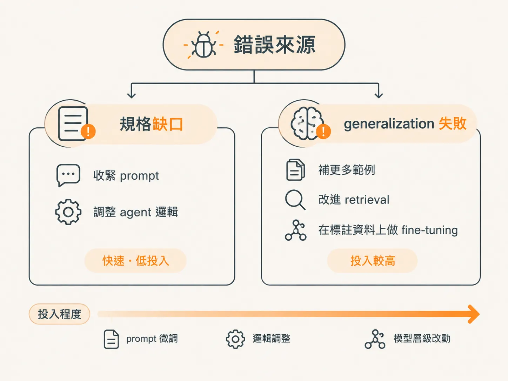

# Analyze–Measure–Improve：把 gulf 變成可重複的診斷迴圈

上一段把 LLM 出錯的方式拆成三個 gulf：Comprehension、Specification、Generalization。

知道這三個名稱很有用，但光記住名詞，並不會告訴你下一步該做什麼。你需要的是一套能反覆執行的流程，讓每一輪都清楚知道：現在該看哪裡、要產出什麼。

**Analyze–Measure–Improve lifecycle** 把三個 gulf 串成一個診斷迴圈：

- **Analyze**：系統性地理解失敗
- **Measure**：量化失敗
- **Improve**：修正失敗

這是一個迭代框架。每跑一輪，你都能更清楚自己面對的是哪一個 gulf，也能更準確地判斷這個應用需要多嚴謹的 evaluation。

## Analyze：先讀 trace，把失敗的樣子列出來

迴圈從 Analyze 開始。

這一步先別忙著算數字，重點是看真實的輸入與輸出，理解系統實際做了什麼。目標只有一個：找出 **failure mode**，也就是失敗的類型，還不用量化。

Analyze 最直接對應的是 **Comprehension** 這個 gulf。你得先弄清楚資料長什麼樣子，以及系統在這些資料上實際如何運作。

不過，讀 trace 的過程也常常會順便揭露另外兩個 gulf：

- 規格沒有寫清楚，也就是 **Specification**
- 規格明明清楚，模型卻還是出錯，也就是 **Generalization**

很多時候，這三種問題會在同一批 trace-reading 中一起浮現。

實務上，Analyze 主要做三件事：

1. **讀 trace**：查看每個 request 的完整執行紀錄，了解 agent 到底做了什麼。
2. **和使用者或領域專家討論**：確認什麼樣的結果才算正確。
3. **列出 failure mode**：把系統失敗的方式一條一條整理成清單。

舉例來說，你檢查一批 email 摘要，發現兩個反覆出現的問題：

- LLM 有時會把簽名檔裡的無關文字也放進摘要。
- LLM 有時又會漏掉最重要的請求。

這兩個觀察先告訴你，系統在哪裡出錯；接著也提供線索，讓你判斷問題究竟是規格沒寫清楚，還是 generalization 失敗。

## Measure：把 generalization 的失敗量化

完成 Analyze 之後，你會知道系統犯了哪些錯。

其中有些明顯是規格問題：prompt 沒有說清楚，修法通常比較直接。另一些則看起來像 **generalization error**：prompt 明明寫得清楚，LLM 在某些情況下卻還是會出錯。

Measure 這一步，主要處理後者，也就是需要量化的 generalization 問題。

核心問題是：每一種 failure mode 到底多常發生？這個比率低到什麼程度，系統才算仍然可用？

如果沒有測量，你只能靠手上幾條 trace 拼出印象。但印象很容易誤導你：幾個糟糕的例子，可能讓一個原本不錯的系統看起來很差；幾個剛好成功的例子，也可能讓一個問題重重的系統看起來沒事。

要在大規模資料上測量，就需要設計 **evaluator**，也就是自動檢查工具。它能替 trace 評分，讓你不必逐筆人工檢查。

evaluator 可以是根據規則撰寫的 **code-based** 檢查，也可以交給另一個 LLM 擔任 judge。

回到 email 摘要的例子。假設你已經把 prompt 寫清楚，但 LLM 還是會把整段簽名檔放進摘要。

這時，你可以寫一條 rule-based check，掃過幾千筆輸出，專門標出這些樣板文字。結果發現，這個問題出現在 **8% 的案例**中。

有了這個數字，你才知道它究竟只是偶爾出現、令人礙眼的小問題，還是已經成為系統性的錯誤。

## Improve：看錯誤的來源決定怎麼修

最後一步是 Improve。

你要根據 Analyze 與 Measure 找出的結果，決定如何調整系統。走哪一條修正路線，取決於錯誤的來源。

如果錯誤來自規格缺口，通常可以：

- 收緊 prompt
- 調整 agent 的邏輯

如果錯誤來自 generalization 失敗，可能就需要更強的手段，例如：

- 補充更多範例
- 改進 retrieval
- 使用標註資料進行 fine-tuning

這些改善方式，可以看成從低投入到高投入的一條路線：先從快速的 prompt 微調開始，再視需要進行模型層級的改動。

繼續用 email 摘要的例子來看。

假設測量結果顯示，「漏掉關鍵請求」是因為 prompt 從來沒有說清楚摘要要寫到多詳細。這就是規格問題。你可以把指令改成：

> 用三個精簡的 bullet point 摘要寄件人的請求。

但如果「名字混淆」的問題在 prompt 寫清楚後仍然存在，那就屬於 generalization 問題。

這時可能需要補充標註資料來訓練模型，或者直接改變設計：不要要求 LLM 從 email body 判斷寄件者，而是改從 email metadata 取得寄件者資訊。

## 把三個 gulf 接成一個迴圈

遇到一個表現不佳的 LLM 應用時，可以先問：

> 這個失敗掉進了哪一個 gulf？

- **Comprehension**：你還不了解輸入資料長什麼樣子，也不清楚系統在這些輸入上實際如何運作。這時先多看 trace，不要急著修改系統。
- **Specification**：你的要求還不夠明確，LLM 沒辦法照著做。這時要修改 prompt 或 agent 邏輯，把規格缺口補起來。
- **Generalization**：要求已經寫清楚，但 LLM 在某些輸入上仍然失敗。這時要先量化問題發生的頻率，再考慮加入更多範例、改善 retrieval，或進行 fine-tuning。

Analyze–Measure–Improve 這個 lifecycle，將這套診斷方式變成可重複執行的流程：

1. 分析 trace，找出 failure mode。
2. 測量這些問題有多常發生。
3. 套用適合的修法。
4. 把修正後的結果帶回下一輪分析。

每跑一圈，你對三個 gulf 的理解就會更清楚，也更能判斷這個應用需要多嚴謹的 evaluation。

不過，在往下走之前，還有一個更前面的岔路要先分清楚：你手上這個系統，要回答的是「夠不夠好、能不能上線」，還是「哪個更好」？下一段就把評估設定分成這兩類來看。
