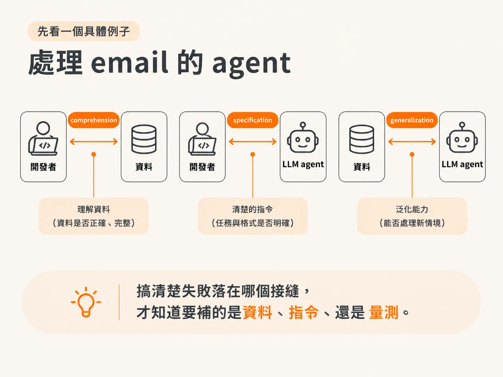
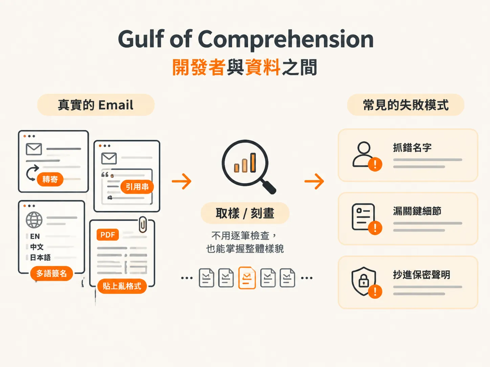
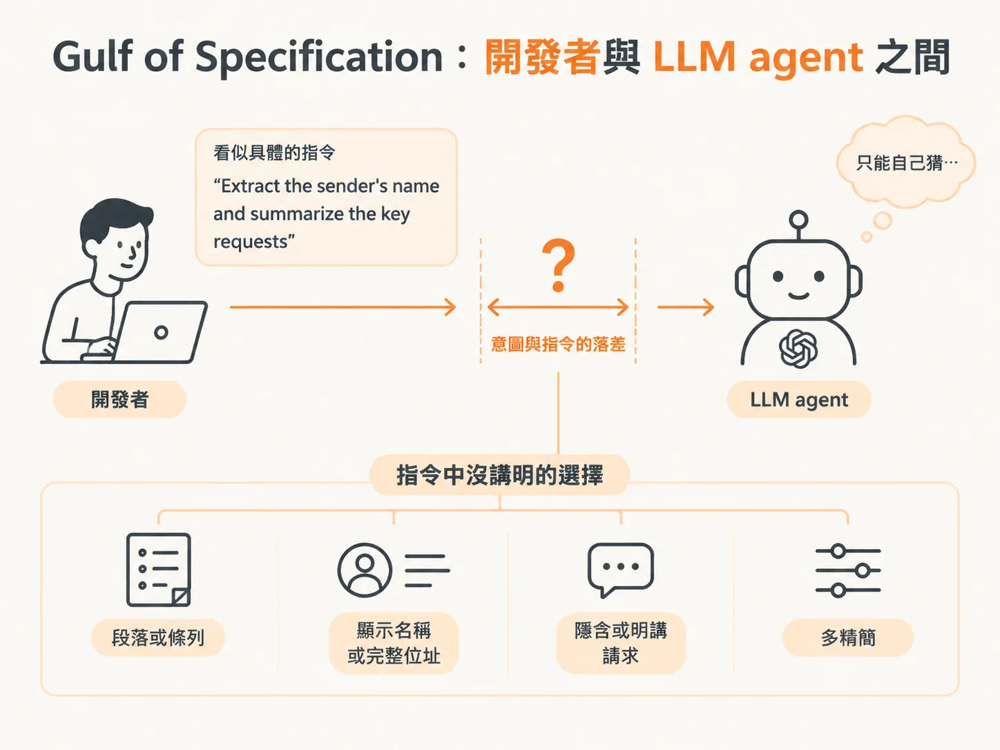
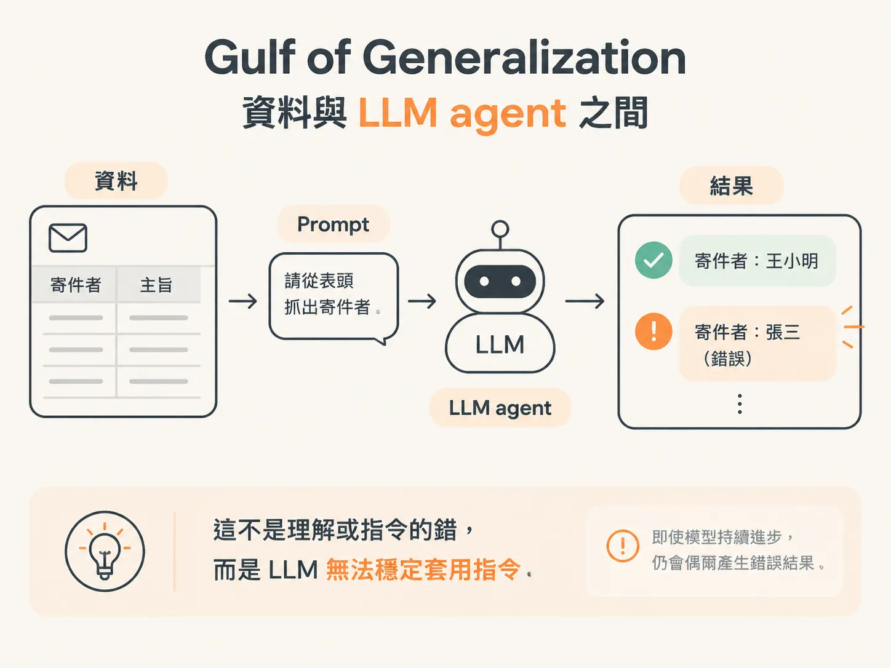
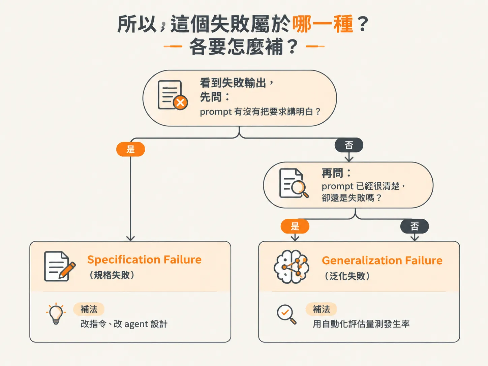

# Three Gulfs：comprehension、specification、generalization 各在哪裡斷掉

前面談到，Air Canada 的錯答案在顧客照著行動之前沒有人攔下來。但要攔下它，得先能說清楚它究竟錯在哪裡。當一個 agent 的表現不如預期，最省事的說法是：「模型壞了。」

但這不是診斷，也無法告訴你下一步該做什麼：要補資料、修改 prompt，還是量測它到底多常出錯？

Three Gulfs 這套框架，會把「壞了」拆成三個具體的斷點：**comprehension、specification、generalization**。這樣一來，碰到一段失敗的輸出，你就能判斷它卡在哪一關，以及該用什麼方法補起來。

這套模型改寫自 Shankar et al.（2025），並受 Norman（1988）啟發。它替開發與評估 LLM 應用時常見的三種落差命名，而這三個名稱也會貫穿整本書。

我們可以用它診斷應用為什麼失敗，再選擇對應的修正策略。它同時也是團隊共用的一套詞彙：與其爭論模型「哪裡怪怪的」，不如直接說這是 specification failure，也就是 prompt 沒把要求講清楚；或是 generalization failure，也就是 LLM 沒有穩定套用指令。這樣才能把討論帶到可以實際動手的地方。

## 先看一個具體例子：處理 email 的 agent

想像一個 agent，任務是處理寄進組織的 email：抓出寄件者姓名、摘要主要請求，再替信件分類。

乍看之下，這個任務似乎很單純。但在開發的不同階段，會各自撞上不同的 gulf。

先記住一個重點：這三個 gulf 不是「模型不夠強」的不同說法。它們分別發生在三個不同的接縫上——開發者與資料之間、開發者與 LLM agent 之間，以及資料與 LLM agent 之間。

搞清楚失敗落在哪個接縫，才知道要補的是資料、指令，還是量測。

## Gulf of Comprehension：開發者與資料之間

第一個 gulf 發生在開發者與資料之間。

要寫出有效的 prompt 和 agent，你得先真的搞懂輸入實際上長什麼樣子。少了這層認識，你設計的就會是「想像中的任務」，而不是真實世界裡的任務。

以 email 為例：如果你只看過幾封乾淨、格式工整的信，就開始撰寫 prompt，那麼指令可能只在這幾封信上表現良好。

但正式環境裡的資料，還可能包含轉寄信、夾著大段引用歷史的回覆、多種語言混在一起的簽名檔，以及從 PDF 貼過來、格式早已跑掉的文字。

忽略這些現實的 prompt，可能會讓 LLM 摘要整串引用討論，而不是只摘要最新寫的內容；也可能把簽名檔誤認成主要請求。

comprehension 不只適用於輸入端，輸出端也一樣。

你不可能把 LLM 產生的每一則輸出都讀過一遍，但仍然需要認得它「常見的成功方式」與「常見的失敗方式」。否則，很容易被幾個看起來不錯的例子誤導，漏掉只有在大量使用後才會浮現的問題。

以 email agent 來說，LLM 也許大多時候都能正確抓出寄件者，並寫出還算像樣的摘要。但仔細觀察後，可能會發現幾個反覆出現的毛病：

- 信中同時提到好幾個名字時，抓錯寄件者。
- 面對很長的信件，漏掉關鍵細節。
- 把保密聲明這類制式文字抄進摘要。

這些失敗也許不是每次都發生，但只要偶爾發生，使用者就可能覺得系統不可靠。

要補起這個 gulf，靠的是**在大規模上刻畫輸入與輸出**：不用逐筆人工檢查，也能掌握資料真正長什麼樣子，以及系統實際上是怎麼運作的。

## Gulf of Specification：開發者與 LLM agent 之間

第二個 gulf，發生在「我們想要的事」與「我們實際告訴 LLM 去做的事」之間。

我們心裡的意圖，往往只被 prompt 或 agent 邏輯鬆鬆地捕捉到。自然語言本來就不精確，措辭上的一點小落差，就可能造成行為上的巨大差異。

看看這句指令：

> Extract the sender's name and summarize the key requests in this email.

乍看之下，它似乎已經很具體，但其實還有許多重要細節沒有交代：

- 摘要要寫成一段文字，還是條列式？
- 寄件者要取顯示名稱、完整 email 位址，還是兩者都要？
- 隱含的請求要算進去，還是只處理明講的請求？
- 摘要要寫得多精簡？

這些選擇，LLM 沒辦法替你填好。你沒有說清楚，系統就只能自己猜；而這些猜測不會每次都符合你的期待。

這也是為什麼同一個 agent 跑兩次，可能產出不同的格式、不同的詳細程度，或是在邊界案例上採取不一致的處理方式。

specification 這個 gulf，指的就是我們的意圖與實際指令之間的落差。要補起它，就得把期待講明白，而且要讓這些期待貼近 agent 真正會看到的資料。

## Gulf of Generalization：資料與 LLM agent 之間

第三個 gulf，發生在系統看到的資料，以及 LLM 如何 generalize 到這些資料之間。

即使你已經充分掌握輸入，也寫出了清楚、範圍明確的 prompt，LLM 仍然可能犯錯。LLM 不是完美的，它就是會出錯。

例如，你已經把「要從 email 表頭抓出寄件者姓名」講得很清楚。大多數時候，LLM 也確實照做。

但偶爾，當信件本文提到另一個人——例如某位公眾人物——LLM 可能會錯誤地回傳那個人的名字。

這時，你對資料的理解沒有錯，prompt 也沒有錯，問題純粹是 LLM 沒有穩定套用指令。也許模型對訓練資料裡看過的名字，存在特別明顯的偏誤。

這就是 generalization 這個 gulf：即使 comprehension 和 specification 都處理好了，LLM 的行為仍可能難以預測。

這類錯誤通常要等系統暴露在真實世界的多樣性中，才會顯現出來。而且這些錯誤無可避免——不管模型再怎麼進步，總會有產出錯誤結果的時候。

## 換個領域也一樣：客服與程式生成

Three Gulfs 不只適用於 email 處理。

以客服 chatbot 為例，comprehension 關注的是顧客查詢的完整多樣性，包括多語言訊息、錯字，以及一次提出好幾個問題。

specification 關注的是：什麼才算「好的」回覆？例如，一個應該轉接真人、卻只會一直道歉的 bot，很可能是指令沒把轉接條件講清楚，未必是模型特別笨。沒有明確規則，它就只能自己猜。

generalization 則可能表現在：chatbot 能把帳務問題處理得很好，卻在比較少見、產品特有的問題上失手。

換成程式生成助理，comprehension 關注的是開發者實際上怎麼描述需求。這些描述往往很模糊、脈絡不完整，還會引用到沒有文件化的內部 API。

specification 關注的是輸出格式、錯誤處理方式，以及程式碼風格慣例。

generalization 則可能表現在：模型能寫出正確的 Python，卻在較冷門的程式語言，或複雜的多檔案修改上失手。

每個應用該採用什麼評估策略，取決於哪一個 gulf 才是失敗的主要來源。

## 所以，這個失敗屬於哪一種？各要怎麼補？

這套框架真正派上用場的時機，是你開始檢查輸出，也就是開始關閉 comprehension 這個 gulf 之後。

你必然會看到錯誤。接下來的問題是：這些錯誤，是 specification 沒講清楚，還是 generalization 撐不住？

判斷路徑其實很直接。

如果 prompt 沒有把要求講明白，那多半是 specification 的問題，你可以用更好的指令或 agent 設計來修正。

如果 prompt 已經寫得很清楚，LLM 卻還是失敗，那問題就落在 generalization。這時要靠自動化評估，量測這類錯誤到底多常發生。

三種補法可以這樣記：

- **comprehension：補「認識資料」**  
  用大規模刻畫輸入與輸出的策略，了解資料真正的樣子，以及系統實際上的行為。

- **specification：補「把意圖講明」**  
  把期待寫成明確指令，並讓指令對齊 agent 實際會看到的資料。

- **generalization：補「量測頻率」**  
  既然錯誤無可避免，就用評估器量出錯誤發生率，再判斷這個比率是否仍在可接受範圍內。

## 為什麼這件事不是一次性的？

評估 LLM 應用之所以困難，是因為每個應用都得在自己的情境中，重新替三個 gulf 搭橋。

評估是反覆迭代的過程，沒辦法做一次就結束。需求往往要等你真的接觸過真實輸出，才會慢慢變清楚。

而且，不同應用能靠使用者自己補上這些落差的程度，也差很多。

以 coding assistant 為例，也許可以假設工程師本身具備足夠能力：他們知道如何精確描述需求，讀得懂生成的程式碼，也能找出其中的錯誤（comprehension），還能執行測試，抓出 LLM 沒有 generalize 好的地方。

但換成由 LLM 驅動的個人造型師，情況就不同了。

使用者可能根本不知道該怎麼把需求講清楚，這時應用本身就得主動問清楚，例如問天氣、問正式程度，把 specification 的落差縮小。

使用者也不容易察覺 generalization 的失敗。看到系統提供的 casual 冬裝建議不錯，就可能以為同樣的建議也適合冬天婚禮；但這個假設未必成立。

所以，有效的評估取決於你如何思考每個 gulf 在自身應用中的「賭注」有多高。

如果某個落差的賭注很高——因為使用者難以自行發現錯誤，或錯誤代價很大——就得設計更嚴謹的流程，把那個落差補起來。
