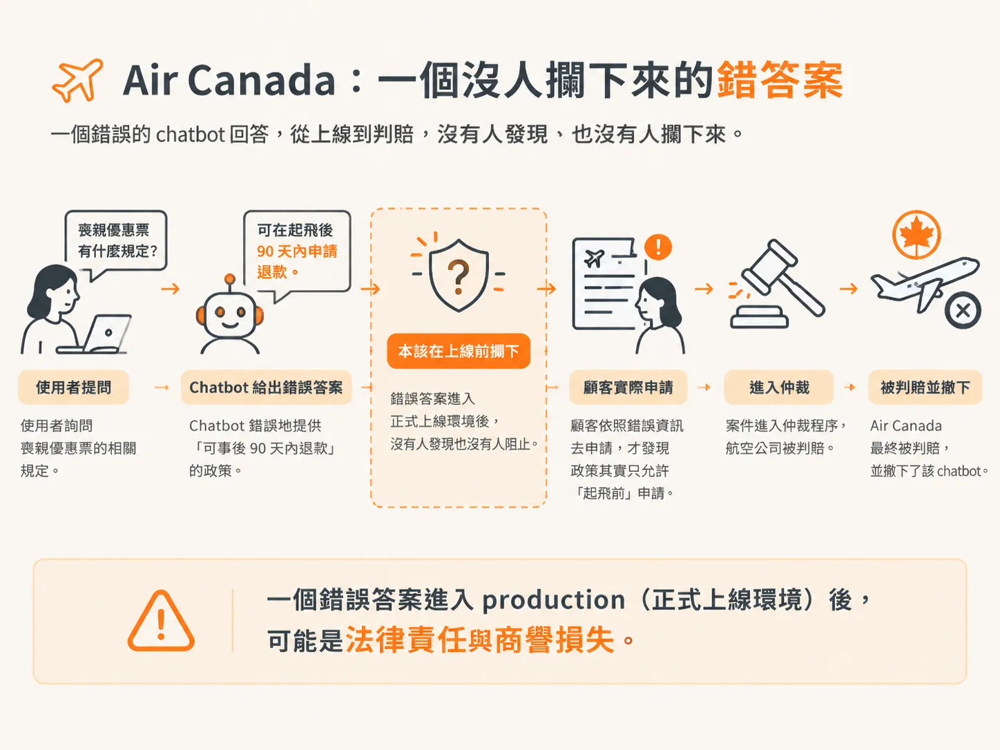
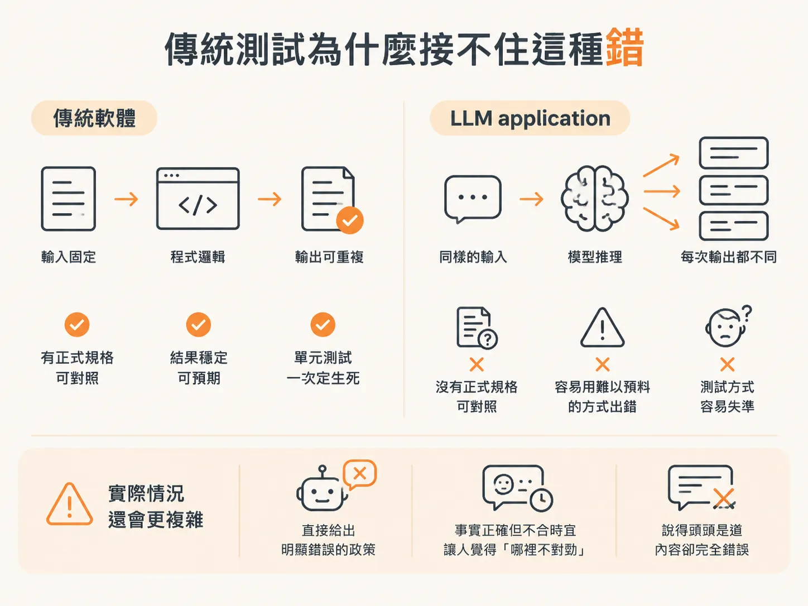
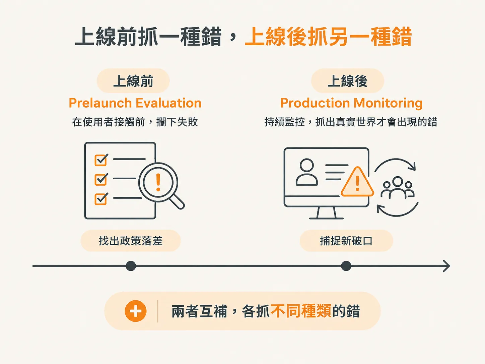
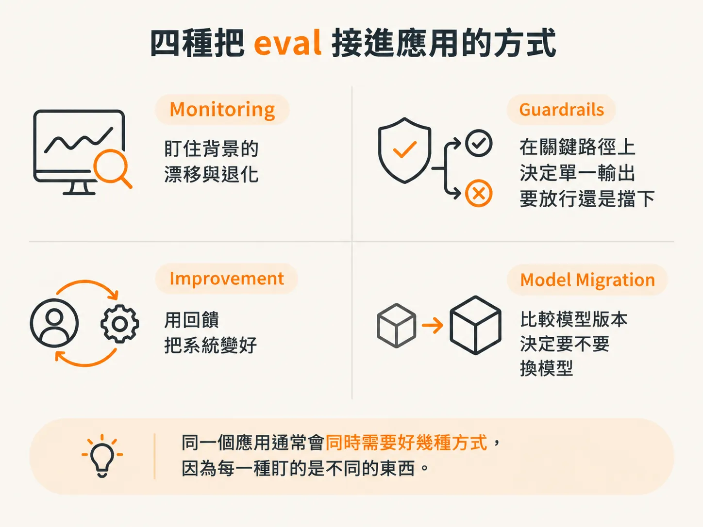

# 為什麼 LLM 讓傳統軟體測試失效：Air Canada 與四種 eval 用法

「你的 chatbot 說錯一句話，公司要賠錢。」

這件事 2022 年底真的發生過，就從這裡談起 **evaluation（評估）**。

## Air Canada：一個沒人攔下來的錯答案

2022 年底，一位名叫 Jake Moffatt 的乘客，在祖母過世後需要臨時訂機票，於是造訪 Air Canada 官網。

他詢問客服 chatbot，能不能購買**喪親優惠票**（bereavement fare，也就是許多航空公司提供給奔喪旅客的折扣票）。

chatbot 給了錯誤答案。它告訴 Moffatt，可以先買一般票，之後再於航班起飛後 90 天內申請喪親優惠退款。

但 Air Canada 的實際政策是：喪親優惠只能在航班起飛**之前**申請，起飛後就不行。

後來，Moffatt 真的提出退款申請，卻遭到航空公司拒絕。他因此將案件提交至卑詩省民事糾紛仲裁庭（British Columbia Civil Resolution Tribunal）。

2024 年 2 月，仲裁庭判 Moffatt 勝訴。仲裁庭駁回航空公司「chatbot 是獨立法律實體」的說法，認定 Air Canada 必須為 chatbot 憑空捏造的政策負責。航空公司被判賠，之後不久也將 chatbot 從官網撤下。

沒有人確切知道 chatbot 為什麼會答錯。

可能是它讀到某段政策文字後轉述錯誤，也可能是不正確地引用了其他航空公司的規定。有些航空公司確實允許旅客事後補申請喪親優惠。

我們唯一確定的是：在顧客真的照著錯誤答案行動之前，沒有人攔下它。

而這正是 evaluation 要處理的問題：系統性檢查 chatbot 怎麼回答常見的政策問題，原本就能在上線前找出這個落差。

一個錯誤答案進入 production（正式上線環境）後，代價可能是法律責任與商譽損失。這不是抽象的風險，而是一張真的被判賠的帳單。

## 傳統測試為什麼接不住這種錯

傳統軟體比較不會以這種方式出錯，原因在於它通常具備兩個條件。

第一，輸出一致而且可重複。

第二，系統「應該做什麼、不應該做什麼」，通常都有正式規格（formal specification）可以對照。

因此，你可以寫一個單元測試：輸入固定，預期輸出也固定。測試跑一次不通過，就是不通過。

但在 LLM application 上，這兩個條件往往都不成立。

同一個輸入，在不同次執行中可能得到不同輸出；而且系統沒有一份正式規格，清楚告訴你它在邏輯上應該做什麼、不應該做什麼。

更麻煩的是，LLM 出錯的方式常常難以事先想像。

有時候，它會像 Air Canada 的 chatbot 一樣，直接給出明顯錯誤的政策。更多時候，錯誤卻很難清楚界定：一段回答可能事實正確，卻不合時宜，讓人覺得「哪裡不對勁」；也可能說得頭頭是道，內容卻完全錯誤。

這也讓 LLM 和傳統機器學習（machine learning，ML）走上不同的測試路線。

傳統 ML 的輸出通常定義得很清楚，例如數字、類別或結構化預測，而且一般會有 ground truth，也就是可用來比對的正確標籤。因此，可以直接使用 accuracy 或 F1 等標準指標。

LLM 的輸出則通常是開放式、非結構化，而且常常帶有主觀性。

你手上沒有一張「正確答案表」，可以拿來逐筆核對。

## 先分清楚：錯的是 agent 還是 application？

在討論怎麼測試之前，必須先確認問題出在哪一層。

這裡把 **agent** 和 **application** 分開看。

Agent 是由 LLM 驅動的元件，負責推理、呼叫工具，以及產生輸出。

Application 則是包在 agent 周圍的其他部分，包括使用者介面、資料庫、API 層與部署基礎設施。

有些失敗來自 agent 本身，例如：

- 呼叫錯誤的工具
- 推理錯誤
- 輸出格式損壞

另一些問題則來自外部 application，例如：

- 使用者介面故障
- 資料缺漏
- 回應速度太慢

這門課聚焦在 agent 層級的 evaluation，因為這是 LLM 特有、也最難用傳統測試接住的部分。

至於 application 層的錯誤，多數仍能透過傳統測試與監控來處理。

## 上線前抓一種錯，上線後抓另一種錯

一個常見誤解是：「evaluation 就是上線前做一次測試，系統上線後就結束了。」

其實不是。

Evaluation 會貫穿整個系統生命週期，而上線前後要抓的錯誤也不一樣。

**Prelaunch evaluation** 是在使用者看到系統之前，先跑一輪檢查。

**Production monitoring** 則是在系統上線後，持續盯著、持續檢查。

兩者都是 evaluation 流程的一部分，但負責處理的問題不同：

- prelaunch evaluation：在使用者接觸系統前，找出已知的失敗
- production monitoring：找出只有真實世界才會出現的新失敗

這是因為系統上線後，輸入分布可能改變，使用者行為也無法完全預測。

像 Air Canada chatbot 那樣的錯誤，就需要這兩層一起接住：

上線前，透過系統性檢查找出政策落差；上線後，則透過持續監控，捕捉真實使用情境才會冒出的新破口。

## 四種把 eval 接進應用的方式

Evaluation 不是只有「跑一次，看看分數多少」。

它可以從不同位置接進應用程式，書中列出的四種用法，分別對應不同的時機與後果。

- **Monitoring（監控）**  
  在背景持續執行檢查，用來偵測系統隨時間出現的漂移或退化。這就是 production monitoring 的日常形式。

- **Guardrails（護欄）**  
  把 evaluation 放在關鍵路徑（critical path）上。當輸出不符合預先定義的條件時，系統可以擋下輸出、重新嘗試，或改用備援方案。這一層的目的，是不讓錯誤內容直接流出去。

- **Improvement mechanisms（改進機制）**  
  使用 evaluation 產生回饋，例如把標記好的範例拿去重新訓練模型，把整理過的輸入與輸出範例直接放進 prompt，形成 few-shot examples，或系統性找出失敗案例，推動架構調整。

- **Model migration（模型遷移）**  
  使用 evaluation 比較不同模型版本的表現，協助判斷什麼時候應該換用新模型。

四種用法，其實是在回答四個不同問題：

- monitoring 問：「系統現在有沒有變差？」
- guardrails 問：「這個輸出能不能放行？」
- improvement 問：「怎麼利用這些結果讓系統變好？」
- model migration 問：「換另一個模型會不會更好？」

同一個應用通常會同時需要好幾種方式，因為每一種盯的是不同的東西。

## 收尾

回到最核心的問題：我們要怎麼判斷一個 LLM agent 表現得夠不夠好？又要怎麼找出它究竟在哪裡失敗？

Air Canada 的故事說明，沒有做好這件事，代價可能是法律責任與商譽損失。

傳統測試之所以接不住 LLM，是因為它的輸出可能無法重複，也沒有正式規格，還會用難以預測的方式出錯。

因此，必須先分清楚 prelaunch evaluation 與 production monitoring 各自要抓什麼問題，再把 eval 透過 monitoring、guardrails、improvement 和 model migration 四種方式接進系統。

這就是後續所有方法的起點。
