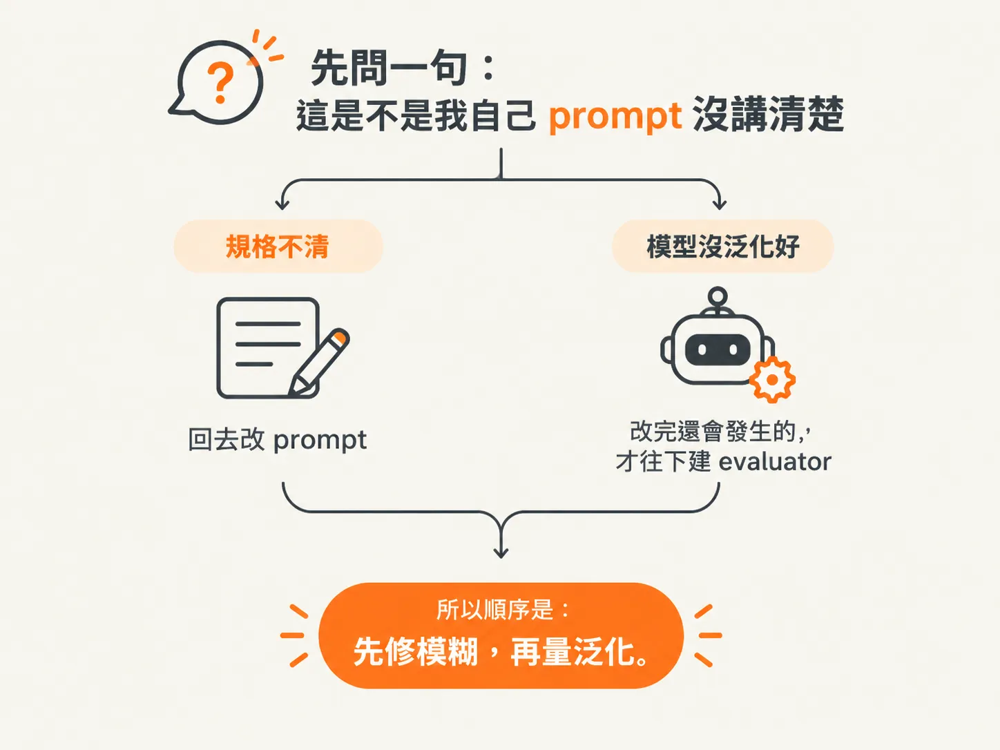
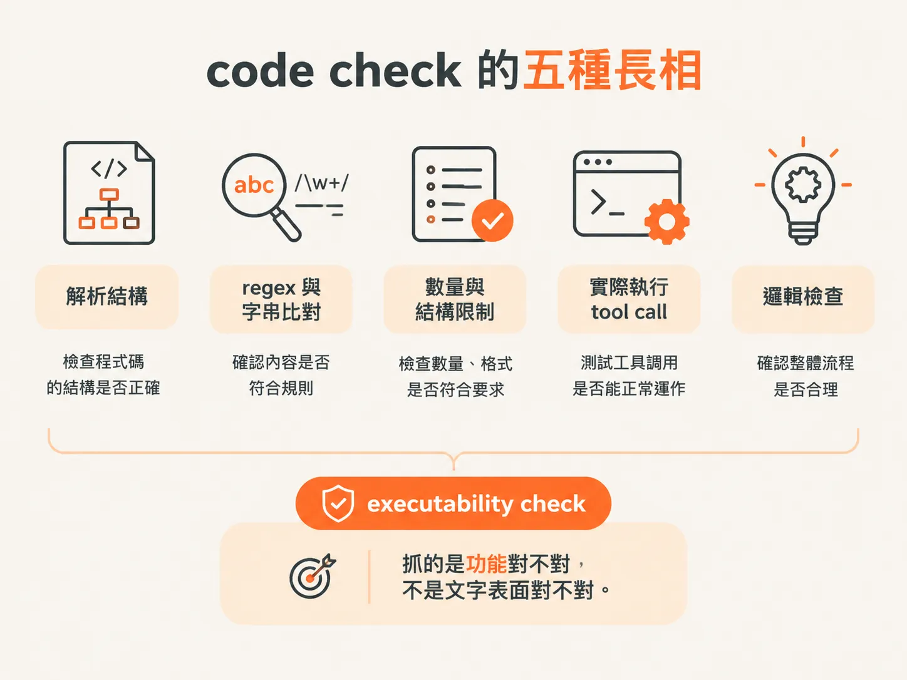
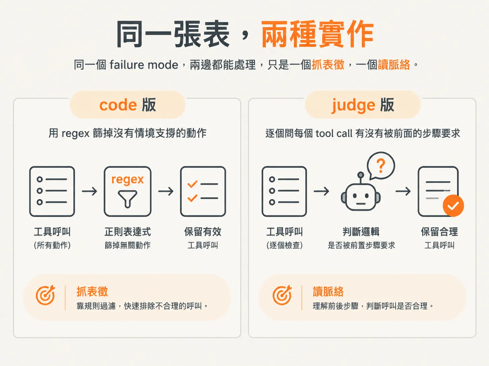

# 先判斷：這條 failure mode 該用 code check 還是 judge

你手上有一張 failure mode 清單，每一條都是從真實 trace 整理出來的。

每一條最後都要配一個能自動跑的 evaluator（評估器），但 evaluator 不是只有一種長相：

- 有些問題，幾行 regex 就能判斷。
- 有些問題，得讓另一個 LLM 讀過輸出再判斷。

選錯方法的代價不小：

- 該寫規則的地方，養出一個不穩定的 judge。
- 該請 judge 的地方，硬寫一堆規則，最後得到一個永遠回傳 Pass 的假指標。

所以第一步不是埋頭寫 evaluator，而是先分流。

## 先問一句：這是不是我自己 prompt 沒講清楚？

書裡的示範場景是一間房地產公司的 CRM 助理。它會讀房仲的自然語言查詢、產生 SQL、草擬客戶信、讀行事曆，還能上網搜尋。

作者分析它的錯誤之後，整理出八種 failure mode：

- 漏掉 SQL 條件
- SQL 聚合層級錯誤
- 亂用不存在的工具
- 信件內容不完整
- 語氣和客戶人設不搭
- 工具呼叫順序錯
- 沒有理由的工具呼叫
- 地名歧義

拿到這張表，直覺通常是：那就一條一條寫 evaluator。

作者提醒先別急。第一步要分辨的是，這條錯屬於 **Specification 失敗**，還是 **Generalization 失敗**。

### Specification 失敗：指令本身不清楚

Specification 失敗，指的是我們給 LLM 的指令模糊或不完整。

這一類問題該改 prompt，不該寫 evaluator。書上給了兩個理由。

第一個是效率。

很多 specification 失敗，只要在原本的 prompt 補上清楚的規則和細節就解決了。替這種「改 prompt 就會好」的問題蓋一個自動化 evaluator，等於花時間維護一個原本不需要的工具。

第二個理由更根本：

我們真正想量的是「LLM 能不能照著清楚的指令正確泛化」，不是「LLM 能不能猜中我沒說清楚的心意」。

替規格不清的任務建立 evaluator，本質上是在量通靈能力。

所以順序是：先修模糊，再量泛化。

書裡拿同一張表示範這條線怎麼切。

「信件內容不完整」可能只是 prompt 沒寫清楚哪些欄位必填，這種情況改 prompt 就好。

但「漏掉 SQL 條件」不一樣。

prompt 裡已經明寫 `max_price: $600k`，LLM 還是漏掉這個條件，那就是泛化失敗。這種問題才值得寫 evaluator。

「語氣和人設不搭」也一樣，前提是客戶人設已經清楚交給 LLM。

至於「呼叫不存在的工具」，只要可用工具的定義夠清楚，幾乎一定落在泛化失敗這一邊。

判準可以收成一句話：

**把 prompt 改到不能再清楚之後，這個錯還會不會發生？**

還會，才輪到建立 evaluator。

## code check 的五種長相

決定要自動化之後，第一順位通常是 code。

書上列的適用情況很具體：

- **解析結構**：檢查 JSON 是否合法，或確認 SQL 語法是否正確。
- **regex 或字串比對**：抓出一定要出現，或一定不能出現的片語。
- **數量與結構限制**：確認摘要是不是一定得有三個 bullet。
- **實際執行工具呼叫**：把 LLM 產生的 tool call 跑一次，看它會不會 raise error。
- **邏輯檢查**：查詢問的是可養寵物的房子，就檢查輸出有沒有提到 `pets allowed`。

這些 check 的共同點是快、便宜、deterministic，而且好解釋。同樣的輸入永遠得到同樣的答案；出錯時，也直接看得出是哪條規則沒過。

它們同時支援兩種評估方式：

- **Reference-free**：不需要標準答案，例如檢查文字有沒有超過長度上限。
- **Reference-based**：準備一個參考答案，例如把輸出中的值抽出來，和 gold set 比對。

這裡還有一個很容易被略過的層次：**executability check**。

它看的是功能上對不對，不是文字看起來對不對。

例如：

- 把 SQL 丟進測試資料庫跑一次，看語法有沒有錯、查詢結果合不合理。
- 模擬執行 tool call，看它在邏輯上能不能達到目的。

有些輸出看起來完全正確，真正跑起來卻會出錯。這類問題，只有執行性檢查抓得到。

## judge 的位置：code 抓不到的語意

反過來，如果 failure mode 牽涉的是 code 很難抓的詮釋和細微差別，就得上 **LLM-as-judge**，也就是後面直接叫 judge 的做法。

書上舉了三個很典型的問題：

- 語氣適不適合？
- 摘要有沒有忠於原文？
- 回答有沒有幫助？

這些問題很難靠 regex 判斷。

做法是另外找一個獨立的 LLM，和受測的應用分開，專門判斷某一條 failure mode。

每個 metric 都可以有自己的 judge，針對它負責的 failure mode 設計判斷方式。這是預期中的結果，甚至是好事：你本來就在評不同面向的品質，不需要把所有判斷塞進同一個 judge。

### judge 的代價

不過 judge 也有代價：

- 可能引入偏誤。
- 判斷結果可能不穩定。
- 需要額外的推論成本。

所以書上把 judge 的適用範圍說得很窄：**narrowly defined, binary tasks**。任務要定義得夠窄，答案最好只有 Pass 或 Fail。

開放式評分或自由回饋則難監督、也難對齊，這個限制會一路貫穿後面幾篇。

## 同一張表，兩種實作

書裡把幾個 failure mode 並排比較，差別就很清楚。

### 語氣和人設不搭

在 programmatic 那一欄，答案是 N/A，因為這是主觀判斷，很難找到一套穩定的規則。

judge 那一欄則可以用 few-shot prompt，把定義和範例寫清楚，讓它判斷語氣符不符合人設。

### 沒有理由的工具呼叫

這條 failure mode，programmatic 和 judge 兩種方式都能做。

Programmatic 的做法是用 regex 篩掉沒有被輸入情境支撐的動作。

Judge 的做法則是問：

「每一個 tool call，是不是都被前面的步驟要求或正當化過？」

同一個 failure mode，兩邊都能處理，只是一個抓表徵，一個讀脈絡。

## Reference-based 還是 reference-free？

還有一組選擇和 judge 本身無關，但會影響之後的數字怎麼報：要用 reference-based，還是 reference-free？

**Reference-based** 得先準備 input-output 對，其中 output 是理想版本，也就是不帶這個 failure 的結果。

Evaluator 量的是實際輸出和這份 golden reference 有多接近。

**Reference-free** 則先定義和這條 failure mode 相關的內在性質或規則，再檢查輸出符不符合。

好處是它可以直接套在大量還沒標註的新資料上，甚至拿來做 online 監控。

書上的建議是：重要的 failure mode，兩種都試著設計一個。

## 分流之後，下一個問題

到這裡，你手上應該已經分成兩堆。

第一堆是「改 prompt 就會好」的問題，先回去修 prompt。

第二堆是真正需要 evaluator 的問題。其中大部分用 code 就夠了，只有語氣、忠實度、有沒有幫助這類問題，才需要交給 judge。

當你確定「這條要用 judge」，下一個問題馬上出現：

**這個 judge 到底要審多大一坨東西？**

讓它一次判斷「這封信寫得好不好」，它只會給你一個無法反駁、也不知道怎麼修的分數。

下一篇要把這件事收到極限：

**一個 judge 只審一個 criterion，答案只有 Pass 或 Fail。**
