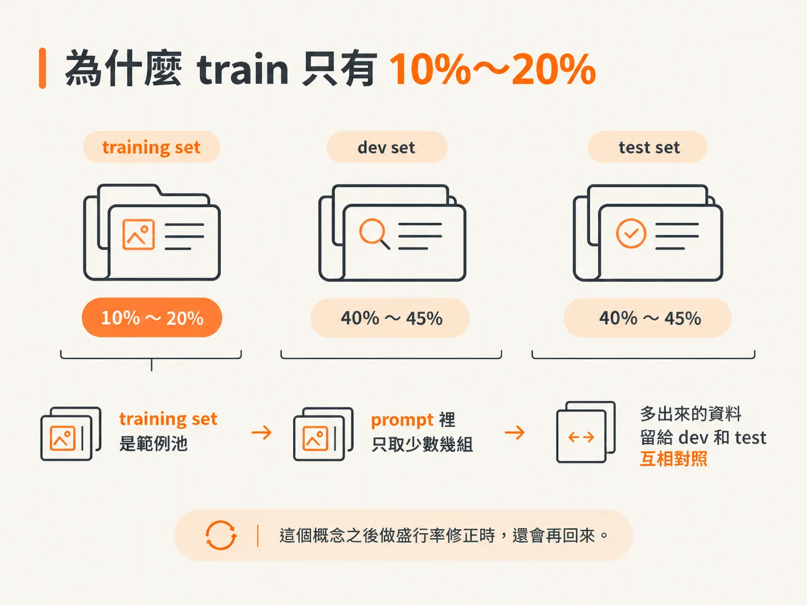
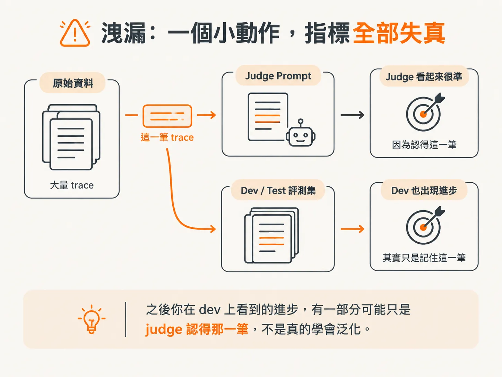

# Few-shot 從哪裡來：人工標註與不泄漏的資料切分

上一頁的模板裡有兩組範例：一組明顯 Fail，一組明顯 Pass。

等你把模板改成自己的 criterion，馬上會卡住：這兩筆到底要從哪裡挑？

如果隨便從手上幾十筆 trace 裡挑兩筆順眼的丟進 prompt，接著又拿同一批 trace 來測 judge 準不準，得到的數字大概會漂亮得不太真實。

這篇要講清楚兩件事：

1. few-shot 範例從哪裡來？
2. 資料為什麼一定要先切成三份？

## 起點是人工標註，不是你的印象

書上在講資料切分之前，先補了一段實務建議。原因很簡單：要切資料，前提是手上已經有一批標註好的資料。

理想的做法，是由一位可信的領域專家先定義 failure mode、定稿 rubric，再把整批 trace 標完。規模大約 100 到 200 筆，這是撐得住後續切分的最小量。

書上認為這樣最有效率，因為不必另外去衡量標註者之間的一致性（IAA）。

如果找不到單一專家，例如團隊規模很大，或判準太主觀、不是一個人能獨自判斷，那就退一步：

先找一個小規模的協作小組，約 20 到 50 筆，一起把 rubric 調到一致性夠高，剩下的再交給一個人標完。

這段建議的重點不在數字，在順序：

**先確認 rubric 站得住，再進行大規模標註。**

反過來做，你可能標完兩百筆，才發現大家的判準根本不一樣，那兩百筆大概全部要重來。

書上後面還提醒，不要把標註外包給對應用情境毫無脈絡的人，也不要外包給 LLM。

你的 judge 之後要對齊的就是這批人工標籤。標籤歪掉，後面的流程會跟著一起歪。

## 三份資料，各做一件事

資料標好之後，書上建議切成三個互不重疊的集合。

它把設計 judge 比喻成訓練一個分類器，差別只在：一般模型的「訓練」在調參數，judge 的「訓練」在 prompt 裡。

### Training set

Training set 是一個標註過的範例池，你在組 prompt 時從裡面挑 few-shot 範例。

這些範例通常是清楚明確的 Pass 和 Fail 案例，用來示範這條 failure mode 的邊界。

### Dev set

Dev set 是一個比較大的獨立標註集合，用來改 prompt。

每次你調整 instruction、改寫 criterion，或換掉 few-shot 範例，就把 judge 拿去跑一遍 dev set，再和人工標籤比對。

書上特別強調：**dev set 的範例絕對不能出現在 prompt 裡。**

只有這樣，你才量得到 judge 遇到「沒看過的範例」時，能不能泛化。

### Test set

Test set 留到最後才用。

等 prompt 定稿，才拿 test set 來算 judge 的 alignment。開發過程中，完全不要去看它。

它提供的是一個沒有偏誤的真實準確度估計，也就是後面會用到的 TPR 和 TNR。

三份資料的角色，一句話記住：

**train 是素材庫，dev 是練習題，test 是期末考。**

你可以從素材庫挑範例上課，但不能拿練習題當教材，更不能先偷看期末考題，再回頭改教材。

## 為什麼 train 只有 10%～20%？

書上給的典型比例，第一次看到會愣一下：

- Training：labeled traces 的 10%～20%
- Dev：40%～45%
- Test：40%～45%

這和一般機器學習的直覺相反：訓練集反而最小。

書上的解釋是，in-context learning 放進少數幾個挑得好的範例之後，通常就飽和了。

附註裡給了更精確的說法：研究顯示，LLM 的表現往往在一到八個範例之後就到頂。再往上加，準確度甚至可能下降，或直接撞上 context 長度上限。

所以 training set 是一個**範例池**，不是要把全部資料塞進 prompt。

你的 prompt 可能只放兩到四組範例，但你需要一個夠大的池子，讓自己能替換、比較不同的範例。

多出來的資料，就分給 dev 和 test。畢竟這兩份才是決定你能不能信任這個 judge 的地方。

書上還有一項要求：dev 和 test 都要有足夠的 Pass 與 Fail 範例，理想上各 30 到 50 筆。

這個比例不會反映真實世界裡 failure 的出現頻率，尤其是在 failure 很罕見的時候。書上認為這種不平衡是刻意的，也可以接受。

因為你現在要的是「量得準」，不是「看起來像生產環境」。

這個概念之後做盛行率修正時，還會再回來。

## 洩漏：一個小動作，指標全部失真

現在回到文章開頭那個情境。

書上說得很直接：同一個範例重複用在不同集合裡，尤其是把 dev 或 test 的範例放進 prompt，就會造成 data leakage，讓準確度估計被膨脹。

這是常見錯誤之一。具體來說，它可能是這樣發生的：

團隊先把某些 trace 當 few-shot 範例放進 judge prompt，接著又把同一批 trace 放進 evaluation set，用來量 alignment。

結果就是 metric 被污染。TPR 和 TNR 看起來很高，不是因為 judge 泛化得好，而是它早就看過這些範例。

書上還補了一個現況觀察：很多人不是根本沒留 held-out set，就是直接把 dev set 的準確度當成 judge 的真實表現報出去。

兩種做法都會生出高度膨脹、又容易誤導人的數字。

所以規則可以寫成一句沒有模糊空間的話：

**任何進過 prompt 的 trace，都必須從 eval set 排除。**

實務上，這句話最常破功的地方不是惡意，而是流程疏忽。

例如你先標了 150 筆，切成：

- 20 筆 train
- 65 筆 dev
- 65 筆 test

接著為了調 judge，你從 dev 的錯誤案例裡挑出一筆很好的反面教材，放進 prompt。

這一刻，dev 就污染了。

之後你在 dev 上看到的進步，有一部分可能只是 judge 認得那一筆，不是真的學會泛化。

防止這種問題的方法很土，但有效：

替每一筆 trace 留一個 id。prompt 定稿前，把 prompt 裡用到的 id 全部列出來，和 dev、test 的 id 逐一比對。

沒有交集就沒事；一出現交集，就重新切資料。

## 反過來，也別完全不放範例

書上把最常見的錯誤擺在第一位，另一個常見錯誤剛好在反方向：

**完全不放範例。**

理由很清楚：沒有具體範例，模型對「什麼算這條任務的 failure」就沒有明確著力點。

任務定義寫得再清楚，模型的行為還是可能變得含糊、不一致。

所以兩邊都不能走極端：

- 沒有範例，judge 只能靠自己的常識猜。
- 範例選錯，或把範例重複放進 eval，指標就會替你圓謊。

比較穩妥的做法：

從 training set 挑少數幾筆清楚、帶標籤的範例放進 prompt，其餘留給 dev 和 test，而且永遠記得追蹤每筆 trace 的 id。

## 切乾淨之後，還有另一種錯

到這裡，你的 judge 應該已經具備：

- 一份四段式 prompt
- 從人工標註挑出的 few-shot 範例
- 乾淨的 train、dev、test 切分
- 一套避免範例和 eval 重疊的 id 檢查方式

但這些處理的都是「資料層」的錯。

還有一種錯是資料切得再乾淨也擋不住的：judge 本身的系統性偏好。

例如兩封品質相當的信，只因為某個和品質無關的因素，judge 就穩定偏向其中一封。

這種偏好不會讓資料切分失效，卻會讓 TPR 和 TNR 一起歪掉，而且是朝著固定方向歪。

下一篇把三種偏誤逐一點名：position、verbosity、self-enhancement，以及它們各自在什麼情況下發作。
