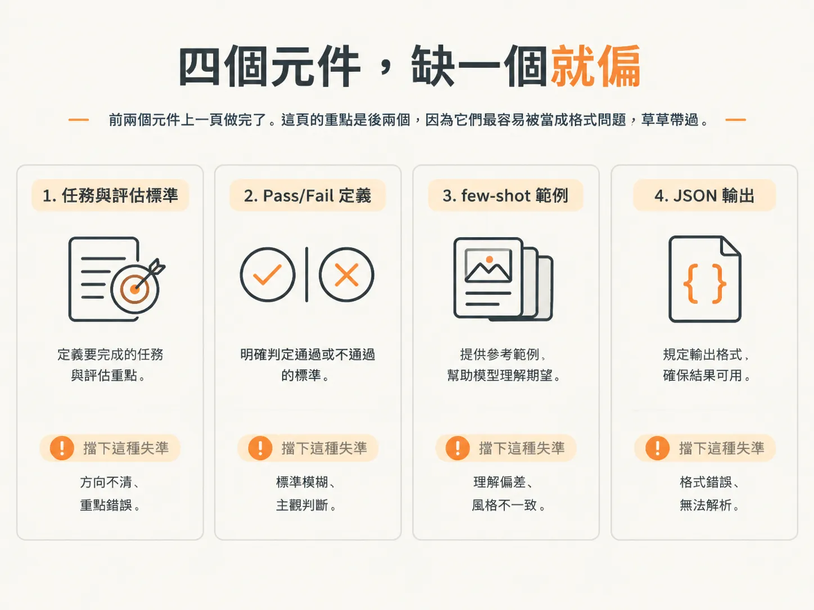
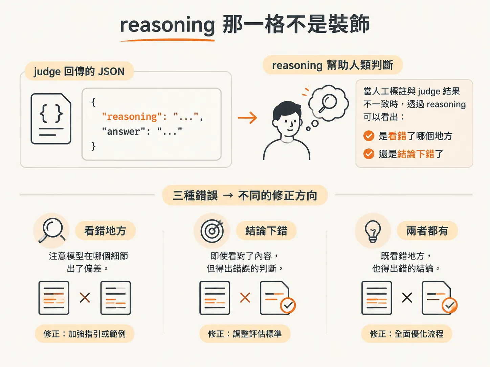

# 四段式 judge prompt：任務、定義、few-shot、JSON

上一頁結束時，你手上有一個 criterion 名稱、兩行 Pass/Fail 定義，還有一組用 trace 測過的邊界案例。

這些東西現在散在筆記裡，還不是一份能貼進 API 的 prompt。

這篇要把四段材料組成一個真的能跑的 judge，再用書上的 Example 5-1 逐段拆。

拆完你會發現，這份模板除了四個必要元件，還夾著一個很容易漏掉的東西：**把領域知識寫進 prompt**。

## 四個元件，缺一個就偏

書上說，一份結構良好的 judge prompt 有四個必要元件，後面所有的 judge 都照這個順序搭。

第一個是**清楚的任務與評估標準**。

一份 prompt 只管一個範圍明確的 failure mode。任務太模糊，judge 的判斷就不穩。

第二個是**精確的 Pass/Fail 定義**。

Pass 代表 failure 不存在，Fail 代表 failure 存在，這兩句要直接從錯誤分析階段整理出來的 failure 描述推導。

第三個是**few-shot 範例**。

few-shot 範例用來校準 judge 的判斷邊界（decision boundary），所以要放已經標註過、而且明顯落在 Pass 或 Fail 的輸出。

第四個是**結構化輸出**。

judge 要用一致、機器讀得懂的格式回答，通常是一個 JSON 物件，兩個欄位：

- `reasoning`：用一到兩句話解釋判斷理由。
- `answer`：填入 `"Pass"` 或 `"Fail"`。

前兩個元件上一頁做完了。這頁的重點是後兩個，因為它們最容易被當成格式問題，草草帶過。



## Example 5-1：整份看過

書上的示範對象，是房地產 CRM 助理的語氣問題。下面是完整的 judge prompt 模板：

<!-- source: sources/agent-eval/20261029/Evals for AI Engineers Systematically Measuring and Improving AI Applications .txt#L1370-L1444 -->

```text
Example 5-1. LLM-as-judge prompt template for tone appropriateness
You are an expert evaluator assessing outputs from a real estate
assistant chatbot.

Your Task: Determine if the assistant-generated email to a client
uses a tone appropriate for the specified client persona.

Evaluation Criterion: Tone Appropriateness

Definition of Pass/Fail:
- Fail: The email's tone, language, or level of formality is
  inconsistent with or unsuitable for the described client persona.
- Pass: The email's tone, language, and formality align well with
  the client persona's expectations.

Client Personas Overview:
- Luxury Buyers: Expect polished, highly professional, and
  deferential language. Avoid slang or excessive casualness.
- First-Time Homebuyers: Benefit from a friendly, reassuring, and
  patient tone. Avoid overly complex jargon.
- Investors: Prefer concise, data-driven, and direct communication.
  Avoid effusiveness.

Output Format:
Return your evaluation as a JSON object with two keys:
1. "reasoning": A brief explanation (1-2 sentences) for your
   decision.
2. "answer": Either "Pass" or "Fail".

Examples:

-----

Input 1:
Client Persona: Luxury Buyer
Generated Email: "Hey there! Got some truly awesome listings for
you in the high-end district. Super views, totally posh. Wanna
check 'em out ASAP?"

Evaluation 1:
{
  "reasoning": "The email uses excessive slang ('Hey there',
    'awesome', 'totally posh', 'ASAP') and an overly casual tone,
    which is unsuitable for a Luxury Buyer persona.",
  "answer": "Fail"
}


-----

Input 2:
Client Persona: First-Time Homebuyer
Generated Email: "Good morning! I've found a few properties that
seem like a great fit for getting started in the market, keeping
your budget in mind. They offer good value and are in nice,
welcoming neighborhoods. Would you be interested in learning more
or perhaps scheduling a visit?"

Evaluation 2:
{
  "reasoning": "The email adopts a friendly, reassuring tone
    ('great fit for getting started', 'nice, welcoming
    neighborhoods') suitable for a First-Time Homebuyer, and
    clearly offers next steps.",
  "answer": "Pass"
}

-----

Now, evaluate the following:

Client Persona: {{CLIENT_PERSONA_HERE}}
Generated Email: {{GENERATED_EMAIL_HERE}}

Your JSON Evaluation:
```

## 逐段看，它到底在防什麼

開頭兩句先交代角色和任務：你是一位 expert evaluator，負責判斷助理寫給客戶的信，語氣符不符合指定的人設。

注意，這裡沒有寫「評估這封信的品質」。題目從第一行就被限制在語氣上。

接著是 criterion 的名稱：`Tone Appropriateness`。

這個名稱不是裝飾。它會變成之後報表上的欄位名，也讓你能回頭確認：這條 judge 到底在量什麼？

然後是 Pass/Fail 定義。

Fail 描述語氣、用語、正式程度和客戶人設對不上的情況；Pass 描述這些元素符合客戶期待的情況。這就是你上一頁做完的工作，只是換成英文。

真正值得停下來看的是 `Client Personas Overview`。

這段不在四個必要元件裡，書上也沒把它列進清單，但它是這份 prompt 能運作的關鍵。

judge 只看得到 trace 裡的信件和人設標籤，卻不知道 luxury buyer 應該被怎麼對待。所以模板把每種人設的期待直接寫進去：

- luxury buyer 要用修飾過、高度專業且帶有敬意的語言，避免俚語和過度隨便。
- first-time homebuyer 要有友善、讓人安心、有耐心的語氣，避免太複雜的術語。
- investor 要的是簡潔、以數據為基礎、直接的溝通，避免過度熱情。

你在上一頁拿來判斷邊界的那段領域知識，不能只留在腦子裡。

它必須變成 prompt 的一部分，否則 judge 只能靠自己的常識猜。而它的常識，不一定和你的產品價值相同。


## reasoning 那一格不是裝飾

書上對輸出格式只寫了一小段，但這個設計同時做兩件事：改善準確度，也讓判斷可解釋。

可解釋性很好理解。

之後你會拿 judge 的判斷去和人工標註比對，一定會遇到不一致的案例。judge 只回一個 `"Fail"`，你就只能猜它為什麼判錯。

有了 `"reasoning"`，你就能讀到它的判斷理由。

Example 5-1 的 Evaluation 1 就是這樣：它直接點名 `Hey there`、`awesome`、`totally posh`、`ASAP` 這幾個詞太口語，不符合 luxury buyer 的人設。

你一看就知道，它是抓對了地方，還是看錯了重點。

至於準確度為什麼會變好，書上沒進一步說明機制。不過從模板的設計看得出來：要求模型先寫一兩句理由再給答案，等於逼它說明判斷依據，而不是直接跳到標籤。

實務上還有另一個好處。

遇到 judge 和人工標註不一致的案例，你可以順手把錯誤分類：

- 理由看到了不該看的東西。
- 理由基本正確，但結論下錯。
- 完全沒有提到關鍵句。

這三種錯誤，後續要修的地方完全不同。



## few-shot 要 clearly Pass、clearly Fail

Example 5-1 的兩組範例是刻意挑的。

Input 1 是 luxury buyer 配上滿是俚語的信，Fail 得毫不含糊。

Input 2 則是 first-time homebuyer 配上友善、而且有清楚下一步的信，Pass 得同樣明確。

書上說，範例是用來校準 judge 的判斷邊界，所以要放 **clearly Pass** 和 **clearly Fail** 的輸出。

邏輯是：先教模型邊界的兩側在哪，而不是一開始就教它處理灰色地帶。

放一個模稜兩可的範例進去，模型學到的也可能是模稜兩可的判斷方式。

書上也坦白說，Example 5-1 是為了讓讀者容易理解，才挑了這麼乾淨的案例。

實務上，你的 criterion 可能更複雜，few-shot 範例也可能需要放入 borderline、難以判斷的案例。

等你開始調 judge，這個差異會很明顯：

清楚的範例讓你起步順利；困難的範例，才會把你一步步逼向人類的判斷方式。

還有一個細節：這兩組範例都是完整的一套三件，包括：

1. 人設。
2. 信件內容。
3. 帶有 reasoning 的 JSON 輸出。

也就是說，你不只示範「這封信應該判什麼」，還示範「判完之後要長什麼樣子」。

對要求 JSON 輸出的 judge 來說，這比只提供一個標籤有效得多。

## 換成你自己的 criterion

把 Example 5-1 換成你手上的 failure mode，步驟其實很死：

- 把任務那句換掉，改成你的 criterion，只留一個。
- 把 Pass/Fail 定義換成上一頁寫好的那兩句。
- 把人設概況換成你的領域知識，也就是人類專家一看就知道、模型卻不一定知道的判準。
- 把兩組範例換成一筆明顯 Fail、一筆明顯 Pass 的 trace。
- 保留原本的 JSON 輸出結構。

做到這裡，你就有一份能跑的 judge 了。

但「跑得起來」和「量得準」是兩回事。

上面每一步其實都壓著一個還沒解的問題：那兩組 few-shot 範例從哪裡來？

書上說，範例是從 human-labeled traces 裡挑的。可是如果你手上只有幾筆標註過的資料，挑幾筆放進 prompt，之後評測又拿同一批資料來用，會發生什麼事？

下一篇處理這件事：資料要怎麼切成三份，以及為什麼切錯之後，指標會好看得不像真的。
