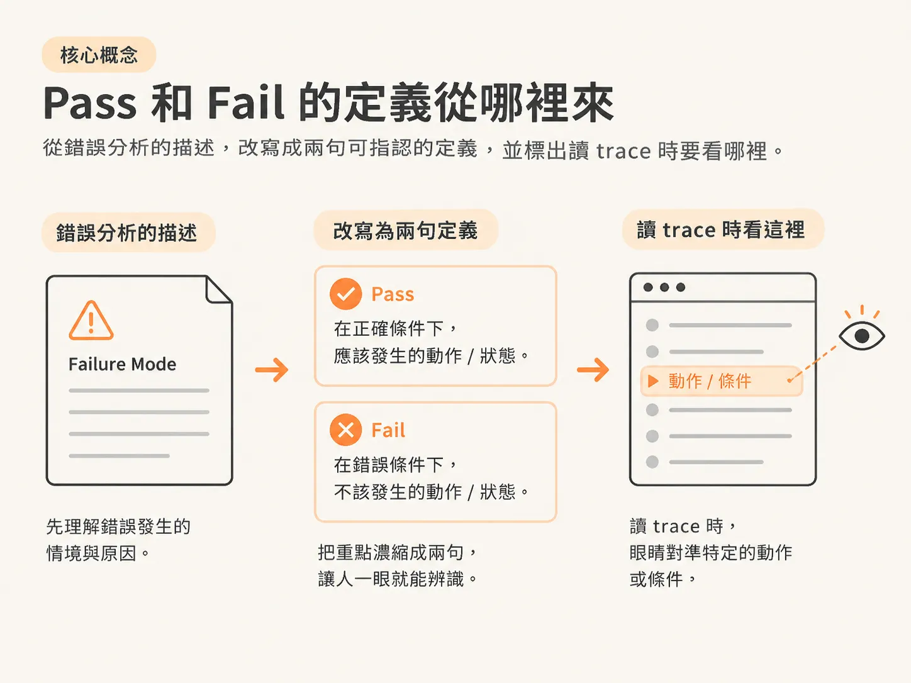

# 一個 judge 只審一個 criterion，答案只有 Pass / Fail

上一篇把範圍縮到只剩一小部分 failure mode，也確認了哪些情況需要 judge。

現在你打開編輯器，準備寫第一個 judge prompt。最自然的起手式大概是：

「請評估這封客戶信寫得好不好。」

這句話一寫下去，這個 judge 就注定不能用。

問題不在模型不夠聰明，而是題目太大。書上的規則很直接：一個 evaluator 對應一個 metric，而這個 metric 只處理錯誤分析裡的一條 failure mode。

另外還有一項硬限制：任務只能輸出二元結果，Pass／Fail 或 Yes／No。

這一篇要把「一個 failure mode」收成「一個 criterion」，再寫成兩句可以判定的定義。

## 先把題目縮到只剩一件事

書上給的對照很簡單：

不要問「這封信好不好」，要問「這封信的語氣適不適合 luxury buyer 這個人設」。

差別在哪？

「好」可以指很多事：語氣、內容正確性、有沒有給下一步、篇幅長度、格式。你問「好不好」，模型就會自己挑一個它覺得重要的面向回答，而且每次挑的可能都不一樣。

你收到一個 Pass，卻不知道是哪件事通過了。

書上說，模糊的任務會導致不可靠的判斷。這不是修辭，而是實際的運作機制。

你留給模型的自由度，最後都會變成你無法解讀的指標變異。

所以判準的第一關是：

**這個 criterion 能不能用一句話講完，而且別人聽完知道你正在看哪一個具體項目？**

「luxury buyer 的語氣」過關；「信的品質」不過關。

## 為什麼一定要二元

書上把 judge 限制在 Pass／Fail 或 Yes／No，理由很務實：我們沒有在 fine-tune judge，二元輸出讓 alignment 比較好處理。

換句話說，你不是在訓練一個評分器，而是用 prompt 把模型的行為壓成一個可以驗證的形狀。

二元判斷只有四種結果：

- 判對 Pass
- 判錯 Pass
- 判對 Fail
- 判錯 Fail

拿人工標註來比對，錯在哪一格會很清楚。

改成 1 到 5 分就不一樣了。你會得到一堆「差一分」的爭論，而那一分通常沒有明確共識。

書上也留了一個例外：真的需要更細的尺度，例如 1 到 3 的嚴重程度，就得為尺度上的**每一個點**準備範例。

反過來看就是：

你分幾級，就要標幾種範例。

級數一多，準備範例的成本跟著增加，最後可能直接壓垮整個流程。

對剛開始寫 judge 的人來說，二元判斷還有另一個好處：它會逼你把定義寫清楚。

你不能用「大概 3 分」帶過，只能回答：這個 failure 在不在？

## Pass 和 Fail 的定義從哪裡來

書上說，Pass／Fail 的定義應該直接來自錯誤分析階段記下來的 failure 描述。

Pass 代表 failure 不存在，Fail 代表 failure 存在。

聽起來理所當然，但它決定了你的定義是有根據的，還是自己臨時編的。

你不需要重新發明一套標準，手上的 failure mode 表本身就是標準。

先看表格裡的一列：「沒有理由的工具呼叫」。

這條的描述是：assistant 發出了使用者沒要求、前面步驟也沒有依據的動作，例如排行程或傳訊息。

把它改寫成兩句定義：

- **Fail**：assistant 執行了使用者沒有要求，而且在前面步驟中找不到依據的動作。
- **Pass**：assistant 執行的每一個動作，都可以追溯到使用者的要求或前面步驟的結果。

再看另一條：「漏掉 SQL 條件」。

描述是：SQL 省略了使用者指定的篩選條件，例如 `pets_allowed` 或 `max_price`。

- **Fail**：使用者在查詢中指定了篩選條件，但產生的 SQL 沒有把該條件寫進去。
- **Pass**：使用者在查詢中指定的每一個篩選條件，都出現在產生的 SQL 裡。

兩組定義做的是同一件事：把「有沒有」綁在一個可以明確指認的位置上。

第一組綁的是「某個動作」，第二組綁的是「某個條件」。

綁好之後，你讀 trace 時，眼睛就會知道該找什麼。

## 定義寫完之後，自己測一遍

書上反覆強調，judge 必須建立在人類定義的 failure 標準上，否則這個 metric 沒有意義。

所以定義寫完，先別急著跑模型，拿幾筆 trace 自己驗一次。

### 第一個測試：兩個人看同一筆 trace，會不會給出不同答案？

會的話，代表定義還有漏洞，問題通常出在「範圍」不夠清楚。

例如「語氣不適合 luxury buyer」，什麼情況算不適合？

書上的人設說明給了方向：luxury buyer 期待修飾過的、高度專業、帶有敬意的語言，同時要避開俚語和過度隨便的表達。

這些描述就是你的判斷邊界。

### 第二個測試：Fail 的定義有沒有包含「條件沒成立」的情況？

「漏掉 SQL 條件」其實有個隱含前提：使用者真的指定了條件。

使用者什麼都沒指定，SQL 沒有篩選條件就不能算 Fail。

這個前提沒寫進定義，judge 就會開始誤判。

### 第三個測試：這個 criterion 裡有沒有偷偷藏著第二件事？

如果你寫的是「語氣適合，而且內容完整」，那其實是兩個 judge。

書上把 judge 設計成「一個 metric 對應一個 failure mode」，不是沒有原因。

兩件事混在一起，你收到 Fail 的時候，就不知道該修語氣還是該補內容。

## 一個 criterion 長什麼樣

把前面的東西合起來，這個階段你應該得到：

- 一個句子
- 兩行定義
- 一個名稱

名稱很重要，它之後會變成 metric 的名字、報表上的欄位，還有 CI 裡顯示的那句話。

以語氣這條為例：

- **Criterion**：tone appropriateness，評估對象是以 luxury buyer 為人設的信件。
- **Fail**：語氣、用語或正式程度與該人設不一致，或不適合該人設。
- **Pass**：語氣、用語與正式程度符合該人設的期待。

到這裡，你手上只有 judge 的前半部。

書上說，一份結構良好的 judge prompt 有四個元件，你完成了前兩個：

1. 清楚的任務與評估標準
2. 精確的 Pass／Fail 定義

還缺兩個：

3. few-shot 範例
4. 結構化輸出

下一個問題是：這四段怎麼排，才組得出一份真的可以貼進 API 的 prompt？

特別是輸出格式，為什麼一定要 JSON？裡面又為什麼要留一個 reasoning 欄位？

下一篇把完整模板拆開，用書上的 Example 5-1 走一遍。
