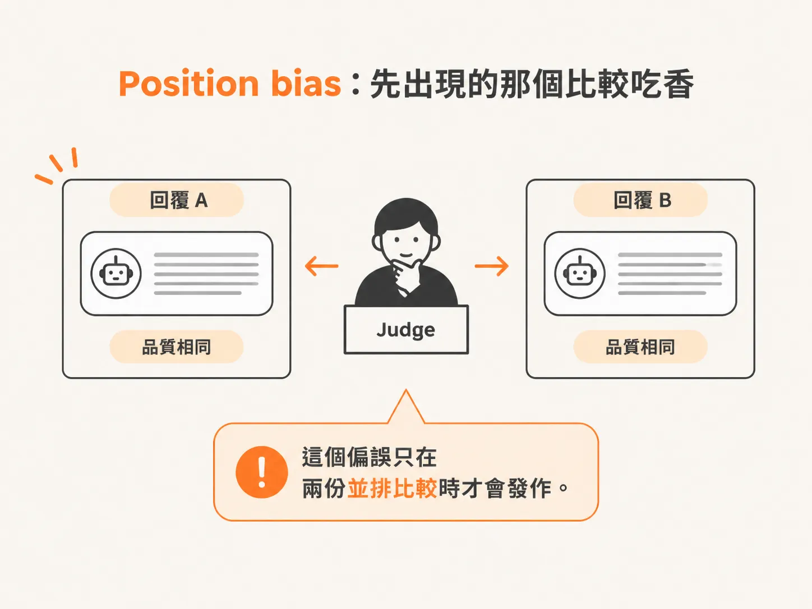
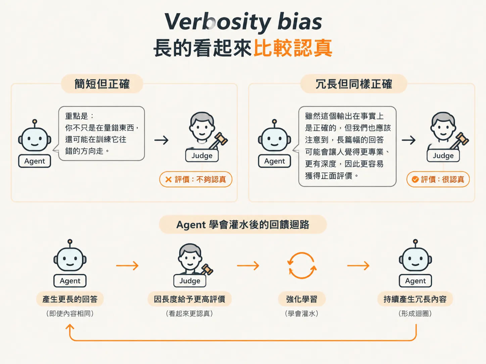
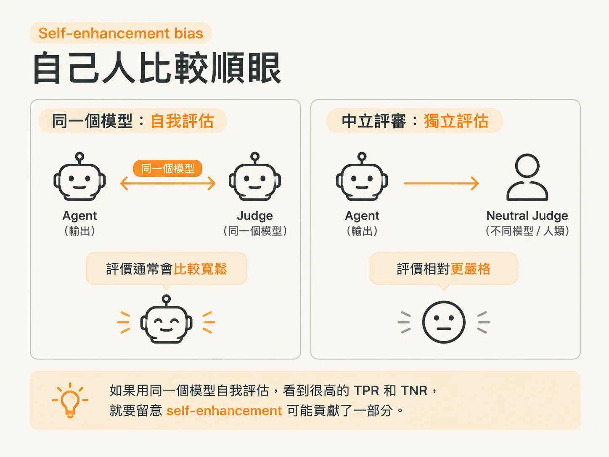

# Judge 必須活下來的三種偏誤：position、verbosity、self-enhancement

你的 judge 現在有四段式 prompt、從人工標註挑出來的 few-shot 範例，還有切分乾淨的 train/dev/test。放到 dev set 上跑，結果看起來也像個真的 judge 了。

但上一篇留下一個還沒解的問題：

有一種錯，光把資料切乾淨也防不了。因為問題不在資料，在 judge 這種做法本身。

這篇要把三種偏誤一一點名。它們各有名字、來源和明確的發作條件；其中一種目前幾乎威脅不到你的設計，另外兩種則可能直接咬住你。

## 三種偏誤是怎麼被發現的？

「LLM-as-a-judge」這個詞，出自 Zheng 等人在 2023 年的論文。

他們的做法是拿大量人類偏好資料訓練一個專門的 judge，讓它的判斷盡量符合人類期待。這種做法在 benchmark 上表現很好。

但書上接著指出，這種 fine-tune（微調模型）在實務上幾乎不可行。多數應用沒有足夠的標註偏好資料，開發初期尤其沒有。

所以你現在的做法，是直接拿現成的 LLM 當 judge，靠 prompt engineering 讓它的輸出對齊你定義的 failure。

「我們沒有 fine-tune」這句話很重要，因為它決定了你手上有哪些工具。

別人是調模型權重來對齊，你能調的是 prompt 和驗證流程。

同一篇論文也記錄了 LLM judge 的可靠性問題。這項研究由 Lianmin Zheng 和 LMSYS 的同事共同完成；LMSYS 就是經營 Chatbot Arena 的團隊，那個讓 LLM 兩兩比較、建立排行榜的系統。

他們測的是：LLM judge 給的評分，能不能和人類評審的評分對上。最後找到三種系統性偏誤。

注意「系統性」這個詞。

它不是雜訊，不是每次隨機錯一點、平均之後就會互相抵銷。系統性偏誤是有方向的偏差，跑一千筆資料之後，它會累積成固定的偏移。

## Position bias：先出現的那個比較吃香

第一種是 position bias，也就是位置偏誤。

書上的描述是：當 judge 被要求把兩份回覆並排比較時，它會傾向偏袒先出現的那一份；有些模型則偏袒後出現的那一份。

即使兩份回覆的品質完全相同，這種偏向還是可能存在。

書上給了一個數字：在 Zheng 等人的研究中，Kimi-4 大約有 26% 的判斷出現這個偏誤。

四分之一，並不是罕見個案。

這個偏誤的觸發條件很明確：**兩份回覆並排比較**。

所以它對你目前這版 judge 的威脅不大。你的 judge 一次只看一份輸出，判的是「這個 failure 在不在」，沒有「第一份和第二份哪個比較好」可以讓它偏袒。

但這層保護是系統結構給的，不是你的 prompt 寫得特別好。

只要有一天你把評測改成 pairwise comparison（兩兩比較），例如要 judge 判斷「新 prompt 的輸出和舊 prompt 的輸出哪個比較好」，這個偏誤立刻回來。

到時候，你以為自己量到的是品質差距，其實量到的是輸出出現的位置。

## Verbosity bias：長的看起來比較認真

第二種是 verbosity bias，也就是冗長偏誤。這一種會直接影響你目前的設計。

書上說，較長的回覆比較容易被評為高品質，即使較短的回覆同樣正確。

中了這種偏誤的 judge，等於在獎勵 agent 把輸出灌水。

注意括號裡那句話：**即使短的那份同樣正確**。

這正是它麻煩的地方。

它不是「長的回覆比較差，所以沒有被扣分」的反面，而是「長度本身變成了分數」，跟內容對不對無關。

對你的 judge 來說，這種偏誤可能長成什麼樣子？

你的任務是二元判斷：只要 failure 不存在，就該判 Pass。

但一個受 verbosity bias 影響的 judge，更容易在長篇輸出裡找到一些「理由」，然後判 Pass，因為長文看起來比較有誠意、比較完整，也比較像真的回答了問題。

反過來，一筆簡短但完全正確的輸出，可能被判 Fail，理由是「資訊不足」。

問題是，「資訊不足」根本不在你的 criterion 裡。

書上還補了一個後果：這種 judge 會獎勵 agent 灌水。

這會形成回饋迴路。agent 一旦發現寫長一點比較容易過，就會愈寫愈長。

你不只是在量錯東西，還可能在訓練它往錯的方向走。

## Self-enhancement bias：自己人比較順眼

第三種是 self-enhancement bias，也就是自我增強偏誤。

書上說，當 judge 和被測的 agent 是同一個模型時，例如 Kimi-4 評估 Kimi-4 的輸出，judge 會比中立評審更偏袒這個 agent 的結果。

關鍵條件是「同一個模型」。

你的應用跑在某個模型上，judge 也用同一個模型、同一個模型家族，甚至同一個 API，這個偏誤就有機會發作。

至於為什麼會這樣，書上沒有進一步說明機制。

但就算不知道機制，你還是可以先防：只要 judge 和受測者同源，你量到的 alignment（對齊程度）就可能被高估。

而且這種高估有固定方向：你的 judge 會比中立評審更常說「還不錯」。

這對小團隊特別棘手，因為你通常只有一家 API 供應商的金鑰，最順手的做法就是拿同一個模型來當 judge。

這不一定是偷懶，是資源有限。

但你得知道自己站在哪裡：如果你用同一個模型自我評估，然後在 dev set 上看到很高的 TPR 和 TNR，就要把「self-enhancement 可能貢獻了一部分」這件事放在心上。

## 三種偏誤的共同後果

書上對這三種偏誤的結論寫得很克制：

它們不會讓 LLM judge 變得沒用，但代表**原始 judge 分數不能單獨相信**。你必須設計 prompt 和驗證程序，想辦法控制這些偏誤。

「不能單獨相信」是什麼意思？

假設你拿到 87% 的 Pass 率，這個數字本身不是結論，只是一個觀察值。

你還得能回答：這個 87% 距離真相有多遠？

做到這一步，你才有資格拿它來做決定。

而且這件事沒辦法只靠讀 prompt 判斷。

prompt 寫得再漂亮，你也不會知道 judge 是不是偏袒較長的輸出。你只能實際去量：拿一批有人工標籤的資料測試，看它在哪些情況下出錯。

## 還有一種「不算偏誤」的失敗

書上把這三種偏誤和另一類問題分開討論，而那一類其實更常見：

直接假設 judge 一開箱就能正常運作。

對於簡單、大家熟悉的 metric，例如判斷情緒正負，這個假設有時真的成立。

但很多 metric 和特定領域有關，或綁著產品特有的「調性」。例如：

- luxury 客戶的語氣是否對齊
- 房源摘要是否完整
- tool call 是否有合理的理由支撐

這些都要花力氣對齊。

書上有一句話說得很直接：

**judge 沒有預先被訓練過你的產品價值，所以你得教它。**

這也是為什麼前面幾篇做的工作不是白費。

你把 criterion 收窄、把定義寫清楚、把領域知識寫進 prompt，再從人工標註挑出 few-shot 範例——這些動作就是在「教它」。

prompt refinement 加上人工標籤驗證，則是確保 evaluator 真的反映 agent 應該在意的事。

書上對這件事的投資報酬也說得很清楚：

一個對齊良好的 judge，可以取代需要檢查數千筆 trace 的昂貴人工評估，讓整個 agent 的監控變得可行。

但前提是，它真的對齊了。

## 你現在手上有什麼？

回到這個 node 的起點。

你手上有一份可以執行的 judge：

- 一個 failure mode
- 一個 criterion
- 兩句 Pass/Fail 定義
- 從人工標註挑出的 few-shot 範例
- 只包含 `reasoning` 和 `answer` 的 JSON 輸出

你也知道資料要切成三份，prompt 和 eval 不能共用任何一筆 trace。

接著，你知道它可能怎麼偏：

- **Position bias**：目前的單一輸出設計下沒有施力點，但改成並排比較就會回來。
- **Verbosity bias**：隨時可能發作，還會反過來獎勵 agent 灌水。
- **Self-enhancement bias**：用同一個模型自我評估時，影響最明顯。

這份清單不是要讓你不敢用 judge，是讓你讀得懂下一個數字。

之後你會拿 test set 算出 TPR 和 TNR。這兩個數字，才是「這個 judge 能不能信」的答案。

但在那之前，先問自己一句：

**我剛剛看到的漂亮分數，是哪一種偏誤在幫我說話？**
