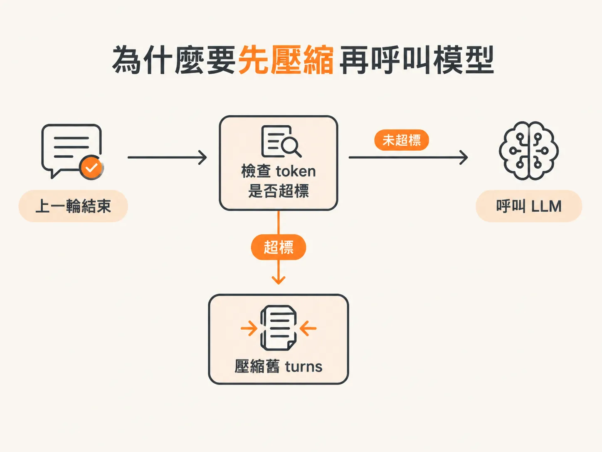
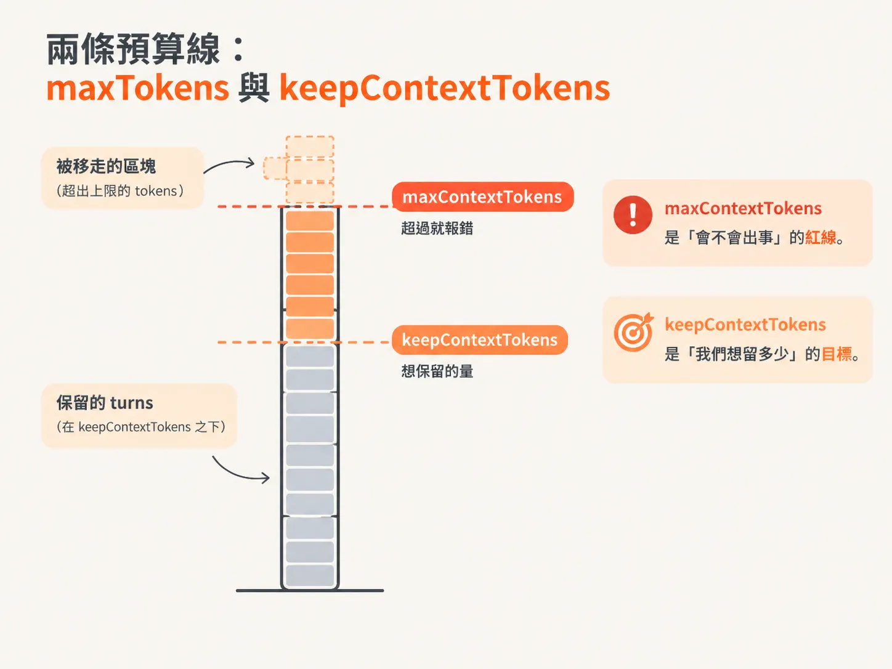
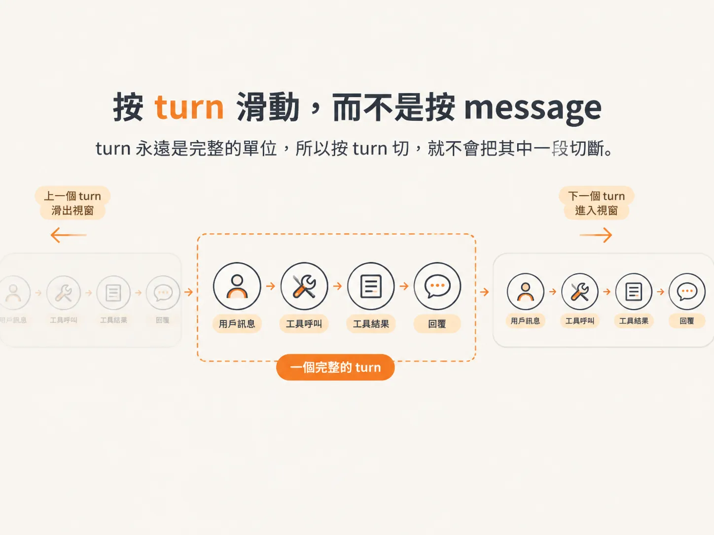
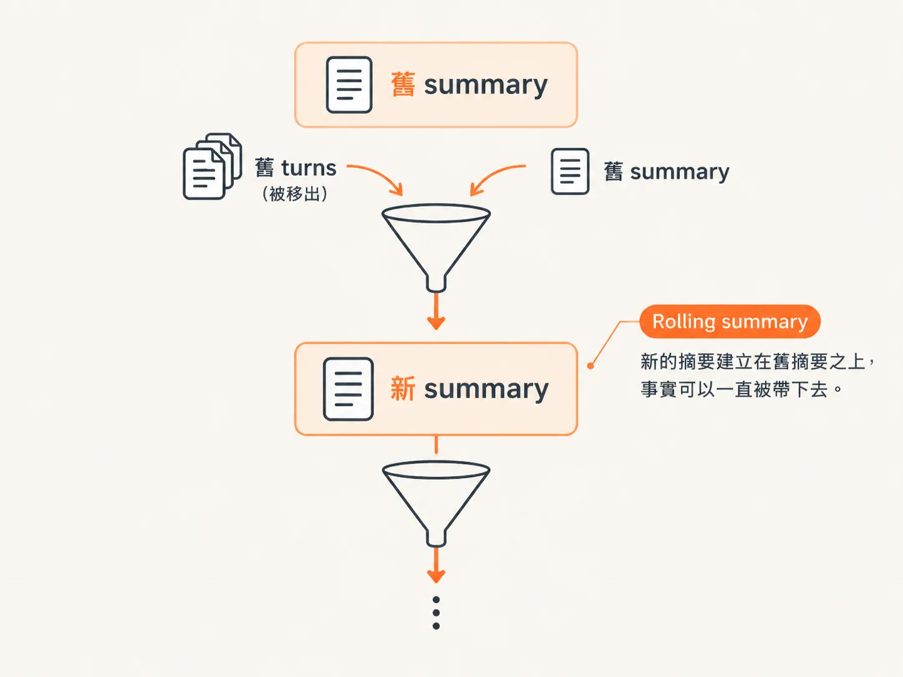

# 超過預算就壓縮：sliding window 與 rolling summary

上一篇文章提到，每次呼叫前都可以用 `buildContext` 重新組出 context。

但那只解決了「這一輪該看哪些內容」，還沒處理另一個更實際的問題：

session 執行得越久，History 就會越來越長，token 早晚會超過模型的 context window。

這篇要處理的，就是在呼叫 LLM 前先檢查 token。只要超過上限，就把最舊的 turns 摺進一個可以持續累積的 summary，只留下最近的 turns。

## 為什麼要先壓縮再呼叫模型

時機是這套設計的關鍵。

如果等到 model turn 真正執行、context 已經超過上限，錯誤就會在那一刻爆發。因此，壓縮的工作要放在呼叫 LLM 之前，而不是之後。



*AI 生成示意圖*

具體來說，在進入 `while` loop 之前，先準備兩個變數：

- `turns`：一個「陣列的陣列」，用來收集每一輪的 messages。
- `summary`：目前累積到現在的摘要，初始值是空字串。

接著，在每一輪 model turn 開始前，先判斷：

`estimateTokens(turns.flat)` 是否大於 `maxContextTokens`。

如果大於，就代表預算爆了，需要開始壓縮。

## 兩條預算線：maxTokens 與 keepContextTokens

這裡有兩條不同的界線，第一次看到時很容易混在一起：

- `maxContextTokens`：context window 的硬上限。超過它，模型會直接報錯，因此它是「觸發壓縮」的門檻。
- `keepContextTokens`：我們希望保留的 token 數量。它決定滑動視窗要留下多大的範圍；超過這個數量，就把最舊的 turn 移出去。

一句話記住：

`maxContextTokens` 是「會不會出事」的紅線，`keepContextTokens` 是「我們想留多少」的目標。



*AI 生成示意圖*

## 按 turn 滑動，而不是按 message

一旦超過預算，就用 `while` loop 把最舊的 turns 移出去：

<!-- derived -->
```ts
while (turns.length > 1 && estimateTokens(turns.flat) > keepContextTokens) {
  const oldest = turns.shift();
  if (oldest) old.push(oldest);
}
```

這兩個條件各有用途：

- `turns.length > 1`：至少保留一輪，不會把內容全部清空。
- `estimateTokens(turns.flat) > keepContextTokens`：如果內容還是太長，就繼續移除。

為什麼要按 turn，而不是按 message 滑動？

這是整套設計裡最值得記住的一點。如果直接按 message 壓縮，很可能留下不完整的狀態。

例如，最後一則 message 可能是一個還沒有對應 tool result 的 tool call。接下來 LLM 收到這種內容，就可能無法正常處理。

但一個 turn 是完整的一圈：從 user input 開始，接著可能包含一串 tool call 與回應，最後以 response message 收尾。

turn 永遠是完整的單位，所以按 turn 切，就不會把其中一段切斷。



*AI 生成示意圖*

source 裡也明確說明，turn 會把「文字、相關的 tool calls、相關的 response messages」整組包在一起。

如此一來，我們可以直接按 turn 做 compaction，不必另外寫一堆判斷：

「如果 role 是這個就不要做，如果 role 是那個就……」

把內容分組進 turn 後，滑動視窗就只是簡單的 `shift`。

## 把最舊的 turns 摺進 summary

滑出去的 `old` 不能直接丟掉，因為它們承載著過去發生過的事實。

我們要做的是，把這些內容摺進 summary。

如果 `old.length > 0`，就呼叫 `summarize(old, priorSummary)`。

請注意第二個參數：`priorSummary`，也就是之前已經存在的 summary。

這個參數讓摘要可以持續累積，形成「摘要的摘要」。



*AI 生成示意圖*

`summarize` 函式本身其實很簡單，就是再進行一次 LLM 呼叫：

<!-- derived -->
```ts
async function summarize(old: Message[], priorSummary?: string) {
  const transcript = old
    .flat()
    .map((m) => `${m.role}: ${m.content}`)
    .join("\n");

  return generateText({
    model,
    messages: [
      { role: "system", content: "把 agent 的工作紀錄壓縮成簡短的 running summary，保留具體事實：item IDs、類別、draft IDs、金額、已經寄出什麼。要精簡。" },
      { role: "user", content: `這是之前的摘要：${priorSummary ?? ""}。把它摺進這份新紀錄，回傳更新後的摘要。` },
    ],
  });
}
```

這裡有幾個細節值得特別看清楚：

1. **使用 `generateText`，而不是 `streamText`**

   摘要不需要串流給使用者看。我們必須等摘要完成後，才能繼續後面的流程，因此直接等待它完成。

2. **使用不同的 system prompt**

   這個 agent 不是負責替使用者完成任務，而是負責整理摘要，所以需要設定不同的目標。

3. **最後一則訊息必須是 user 訊息**

   如果 messages 陣列最後不是 `role: user`，LLM 可能會回應：「所以你要我做什麼？」

   原因很簡單：你根本沒有在最後提出要求。

   因此，我們會把「這是之前的摘要，請把它摺進這份新紀錄，並回傳更新後的摘要」放在最後，作為 user message。

把 `priorSummary` 一起餵進去，正是 rolling summary 的核心。

每次壓縮都建立在上一次摘要的基礎上。這樣一來，summary 可以持續累積，舊事實也不會因為滑動視窗而完全消失。

## 重建 context 並告訴使用者

壓縮完成後，還有三個步驟要收尾：

1. 使用 `estimateTokens`，重新計算新的 context 有多大。
2. 使用 `buildContext(input, summary, turns)` 重建 messages。這次的內容會包含剛產生的 summary，以及剩下的 turns。
3. 發出 `memory.compacted` 事件，內容包括 workflow ID、被摘要的 turns 數量、目前 message history 的 token 數，以及 summary 內容。事件名稱就是 `compacted`。

為什麼要發出事件？

因為摘要本質上代表「LLM 忘掉了一部分內容」。這不一定是壞事，但使用者應該知道自己的內容剛被壓縮過，而不是等到模型突然記不得前面說過什麼，才發現發生了變化。

最後，model turn 取得的是 `buildContext` 的結果，也就是 `context`，而不是原始的 messages。

這樣一來，summary 才會真正進入這一輪模型的視野。

接著，再把這一輪產生的 `turnMessages` push 回 `turns`，繼續累積，等著下一輪檢查。

到這裡，壓縮的邏輯已經寫完了。但「寫在程式裡」和「親眼看到它發生」是兩回事；下一課就把門檻調到荒謬低，實際跑一次看看壓縮何時觸發、又留下什麼。
