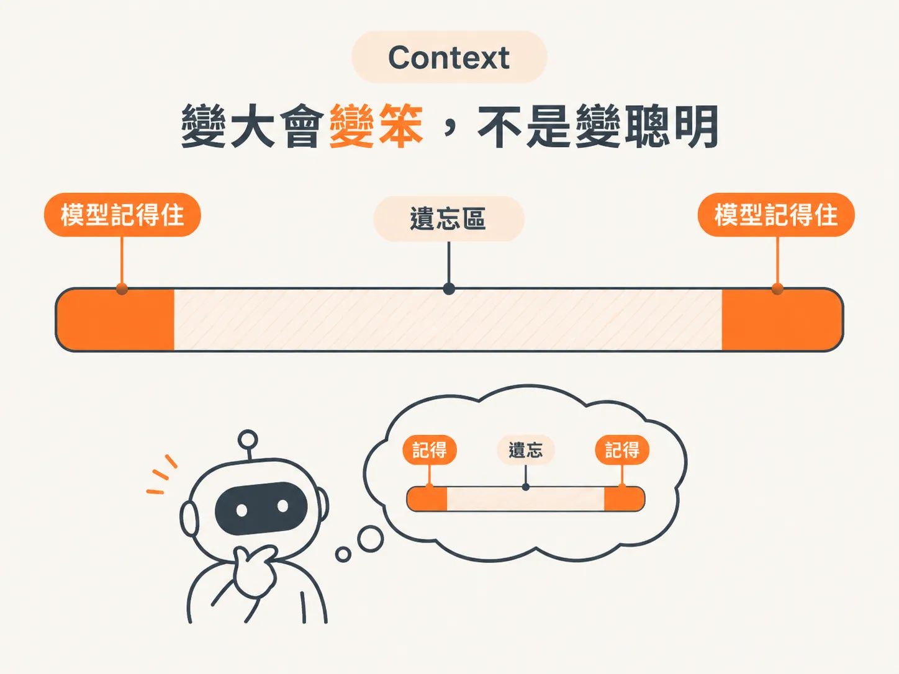
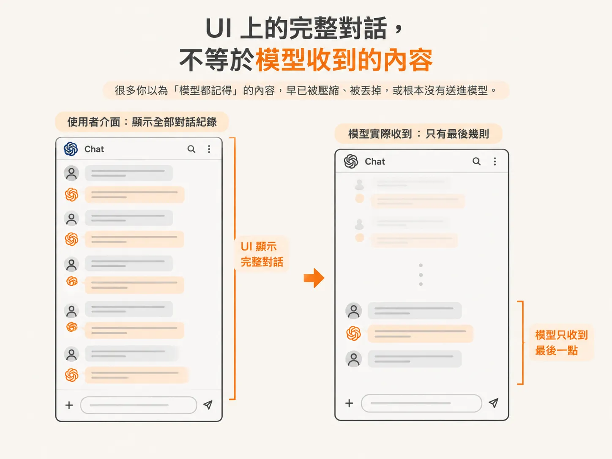
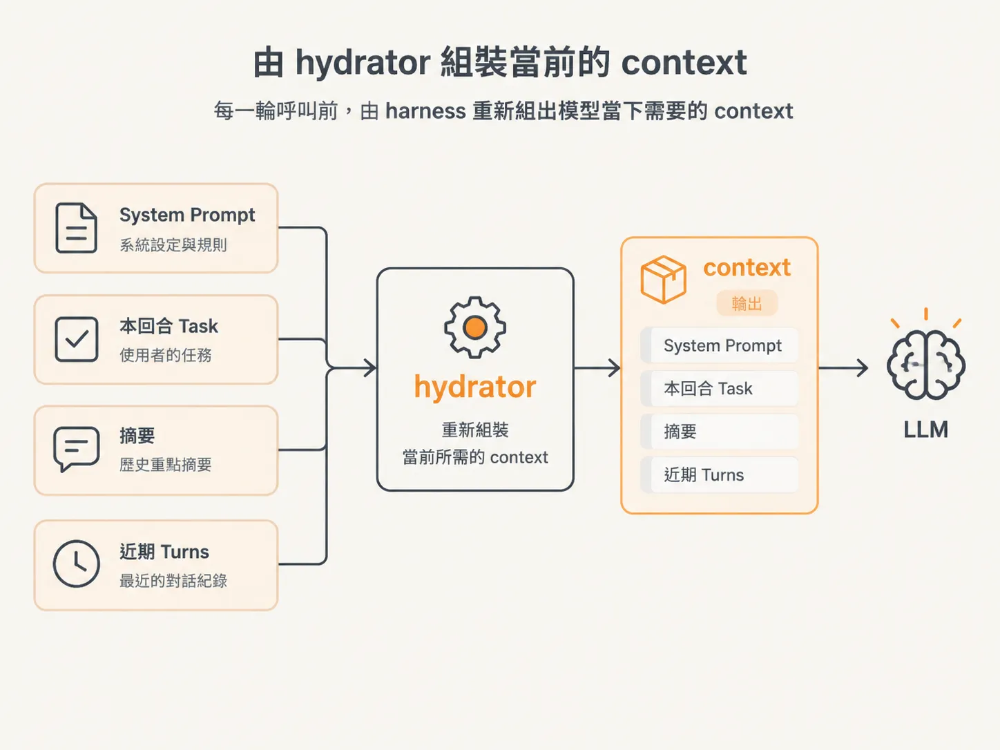
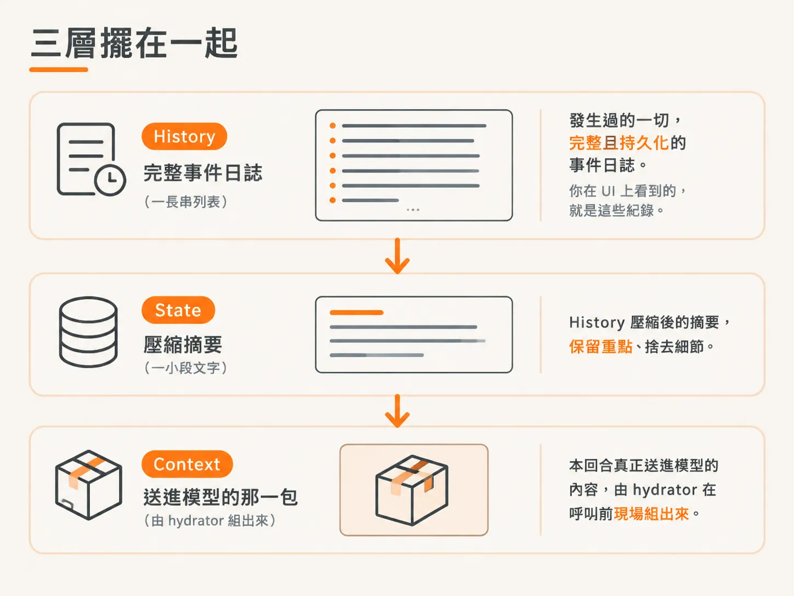

# History、State、Context：模型每一輪到底看到什麼

你在 agent 的聊天介面往上滑，看到的是從頭到尾的一整串對話。

這很容易讓人產生錯覺：模型每一輪是不是都把這整串內容重新讀過一遍？

這一課要拆掉這個錯覺。

你以為模型看到了全部，是因為介面把全部內容呈現給你；但實際上，模型每一輪收到的，可能只有其中很少的一部分。

「記憶」也不是一個模糊的概念。它至少可以拆成三層：**History、State、Context**。

三者看起來都和「過去的紀錄」有關，但負責的工作完全不同。

## History 是發生過的一切

**History** 是完整的事件日誌。

每一則使用者訊息、每一次工具呼叫，以及每一段模型回覆，都會依序記錄下來。素材裡稱它為 persistent event log，意思是它會被持久化保存，不只是暫時放在記憶體中，因此即使系統重新啟動，紀錄仍然存在。

問題是，History 沒有上限。

對話越長，History 就越長。而且每一輪都得重新設定整段對話，所以它不只會變長，也會讓處理速度變慢、成本變高。

## Context 變大會變笨，不是變聰明

接著是一個很反直覺的事實：**Context 越大，模型可能反而越笨。**

素材的說法更直接：它會變笨，甚至變得「超級笨」。原因是模型其實只記得住開頭和結尾，中間那一大段內容，幾乎等於被忘掉。

所以，「百萬 token context window」聽起來很厲害，但 Context 越多不代表效果越好，很多時候反而更差。

真正該做的，是盡量限制使用中的 Context，而不是把所有內容都塞滿。

而且，Context 無限變大，最後仍然會撞上硬上限。到了某個程度，內容再也塞不進去，系統就會直接報錯。

所有對話型 AI 應用程式，遲早都可能在這裡遇到問題。

*AI 生成示意圖*

## UI 上的完整對話，不等於模型收到的內容

這是這一課最關鍵的一句：

**你在畫面上看到從頭到尾的完整對話，但那只是 UI 呈現給你看的內容。**

模型真正收到的，可能只有最後一小段。

理由很直接：物理極限。系統沒有辦法處理無限多的 Context，literally physics。

因此，那些你以為「模型都記得」的內容，很多早已被壓縮、被丟掉，或者根本沒有送進模型。

*AI 生成示意圖*

## State 是壓縮後的摘要

那麼，被丟掉的內容去了哪裡？

它不是憑空消失，而是被壓縮成 **State**。

素材裡的 compact、summarize，指的就是這件事：把一大段 History 摺疊成一小段摘要，保留重要事實，捨去細節。

State 可以看成 History 的濃縮版。

它不是完整保留過去發生的每一件事，而是留下過去的重要部分。模型靠著這份摘要掌握關鍵脈絡，不必每次都重新讀完整段對話。

## Context 是本回合真正送進去的那一包

最後一層是 **Context**，也是模型唯一「真的看到」的內容。

每一輪呼叫模型之前，都要重新組出這一輪要使用的 Context。素材用 **hydrator** 來描述這項工作：把 LLM 現在需要的 Context 準備好，再交給它。

組合 Context 的是 harness，不是模型。

素材強調，這是「某個人的工作、某個團隊的工作」；在我們的專案裡，就是 hydrator 的責任。

**compactor** 則負責另一件事：監看 History 的 token 數量，超過門檻時就進行壓縮。

素材把這個門檻設得很低，故意讓壓縮容易被觸發，這樣就能清楚看見它如何運作。

*AI 生成示意圖*

## 三層擺在一起

回到一開始的錯覺，現在可以把三者整理在一起：

- **History**：發生過的一切，完整且持久化的事件日誌。你在 UI 上看到的，就是這些紀錄。
- **State**：History 壓縮後的摘要，保留重點、捨去細節。
- **Context**：本回合真正送進模型的內容，由 hydrator 在呼叫前現場組出來。

*AI 生成示意圖*

所以，**UI 上的完整對話是 History，模型收到的內容是 Context**，兩者不是同一件事。

你看到的是全部紀錄；模型看到的，則是 hydrator 為這一輪整理出來的那一小包內容。
