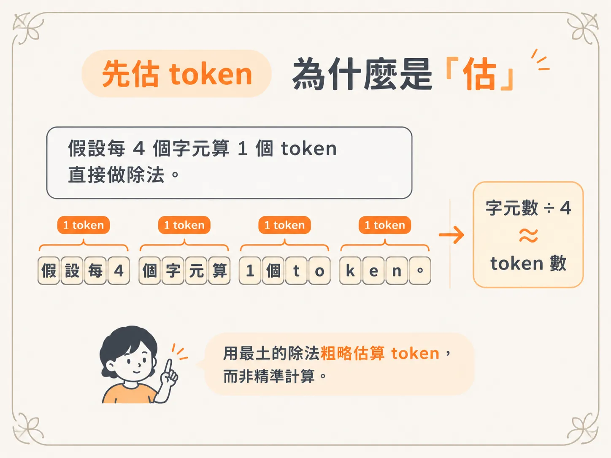
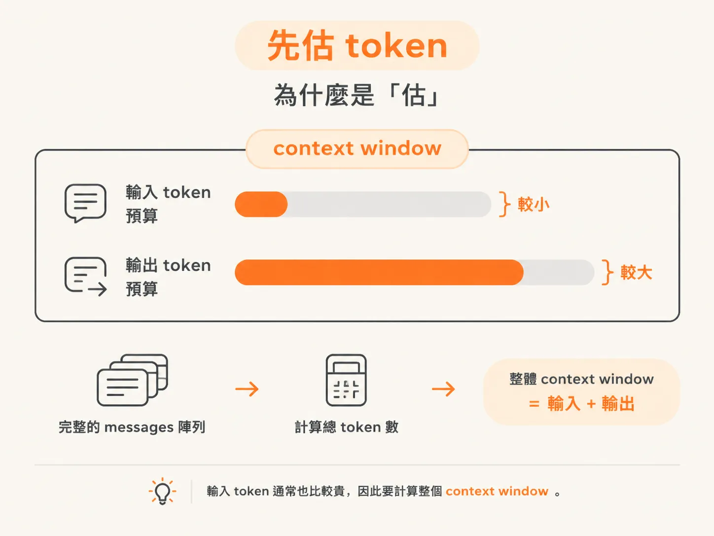
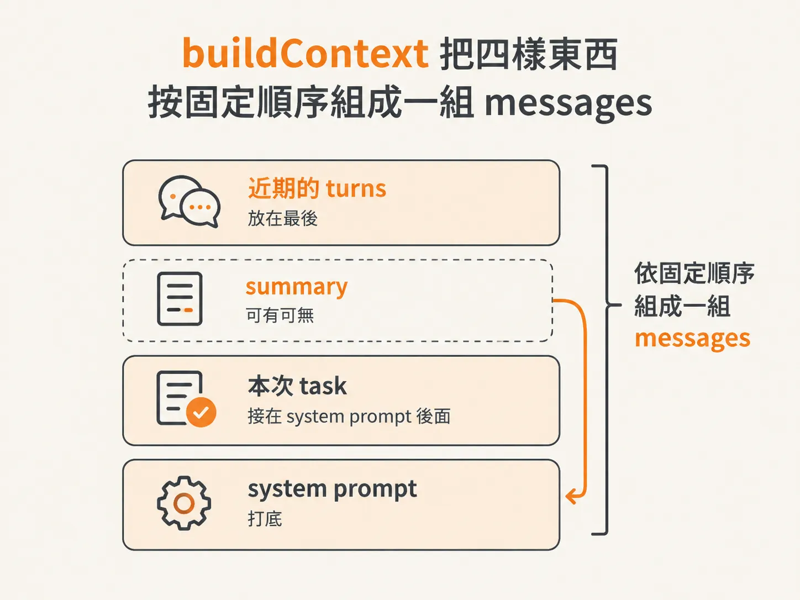
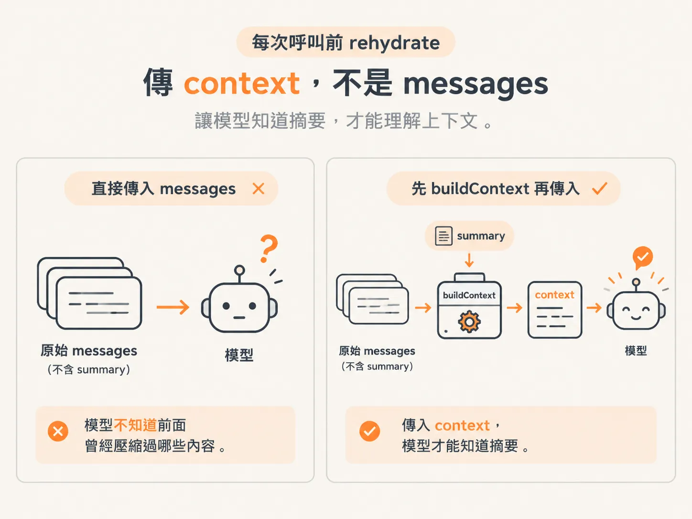

# 每次呼叫前重新 hydrate：buildContext 與 token 估算

上一課把記憶拆成 History、State、Context 三層，也看到模型每輪真正收到的是 hydrator 組出來的那一小包 Context。

這一課要看的是實際動手的那一步：每次呼叫模型前，harness 到底組出了什麼。

答案有兩塊：

- `estimateTokens`：先粗估目前有多少 token
- `buildContext`：把 system prompt、本次 task、summary 與近期 turns 組成新的 messages 陣列

最後，再把組好的 context 餵給模型。這個步驟就叫做 **hydrate**。

## 先估 token：為什麼是「估」

要決定是否需要壓縮，得先知道目前用了多少 token。素材裡定義了兩個門檻，而且故意設得很低，低到我們能親眼看到壓縮發生：一個是 500，另一個是 200，單位都是 token。

那 token 要怎麼算？

素材給了一個很好記、但很粗略的規則：**平均 4 個字元大約算 1 個 token**。

這個估法準不準，取決於每個模型使用的 encoder。每個 LLM 都有自己的 encoder，因此同一段文字，在不同模型眼裡可能會有不同的 token 數。

理想的做法，是使用和模型相同的 tokenizer 來計算。業界的標準是 TikToken，它會跟著模型更新，使用的也是和模型相同的 encoder，計算結果會比較準。

但 TikToken 是 Python 套件。作者上次使用時，JS 版本已經沒有持續更新；在 TypeScript 生態裡，也找不到幾個好用的 tokenizer。

所以這堂課先用一個簡化做法：假設每 4 個字元算 1 個 token，直接做除法。



*AI 生成示意圖*

素材特別提醒，這只是示範。放到生產環境時，應該使用和模型 encoder 採用相同演算法的快速 tokenizer。

`estimateTokens` 會吃進整個 messages 陣列，最後回傳一個數字。

<!-- derived -->
```ts
function estimateTokens(messages: ModelMessage[]): number {
  const chars = JSON.stringify(messages).length;
  return Math.ceil(chars / 4);
}
```

這裡有個背景知識值得補充：模型會把 token 分成 input 和 output 來計算。

所謂「百萬 token 的 context window」，指的是輸入與輸出加起來的總量。通常輸入的預算比較小、輸出的預算比較大，因為你對模型說的話，通常比模型回覆你的內容少。

輸入 token 通常也比較貴。因此，我們要計算的是整個 context window：把完整的 messages 陣列丟進去，算出其中總共有多少 token。



*AI 生成示意圖*

## buildContext：把一回合的 context 組起來

估算完 token 後，下一支函式就是 `buildContext`。

素材把它稱為「很便宜、很快的版本」。之後你很可能會直接購買現成產品來處理這件事，甚至可能使用比 LLM 更適合的模型。不過，它的基本概念就是這樣。

`buildContext` 會接收三個參數：

- `task`：使用者剛剛說的那句話
- `summary`：可能有，也可能沒有的摘要
- `turns`：近期的幾輪對話

最後回傳一組新的 model messages。

組裝順序是固定的。

首先放入 baseline，也就是 system prompt。它永遠是第一則訊息，role 是 `system`。

接著放入使用者這一回合剛提出的 task，role 是 `user`。順序刻意安排成這樣：先記住「使用者剛剛問了什麼」，如果需要壓縮，就把壓縮內容放在它下面。

接下來處理 summary。

如果有傳入 summary，就把它注入 system prompt，讓 LLM 知道：「這是目前為止的摘要。」

素材在這裡特別提醒了一個容易踩到的坑：不要為了放入 summary，又另外 `push` 一則 role 是 `system` 的訊息。兩則 system message 可能引發警告，甚至造成錯誤。

正確做法是直接修改第一則訊息的 content，使用 `+=` 把 summary 接上去。

最後，再依序把近期每一輪的 turn `push` 進 context，整個組裝就完成了。

<!-- derived -->
```ts
function buildContext(
  task: string,
  summary: string | undefined,
  turns: ModelMessage[],
): ModelMessage[] {
  const context: ModelMessage[] = [
    { role: "system", content: systemPrompt },
    { role: "user", content: task },
  ];

  if (summary) {
    context[0].content += `\n\nSo far:\n${summary}`;
  }

  for (const turn of turns) {
    context.push(turn);
  }

  return context;
}
```

組出來的東西，就是本回合的 context：system prompt 打底，本次 task 接在後面；如果有 summary，就把它黏進 system prompt；近期的 turns 則放在最後。



*AI 生成示意圖*

## 每次呼叫前 rehydrate：傳 context，不是 messages

`buildContext` 寫好後，重點就變成兩件事：什麼時候使用，以及要拿什麼資料使用。

呼叫模型前，先執行 `buildContext`，把使用者這一回合的 input、可能存在的 summary，以及目前累積的幾輪對話一起傳進去，取得一組新的 context。

這組 context 已經把 summary 包含進去了——如果 summary 存在的話。

關鍵在於，原本的 `modelTurn` 接收的是 `messages`；而 messages 是**不含 summary 的原始訊息**。

如果繼續傳入 `messages`，模型就永遠不知道前面曾經壓縮過哪些內容。因此，這裡要改成傳入 context。



*AI 生成示意圖*

<!-- derived -->
```ts
const context = buildContext(input, summary, turns);
const turn = await modelTurn(workflowId, context);
```

如果目前沒有 summary，也從來沒有做過壓縮，那麼 context 就會等於一般的 messages，行為不會改變。

這個步驟就叫做 **hydrate**：每次呼叫模型時，都重新組出「模型這一刻應該看到的內容」。

如此一來，長對話中的模型視角就很清楚了。它永遠看到的是：

**system prompt + 本次 task + 摘要 + 近期幾輪**

而不是你在螢幕上看到的、從頭到尾的完整紀錄。

下一課要看的，是另一支函式：當對話超過 token 預算時，如何把最舊的 turns 摺進 summary。
