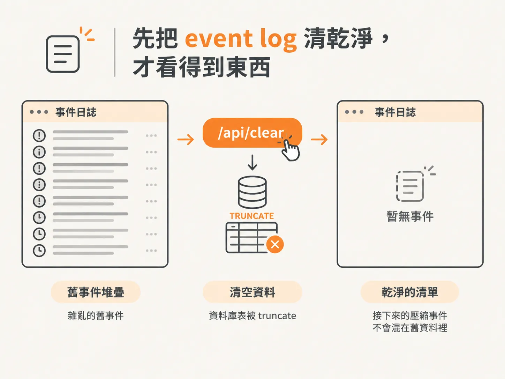
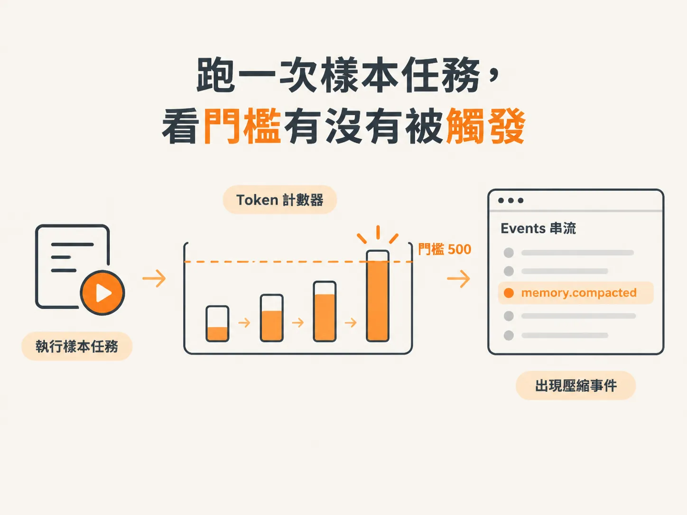
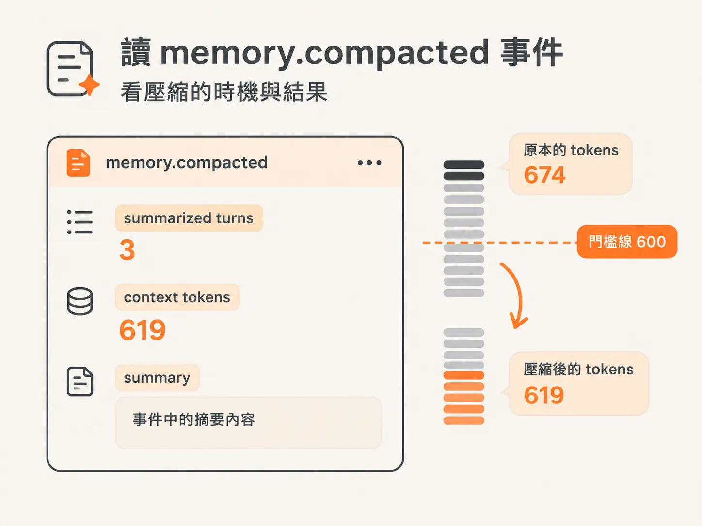
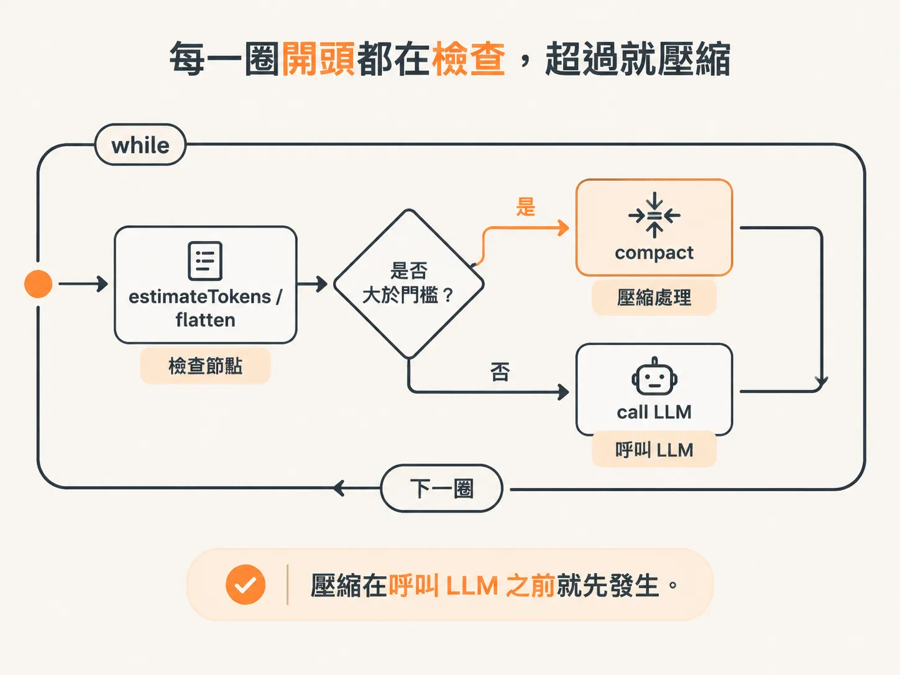

# 把門檻調到荒謬低，看壓縮真的發生

前一課已經完成 compaction 邏輯：當內容超過 token 預算，就滑動視窗，把最舊的 turns 摺進 summary。

但把邏輯寫進程式，和親眼看到它執行，還是兩回事。

這一課要做的事很直接：把門檻調到一個荒謬低的數字，實際跑一次任務，再從 event log 找出 `memory.compacted` 事件，確認壓縮是在什麼時機發生，以及最後產出了什麼結果。

## 先把 event log 清乾淨，才看得到東西

第一個障礙很實際：event log 裡已經堆了許多舊事件，新的壓縮事件很容易被淹沒。

所以，得先把 event log 清掉，才看得到接下來發生的事。

做法分成三步。

第一步，在 `db.ts` 加入 `clearEventLog` 函式。它的工作就是 truncate 這張表，也就是整張表直接清空。

第二步，到 server 的 index 匯入這個函式，並新增一條 POST 路由 `/api/clear`。只要呼叫這條路由，就會清空 event log。

為了讓瀏覽器能呼叫這條路由，還需要設定 CORS。CORS 的作用，是決定「不同 domain 的 client 能不能連到你的 server」。這裡把它設成允許任何 origin 通過 preflight 檢查。

UI 上的 clear 按鈕原本就已經接好了。因此，路由一加上去，按鈕就能直接使用。

第三步，就是實際按下 clear。

素材啟動 dev server，進入 harness inspector 後按下 clear，操作成功。事件清單回到乾淨狀態，接下來的壓縮事件才不會混在舊資料裡。

*AI 生成示意圖*

## 跑一次樣本任務，看門檻有沒有被觸發

清空事件後，素材貼上一個樣本任務。

這個任務包含 5 個 items，門檻當時設在 500，另外還提供了 30 turns。作者一開始也不確定會發生什麼事：

也許模型夠聰明，很快就能完成；也可能得把門檻一路降到 10 tokens 這種誇張數字，才看得到壓縮。

結果模型開始一項一項處理，邊處理邊產生 draft reply。素材一邊觀察一邊說，這個任務有 5 個 items，門檻是 500，又給了 30 turns，應該會觸發壓縮。

他把視線轉到 events 輸出，起初還沒看到壓縮事件。接著，畫面上出現了：

`memory.compacted`

*AI 生成示意圖*

## 讀 `memory.compacted` 事件，看壓縮的時機與結果

這就是前一課埋下的 `memory.compacted` 事件。

它會記錄幾件事：

- summarize 了幾個 turns
- 壓縮後的 context 還剩多少 tokens
- summary 的內容

這一筆事件記錄的是：

- summarize turns：3
- context tokens：619
- summary：事件中的摘要內容

*AI 生成示意圖*

接著，素材發現一件更有趣的事：log 裡每一筆 compacted 事件，token 數都剛好比門檻低一點。

例如這一筆原本是 674，壓縮後就降回門檻附近。

原因是，當內容超過門檻，系統就會啟動壓縮；壓縮完成後，內容會回到門檻以下。

所以，「每個 compacted 事件的 token 數都略低於門檻」，反過來正好證明了壓縮是在「略高於門檻」時被觸發的。

這裡還有一個數字上的小插曲。

素材一開始以為門檻是 600，後來才想起來，設定其實是 `maxContentTokens 500`、`keepContextTokens 200`。也就是說，先前想到的 600 不對，500 才是合理的門檻。

## 每一圈開頭都在檢查，超過就壓縮

為什麼壓縮會在這個時機發生？

素材回頭查看程式，發現 runtime 的每一圈 `while loop` 開頭，都會先做檢查，而且是在呼叫 LLM 之前。

harness 會先執行 `estimateTokens`，把 turns flatten，接著確認目前的內容量。簡單說，就是先問一句：

> 我們現在累積到哪裡了？

如果目前的 token 數已經超過門檻，就會先進行壓縮。

所以，壓縮不是等 LLM 出錯後才處理，而是在呼叫 LLM 之前就先動手。

*AI 生成示意圖*

這也呼應前一課提到的設計：要趕在 model turn 之前完成 summarize，因為真正可能爆掉的地方，就是 model turn。

## 用 system prompt 逼它多用 token

最後還有一個小技巧。

為了讓壓縮更常發生，方便觀察整個流程，素材在 system prompt 加入一段要求，逼模型慢慢、一項一項完成任務：

- 一次處理一個 item
- 完成該 item 的四個步驟後，才能開始下一個
- 所有 item 都完成後，再簡短總結做過的事

目的就是讓模型確實走完每個步驟，盡可能多使用一些 token。

作者也明確說明，這種寫法不適合真實世界。它只是 demo 技巧，用來讓模型多燒一點 token，讓壓縮更容易被觸發。

這個設定確實太激進，實際的 production 環境不會這樣做。

但這正是這次示範的重點：把門檻調到荒謬低，讓壓縮在可觀察的範圍內一再發生，才能清楚看到它什麼時候觸發，以及會把歷史內容壓縮成什麼樣子。

demo 能順利跑起來，和 production 能長期穩定運作，還是兩回事。
