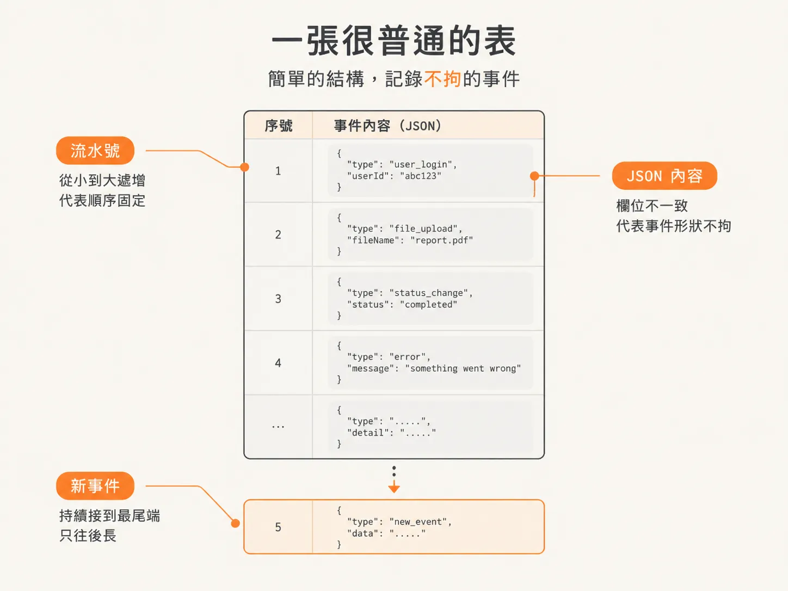

# Event log 的 schema：seq 與 jsonb

上一課的結論是：事件不能只交給 WebSocket，得先落到一個可以照順序讀回來的地方。這課就來看那個地方長什麼樣子。

它在 Postgres 裡，是一張很普通的表，名字叫 `event_log`。別因為它屬於 agent 系統就期待什麼特別設計：素材自己的說法是，這種事情你在任何用資料庫的應用程式裡都做過，跟 agent 一點關係都沒有。

## seq：唯一需要自己想的欄位

表上只有兩個欄位。第一個是 `seq`，負責順序。

harness 跑 workflow 的時候會不斷丟出事件，這些事件總得有個辦法知道誰先誰後。`seq` 就是那個依據，像收據上的流水號：重播的時候照它排，事件重複進來的時候也靠它去重（de-dupe）。

<!-- derived -->
```ts
export const eventLog = pgTable("event_log", {
  seq: integer("seq").primaryKey(),
  data: jsonb("data").$type<AgentEvent>().notNull(),
});
```

素材把它設成主鍵。主鍵的意思跟資料庫裡其他東西一樣：一個被索引、保證唯一的識別。之所以用 `seq` 而不是另外生一組 id，是因為排序和去重剛好是同一個號碼就能回答的兩件事。

講到這裡要停一下：素材只交代了 `seq` 是主鍵、負責排序，沒有說號碼是怎麼配發的。這不是這一課的重點；重點是每一筆事件都帶著一個可以排序、可以辨識的鍵，後面的 replay 才有辦法講「照原來的順序」。

## data：payload 用 jsonb

第二個欄位是 `data`，型別是 `jsonb`，放的是事件的內容本身。取名就叫 `data`，因為它就是一個 JSON 物件。

事件的形狀會隨類型變：文字更新、工具呼叫、工具結果，欄位都不一樣。與其為每種事件開一張表或加一堆欄位，不如整包塞進 `jsonb`，讓資料庫不用理解裡面裝了什麼。

`data` 不能是 null。素材的理由很直接：不能有空白的事件，一筆事件一定要有內容。

## 那個 TypeScript 泛型只是為了編輯器

Drizzle 允許在欄位上掛一個型別，寫成 `$type<AgentEvent>()`。這行看起來很技術，但它不影響資料庫。

素材講得很清楚：加了泛型之後，你在程式裡碰到 `row.data` 時，編輯器會提示成 `AgentEvent`；拿掉它，程式照樣跑。資料庫看到的永遠只是一個普通的 JSON 物件，它不知道 `AgentEvent` 是什麼。這是開發體驗，不是 schema。

## 建表順序：先確保它存在

表定義好之後，素材還加了一段執行期的檢查：用 `create table if not exists` 確認表真的在。寫法是把 SQL 放在 template tag 裡，直接交給 Drizzle 執行。

素材對它的定位是「小小的 runtime migration」，而且明說不是必要的。會放進來，是因為作者在錄課時遇到錯誤，索性讓後來的讀者不會撞到同一件事。

## 一張很普通的表

所以這張表的全部內容，就是一個排序用的主鍵，加上一個不能為空的 JSON payload。它是一個 tail log：事件一直往後長，順序固定，內容不拘。


*AI 生成示意圖*

表有了，下一個問題是：什麼時候寫進去？答案聽起來像廢話——emit 的時候。但 emit 裡面「先寫」還是「先送」，順序差很多，下一課專門講這件事。
