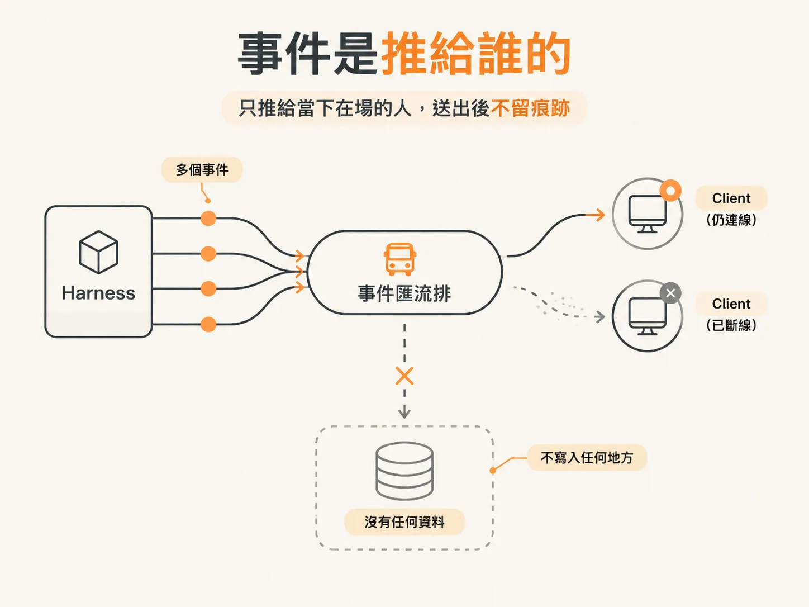

# 事件只活在記憶體裡，斷線就沒了

前面幾課做完，你應該有一個能跑的畫面：使用者送出任務，模型一邊想、工具一邊跑，文字一段一段出現在瀏覽器上。整個過程看起來很順，直到你把伺服器關掉再開回來。

重新整理頁面，什麼都沒有了。不是畫面卡住，是那些事件真的不存在了。

## 事件是推給誰的

先定位問題發生在哪裡。harness 在跑 workflow 的時候，會不斷產生事件：模型開始想了、某個工具被呼叫了、工具回傳結果了。這些事件透過一個 bus（事件匯流排）往外送，訂閱在 bus 上的用戶端再用 WebSocket 收到更新。

問題出在「送」這個動作沒有留下任何東西。事件被 emit 出去，迴圈跑過一輪 listener，然後就結束了。它沒有寫進任何地方。


*AI 生成示意圖*

<!-- derived -->
```ts
// 目前的 bus：只把事件推給此刻還連著的 listener
export function emit(event: AgentEvent) {
  for (const listener of listeners) {
    listener(event);
  }
}
```

只要 listener 那一刻不在，事件就跟他無關了。

## 三個遺失點

把情況列成清單，你會發現遺失不是某個 bug，而是這個設計的預設行為。

| 情況 | 發生什麼 |
|---|---|
| client 斷線 | 事件照樣 emit，但沒有 listener 收，直接消失 |
| client 介面出錯 | 下游處理失敗，事件已經送出去了，沒有重試的依據 |
| 伺服器重啟 | `listeners` 這個集合在記憶體裡，重啟後是空的 |

素材裡把話說得很直白：現在沒有任何持久化層，所以「如果中間出了什麼差錯，你就是錯過了，它不在那裡，你也沒救了」。

這也是為什麼串流看起來很即時，卻不能當成狀態。即時和可靠是兩件事。

## 需要的是儲存層，不是更好的重試

第一反應通常是加 retry，讓送失敗的事件再送一次。但 retry 解決不了「不知道送過什麼」的問題：重試需要一份紀錄，而現在正好沒有。

素材給的方向是儲存層：事件要先被保存在某個地方，之後才能重播（replay）、才能從中斷的地方接下去。即使某個環節壞了，資料還在。

換句話說，bus 的角色要從「廣播器」變成「有紀錄的廣播器」。儲存不是為了事後查帳，而是為了讓斷線後的 client 有東西可以補。

## 重連時會發生什麼

補的動作發生在連線建立的那一刻。素材的描述是：不管是伺服器重啟還是 client 重啟，只要 client 重新連上伺服器，就會觸發 connection 事件；在那裡把所有事件重播一遍，事件就自動補回來了。

注意這句話的範圍：重播發生在「連上」時，不是「使用者按了重新整理」時。客戶端不需要知道自己錯過什麼，它只要連上，就有一份完整的歷史等著它。

所以真正要建的是一份可以照順序讀出來的事件紀錄。下一課先看這張表長什麼樣子：一個序號欄位，一個放 payload 的欄位。
