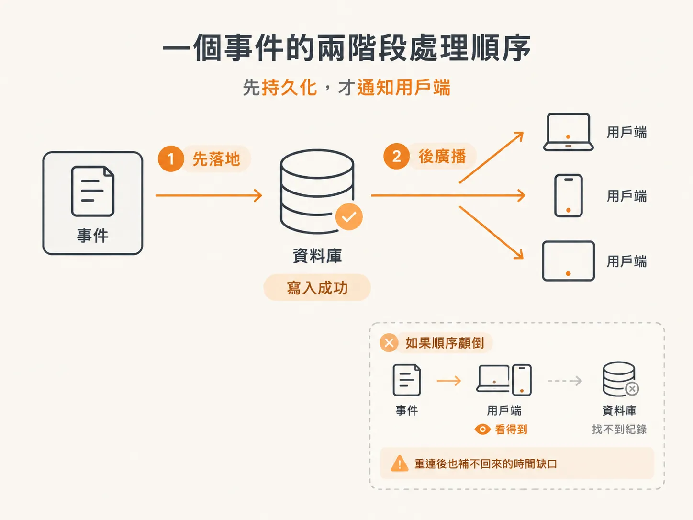

# 先落地再廣播：emit 的順序

表建好了，但表不會自己長出資料。所有事件都從同一個地方進來：`emit`。這一課要把原本只會往外送的 `emit`，改成先寫資料庫、再通知用戶端。

動手之前還有一個搬遷動作。

## bus 從 server 搬進 harness

原本的 bus 放在 server 裡，是一個記憶體版本的實作。素材的做法是把它整包移到 harness，然後改掉 index server 那邊的 import。

搬家的理由不是為了檔案整齊，而是因為它接下來要碰資料庫。bus 一旦負責持久化，它就屬於 harness 的狀態面，而不是伺服器啟動流程的一部分。

搬過去之後，還有一個東西要拆：原本那個 class。它存在的原因是為了在記憶體裡維護狀態，例如一個存事件的陣列。現在狀態交給 Postgres，class 就沒有存在的理由了。

拆完剩下三樣東西，也就是這個 bus 全部的介面：

- `subscribe`：讓某個用戶端開始收事件
- `emit`：產生一則事件
- `history`：把歷史事件讀回來

`listeners` 這個集合還在，因為「現在有誰連著」仍然是記憶體該管的事。差別只在於，它不再是人們唯一能拿到事件的管道。

## emit 變成 async

原本的 `emit` 是同步的，跑一圈 listener 就結束。現在它要跟資料庫說話，所以是 async，回傳一個 Promise；素材特別提了一句，這個 Promise 實際上不帶任何值（resolve 成 nothing）。

函式收進來的是要 emit 的內容，然後補上兩個事件自己該有的欄位：一個隨機產生的 `id`，還有建立當下的 `timestamp`。

<!-- derived -->
```ts
export async function emit(input: EventInput): Promise<void> {
  const event: AgentEvent = {
    id: crypto.randomUUID(),
    timestamp: Date.now(),
    ...input,
  };

  // 先落地
  await db.insert(eventLog).values({ data: event });

  // 確認在資料庫裡了，才廣播
  for (const listener of listeners) {
    listener(event);
  }
}
```

## 順序就是整個設計

把這兩步拆開看：`await db.insert(...)` 完成之後，才進入 listener 的迴圈。

素材在寫這段時反覆強調同一句話：因為已經 insert、確認事件在資料庫裡，「現在把事件送給用戶端是安全的」。安全不是指網路不會斷，而是指即使接下來斷了，這則事件仍然找得回來。


*AI 生成示意圖*

反過來寫會壞在哪？如果先廣播、後寫入：

- 用戶端已經看到的事件，可能還沒進資料庫；中間若寫入失敗，畫面上有一則 log 裡不存在的事件。
- 伺服器如果在兩步之間掛掉，使用者看到過的東西，重連後重播不出來。

第一種是幽靈事件，第二種是時間軸破洞。兩種都讓「畫面」和「紀錄」對不起來，而這個 node 想建立的核心保證，正是這兩者要是同一件事。

## 一個小插曲：事件不能是 undefined

素材在改寫的過程中撞到一個型別錯誤：`event` 的型別是 `undefined`，不能塞進 `AgentEvent`。這不是什麼深奧的 bug，就是事件的推導在某處掉了，補回來就好。

值得留意的是它出現的時機：當你把「產生事件」和「寫入資料庫」放在同一條 async 流程裡，型別會逼你把事件的形狀講清楚。這跟上一課的 `$type<AgentEvent>()` 是同一件事的兩端：一個管編輯器看到什麼，一個管執行時真的送出去什麼。

現在 `emit` 有了，而且順序是對的。但用戶端要怎麼收到事件、重連之後要怎麼把過去補起來？那是另外兩個函式的事。
