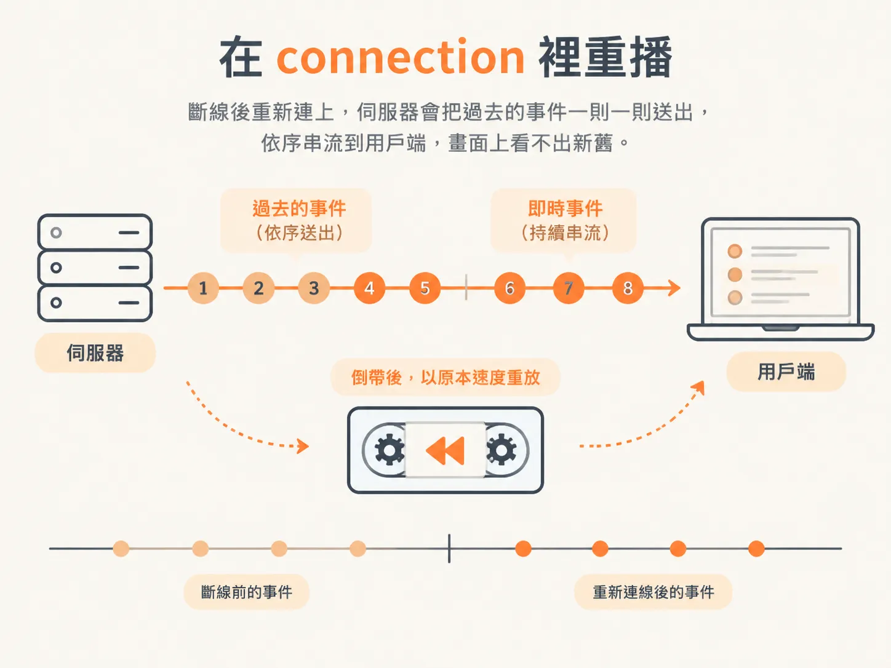

# 重啟後 replay：把斷線的時間軸接回來

`history` 已經能把整份事件讀回來，但還沒有人呼叫它。這個 node 的最後一塊，是把「連上線」和「補歷史」接在一起。

## 在 connection 裡重播

重播的位置在 WebSocket 的 connection handler。每當有用戶端連上，就先跑一輪 `history`，把每一則事件逐一送出去。

<!-- derived -->
```ts
wss.on("connection", (ws) => {
  // 不管是伺服器重啟還是用戶端重連，連上就先補歷史
  (async () => {
    for (const event of await history()) {
      ws.send(JSON.stringify(event));
    }
  })();

  ws.on("message", async (raw) => {
    const input = JSON.parse(raw.toString());
    await DBOS.startWorkflow(runAgentWorkflow)(input);
  });
});
```

素材特別交代，這是「一則一則」送，不是打包成一個陣列一次丟過去。每一則事件各自串流進來，用戶端收到的感覺跟即時串流一樣，只不過這些其實是過去發生的事。就像有人把錄影帶倒帶，然後用原本的速度再放一次，畫面上看不出新舊之分。


*AI 生成示意圖*

同一個 handler 裡還有另一件事：收到用戶端的訊息時，啟動 workflow。素材的順序是先處理送進來的任務，然後在同一個 connection 範圍內重播歷史。

## 誰重啟都一樣

這個設計最關鍵的一句話，是素材在 recap 裡講的：不管是伺服器重啟，還是用戶端重啟，連線這件事都會發生，於是重播就會發生。

用戶端不需要記住「我上次看到第幾則」，也不需要一個「補資料」的按鈕。它只要連上，就自動被補到最新狀態。

這也是為什麼前幾課一直強調 `seq`：使用者重新整理頁面，拿到的歷史還是同一個順序；連線斷了再接回來，看到的還是同一條時間軸，而不是從中間接上的另一條。

## 驗證方式：把伺服器殺掉

素材示範的測試很粗暴，但很有說服力。

先送一個任務，看著模型開始思考、工具開始跑。趁它還在跑的時候，直接把伺服器停掉。然後重新啟動、回到瀏覽器、重新整理。

結果是它接上了，而且繼續串流。素材原本以為要等某個事件觸發才會繼續，實際上模型自己就接下去了：它看到訊息陣列裡最後一則是被回覆的對象（工具訊息或使用者訊息），就知道該產生回覆。這件事跟用戶端無關，用戶端只是重新載入而已。

再測一次更單純的：重新整理，內容還在；把伺服器殺掉再開，結果還在。素材的對照是「以前做不到，這些東西會直接消失，因為我們沒有任何持久化」。

## 狀態面的邊界

到這裡，這個 node 的三件事都齊了：事件先寫進 Postgres，寫成功才廣播，重連時照 `seq` 重播。使用者看到的畫面，終於和資料庫裡的紀錄是同一份。

但要注意這條保證的範圍。事件流回答的是「發生了什麼、順序是什麼」，它不負責決定「工作從哪一步繼續」。素材示範裡伺服器重啟後 workflow 還能接下去，靠的是 workflow 自己的機制；事件只是把過程呈現出來。

這也是下一個 node 要處理的問題：哪些動作必須被包成 workflow 的 step，重啟之後才不會重跑一次。
