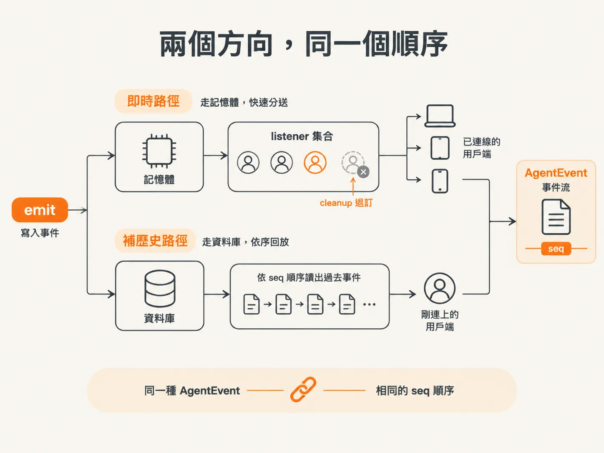

# subscribe 與 history：兩個方向的介面

`emit` 只負責往外推。但用戶端跟事件之間其實有兩個方向：連著的時候要即時收到，剛連上的時候要補回過去。這個 node 的 bus 剛好就只有這兩種操作，加上一個負責寫入的 `emit`。

先把「誰在收」處理好。

## subscribe：加進去，也要拿得出來

`listeners` 是一個集合，裡面放著所有訂閱這個 bus 的用戶端。`subscribe` 的工作就是把人加進去。

<!-- derived -->
```ts
export function subscribe(listener: Listener): () => void {
  listeners.add(listener);
  return () => listeners.delete(listener);
}
```

注意它回傳的不是 void，而是一個函式。這個函式被呼叫時，會把剛才加進去的 listener 從集合裡刪掉。

素材把它類比成 React 的 `useEffect` 的 cleanup：你訂閱了什麼，就要有對應的動作把它收掉。就像報名活動要能退名，只進不出的話名冊只會越來越肥。不做的話，斷線的用戶端會一直留在集合裡，`emit` 每次都會對著早就離開的連線送事件。素材用的詞是 memory leak。

（素材也順口提醒：`useEffect` 本身很危險，能不用就不用。這裡借用的是 cleanup 的概念，不是叫你把它搬進 React。）

所以這個介面的形狀是：`subscribe(listener)` 回傳 `cleanup`。呼叫端拿到什麼，就有責任在適當的時機把它執行掉。

## history：把紀錄讀回來

另一個方向是 `history`。它是非同步的，回傳一個 `AgentEvent` 陣列，內容是資料表裡的所有事件。

<!-- derived -->
```ts
export async function history(): Promise<AgentEvent[]> {
  const rows = await db.select().from(eventLog).orderBy(eventLog.seq);
  return rows.map((row) => row.data);
}
```

兩個細節值得停下來看。

第一是 `orderBy`。查詢指定用 `seq` 排序，所以每次呼叫 `history`，拿到的順序都一樣。這不是資料庫剛好吐出來的巧合，是刻意要求的。

第二是 `map`。每一列取出來之後，只回傳 `data`，其他欄位不需要。`seq` 的用途是排序，排完就不必跟著事件一起交給上層；用戶端要的是 event 本身。

素材對這個函式的評語是：當我們要重新接上時，這個很好用，因為「我現在需要把全部事件重播一遍」。

## 兩個方向，同一個順序

把三個函式放在一起看，責任分得很清楚：

| 函式 | 方向 | 什麼時候用 |
|---|---|---|
| `emit` | 寫入 → 廣播 | 事件發生的當下 |
| `subscribe` | 記憶體 → 用戶端 | 連線還活著的時候 |
| `history` | 資料庫 → 呼叫端 | 需要補回過去的時候 |

即時的那條路走記憶體，補歷史的那條路走資料庫。兩條路最後送出的都是同一種 `AgentEvent`，而且都建立在同一個 `seq` 順序上。


*AI 生成示意圖*

這也是為什麼 `emit` 一定要先 insert：如果事件只走過記憶體那條路，`history` 就補不出東西，兩個方向會對不起來。

介面到齊了。下一個問題是誰來呼叫 `history`——總不能叫使用者自己按一個「補歷史」的按鈕。
