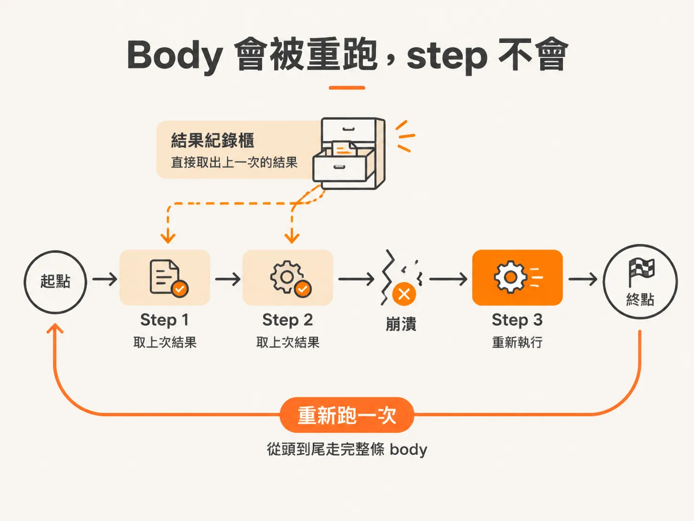
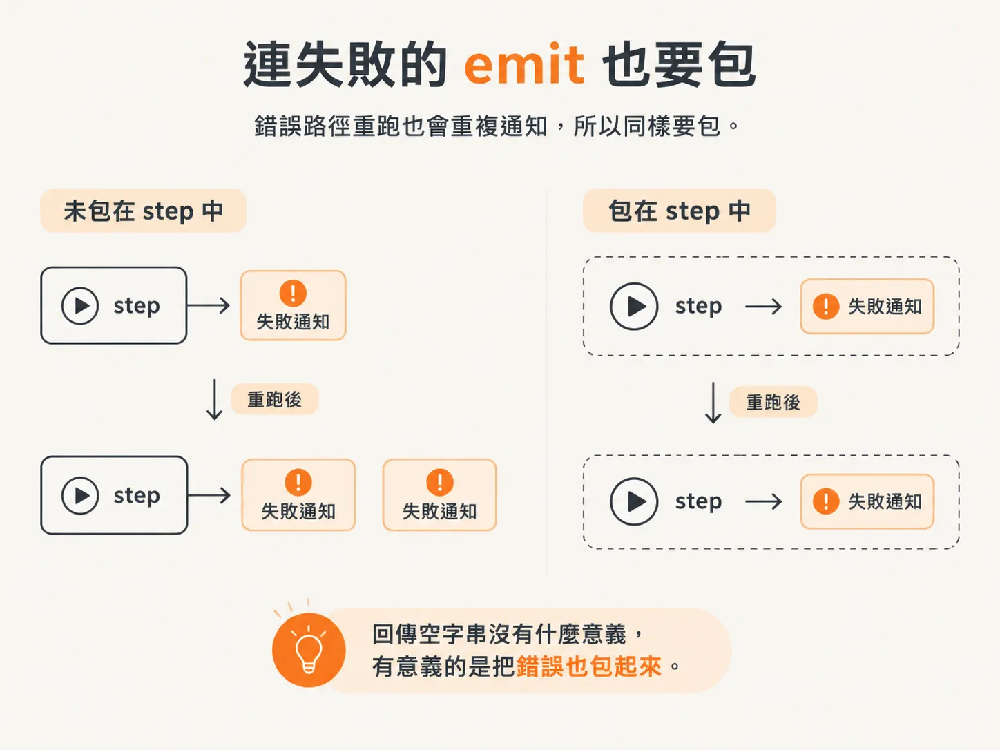
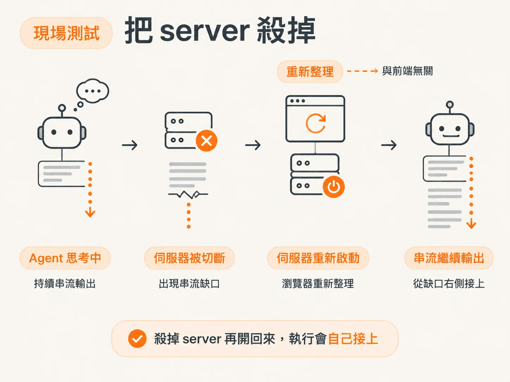
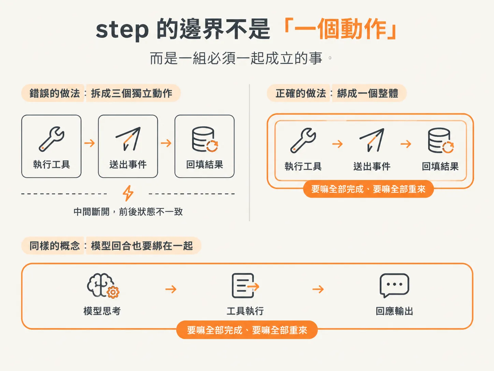

# Recovery 為什麼會重跑 workflow body

前面幾篇把 emit、tool call、model turn 一個一個包進 step，也留下一個問題：程式重啟之後，這條迴圈要怎麼從中斷的地方接回去？答案要先從註冊開始。而改完之後跑起來跟以前一模一樣，這其實有點掃興：你花了半天重構，畫面沒變、回答沒變，怎麼知道那些 step 真的有用？

素材裡的驗收方式很直接：把伺服器殺掉。

不是等它自己出錯，是在 agent 正在思考的時候，直接把 process 停掉。這種測試沒有人會不小心做成功，一定要故意做。

## 先註冊，否則 step 等於沒寫

包完 step 之後，還剩最後一個動作：把這個函式註冊成 workflow。

原本的寫法是直接 export 那個函式。現在要改成把它交給 DBOS 註冊，拿到一個註冊後的版本再 export。素材的說法是 `registerWorkflow`，把 function 傳進去，再給一個名字；名字可以跟函式同名。

<!-- derived -->
```ts
const runAgentWorkflow = DBOS.registerWorkflow(agentWorkflow, {
  name: "agentWorkflow",
});
```

素材對這件事的解釋只有一句，但那句是重點：沒有註冊，那些 step 就沒有意義。

想像你把每個動作都標好了「這裡要記錄」，卻沒有把這份清單交給任何單位。標記還在，但沒有人會來記錄。註冊就是那個「交給引擎」的動作：從現在起，這個函式不是普通函式，而是一個有 step、會被引擎接管執行的 workflow。

函式改名成 `agentWorkflow` 也是同樣的道理。不是編譯器要求，是給人看的。作者說，在 durable engine 裡，他習慣讓名字帶上 workflow，提醒自己：這不是普通函式。body 裡沒被包進 step 的程式碼，行為跟一般函式不一樣。

## Recovery 從頭跑的是外殼

那個「不一樣」就是這一課的主題。

Workflow 掛掉之後，recovery 不是從中斷的那一行接下去，而是把整個 workflow body 從頭再執行一次。聽起來很粗暴，但它是設計，不是缺陷。

原因在於：中斷那一刻執行到哪裡，這種資訊本來就沒有被保存。被保存下來的是另一種東西——每個 step 跑完之後的結果。

所以重跑 body 的時候，引擎會一個 step 一個 step 對：這個 step 之前跑過了嗎？跑過，就把上次的結果直接還給你，裡面的程式碼不再執行；沒跑過，才真的叫它跑。

換句話說，body 從頭到尾都被走了一遍，但真正做事的只有還沒做過的那幾段。你看到的「續跑」，其實是「重跑外殼、跳過已完成的部分」。



*AI 生成示意圖*

這也解釋了為什麼 body 裡的程式碼必須長得很乖。算字串、組物件、讀設定、判斷要走哪個分支，這些重跑幾次都一樣，留在 step 外面完全沒問題。至於重跑會多出第二個結果的動作，就是第一課點名的那三類，它們已經被關進 step 裡了。

好處是你不必自己寫 resume 邏輯。不用記游標、不用存「執行到第幾行」、不用設計一套狀態機。你只要把邊界畫對，續跑這件事就交給引擎。

## 連失敗的 emit 也要包

素材在 body 底部還有一個 emit，負責回報 workflow 失敗。

這種「只在出事時才跑」的程式碼，很容易被當成例外放過。但作者的處理方式一樣：包成 step，名字叫 failed step。裡面在做什麼？如果失敗，就回傳空字串。

回傳空字串本身沒有什麼意義，只是 step 需要一個回傳值。有意義的是那個包裝動作：連錯誤路徑都不放過。



*AI 生成示意圖*

判斷標準不是「這段重不重要」，而是「重跑會不會多一件事」。失敗通知重跑，就是第二次通知；使用者看到兩則失敗訊息，會以為系統連續掛了兩次。

## 現場測試：把 server 殺掉

回到驗收。素材的操作順序是這樣：

先送一個任務，看著 agent 開始思考，工具呼叫也真的跑了。然後在它還在 thinking 的時候，把 server 停掉。接著重新啟動，回到瀏覽器，重新整理頁面。

結果它接上了，而且繼續串流。



*AI 生成示意圖*

作者自己在直播裡原本還猜，重啟後應該要等到某個事件進來才會動。結果不是，畫面直接繼續。這件事讓他有點意外，也正好說明為什麼要現場做一次：你對系統的預期，往往比系統實際行為保守。

對照組是改動之前。那時候沒有任何持久化，同樣的動作做完，畫面就是空的，剛才跑到哪裡全部消失。

## 它為什麼會自己繼續

這裡常被誤解成「伺服器記得剛才停在哪」。

實際上是訊息陣列在發揮作用。重啟之後，messages 被重新餵進模型，而模型只看得到一件事：陣列的最後一則是什麼角色。

最後一則是 tool，代表使用者（或系統）把工具結果放回來了，那它就該根據結果生成回覆。最後一則是 user，那它就該回答使用者。就是這麼單純的規則。

模型不知道這則訊息是三分鐘前送的，也不知道中間 server 死過一次。它沒有「我剛剛被中斷」的概念，它只看到一個還沒有回覆的對話結尾，於是照規則往下寫。

把兩件事接起來看：workflow body 重跑，已完成的 step 直接把結果還回來，訊息陣列因此被重建；模型看到那個懸著的結尾，自然就生成了下一輪。所謂「自己接上」，是這幾件事湊在一起的結果，不是有人在旁邊按了繼續。

## 分組：step 的邊界不是「一個動作」

Recap 裡有一段在解釋，為什麼 tool 相關的動作全部塞在同一個 step，而不是每個動作各一個 step。

理由是「不能只發生一半」。工具真的跑了、emit 也送出去了、結果也回填了，這三件事必須一起成立。如果 emit 成功了，工具卻沒跑，前端就會顯示一件根本沒發生的事。這種不一致比崩潰更難查，因為畫面看起來很正常。

Model turn 也一樣。串流文字、等串流結束，是同一件事的不同階段，拆開沒有好處，只會多出「文字送了一半，但這一輪算不算完成」的問題。

所以 step 的邊界不是「一個動作一個 step」，而是「一組必須一起成立的事」。專案裡所有的重構，本質上都在畫這條線：把不該重跑的動作圈在一起，圈完之後外面的程式碼就可以安心被重跑。



*AI 生成示意圖*

## 註冊只是把手續辦完

整件事走到這裡，其實沒有新增任何業務邏輯。while 迴圈還是同一個 while 迴圈，stream text 還是同一段 stream text，工具還是原本那些工具。差別只在於：有些程式碼被搬進 step，然後整個函式被註冊成 workflow。

但就是這個註冊，讓前面所有的包裝開始生效。沒有它，step 只是長得比較特殊的函式呼叫；有了它，引擎才知道這個函式可以被重跑、哪些段落已經有紀錄、重啟之後該把哪些結果直接還你。

下次要驗收自己有沒有做對，不用讀程式碼。找個 agent 正在思考的時刻，把 server 殺掉，再開回來。它如果自己接上，就代表你的 step 邊界畫對了；如果它從頭再問一次、或多送了一次通知，那就是某個該被包起來的動作還留在外面。
