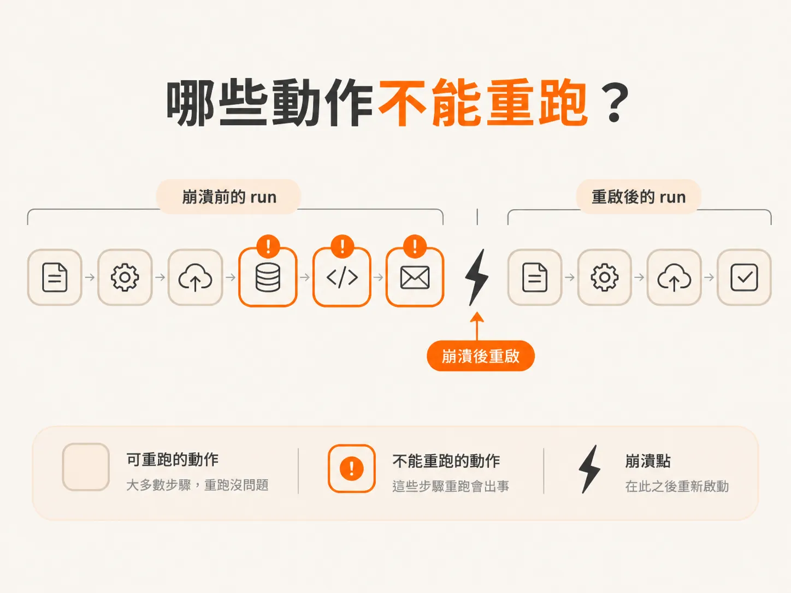
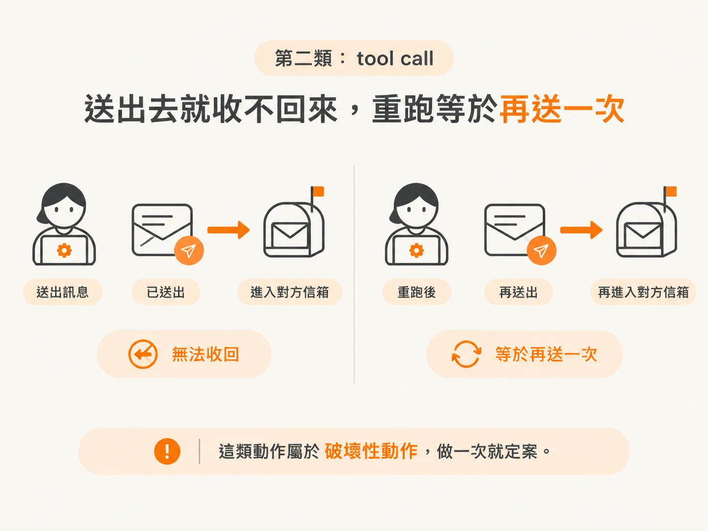
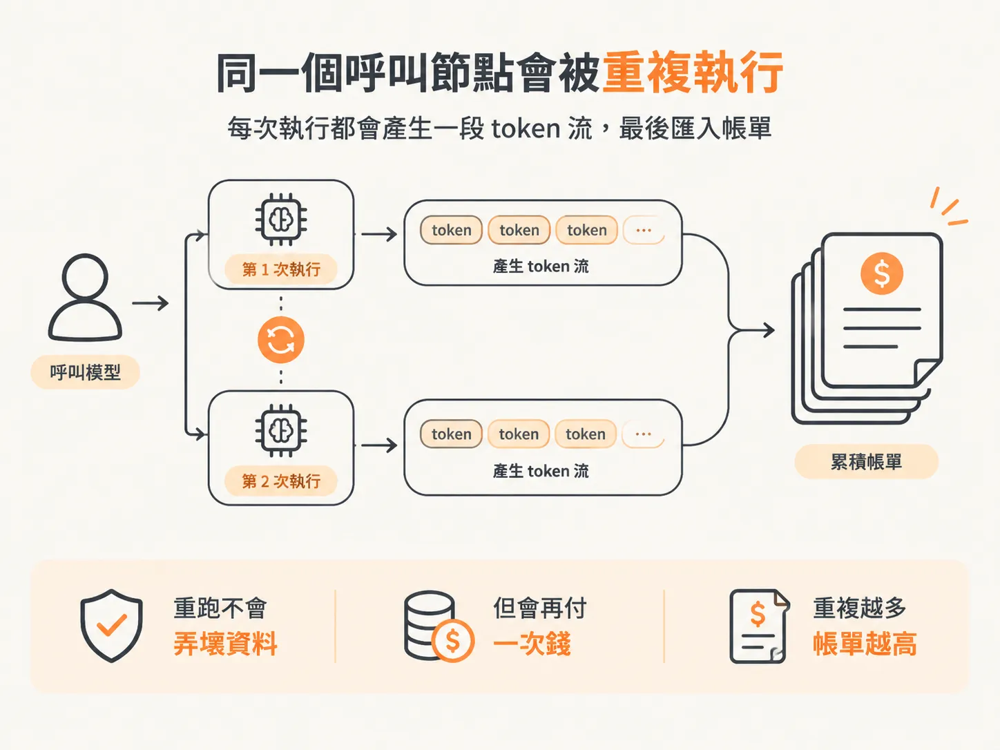
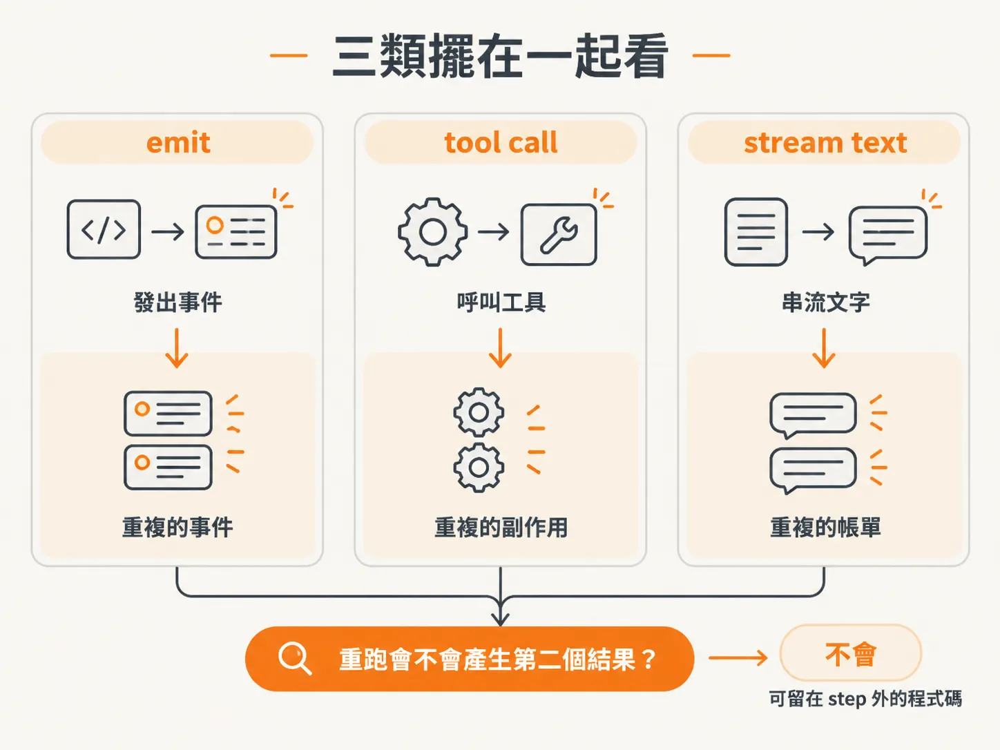

# 哪些動作不能重跑

Agent 跑到一半掛掉，重啟之後最常見的做法就是「再跑一次」。大部分程式碼這樣做沒問題：算一次匯率、組一次 prompt、讀一次設定，跑兩次結果都一樣。

但有些動作跑第二次就是事故。

*AI 生成示意圖*

這一課只做一件事：把 agent runtime 裡「不能重跑」的動作挑出來，數一數重跑一次要付多少代價。

## while 迴圈本身沒有變

先講不變的部分。素材在 recap 裡特別聲明：原本那個 runtime 還是原來的樣子。它是一個 while 迴圈，執行工具、拿到結果、再問模型還有沒有工具要呼叫，直到沒有為止，最後產生回覆。

Durable execution（持久化執行）沒有換掉這個迴圈。它做的事情只有一件：把某些動作包進 step，讓 step 的輸入與輸出寫進資料庫；同一個 workflow 裡再遇到同一個 step，就跳過不動。

形狀沒變，差別在「跑過沒有」這件事有了紀錄。也正因為只改了這件事，判斷哪些東西該包就變得非常關鍵。包錯地方，等於白做；漏包一個，重啟之後就補不回來。

## 第一類：emit

`emit` 是往外送事件的那個函式。使用者看到的「agent 正在想」、「工具回傳了什麼」，都是它送出去的。

原本的 emit 只是通知：跑一圈 listener，結束。加上持久化之後，它同時要寫進 event log，於是一個單純的通知變成有紀錄的副作用。

重跑的代價是重複。Workflow 被 retry，emit 再跑一次，資料庫就多一筆一樣的事件；前端收到兩筆，畫面上就是兩則重複的 log。使用者不會知道那是 retry 造成的，他只會覺得這個 agent 怪怪的。

還有一種比較隱微的版本：事件重複，但 UI 做了去重，看起來沒事。可是 event log 已經髒了，之後要拿它做審計或 replay，就會對不上。畫面可以藏，紀錄藏不住。

## 第二類：tool call

工具呼叫是這三類裡最容易理解的。工具有副作用：寄信、開 ticket、扣款、改資料庫，這些動作沒有 undo。

素材舉的例子是 send reply。信送出去就是送出去了，agent 掛掉重啟之後，你沒辦法走進對方的信箱說「先別開，我收回來」。素材用的詞是 destructive action，破壞性動作，做一次就定案。

*AI 生成示意圖*

所以工具呼叫要包進 step。同一個 workflow、同一個 step 已經有紀錄，重啟就跳過，不要呼叫第二次。

這裡有個實作上的轉折，值得先知道。在這份素材的專案裡，工具呼叫原本不是 harness 做的，是 AI SDK 幫忙做的。要把它包進 step，就得先讓 AI SDK 閉嘴：把每個 tool 的 `execute` 拿掉，改成自己寫一個 tool runner，用 switch 判斷這次要呼叫哪個工具，再自己叫那個函式。

也就是說，「哪些動作不能重跑」這個問題，會逼你先把執行權拿回來。沒有執行權，就沒有包裝的位置。

## 第三類：stream text

第三類是模型呼叫，素材裡叫 stream text。

它不像寄信那樣不可逆，重跑也不會弄壞什麼資料。它的代價是錢。

*AI 生成示意圖*

每一次呼叫模型都在燒 token。Workflow 掛在第三步，重啟後從第一步重跑，前面那幾次模型呼叫就跟著重付一次。呼叫越長、迴圈越多，重跑一次的成本越高。素材把 tool call 和 stream text 放在同一句裡講：一個關乎副作用，一個關乎錢和 token。

這也是為什麼「反正重跑很便宜」是個危險的預設。單次呼叫或許不貴，但 agent 的失敗通常發生在迴圈深處，前面已經累積了好幾輪。

## 三類擺在一起看

把三類並排，判斷規則其實只有一條：這個動作重跑一次，會不會產生第二個結果？

- emit 重跑，多一則事件。
- tool call 重跑，多一次副作用。
- stream text 重跑，多一張帳單。

三個都是「第二次」。差別只在第二次的代價落在哪裡：前端畫面、外部系統，還是你的帳單。

反過來說，不會產生第二個結果的東西就不需要包。組字串、算時間、讀設定，跑幾次都一樣，留在 step 外面沒關係。這條線畫清楚，才知道哪些程式碼該被包起來。

*AI 生成示意圖*

## 先列清單，再改程式

素材在 recap 開頭說，這一步看起來改了很多東西，其實只是把不想要的動作包進 step。這句話可以當成施工順序：先盤點，再動手。

盤點的方式很土。把 runtime 從頭到尾看一遍，遇到每個會碰到外部世界的呼叫就問一次：重跑會怎樣？答案如果是「多一則事件」、「多一次副作用」、「多一筆 token」，就標記起來。

三類都標完，step 的邊界大概就出來了。下一課要處理更細的分工：workflow body 本身會被重跑，哪些程式碼可以安全地留在外面。
