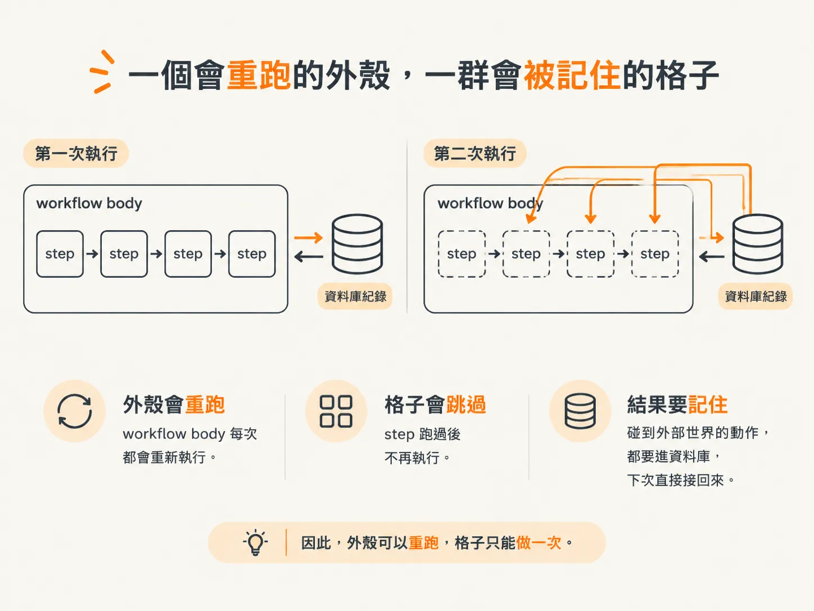
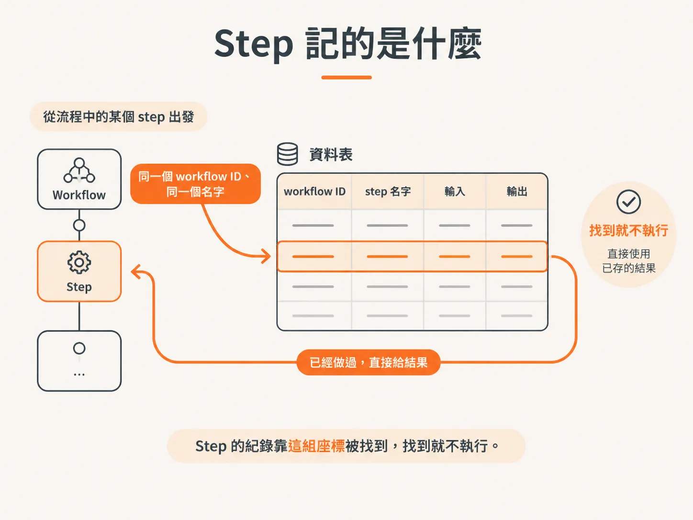
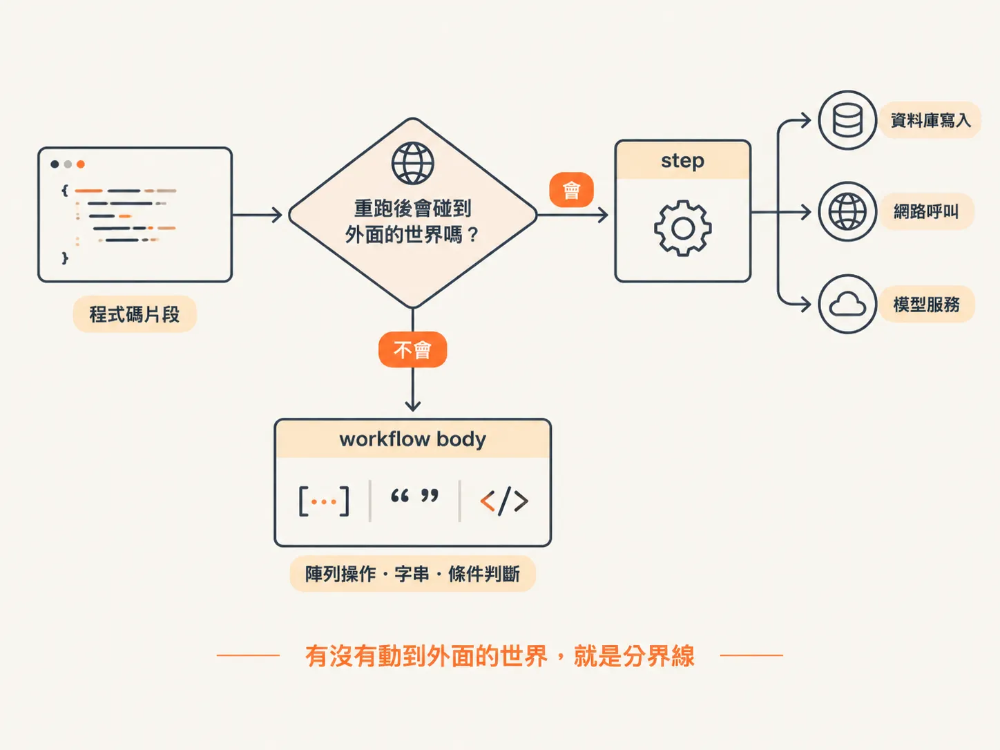
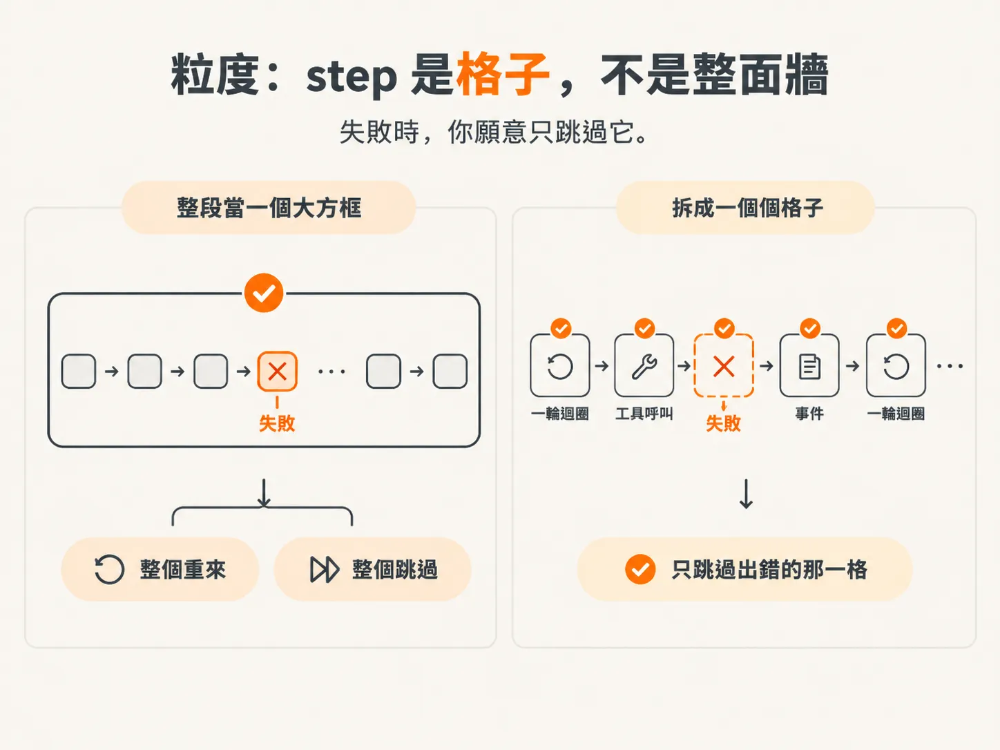

# Workflow body 可以重跑，step 的結果會被記住

上一課點名了三類「不能重跑」的程式碼：emit、tool call、模型呼叫。點完名，下一個問題自然就來了：那程式碼到底要放在哪裡？

答案不是「全部包起來」。Durable execution 是兩層的設計，不是一層。

## 一個會重跑的外殼，一群會被記住的格子

Workflow 就是一個函式。註冊到 DBOS 之後它會有名字，每次呼叫拿到一個 workflow ID。函式本體，也就是 workflow body，就是你原本那段 while 迴圈。

Step 是 body 裡面的一段 async 工作。`DBOS.runStep` 收一個 callback 和一個名字，把它包起來。所謂包起來，意思是這段工作的輸入和輸出會寫進資料庫。

兩層的差別只有一句：body 每次 recovery 都從頭再跑一遍，step 跑過就跳過。

這句話決定了所有事。因為 body 會被重跑，裡面就只能放「跑兩次也沒差」的程式碼；因為 step 跑過會跳過，所有碰到外面世界的動作都得進去。



*AI 生成示意圖*

## Step 記的是什麼

素材的描述很直白：把 runtime 變成 step，讓 step 的輸入與輸出被記錄在資料庫。失敗之後要重試，只要看那些 step 的結果——「這個 workflow ID 底下，這件事我們已經做過了」，於是跳過。

所以資料庫裡的一列，講的是一組座標：哪個 workflow、哪個 step 名字、輸入是什麼、輸出是什麼。



*AI 生成示意圖*

重跑時，body 一路往下跑，遇到同一個 workflow ID、同一個名字的 step，引擎不會再執行 callback，直接把記下來的輸出還給你。你的程式看起來還在 `await`，實際上什麼都沒發生。

這裡有個容易漏掉的前提。素材特別補了一句：step 要冪等（idempotent），這是我們的工作。引擎只會幫你跳過「已經成功記下來」的 step；但如果一個 step 執行完、副作用發生了、卻在寫入紀錄之前掛掉，重試還是可能讓它跑第二次。Checkpoint（那筆記下輸入輸出的紀錄）能減少重複，但不能取代冪等。像寄信這種事，還是得在工具內部自己想辦法辨識「這封我送過了」。

## 判斷句只有一條

要決定一段程式碼放哪裡，問一句就好：

它重跑一次，會不會碰到 body 以外的世界？



*AI 生成示意圖*

會碰、而且碰了會留下痕跡的，包進 step。不會的，留在 body。

實際套用大概長這樣：

- 呼叫模型：step。會花錢。
- 呼叫工具：step。有副作用。
- emit：step。會寫 event log，多一筆就是髒資料。
- 把 tool 結果 push 回 messages：body。只是動陣列。
- 判斷 `turn.toolCalls.length === 0`：body。讀一個已經在手上的值。
- 組 step 的名字、算計數器：body。

素材在講「這段可以留在 step 外面」時的用詞是：它永遠做同一件事，不依賴任何非確定性的東西。這句話可以直接當檢查表。時間、亂數、外部 API、資料庫讀取，都是非確定性；陣列操作、字串拼接、if/else、迴圈控制，都不是。

<!-- derived -->
```ts
async function agentWorkflow(input: string) {
  // 留在 body：重跑幾次都一樣
  const messages = [{ role: "user", content: input }];
  let turnCount = 0;

  while (true) {
    // 包進 step：同一個 workflow ID、同一個名字，第二次直接拿回傳值
    const turn = await DBOS.runStep(
      () => modelTurn(DBOS.workflowID, messages),
      { name: `model-${turnCount++}` },
    );

    messages.push(...turn.response.messages);
    if (turn.toolCalls.length === 0) {
      await DBOS.runStep(() => emit({ type: "agent.completed" }), { name: "done" });
      return turn.text;
    }
    // tool call 一樣包成 step，下一課再拆
  }
}
```

看起來只是把幾個 `await` 換成 `DBOS.runStep`。素材的說法是：邏輯完全一樣，我們只是把東西分到 step 裡。

## 粒度：step 是格子，不是整面牆

知道「要包 step」之後，下一個常見錯誤，是把整段 while 迴圈包成一個 step。

那樣做第一次會成功，但 checkpoint 只剩一個。之後 recovery 時，整個迴圈已經被記成「做完了」——明明失敗在第 17 輪，資料庫只知道第 0 輪到最後一輪是一件事。你要嘛從頭重跑，等於沒包；要嘛整個跳過，等於沒做。

格子要小到「失敗時你願意只跳過它」。



*AI 生成示意圖*

模型一輪一個 step、工具一次呼叫一個 step、事件一則一個 step。素材裡命名的習慣也長這樣：模型相關的帶步驟序號，工具相關的用 `toolCallID`，事件用它的用途，像 `model done`、`completed`、`failed`。

## 名字就是身分證

Step 的名字不只是給人看的標籤，它是資料庫裡比對用的身分。同一個 workflow ID 底下，名字一樣才算「這件事做過」。

所以名字不能隨便變。如果把時間戳或亂數放進名字，每次重跑都是新名字，checkpoint 永遠對不上，等於每次都重做。這跟「非確定性不能進 body」是同一條規則——連 step 的名字本身，都得是可預期的。

反過來，名字也要能區分不同的格子。while 迴圈裡的模型呼叫如果全叫 `model`，第二輪很可能撞上第一輪的紀錄，直接被跳過。所以要帶序號。

## 回到那條線

這一課的分工可以壓成兩句話：

Workflow body 是流程，重跑沒關係，因為它只做決定、不動世界。Step 是動作，跑過就記住，因為它會動世界。

判斷程式碼該放哪，就看它有沒有動世界。沒動的留 body，動了的一律 step，然後替它取一個穩定而且唯一的名字。

下一步要把這個判斷套到最具體的地方：把 `streamText` 從迴圈裡拿出來，包成一個叫 `modelTurn` 的 step。那一格是整個 agent 最花錢的地方。
