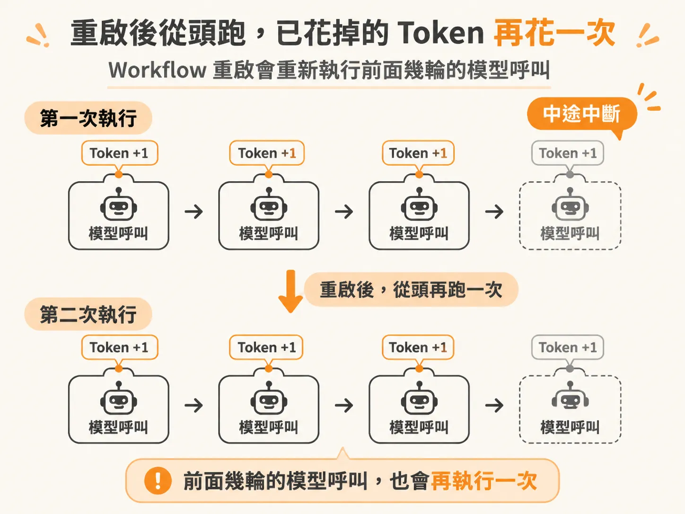
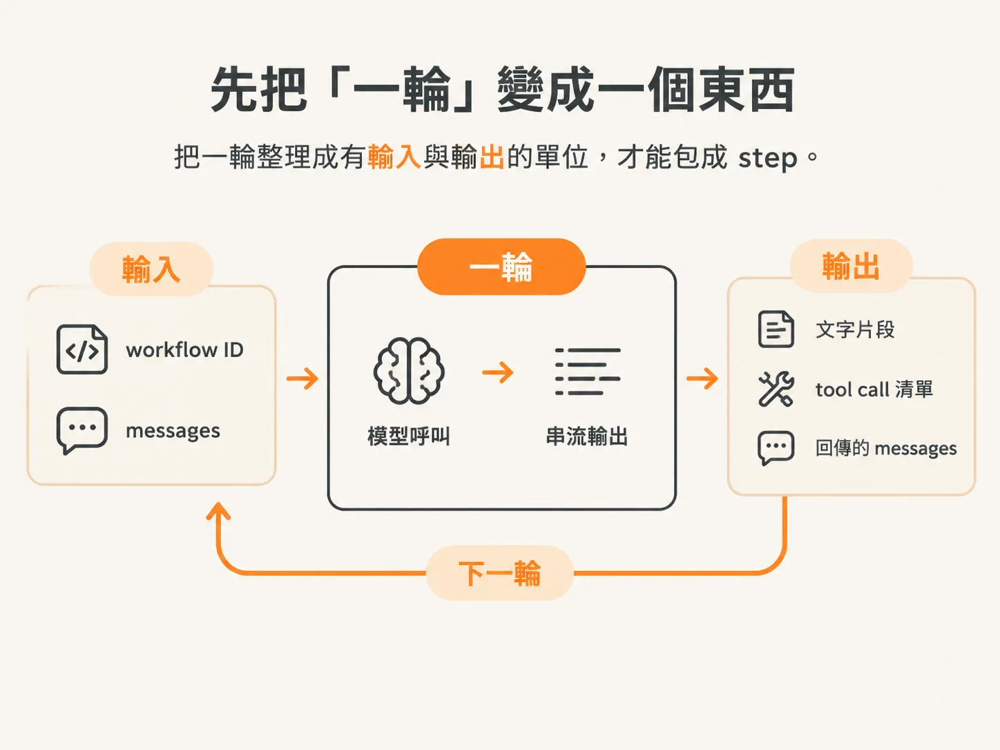
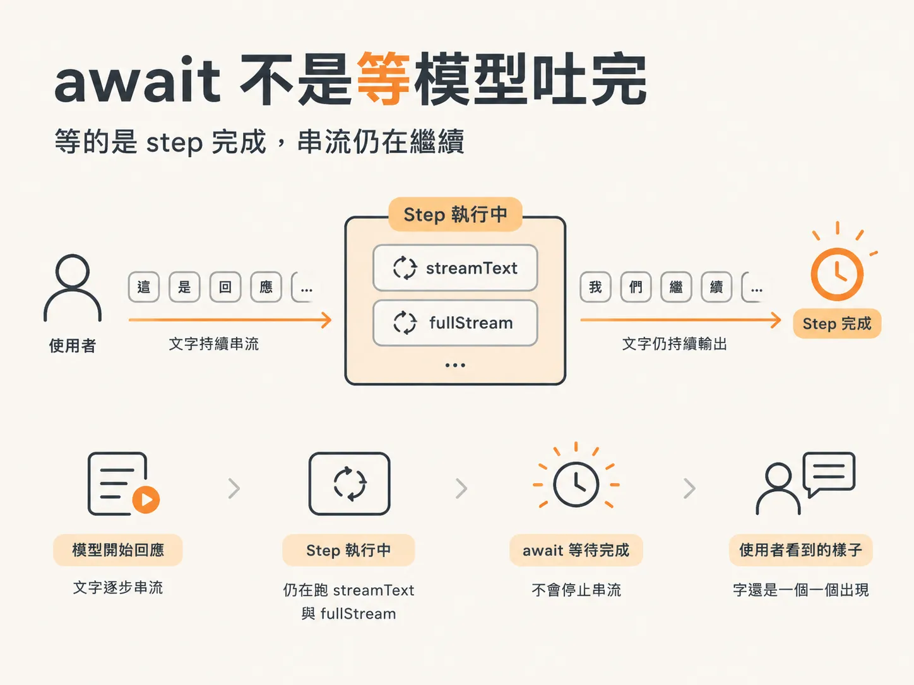
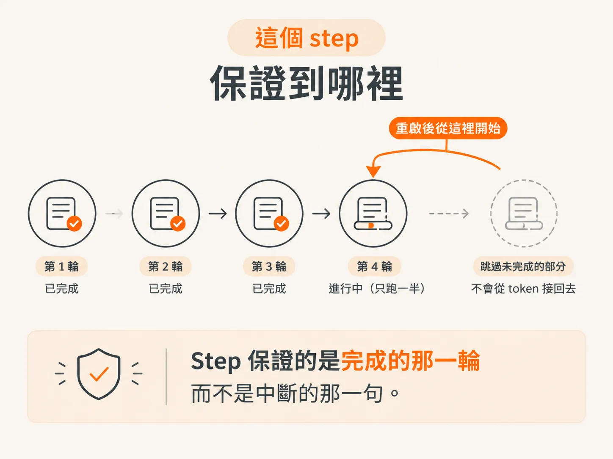

# 把 modelTurn 包成 step

上一課把界線畫完，也點名了下一個目標：把 `streamText` 從迴圈裡拿出來，包成一個 `modelTurn` step。這一課就來看，那筆帳單實際上怎麼省下來。

原本的寫法很直覺：while 迴圈裡直接呼叫 `streamText`，邊收邊送給前端，收到 tool call 就處理，沒有就結束。

程式邏輯沒有錯，錯的是它住在 workflow body 裡。Workflow body 重啟之後會從頭再跑一次，前面那幾輪模型呼叫也跟著重跑。使用者的對話沒有前進，token 已經又燒了一輪。



*AI 生成示意圖*

Durable execution 對這件事的答案，不是「記住模型說了什麼」，而是「把整個呼叫包成一個 step」。Step 完成後，輸入與輸出會被寫進資料庫；同一個 workflow 再遇到同一個 step，就直接拿回上次的結果。模型不會被叫第二次。

## 先把「一輪」變成一個東西

要包 step，得先講清楚要包的是什麼。素材把單位定在「一輪」（turn）。

一輪的定義很具體：呼叫一次模型，模型可能要你執行 tool call，也可能直接回答。要執行 tool call，就執行完再回頭問模型一次，那是下一輪；不用，就結束。

每次因為 tool call 而回到迴圈頂端，就是新的一輪。



*AI 生成示意圖*

素材為此宣告了 `Turn` 型別，裡面放三樣東西：這一輪的文字串流、這一輪要求了哪些 tool call、以及這一輪回傳的 messages。

記下來不只是為了型別好看，是為了 event log：重啟時要知道自己停在第幾輪，才有辦法從那裡接下去。

## 把 streamText 搬進 modelTurn

有了單位，接下來把原本塞在迴圈裡的程式碼整段搬出來，變成一支 `modelTurn` 函式。它收 workflow ID 和 messages，回傳一個 `Turn`。

內容跟原本幾乎一樣：呼叫 `streamText`，逐段讀 `fullStream`，遇到 text delta 就 emit 出去；串流結束後，等 `toolCalls` 與最終的 `response`，整理成前面說的 `Turn` 回傳。

<!-- derived -->
```ts
async function modelTurn(
  workflowId: string,
  messages: ModelMessage[],
): Promise<Turn> {
  const result = streamText({ model, messages, tools });

  for await (const part of result.fullStream) {
    if (part.type === "text-delta") {
      emit(EventType.modelDelta, workflowId, part.text);
    }
  }

  const rawCalls = await result.toolCalls;
  const toolCalls = rawCalls.map((call) => ({
    toolCallId: call.toolCallId,
    toolName: call.toolName,
    inputs: call.input,
  }));

  return {
    toolCalls,
    responseMessages: (await result.response).messages,
  };
}
```

搬出來這件事本身沒有改變行為。串流還在串，emit 還在送，tool call 還是被記下來。改變的是這段程式碼現在有了一個可以被包住的邊界。

## 迴圈只剩下一個 await

接著把迴圈裡的 `streamText` 拿掉，換成 `DBOS.runStep`，把 `modelTurn` 交給它執行。

<!-- derived -->
```ts
const turn = await DBOS.runStep(
  () => modelTurn(workflowId, messages),
  { name: `model-turn-${stepCount}` },
);

messages.push(...turn.responseMessages);
stepCount += 1;
```

Step 的名字帶了計數，純粹是為了看得出來這是第幾輪。同一個 workflow 會有很多輪，log 裡只看到一排 `model-turn`，很難對回對話的第幾步。

這一行 `await` 換掉的是一個模型呼叫，換來的是「這一輪做過了」的紀錄。

## await step 不是等模型吐完

這裡有一個很容易誤會的地方，素材特別停下來解釋：把 `modelTurn` 包進 step 之後，串流並沒有變成「等全部跑完才一次送出」。

`await` 的是 step 執行完成，不是模型回應的結果。Step 裡面還是在跑 `streamText`，還是在迭代 `fullStream`，每個 text delta 還是照樣 emit。使用者看到的行為不變，字還是一個一個出現。



*AI 生成示意圖*

差別在於，這一輪結束時，step 的結果被留下來了。串流的即時性來自函式內部的迴圈，durability 來自外面那層 step，兩件事不衝突。

## 邊界外面還剩什麼

迴圈裡不是所有東西都要包。組 prompt、判斷有沒有 tool call、把 messages 接起來、把計數加一，這些每次跑都一樣，留在 workflow body 裡沒問題。

真正要包的，是會碰到外面世界的呼叫。模型呼叫是其一，寫資料庫的 emit 也是。素材在沒有 tool call 的分支裡，連「模型講完了」和「任務完成」這兩個 emit 都包進 step，理由跟包模型一樣：emit 會寫資料庫，重跑一次就多一筆，這不是冪等。

判斷方式跟前一課同一條線：重跑會不會碰到 body 以外的世界？會，就包。

## 這個 step 保證到哪裡

最後要把保證的範圍講清楚，不然很容易過度期待。

Step 記住的是「完成的那一輪」。如果模型跑到一半、串流到一半程式被殺掉，這一輪就沒有完成，重啟後還是得再跑一次。你不會從某個 token 接回去，只會從上一輪的結尾接下去。



*AI 生成示意圖*

所以省下來的是「已經跑完的輪數」，不是「正在跑的那一句」。對一個會反覆呼叫模型的 agent 來說，這樣已經夠了：失敗通常發生在迴圈深處，前面累積的每一輪都不必重付。

模型這一邊包好了，下一課換另一種更麻煩的東西：會產生副作用的 tool call。
