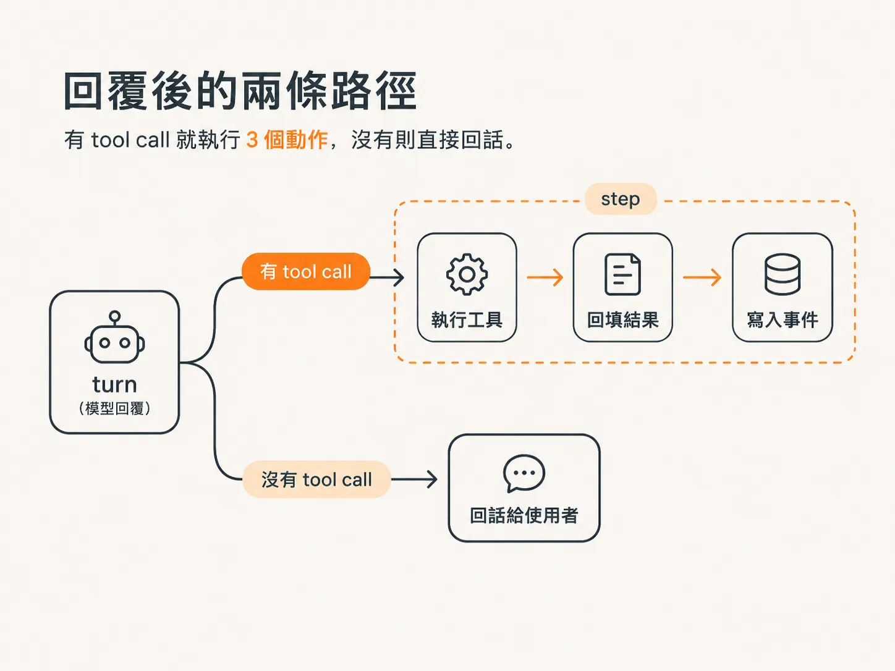
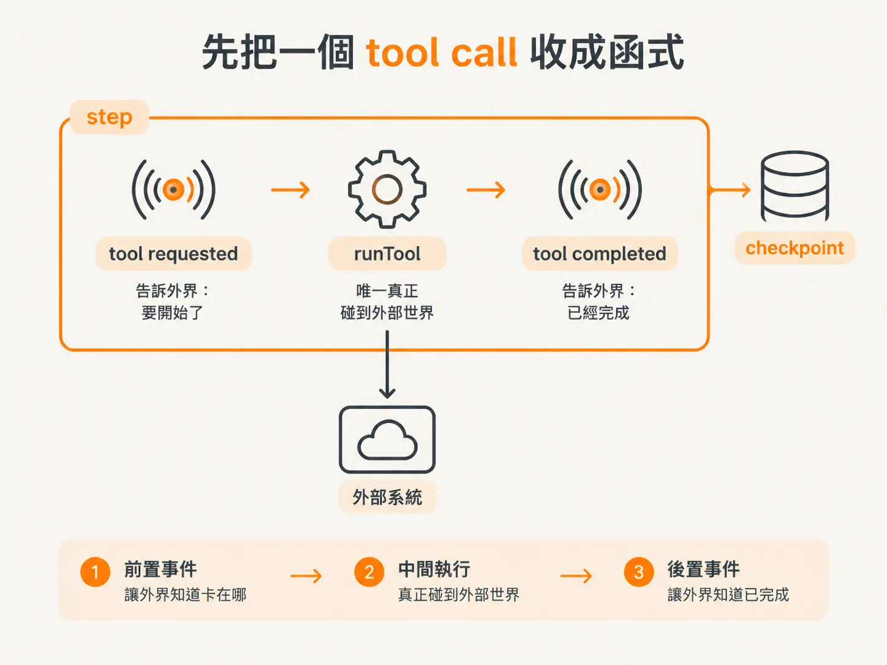
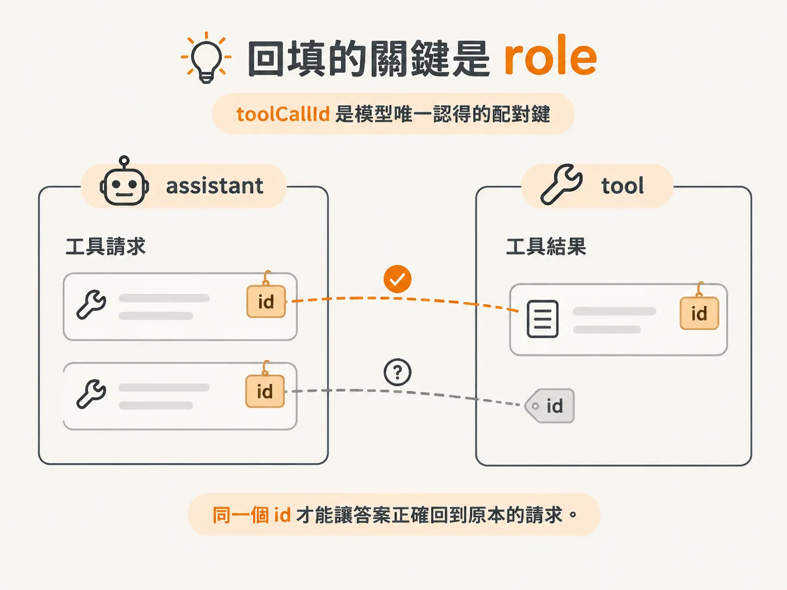
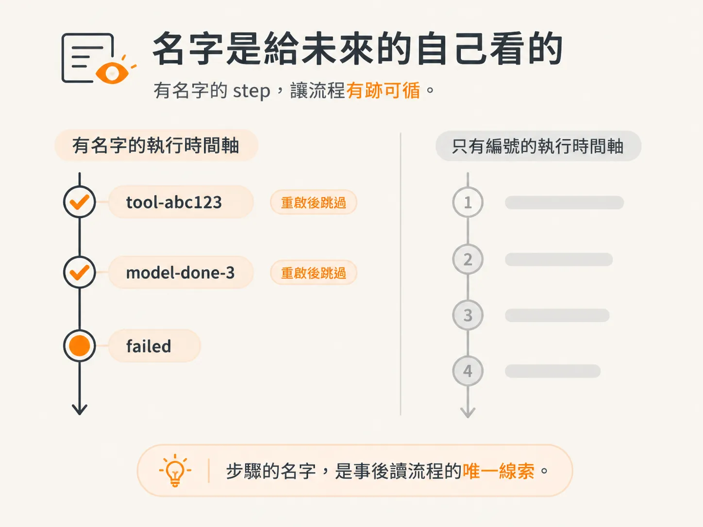

# 把 tool call 與回填包成 step

上一課把 `streamText` 包進 modelTurn，迴圈不會再每重啟一次就重燒一次 token。但 turn 回來的時候，手上可能還握著東西：模型說「我要呼叫這個工具」，參數都填好了，就等你動手。

以前這一步輪不到我們管。AI SDK 會在串流過程裡自己把工具跑掉，再自己把結果塞回對話。現在執行權拿回來了，事情就變成我們的責任：自己跑工具、自己把結果回填、自己決定這整段要不要包進 step。

這一課要把這三個動作接成一條線，並且在正確的位置畫上 step 的邊界。



*AI 生成示意圖*

## 先把一個 tool call 收成函式

素材的做法跟上一課一樣：先抽象，再包。不要在 while 迴圈裡直接寫工具邏輯，先寫一個只處理「一次 tool call」的函式。

它需要兩個參數：`workflowID`，讓事件能掛在同一個 workflow 上；還有 `call` 本身，也就是上一課整理出來的那個乾淨物件，帶 `toolCallID`、`toolName`、`inputs`。

回傳值就是工具的輸出，一個 `Record<string, unknown>`。

函式裡面只做三件事，順序不能換：

1. 工具還沒跑，先 emit 一則 tool requested，帶上 `toolCallID`、工具名稱與參數。
2. 真的去跑：`runTool(call.toolName, call.inputs)`。
3. 跑完再 emit 一則 tool completed，帶上同一個 `toolCallID` 與這次的輸出。

<!-- derived -->
```ts
async function toolStep(
  workflowID: string,
  call: ToolCall,
): Promise<Record<string, unknown>> {
  await emit({
    type: EventType.toolRequested,
    workflowID,
    toolCallID: call.toolCallID,
    name: call.toolName,
    arguments: call.inputs,
  });

  const output = await runTool(call.toolName, call.inputs);

  await emit({
    type: EventType.toolCompleted,
    workflowID,
    toolCallID: call.toolCallID,
    results: output,
  });

  return output;
}
```

兩個 emit 夾著一次執行，這就是一個 tool call 完整的一生。素材的說法是：告訴大家它要開始了、正在跑、跑完了。前後兩則事件讓外面的人知道現在卡在哪，而中間那次 `runTool` 是唯一真正碰到外部世界的地方。



*AI 生成示意圖*

## 邊界要畫在 emit 外面

注意 step 的邊界不是畫在 `runTool` 上，而是把整個 `toolStep` 包起來。

理由前面講過，這裡再具體說一次：emit 現在會寫資料庫。如果 emit 留在 step 外面，workflow 被重跑，事件就再寫一次；前端看到重複的 log，資料庫也多一筆。這種動作不冪等，跑第二次不會回到同樣的狀態。

`runTool` 更不用說，寄信、開 ticket 這種事沒有第二次的機會。

把兩次 emit 和一次執行圈在同一個 step 裡，結果就變成：這個 step 只要成功過一次，重啟後整個函式都不會再跑。事件不會重複，工具不會重打。

## 迴圈裡只剩三行

回到 while 迴圈。turn 帶回 tool calls 的時候，以前是 AI SDK 自己跑，現在換成一個 for 迴圈。

對每一個 call，用 `DBOS.runStep` 包住 `toolStep`，第二個參數給它一個名字。素材選的名字是 `tool-` 加上 `toolCallID`，理由很實在：之後在資料庫或 dev tools 裡看流程，名字是你唯一認得出來的線索。用陣列索引命名，回頭根本不知道那是哪一次呼叫。

Step 回傳的 output 就是工具的結果。拿到之後，還要把它送回模型，否則模型不知道工具做了什麼，迴圈就斷在這裡。

<!-- derived -->
```ts
for (const call of turn.toolCalls) {
  const output = await DBOS.runStep(
    async () => toolStep(workflowID, call),
    { name: `tool-${call.toolCallID}` },
  );

  messages.push({
    role: "tool",
    content: [
      {
        type: "tool-result",
        toolCallId: call.toolCallID,
        toolName: call.toolName,
        output: { type: "json", value: output },
      },
    ],
  });
}
```

回填留在 step 外面，不是漏掉。`push` 只是改記憶體裡的陣列，不碰資料庫也不碰外部系統；而且它用的 output 是 step 記住的結果，重跑時拿到的還是同一個值。workflow body 可以重跑，前提就是這種程式碼必須是決定性的。

## 回填的關鍵是 role

push 進 messages 的這則訊息，最容易寫錯的是 role。

素材講得很直白：要回應工具呼叫，role 永遠是 `tool`。這則訊息的意思是「你剛剛要求我跑工具，這是答案」。寫成 assistant，或自己發明一個 role，模型就接不上。

content 是一個陣列，裡面放一個物件，四個欄位各有作用：

- `type` 是 `tool-result`，宣告這是工具結果，不是普通文字。
- `toolCallId` 沿用 `call.toolCallID`，這是配對鍵。模型一次可能要求好幾個工具，它靠 id 認哪個結果屬於哪個請求。
- `toolName` 讓模型知道是哪個工具回答的。
- `output` 是結果本體，型別寫 `json`，值是剛剛那個 output。素材特別註明，這是 OpenAI 要的格式。

配對這件事值得多想一秒。模型看不見你的資料庫，也看不見 step 的紀錄，它只知道自己在上一則訊息裡發了幾個呼叫、各帶什麼 id。你回填的 id 對不上，它就無法把答案接回去：不是報錯，是沉默地接錯或忽略。



*AI 生成示意圖*

## 沒有 tool call 的那條路也要包

迴圈還有另一個出口：turn 裡沒有 tool calls。這代表模型講完了，可以回話給使用者。

原本這條分支會連發兩則 emit，一則表示模型這一輪結束，一則表示整個 agent 完成。看起來只是通知，但素材在這裡停下來提醒：只要是 emit，就是在跟資料庫說話，就不能讓它漂在 workflow body 裡。

所以這兩個 emit 各自包成一個 step，名字帶上目前是第幾輪。素材的講法是 model done 加上 step 編號，第二個則是整個任務完成的那個 step。

<!-- derived -->
```ts
if (turn.toolCalls.length === 0) {
  await DBOS.runStep(
    async () => emit({ type: EventType.modelDone, workflowID, step: stepCount }),
    { name: `model-done-${stepCount}` },
  );

  await DBOS.runStep(
    async () => emit({ type: EventType.agentCompleted, workflowID }),
    { name: `completed-${stepCount}` },
  );

  return turn.text;
}
```

這裡有一個容易漏掉的心態轉變：不是只有「危險」的動作才要包。emit 本身不寄信、不扣款，但它會留下紀錄，而重複的紀錄就是髒資料。判斷標準不是動作聽起來多可怕，而是它碰了什麼。

## 順手把失敗也包起來

同一段素材的最後還有一個 emit：workflow 失敗的時候送出的那則通知。

它同樣只該寫一次就定案。素材把它包成一個 step，名字叫 failed，回傳空字串。

這一步很小，但它讓整條路徑完整：成功有紀錄、失敗也有紀錄，而且兩者都不會因為重啟而重複。之後要查一個 workflow 到底跑到哪、死在哪，靠的就是這些被命名過的 step。

## 名字是給未來的自己看的

四個地方都包完之後，回頭看這一課加了什麼：一個 `toolStep` 函式、一個 for 迴圈、一則 role 為 `tool` 的訊息、兩個收尾的 emit、一個失敗的 emit。

每一個 `runStep` 都給了名字：`tool-` 加 `toolCallID`、`model-done` 加輪數、`failed`。這不是命名潔癖。Durable engine 的價值在於「發生過什麼」有紀錄，而紀錄如果沒有可讀的名字，等於只有一疊編號。



*AI 生成示意圖*

到這裡，while 迴圈裡每一件會碰到外部世界的事，都有一個名字、一個邊界、一個不會重跑的保證。剩下的問題是：程式重啟之後，這條迴圈要怎麼從中斷的地方接回去？那要先把 workflow 註冊起來，也是下一課的事。
