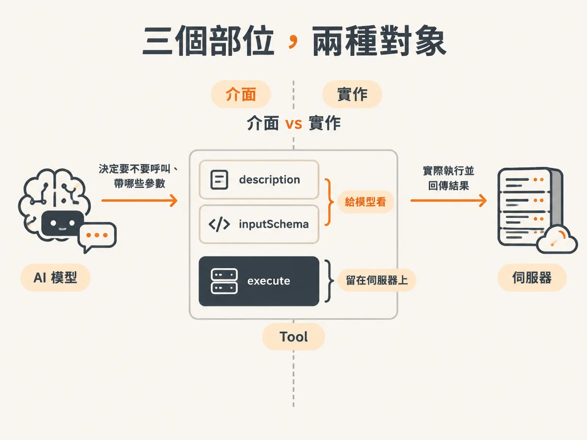

# 一個 tool 的三個部位：description、schema、execute

前面已經看過：模型回傳的 tool call 只是請求，真正執行動作的是你的程式。那麼程式要怎麼知道「有哪些事可以被要求」？答案是在 harness 裡先把 tool 定義出來。

這門課不急著做一個聰明的 agent。知識庫是假的，工具也多半是為了示範而做的簡單版本；先有能被呼叫的東西，才談得上後面要怎麼控制執行。

## 從一個搜尋工具開始

在 harness 裡開一個 tools 檔案，從 AI SDK 匯入 `tool`，做成一個物件。第一個工具是搜尋支援知識庫：

<!-- derived -->
```ts
export const tools = {
  searchKnowledgeBase: tool({
    description: "Search the support knowledge base for relevant articles.",
    inputSchema: z.object({
      query: z.string().describe("What to look up"),
    }),
    execute: async ({ query }) => {
      // 在記憶體裡的知識庫做最基本的文字比對
      // 無論如何都要 return，結果會再送回模型
    },
  }),
};
```

同一個物件裡有三個部位，各自面對不同的對象。


*AI 生成示意圖*

## description：模型要不要發這個請求

`description` 是模型決定「該不該用這個工具」時讀到的文字。你可以寫它做什麼、什麼時候適合用；寫法沒有唯一正確答案。

素材的說法是，這裡不是 true / false 的判斷，而是機率。所以 description 沒有「寫對」的一天，只有寫了之後去量測效果。對模型來說，它比較像你在帶一個新同事：告訴他這個工具為什麼存在、什麼情況下會用到。

## inputSchema：請求要帶什麼參數

`inputSchema` 是參數的格式規定。模型一旦決定呼叫，就必須照這個形狀提供參數；你的程式在執行時也才知道會收到什麼，不會突然冒出一個無法處理的欄位。

以搜尋工具為例，它要求一個 `query` 欄位，型別是字串。欄位本身也能加 `describe`，說明這個參數是要拿來查什麼。素材的比喻還是同一個：你在教新同事怎麼用這個工具，所以會解釋「為什麼用」和「這個參數是什麼」。

## execute：真正發生的那件事

`execute` 是工具被呼叫時實際執行的程式。它接收 schema 定義的那個物件，裡面你可以做任何事，甚至再呼叫另一個 LLM。

唯一的硬性要求是要 return。因為回傳值不是給 log 看的，而是要再餵回模型，讓它知道剛才那一步發生了什麼。

## 三個部位，兩種對象

拆開來看，責任其實只有兩種：給模型看的，和留在伺服器上的。

| 部位 | 誰在看 | 影響什麼 |
|---|---|---|
| `description` | 模型 | 要不要發出這個請求 |
| `inputSchema` | 模型與你的程式 | 請求會帶哪些參數 |
| `execute` | 你的伺服器 | 請求發生後真的做什麼 |

description 和 schema 是介面，execute 是實作。這個分界之後會一直用到：execute 放在哪裡，決定誰有機會在執行前後插手。

這一課的 schema 只有一個自由輸入的 `query`，查不到就回空結果，還算好處理。如果工具只接受幾種固定答案，就不能讓模型自己發明第五種。下一課看分類工具怎麼用 schema 把選項鎖住。
