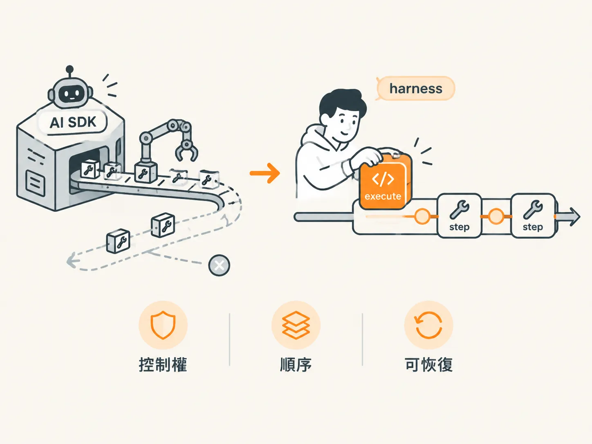

# 把 execute 拿回來：為什麼 harness 要自己執行

把 execute 寫在 tool 裡，看起來很自然：工具自己會做事，模型要求，SDK 執行，結果回給模型。整條路都有人處理。

問題就在「有人處理」。那個人不是你。

## AI SDK 看到 execute 就會自己跑

素材講得很白：只要 tool 上有 execute，AI SDK 看到模型請求工具，就會直接呼叫 execute。它等於幫你把 harness 補完了。

方便是方便，代價是你失去了執行那一刻。工具不會跑在你的 workflow step 裡，也就沒辦法 durable（持久化，程式中斷後還能接著跑）。這一課要的是每次工具執行都落在 DBOS 的 step 裡；execute 被 SDK 提前接手，就沒有這個位置。

有沒有一種繞法，把 step ID 或 workflow ID 傳進 execute？可以，但那等於為了讓 SDK 代勞而多塞參數，浪費 tokens，也沒有意義。

所以做法是反過來：把所有 tool 的 execute 拿掉。


*AI 生成示意圖*

<!-- derived -->
```ts
export const tools = {
  classifyItem: tool({
    description: "Classify a work item into one category.",
    inputSchema: z.object({
      itemId: z.string(),
      category: z.enum(["billing", "technical", "sales", "other"]),
    }),
    // 沒有 execute，AI SDK 不會代跑
  }),
};
```

拿掉之後，tool 只剩給模型看的兩個部位。模型還是能提出請求，但沒有人會偷偷幫你執行。

## 自己寫一個 runTools

執行權回到 harness 之後，要有地方接住請求。課程在 tools 檔案裡新增一個 `runTools` 函式：用 switch 依工具名稱挑出對應的實作，把參數傳進去。

<!-- derived -->
```ts
export async function runTools(
  name: string,
  args: Record<string, unknown>,
): Promise<unknown> {
  switch (name) {
    case "searchKnowledgeBase":
      return searchKnowledgeBase(args.query as string);
    case "classifyItem":
      return classifyItem(args.itemId as string, args.category as string);
    default:
      throw new Error(`Unknown tool: ${name}`);
  }
}
```

這個函式本身會被包成一個 step。也就是說，每一次工具呼叫都發生在同一個可持久化的步驟裡，而不是散在 SDK 的內部流程。

## 同一個理由：連迴圈也不借給 SDK

這個選擇不只發生在 execute。AI SDK 有 maxRetries 之類的設定，用了就等於採用它內建的迴圈。幾乎每個 SDK 都願意幫你管 agent 迴圈，但這門課刻意自己寫。

原因是要控制 harness，特別是透過 WebSocket 送事件。如果改用 SDK 的迴圈，就得跟著它的 hooks 走，整個實作會綁在 AI SDK 上。這裡只想要 AI SDK 做一件事：呼叫 LLM。迴圈、工具執行、事件，都留在自己的程式裡。這樣換 SDK、甚至換語言，骨架還是同一個。

## 有地方站，不等於已經站好

execute 從 tool 物件搬回 harness，表面上是程式位置改變，實際上是責任改變。之後要讓工具執行 durable、要記錄、要在執行前後加檢查，都有一個明確的點可以掛。

但有地方站，不代表已經站好。下一課的 sendReply 會示範：即使執行權在你手上，只要你把安全規定寫在 description 裡，它照樣會把信送出去。
