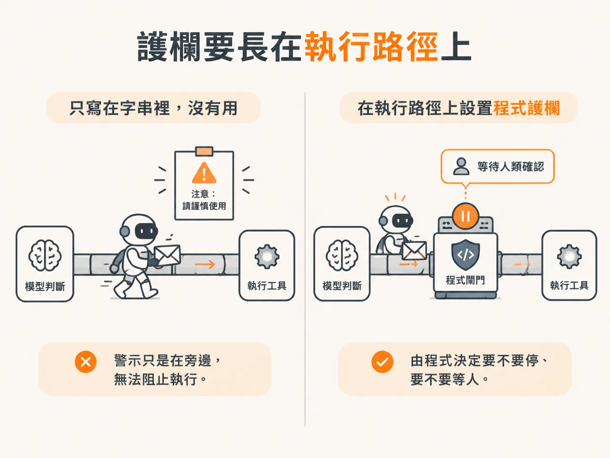

# Description 寫「請先問使用者」不是護欄

想像一個 agent 幫你處理商業信件。它讀完往來內容，起草回覆，草稿看起來也合理。你正準備打開來看，它已經按下送出。

不是你按的。是它自己判斷：目標是「回覆這些信」，信送了才算完成，而它手上有 sendReply 這個工具。

## 先草稿，再送出

sendReply 就是字面上的意思：把已經寫好的回覆寄出去。前面還有 draftReply 負責產生草稿。兩個工具放在一起，看起來像一組安全流程：先草擬，再寄送。

但在 naive 的 harness 裡，它會直接送。素材的描述是「有點恐怖」：模型有送出工具，於是把「完成任務」理解成「把信送出去」，完全沒有停下來等人看過草稿。

你可能會想，補一句話就好：

<!-- derived -->
```ts
sendReply: tool({
  description:
    "Send a reply. Do not use this tool unless you ask the user first.",
  inputSchema: z.object({
    itemId: z.string(),
    message: z.string(),
  }),
}),
```

看起來很負責，但素材的評語是：不是這樣運作的。在文字裡做護欄和安全機制，會失敗。

## 為什麼一句提醒不夠

description 是模型判斷時的輸入，不是程式裡的條件。它會提高或降低某個行為發生的機率，卻不是一道擋在門口的閘。模型可能沒照著做，可能覺得這次情況特殊，也可能把「先問使用者」理解成「先寫草稿」。


*AI 生成示意圖*

更根本的問題是：模型不是那個承擔後果的人。信送出去，出事的是你。

## 跑一次，問題會自己現形

課程用一段 prompt 讓 agent 跑一次。因為工具沒有真的執行，畫面看到的是模型說「我需要跑這些工具」：tool call 事件一筆一筆送出來，像一張待辦清單攤在你面前。

結果有幾個明顯的毛病：

- 它送了三封回覆，但可能一封就夠，出現重複。
- 整個過程沒有問過任何人權限。
- 它明明產生了草稿，卻沒有等人看就送出。那草稿給你看要幹嘛？

素材的結論很直接：這不是能拿去賣人的東西。沒有人會信任一個自己決定要寄信的 agent。這種事本來就是 harness 要負責解決的。

## 護欄要長在執行路徑上

這一課不是說 description 不重要。它仍然是你影響模型的主要介面之一，寫清楚意圖、時機、參數，都能提高它做對事的機率。

但安全不能只靠機率。既然 execute 已經被拿回 harness，攔截就該發生在那裡：在真正送出之前，由程式決定要不要停、要不要等人。這件事寫在字串裡沒有用，寫在程式裡才有作用。

攔住之後，還有一個介面要設計：你要告訴模型「發生了什麼」。下一課看 tool result。
