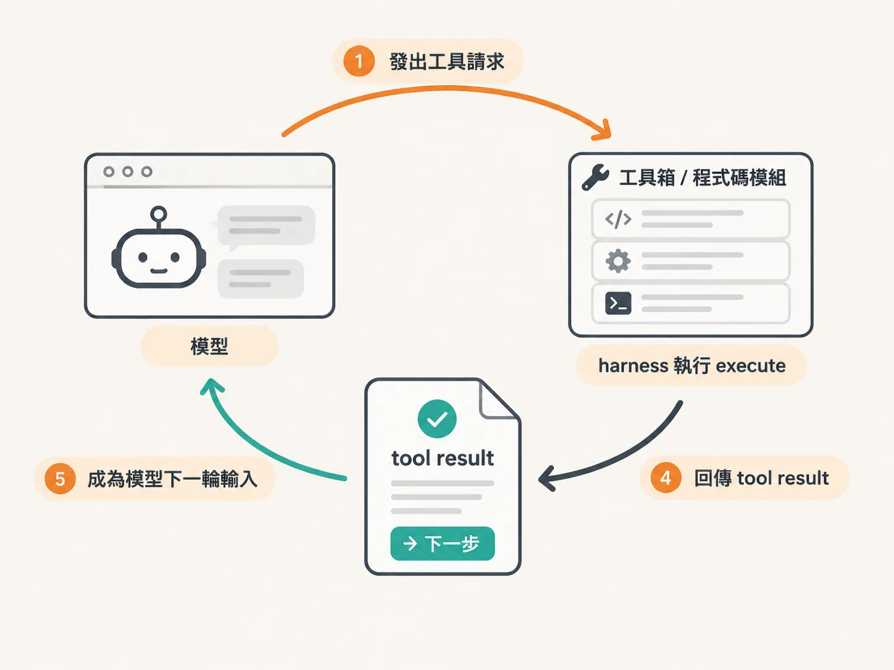

# Tool result 也是給模型看的介面

前面的工具最後都要 return 一個東西。搜尋回傳結果，草稿工具回傳一個 draft ID。你可能會想：有回就好，反正模型看得懂。

但模型看到什麼，取決於你怎麼設計那個回傳值。tool result 不是給程式看的 log，它是模型下一輪的輸入。

就像你問同事一件事，對方只丟一個「嗯」過來——東西是有回，但你不知道接下來該做什麼。模型也一樣。

## 搜尋：有結果，也要說沒結果

搜尋知識庫的 execute 最後要回傳一個物件。回什麼由你決定，判斷標準只有一個：模型看到這個東西，能不能做出下一步。

有查到文章時，除了文章本身，可以告訴它有幾筆：

<!-- derived -->
```ts
if (articles.length > 0) {
  return { count: articles.length, articles };
}
```

沒查到時，空陣列也是一種回答，但它沒有告訴模型「現在該怎麼辦」。所以可以放一段訊息：


*AI 生成示意圖*

<!-- derived -->
```ts
return {
  count: 0,
  message: "No exact match. Use your best judgment, or ask the user.",
};
```

素材列了幾種寫法：提示它自行判斷、請它問使用者這是不是對的、或告訴使用者知識庫資料不足、該補內容。沒有標準答案，取決於這個工具給誰用、你希望它停下來還是往前走。

## 草稿：讓模型知道「做完了，東西在這裡」

draftReply 完成後，除了 `ok: true`，還會回一個 draft ID。這等於告訴模型：草稿做好了，在這裡。

這些工具是為了示範而做的，沒有真的寄信、也沒有真的寫入什麼。但回傳值的任務是一樣的：讓模型知道事情完成了，而且知道完成的是哪一件事。

## 回傳值也是介面

同一個 tool，模型看到的是 description、schema 和 result；你的程式負責的是 execute。前面兩個部位決定模型怎麼發請求，result 決定請求發生後，模型收到什麼、能不能接下去。

這也是為什麼 execute 要留在 harness。只有在自己的執行路徑上，你才能決定成功要長什麼樣、失敗要怎麼說、下一步要留給模型還是留給人。

一個好用的 tool，不是 execute 寫得多厲害，而是模型看到的說明、程式收到的參數、實際發生的事，以及回給模型的結果，四者講同一件事。
