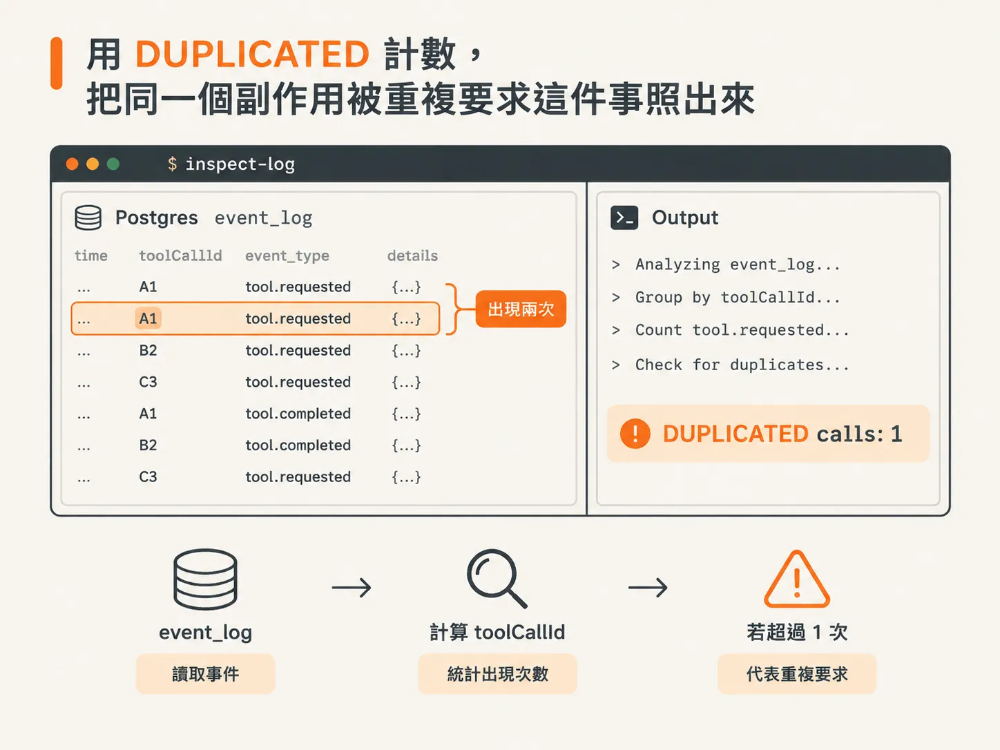
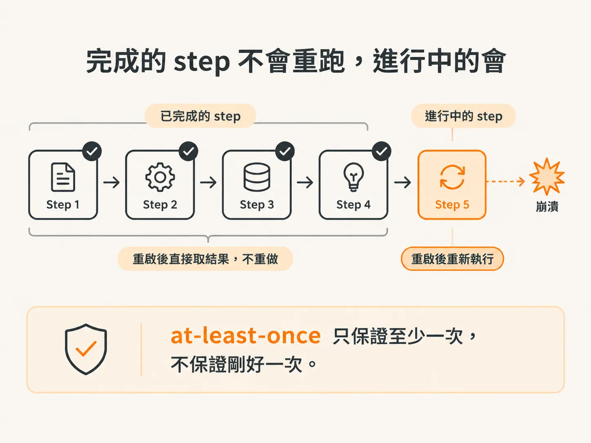
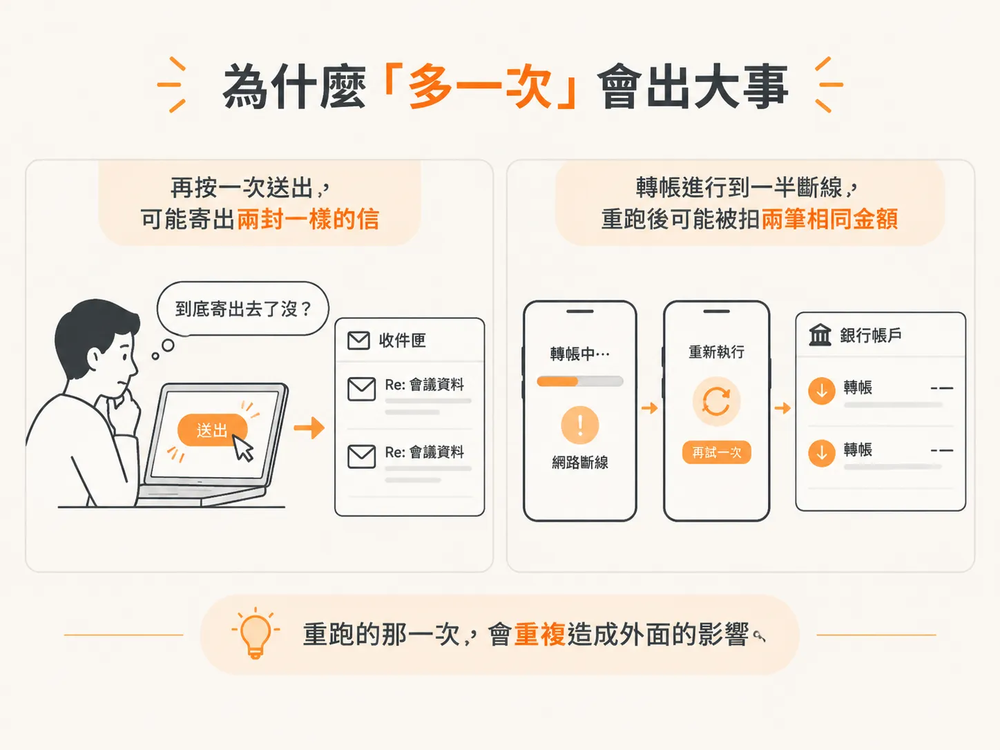
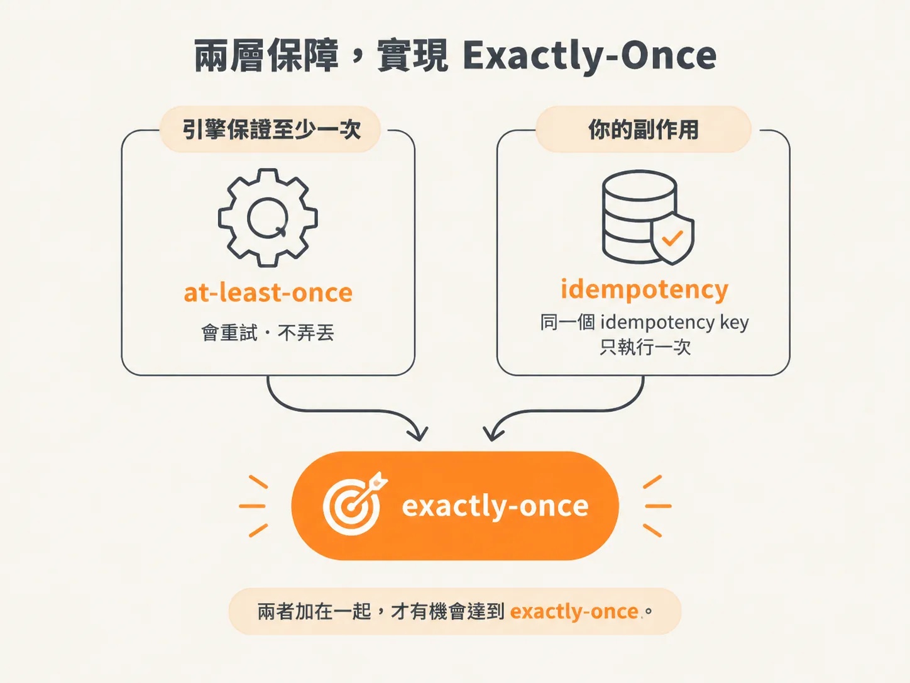

# At-least-once 之後：用 idempotency 補上 exactly-once

前面談 durable execution 時，我們把 workflow 註冊好，讓它即使重啟也能接著執行。

但「接得回來」其實還藏著一個問題：

> 接回來之後，已經做過的事，會不會再做一次？

這不是吹毛求疵。先看一個專門用來回答這個問題的小工具，答案就會自己浮現。

## 用 DUPLICATED 計數，把 at-least-once 照出來

`scripts/inspect-log.ts` 是一個小型 CLI，只有一個工作：直接從 Postgres 讀取 `event_log`，統計每種事件出現幾次，再找出「被要求過不只一次」的 tool call。

<!-- source: sources/agent-harness/20260915/harness-engineering/scripts/inspect-log.ts#L1-L33 -->
```ts
import { config } from "dotenv";
config({ path: ".dev.vars" });
import postgres from "postgres";

const sql = postgres(process.env.DATABASE_URL!);

if (process.argv.includes("truncate")) {
  await sql`TRUNCATE event_log`;
  console.log("event_log truncated.");
  await sql.end();
  process.exit(0);
}

const rows = await sql<{ data: any }[]>`SELECT data FROM event_log ORDER BY seq`;
const events = rows.map((r) => r.data);

const byType: Record<string, number> = {};
for (const e of events) byType[e.type] = (byType[e.type] ?? 0) + 1;

// How many times was each tool call REQUESTED? >1 means a side effect was repeated.
const reqByCall: Record<string, number> = {};
for (const e of events) {
  if (e.type === "tool.requested") reqByCall[e.toolCallId] = (reqByCall[e.toolCallId] ?? 0) + 1;
}
const duplicated = Object.entries(reqByCall).filter(([, n]) => n > 1);

console.log("total events:      ", events.length);
console.log("by type:           ", byType);
console.log("distinct tool calls:", Object.keys(reqByCall).length);
console.log("DUPLICATED calls:  ", duplicated.length, duplicated);
console.log("completed:         ", byType["workflow.completed"] ?? 0);

await sql.end();
```

看註解那一行就夠了：`>1 means a side effect was repeated`。

它會計算每個 `toolCallId` 出現過幾次 `tool.requested`。如果出現兩次以上，就代表同一個副作用被重複要求了。



*AI 生成示意圖*

輸出的最後會提供兩個關鍵數字：

- `DUPLICATED calls`：有幾個 tool call 被重複要求。
- `completed`：整個 workflow 是否已經完成。

前者能告訴你，同一件事是不是被做過不只一次；後者則能確認整條 workflow 有沒有順利收尾。

如果想從乾淨狀態重新開始，傳入 `truncate` 參數就能清空 log。

## 完成的不會重跑，進行中的會

這個工具要驗證的，就是 durable execution 提供的保證到底到哪一層。

測試方式是這樣：先執行一個包含 3 項任務的流程，在 agent 做到一半時把 server 關掉，再重新啟動。

DBOS 找到仍在進行中的 workflow，從最後一個已完成的 step 接著執行。已經跑過的 `sendReply` 不會再次執行。

作者實測得到的結果很乾淨：server 當機時，12 個 tool call 全部完成 checkpoint，沒有任何重複。重啟後，同一個 workflow id 繼續執行到結束，`sendReply` 總共只發送 3 次。

Lesson 1 的結果則不同：當時重啟後一切歸零，重新執行一次，就會多寄一次。

但這裡有一個重要的但書：

已經完成的 step 永遠不會重跑；可是 server 當掉時，當下正在執行的 step，在 recovery 時會再執行一次。因此，中斷的那個 model turn，token 會重新串流一遍。

這就是 at-least-once 的真義：引擎保證「至少執行一次、絕不弄丟」，但不保證「剛好執行一次」。



*AI 生成示意圖*

## 為什麼「多一次」會出大事

「至少一次」聽起來很安全，但問題正是出在「至少」兩個字：它允許執行超過一次。

用生活情境來看，你正在回訊息，按下送出後卻在傳送到一半時斷線。你看著畫面，心裡想著：「到底寄出去了沒？」

既然不確定，就再按一次。結果訊息可能真的被寄出兩次。

換成轉帳，後果就更嚴重：轉帳進行到一半斷線，你重新執行一次，錢可能就被轉了兩次。



*AI 生成示意圖*

所以，重點不在於「引擎會不會重跑」，而在於：

> 重跑的那一次，會不會再次造成外部影響？

信件寄兩次、款項轉兩次，都不是把狀態存回來就能補救的問題。

## 補上 idempotency，把 at-least-once 升到 exactly-once

解法不只在引擎，也在我們自己設計的副作用處理方式。

做法是把 runtime 拆成一個個 step，並把每個 step 的輸入與輸出寫進資料庫。這樣某一步失敗時，重跑前就能先查詢：

> 這個 workflow id 的這一步，是不是已經做過了？

如果已經做過，就跳過，不必再次執行。

但這個做法有一個前提：確保 step 具備 idempotency，是我們的工作。

Idempotent 的意思是，同一個操作即使再執行一次，也會得到相同結果，不會多產生第二個副作用。

對已經完成並建立 checkpoint 的 step 來說，這件事會自動成立，因為它們根本不會重跑。真正需要補強的，是那些會影響外部世界的副作用。

素材舉的例子，是替 `sendReply` 加上 idempotency key。同一則回覆第二次送進來時，接收端可以辨識這個 key，知道那是同一件事，因此不會真的再寄出一次。

把它想成兩層分工：

- 引擎負責 at-least-once：保證不弄丟，必要時會重試。
- 你負責 idempotency：確保重試不會造成重複副作用。

兩者加在一起，才有機會達到 exactly-once。



*AI 生成示意圖*

## 你現在可以去跑什麼

先傳入 `truncate` 清空 log，執行一輪完整任務。接著，在任務進行到一半時把 server 關掉，再重新啟動，最後執行一次 `inspect-log.ts`。

你會看到兩個結果：

- `completed` 有完成，代表 workflow 已經跑完。
- `DUPLICATED calls` 是 0，代表已完成的 tool call 沒有重跑，`sendReply` 也只發送該有的次數。

這個 0，是 checkpoint 擋下重複執行的結果。

至於 server 當機時正在執行的那一步，引擎只保證至少執行一次。它會不會造成重複，就要看你是否已經替副作用補上 idempotency。
