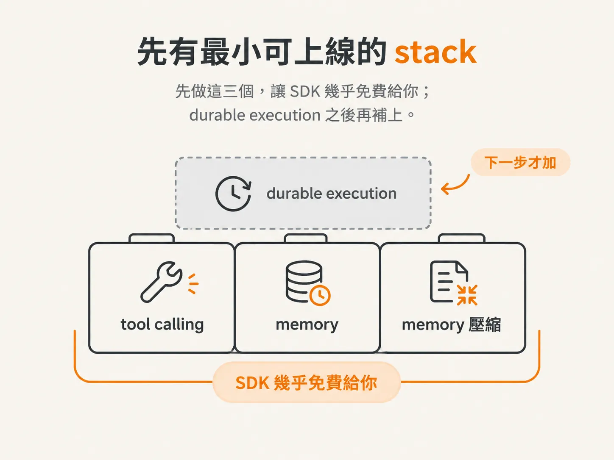
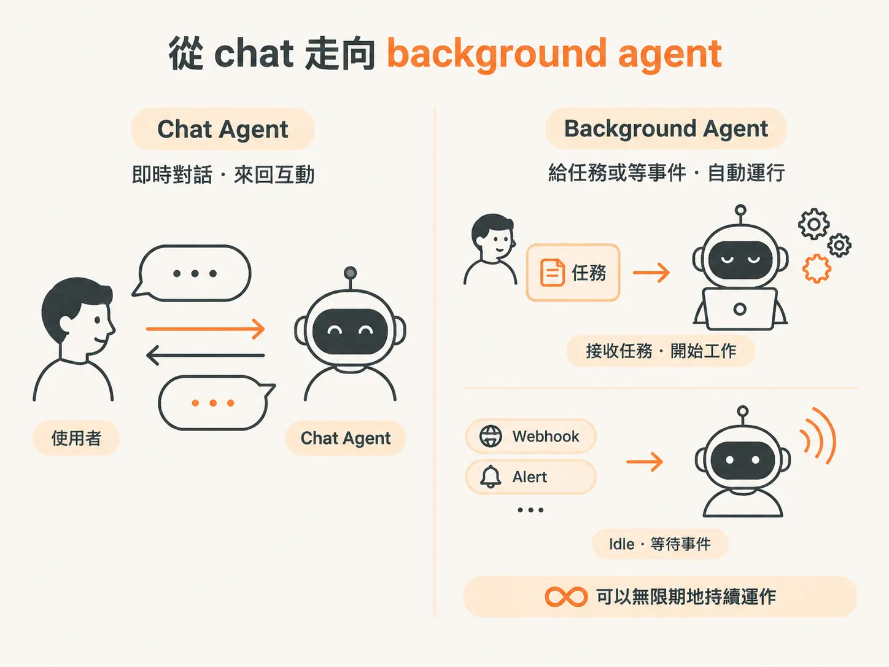
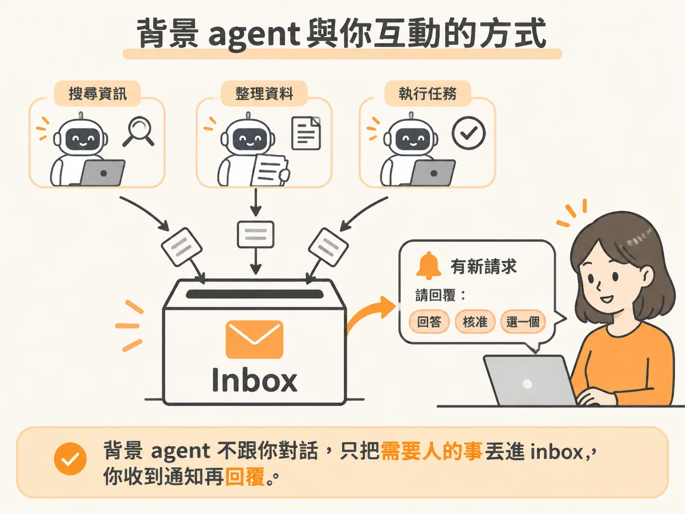
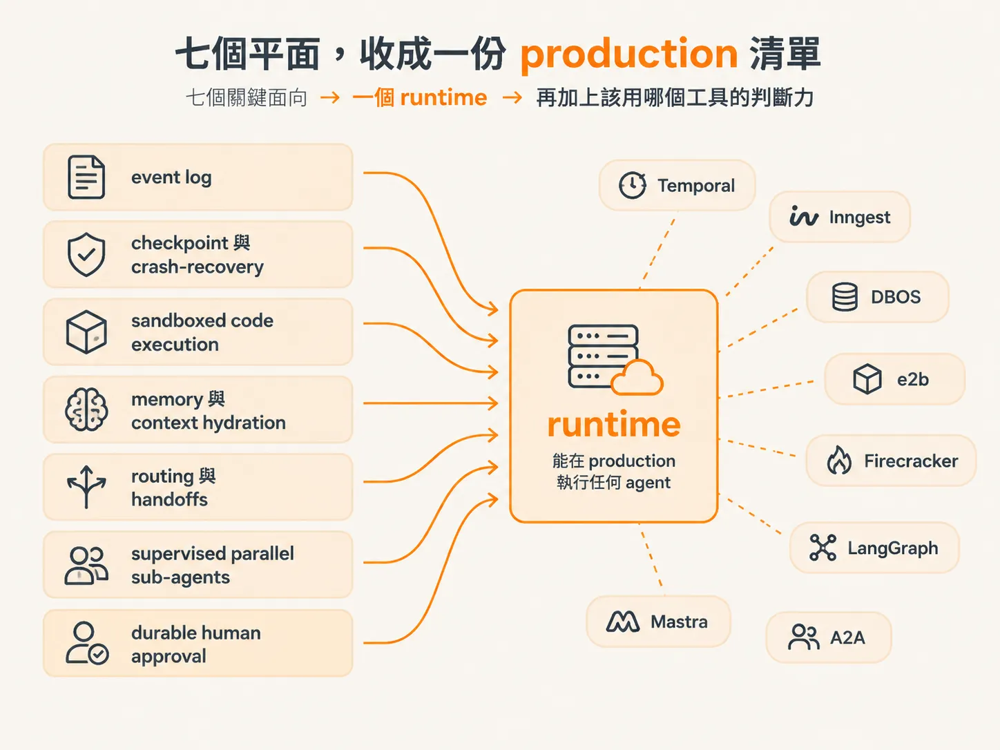

# 背景 agent 與 production 清單

前面四篇，我們分別拆解過 inspector、沙箱、idempotency 與 evals。這篇把鏡頭拉遠，問最後一個問題：

真的要把這套 harness 放到使用者面前，甚至讓它在背景長時間運作，還缺什麼？

答案可以分成兩層。

第一層是「最小可上線」的 stack：先上線、先從使用者身上學，不要一開始就過度投資。

第二層是「能長時間運作的 agent」：它不是拿來聊天，而是接到任務後自己處理，或安靜等待事件進來的背景 agent。

最後，再把這一天累積的七個東西，收成一份上 production 前的檢查清單。

## 先講最小可上線的 stack

有人問：如果想先把 harness 推到使用者面前，從真實使用中學習，最少需要準備什麼？

講者先把範圍限縮在 chat-based agent。這通常是最早開始的地方，也能讓你從實際使用中摸清楚，之後還能把它應用在哪些場景。

tool calling 幾乎每個 SDK 都會免費提供，甚至不一定要算進「需要自己打造的東西」。

memory 多數 SDK 也會提供。唯一的但書是：如果要讓記憶持久存在，就必須把它放在你能控制的地方，例如自己的資料庫。

至於 memory 壓縮，則是百分之百要做的事。對話一旦變長，context 遲早會爆掉，就像行李箱不斷塞東西，總有一天再也關不起來。

有這三個，基本上就過得去了。接下來第一個想加入的功能，是 durable execution——讓 agent 不必綁在 client 上。

講者用了很具體的比喻：如果使用 SSE，發出一個 request，token 一串串回來；這時只要頁面一重整，那些內容就全沒了。

不過，初期「會斷」還可以接受。先把前面三個做好，讓 SDK 幾乎免費提供的功能發揮作用，甚至直接用 turn 上限避免 agent 失控，就足以先上線學習。



*AI 生成示意圖*

## 從 chat 走向 background agent

如果想往「長時間運作，又不失控」的方向走，agent 的形狀就會不一樣。講者把這類東西稱為 **infinite agents**，也就是 **background agents**。

它不是跟你聊天的那種 agent。你給它一個任務，它就自己去做；或者，它安靜地待在背景，等待事件進來。

事件可能是你交代給它的工作、它訂閱的 webhook，甚至是公司內部的 alerting 系統。比方說，它收到一則 alert，就自己開始進行 triage。

重點在於：它可以無限期地持續運作。



*AI 生成示意圖*

講者認為，今天談到的 durable execution layer，是這類 agent 很好的入門，也是基本配備——你必須有它。

但背景 agent 需要的東西，還不只這些。

## inbox：背景 agent 與你互動的方式

chat agent 會用 messages API 記錄 context，因為你正在和它對話。

背景 agent 則不需要 messages。你沒有一直和它聊天，它只是在背景處理自己的工作，真的有需要時才來找你。

那它要怎麼找你？

講者用 **inbox model** 來思考：agent 在背景持續做事，同時有一個 inbox，讓它把需要人處理的事情丟進去：

- 「嘿，幫我回答這個問題。」
- 「嘿，幫我核准這個。」
- 「這幾個你喜歡哪一個？」

你和它的互動就只是這樣：收到 inbox 通知，再針對裡面的事項回覆。

因為 agent 隨時都在工作，也隨時可能在任何一件事上需要你，因此這個 inbox 必須能持續接住它送來的請求。



*AI 生成示意圖*

這和 chat 差很多，但地基是一樣的：durable execution layer。

## durable execution 是背景 agent 的地基

為什麼 durable execution 是基本配備？

回顧第七課的 demo：workflow 在等待核准時，server 被關掉了。重啟之後，workflow 自己接回原本的進度，等到人按下核准，才真正執行退款。

<!-- source: sources/agent-harness/20260915/harness-engineering/lessons/07-human-in-the-loop/index.md#L217-L223 -->
```
classifyItem → HANDOFF → runCode → approval.requested
   ↓ [Ctrl-C — the process is gone]
   ↓ [npm run dev → "Recovering 1 workflows from application version …"]
   ↓ [click Approve]
approval.resolved → issueRefund → draftReply → sendReply → workflow.completed
```

掛掉的 workflow 撐過了 crash，重啟時也能被恢復。那個可能隔天才出現的核准，會再次喚醒 workflow；`issueRefund` 則只會在人說「好」之後執行。

背景 agent 所謂的「暫停之後接回來」，靠的就是同一件事。

## 七個平面，收成一份 production 清單

到這裡，可以把整天的內容收束起來。

七個 lesson，最後要收進一個 runtime：從一個脆弱的 while loop 出發，最後得到的是：

- event log
- checkpointing 與 crash-recovery
- sandboxed code execution
- memory 與 context hydration
- routing 與 handoffs
- supervised parallel sub-agents
- durable human approval

講者最後的收尾很關鍵：

你擁有的不是「一個 agent」，而是「能在 production 執行任何 agent 的 runtime」，再加上判斷力——知道什麼時候該拿 Temporal、Inngest、DBOS、e2b、Firecracker、LangGraph、Mastra 或 A2A 出來使用。



*AI 生成示意圖*

這份判斷力，最後可以整理成一份檢查清單：

1. **事件有沒有留下紀錄？**  
   事件日誌讓你能重播每一步，看清楚 agent 做了什麼，以及為什麼這樣做。

2. **server 掛了之後，能不能接回去？**  
   checkpoint 與 crash-recovery 讓 workflow 從中斷的地方繼續，而不是全部重來。

3. **模型產生的 code 有沒有隔離？**  
   七個平面中的 sandboxed code execution，就是要確保模型寫出的 code 在隔離邊界內執行。

4. **context 是不是每次重新組出來？**  
   memory 必須持久化，每一輪都從自己的 store 重新 hydrate，而不是依賴殘留在記憶體裡的內容。

5. **handoff 有沒有留下理由？**  
   當工作交棒給 billing agent 時，要能回答：「為什麼要交給它？」

6. **平行子 agent 有沒有界線？**  
   上 production 時，應該把它當成 durable child workflow，放在 queue 上執行，並設定 bounded concurrency 與獨立重試。

   不要只是把它當成平行 step，一起毫無限制地衝出去。

   而且，只有在子任務彼此獨立、evals 也證明這樣做有用時，才應該採用平行子 agent；它不該是預設選項。

7. **危險動作是不是要等人核准？**  
   人工核准應該是 first-class、durable、resumable 的 workflow state。

   Temporal 的 signal、Inngest 的 waitForEvent、durable promise，或專門處理 human-in-the-loop 的 HumanLayer，做的都是同一件事。
